## 5.5.2.1 Kein Fang

Deaktiviert das Fangen. Am Schnittpunkt des Cursor-Fadenkreuzes wird kein Auswahlfeld angezeigt.

Punkte werden an der durch das Fadenkreuz angezeigten Stelle ausgewählt. Dieser Modus ist nützlich für Freihandskizzen oder Digitalisieren. Beim Digitalisieren werden alle drei Koordinatenwerte von der Zeichnung abgegriffen. Bei Freihandskizzen lassen sich jedoch nur zwei der Koordinaten bestimmen, und die dritte muss aus der Fangbasis stammen

CAD > Snap > Cursor/Grid Base

Dies ist die empfohlene Einstellung beim Digitalisieren.

## 5.5.2.2 Nächste Kante

Fängt die nächstgelegene Kante.

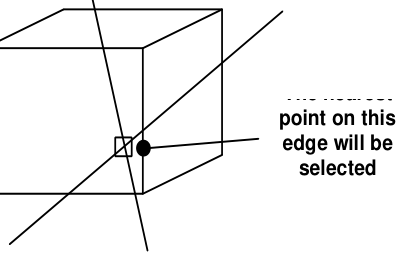

Befindet sich das Auswahlfeld über der Ecke eines Objekts, wird diese Ecke ausgewählt.

Andernfalls wird der nächstgelegene Punkt auf der nächstgelegenen Kante ausgewählt.

Das Auswahlfeld muss sich über einem Objekt oder einer Konstruktionslinie befinden.

## 5.5.2.3 Nächste Ecke

Fängt die nächstgelegene Ecke.

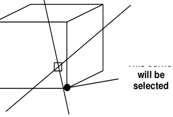

Die dem Auswahlfeld am nächsten liegende Ecke wird ausgewählt.

Das Auswahlfeld muss sich über einem Objekt oder einer Konstruktionslinie befinden.

## 5.5.2.4 Nächste Oberfläche

Fängt auf der Oberfläche.

Befindet sich das Auswahlfeld über der Ecke eines Objekts, wird diese Ecke ausgewählt.

Befindet sich das Auswahlfeld über einer Kante, wird der nächstgelegene Punkt auf dieser Kante ausgewählt.

Andernfalls wird der nächstgelegene Punkt auf der Oberfläche ausgewählt.

Das Auswahlfeld muss sich über einem Objekt oder einer Konstruktionslinie befinden.

## 5.5.2.5 Mittelpunkt einer Linie

Fängt den Mittelpunkt der ausgewählten Kante.

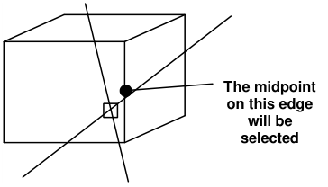

Befindet sich das Auswahlfeld über der Ecke eines Objekts, wird diese Ecke ausgewählt.

Andernfalls wird der Mittelpunkt der nächstgelegenen Kante ausgewählt.

Das Auswahlfeld muss sich über einem Objekt oder einer Konstruktionslinie befinden.

## 5.5.2.6 Tangentenfang

Zwingt den Cursor in die Tangente an die ausgewählte Kante.

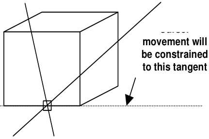

Die dem Auswahlfeld am nächsten liegende Kante wird ausgewählt. Das Auswahlfeld muss sich über einem Objekt oder einer Konstruktionslinie befinden.

Nach der Auswahl wird jede Cursorbewegung auf die durch die ausgewählte Kante definierte Tangente beschränkt. Punkte können nun an beliebiger Stelle entlang dieser Tangente ausgewählt werden.

Sobald ein Punkt ausgewählt ist, wird der Tangentenfang automatisch aufgehoben. Der Tangentenfang kann jederzeit durch Drücken der Escape-Taste (Esc) oder per Rechtsklick abgebrochen werden.

Um Punkte in gleichmäßigem Abstand entlang der Tangente auszuwählen, kann der Tangentenfang mit einer der folgenden Funktionen kombiniert werden:

CAD > Snap > Grid Snap Fängt an einem rechteckigen Raster.

CAD > Snap > X-Gird Snap Fängt an der ausgewählten Kante in einem gleichmäßigen X-Rasterabstand.

CAD > Snap > Y-Grid Snap Fängt an der ausgewählten Kante in einem gleichmäßigen Y-Rasterabstand.

CAD > Snap > Z-Grid Snap Fängt an der ausgewählten Kante in einem gleichmäßigen Z-Rasterabstand.

## 5.5.2.7 Schnittpunktfang

Fängt den Schnittpunkt der ausgewählten Kante mit einer Tangente.

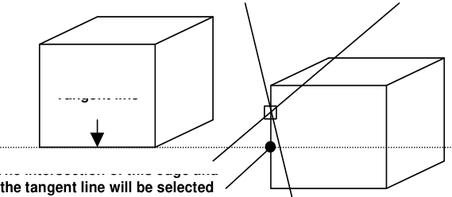

Da diese Funktion in vollem 3D arbeitet, kann die Tangente über oder unter der ausgewählten Kante verlaufen und sie nicht tatsächlich schneiden. In diesem Fall wird der der Tangente am nächsten liegende Punkt auf der ausgewählten Kante gewählt.

Diese Konvention muss hervorgehoben werden. Der Schnittpunkt wird nicht auf der Tangente ausgewählt, sondern auf der Schnittlinie.

Die Verwendung dieser Funktion erfolgt in zwei Schritten. Wenn Sie auf die Schaltfläche Intersect Snap klicken, werden Sie wie folgt aufgefordert:

1. Wählen Sie zuerst eine Tangente aus.

2. Wählen Sie dann die Kante aus, mit der die Tangente geschnitten werden soll. Der Punkt wird auf dieser Linie ausgewählt.

Die dem Auswahlfeld am nächsten liegende Kante wird ausgewählt.

Das Auswahlfeld muss sich über einem Objekt oder einer Konstruktionslinie befinden.

Mit dieser Funktion lassen sich Punkte am Schnittpunkt der Tangente mit der Verlängerung der ausgewählten Kante bestimmen.

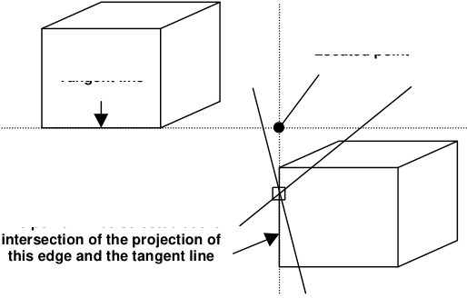

Sobald ein Punkt ausgewählt ist, wird der Schnittpunktfang automatisch aufgehoben. Der Schnittpunktfang kann jederzeit durch Drücken der Escape-Taste (Esc) oder per Rechtsklick abgebrochen werden.

Ein Beispiel für die Verwendung des Schnittpunktfangs beim Modellaufbau finden Sie unter

Tabular Mining

## 5.5.2.8 Konstruktionslinien-Verfolgungsfang

Fängt ausgewählte Ecken entlang eines Konstruktionsliniensegments. Dieser Fangmodus kann als schnelle Methode zum Aufbau von DDLoops ( CAD > Build > DDLoop), FFLoops ( CAD > Build >

FFLoop), Tunneln ( CAD > Build > Tunnel und CAD > Build > GPlanes) verwendet werden.

Um diesen Fangmodus zu verwenden, wählen Sie einfach den Start- und den Endpunkt entlang des gewünschten Konstruktionsliniensegments aus; alle Punkte dazwischen werden automatisch ausgewählt. Wenn Sie beispielsweise die Punkte 4 und 9 auswählen, werden die Punkte 5, 6, 7 und 8 automatisch ausgewählt. Beachten Sie: Wenn Sie denselben Punkt zweimal auswählen, wird die gesamte Schleife ausgewählt.

**6**

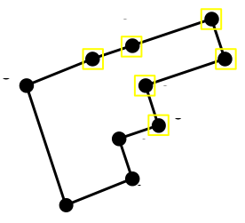

Hinweise:

Die Lage aller Punkte entlang der Konstruktionslinien lässt sich anzeigen, indem Sie den Parameter View > Render > Cline dot radius setzen.

Vor der Verwendung dieses Verfolgungsfangmodus sollten die Konstruktionslinien mit der Funktion CAD > Pack and Renumber Clines bereinigt werden.

Auch die Funktion CAD > Edit > Smooth Construction Lines kann beim Bereinigen der Konstruktionslinien helfen.

## 5.5.2.9 Konstruktionsschleifen-Verfolgungsfang

Fängt alle Ecken entlang eines Konstruktionsliniensegments. Dieser Fangmodus kann als schnelle Methode zum Aufbau von DDLoops ( CAD > Build > DDLoop), FFLoops ( CAD > Build > FFLoop), Tunneln ( CAD > Build > Tunnel und CAD > Build > GPlanes) verwendet werden.

Um diesen Fangmodus zu verwenden, wählen Sie einfach einen einzelnen Punkt auf dem gewünschten Konstruktionsliniensegment aus; alle Punkte auf dieser Linie werden automatisch ausgewählt. Wenn Sie beispielsweise Punkt 4 auswählen, werden die Punkte 5, 6, 7, 8, 1, 2 und 3 automatisch ausgewählt.

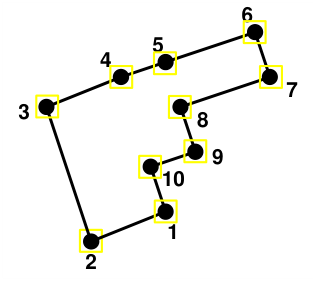

Hinweise:

Die Lage aller Punkte entlang der Konstruktionslinien lässt sich anzeigen, indem Sie den Parameter View > Render > Cline dot radius setzen.

Vor der Verwendung dieses Verfolgungsfangmodus sollten die Konstruktionslinien mit der Funktion CAD > Pack and Renumber Clines bereinigt werden.

Auch die Funktion CAD > Edit > Smooth Construction Lines kann beim Bereinigen der Konstruktionslinien helfen.

## 5.5.2.10 Punktefenster

Wählt Ecken mithilfe eines Fensters aus.

Dieser Fangmodus kann als schnelle Methode zum Aufbau von DDLoops ( CAD > Build > DDLoop), FFLoops ( CAD > Build > FFLoop), Tunneln ( CAD > Build > Tunnel), CLines ( CAD >

Build > CLines) und GLines ( CAD > Build > GLines) verwendet werden.

Obwohl dieser Fangmodus meist zur Auswahl mehrerer Punkte entlang von CLines dient, dürfen Ecken auf allen Elementtypen liegen, darunter: FF-Elemente, DD-Elemente, GPlanes, GLines und CLines.

- Video Demo of FFLoop Model Building

- Video Demo of DDLoop model buiding

- Video Demo of Model_Simplification_Using_Slicing

Wenn Sie in der obigen Abbildung vor der Auswahl eines Fensters einen oder mehrere Punkte auswählen, werden die Fensterpunkte den vorhandenen Punkten hinzugefügt, beginnend mit dem nächstgelegenen zuvor ausgewählten Punkt. Wenn Sie beispielsweise vor der Fensterauswahl Punkt 3 wählen und dann ein Fenster mit den Punkten 4, 5 und 6 verwenden, würden diese Punkte in dieser Reihenfolge hinzugefügt.

Wenn Sie alternativ vor der Fensterauswahl Punkt 3 wählen und dann ein Fenster mit den Punkten 1, 2 und 10 verwenden, würden diese Punkte in der Reihenfolge 2, 1 und dann 10 hinzugefügt.

Wenn Sie in der obigen Abbildung vor der Auswahl eines Fensters keinen Punkt auswählen, werden die Fensterpunkte beginnend an möglichst weit voneinander entfernten Stellen ausgewählt.

Wenn Sie beispielsweise ein Fenster über alle Punkte aufziehen, würden die Punkte, da die Punkte 2 und 6 am weitesten voneinander entfernt sind, in der Reihenfolge 2, 3, 4, 5, 6, 7, 8, 9, 10, 1, 2 ausgewählt.

Da dieses Beispiel eine geschlossene Schleife bildet, werden die Punkte entsprechend ausgewählt.

CAD > Build > DDLoop).

Dies bildet eine für den Aufbau eines DDLoops geeignete Schleife (

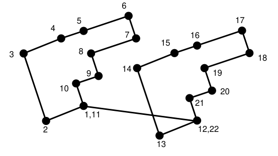

Wenn Sie in der obigen Abbildung vor der Auswahl eines Fensters Punkt 1 auswählen und dann ein Fenster verwenden, das alle Punkte einschließt, werden alle Punkte wie dargestellt ausgewählt: 1, 2, 3, 4, 5, 6, 7, 8, 9, 10, 11, 1, 12, 13, 14, 15, 16, 17, 18, 19, 20, 21, 22, 12.

Dies bildet zwei für den Aufbau eines FFLoops geeignete Schleifen ( CAD > Build > FFLoop). Wenn Sie alternativ vor der Fensterauswahl Punkt 3 wählen und dann ein Fenster mit den Punkten 1, 2 und 10 verwenden, würden diese Punkte in der Reihenfolge 2, 1 und dann 10 hinzugefügt.

Hinweise:

Die Lage aller Punkte entlang der Konstruktionslinien lässt sich anzeigen, indem Sie den Parameter View > Render > Cline dot radius setzen.

Vor der Verwendung dieses Verfolgungsfangmodus sollten die Konstruktionslinien mit der Funktion CAD > Pack and Renumber Clines bereinigt werden.

Auch die Funktion CAD > Edit > Smooth Construction Lines kann beim Bereinigen der Konstruktionslinien helfen.

## 5.5.2.11 Fang am rechteckigen Raster

Fängt an einem rechteckigen Raster. Am Schnittpunkt des Cursor-Fadenkreuzes wird kein Auswahlfeld angezeigt.

Jede Cursorbewegung wird auf die Rasterpunkte beschränkt.

Das Raster kann in den Ebenen X-Y, Y-Z oder X-Z mit beliebigem Abstand und beliebiger Lage ausgerichtet werden. Zum Einrichten dieser Parameter verwenden Sie

CAD > Snap > Cursor/Grid Setup richtet Cursor-/Rasterabstand und -ausrichtung ein.

Ein Beispiel für die Verwendung des Rasterfangmodus beim Modellaufbau finden Sie unter

Freehand Sketching - Room and Pillar.

## 5.5.2.12 Fang am kreisförmigen Raster

Fängt an einem zylindrischen Raster. Am Schnittpunkt des Cursor-Fadenkreuzes wird kein Auswahlfeld angezeigt.

Jede Cursorbewegung wird auf die Rasterpunkte beschränkt.

Das Raster kann in den Ebenen X-Y, Y-Z oder X-Z mit beliebigem Abstand und beliebiger Lage ausgerichtet werden. Zum Einrichten dieser Parameter verwenden Sie

CAD > Snap > Cursor/Grid Setup richtet Cursor-/Rasterabstand und -ausrichtung ein.

## 5.5.2.13 Fang am X-Raster

Fängt an einem x-Rasterabstand.

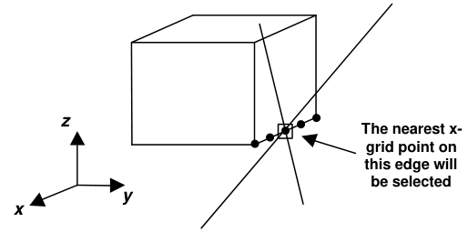

Befindet sich das Auswahlfeld über der Ecke eines Objekts, wird diese Ecke ausgewählt.

Andernfalls wird der nächstgelegene Punkt im x-Rasterabstand auf der nächstgelegenen Kante ausgewählt.

Das Auswahlfeld muss sich über einem Objekt oder einer Konstruktionslinie befinden.

Da die x-Koordinatenwerte auf den vorgegebenen X-Rasterabstand beschränkt sind, werden die y- und z-Koordinatenwerte aus der Gleichung der ausgewählten Linie berechnet.

Rasterabstand und -lage werden entweder durch ein zweites Anklicken der Schaltfläche X-Grid Snap oder mit

CAD > Snap > Cursor/Grid Setup festgelegt, das Cursor-/Rasterabstand und -ausrichtung einrichtet.

Der Fang am X-Raster kann mit einer der folgenden Funktionen kombiniert werden:

CAD > Snap > None Deaktiviert das Fangen.

CAD > Snap > Edge Fängt die nächstgelegene Kante.

CAD > Snap > Tangent Snap Zwingt den Cursor in die Tangente an die ausgewählte Kante.

## 5.5.2.14 Fang am Y-Raster

Fängt an einem y-Rasterabstand.

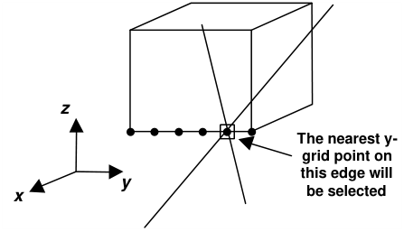

Befindet sich das Auswahlfeld über der Ecke eines Objekts, wird diese Ecke ausgewählt.

Andernfalls wird der nächstgelegene Punkt im y-Rasterabstand auf der nächstgelegenen Kante ausgewählt.

Das Auswahlfeld muss sich über einem Objekt oder einer Konstruktionslinie befinden.

Da die y-Koordinatenwerte auf den vorgegebenen y-Rasterabstand beschränkt sind, werden die x- und z-Koordinatenwerte aus der Gleichung der ausgewählten Linie berechnet.

Rasterabstand und -lage werden entweder durch ein zweites Anklicken der Schaltfläche Y-Grid Snap oder mit

CAD > Snap > Cursor/Grid Setup festgelegt, das Cursor-/Rasterabstand und -ausrichtung einrichtet.

Der Fang am Y-Raster kann mit einer der folgenden Funktionen kombiniert werden:

CAD > Snap > None Deaktiviert das Fangen.

CAD > Snap > Edge Fängt die nächstgelegene Kante.

CAD > Snap > Tangent Snap Zwingt den Cursor in die Tangente an die ausgewählte Kante.

## 5.5.2.15 Fang am Z-Raster

Fängt an einem z-Rasterabstand.

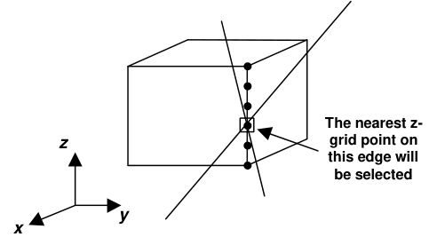

Befindet sich das Auswahlfeld über der Ecke eines Objekts, wird diese Ecke ausgewählt.

Andernfalls wird der nächstgelegene Punkt im y-Rasterabstand auf der nächstgelegenen Kante ausgewählt.

Das Auswahlfeld muss sich über einem Objekt oder einer Konstruktionslinie befinden.

Da die z-Koordinatenwerte auf den vorgegebenen Z-Rasterabstand beschränkt sind, werden die x- und y-Koordinatenwerte aus der Gleichung der ausgewählten Linie berechnet.

Rasterabstand und -lage werden entweder durch ein zweites Anklicken der Schaltfläche Z-Grid Snap oder mit

CAD > Snap > Cursor/Grid Setup festgelegt, das Cursor-/Rasterabstand und -ausrichtung einrichtet.

Der Fang am Z-Raster kann mit einer der folgenden Funktionen kombiniert werden:

CAD > Snap > None Deaktiviert das Fangen.

CAD > Snap > Edge Fängt die nächstgelegene Kante.

CAD > Snap > Tangent Snap Zwingt den Cursor in die Tangente an die ausgewählte Kante.

## 5.5.2.16 Cursor-/Rastereinrichtung

Richtet Lage, Abstand und Ausrichtung des Cursors/Rasters ein.

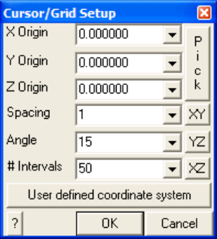

X, Y and Z Origin - legt die Koordinaten des Rastermittelpunkts fest.

Pick - aktiviert das Cursor-Fadenkreuz, um die Cursor-/Rasterbasis interaktiv aus dem

Modell auszuwählen.

Spacing - legt den Abstand zwischen den Rasterpunkten fest.

Angle - legt den Winkel (in Grad) zwischen den Radien des zylindrischen Rasters fest.

#### Intervals - legt die Anzahl der Rasterpunkte fest, die angezeigt werden.

CAD > Snap > XY Cursor - beschränkt Cursor-Fadenkreuz und Fangraster auf die X-Y-Ebene.

CAD > Snap > YZ Cursor - beschränkt Cursor-Fadenkreuz und Fangraster auf die Y-Z-Ebene.

CAD > Snap > XZ Cursor - beschränkt Cursor-Fadenkreuz und Fangraster auf die X-Z-Ebene.

CAD > Snap > User defined Cursor - beschränkt Cursor-Fadenkreuz und Fangraster auf die benutzerdefinierte Ebene.

Das benutzerdefinierte Koordinatensystem ist nur beim Fang am rechteckigen und am kreisförmigen Raster aktiv ( CAD > Snap > Grid Snap und CAD > Snap > Cylinder Snap).

Die benutzerdefinierte Ebene wird durch ihr Einfallen (j), ihre Einfallsrichtung (J) und ihren Rake-Winkel (a) festgelegt, sodass:

- Pnt on X - Die lokale x-Achse ( _x'_ ) entlang des Streichens der Ebene definiert ist. Mit dieser Funktion kann ein Punkt auf dieser Achse ausgewählt werden.

- Pnt on Y - Die lokale y-Achse ( _y'_ ) in Fallrichtung definiert ist. Mit dieser Funktion kann ein Punkt auf dieser Achse ausgewählt werden.

- Die lokale z-Achse senkrecht zur Ebene steht.

- Norm - aktiviert den Cursor, um interaktiv eine Oberfläche auszuwählen, zu der die lokale UCS-Ebene parallel gemacht werden soll. Einfallen und Einfallsrichtung der Ebene werden normal zur ausgewählten Oberfläche gesetzt.

- Rake - ermöglicht die Drehung von X' um die lokale z-Achse.

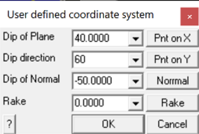

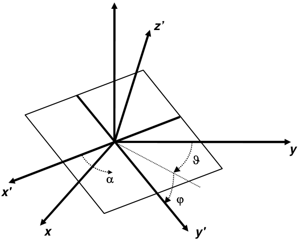

Ein Beispiel für die Verwendung des Rasterfangmodus beim Modellaufbau finden Sie unter Freehand Sketching - Room and Pillar.
