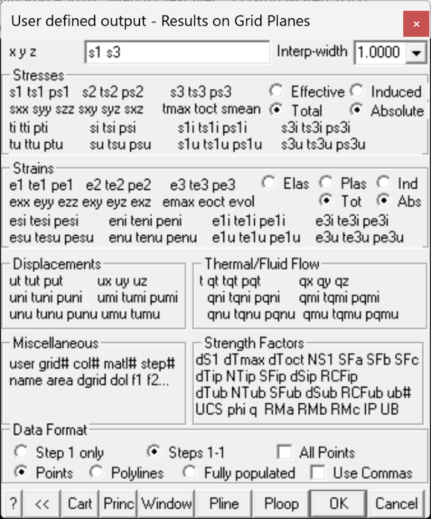
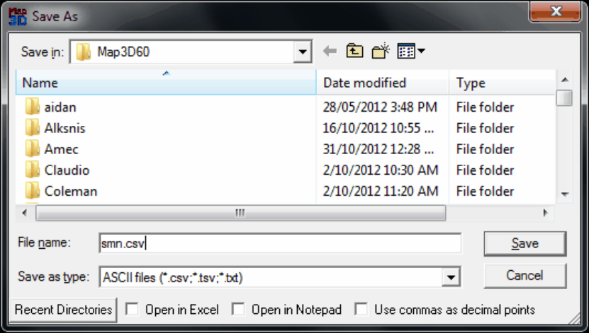
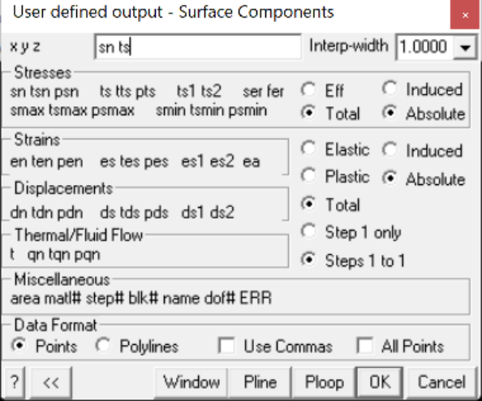
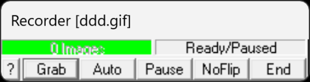

## 5.1.23.1 Bildschirm in die Zwischenablage kopieren

Legt ein Bitmap des Bildschirms in der Windows-Zwischenablage ab. Dieses Bild kann in andere Anwendungen eingefügt werden.

Da der Bildschirmhintergrund normalerweise schwarz und die Elementumrisse weiß sind, möchten Sie möglicherweise

File > Output > Copy Screen (B&W flipped)

auswählen, um diese beiden Farben zu vertauschen.

## 5.1.23.2 Bildschirm kopieren (S/W vertauscht)

Speichert ein Bitmap des Bildschirms in einer PNG- (Portable Network Graphics - *.PNG), GIF- (Compuserve Graphics Interchange Format) oder BMP-Datei (geräteunabhängiges Windows-Bitmap *.BMP), wobei die Farben von Bildschirmhintergrund und Elementumrissen vertauscht sind. Diese Datei kann zur Berichtsdarstellung und zum Drucken in andere Software geladen werden.

Weitere Einzelheiten finden Sie unter

File > Output > PNG, GIF or BMP image

## 5.1.23.3 Bildschirmbild als PNG, GIF, JPEG, BMP oder TIFF

Speichert ein Bitmap des Bildschirms in einer PNG- (Portable Network Graphics - *.PNG), GIF- (CompuServe Graphics Interchange Format), BMP- (geräteunabhängiges Windows-Bitmap *.BMP) oder TIFF-Datei (tagged image file format). Diese Datei kann zur Berichtsdarstellung und zum Drucken in andere Software geladen werden.

Da der Bildschirmhintergrund normalerweise schwarz und die Elementumrisse weiß sind, möchten Sie möglicherweise

File > Output > PNG, GIF, JPEG, BMP or TIFF (B&W flipped)

auswählen, um diese beiden Farben zu vertauschen.

Diese Dateien können mit File > Image Viewer angezeigt werden

Das BMP-Format ist ein weit verbreitetes Grafikdateiformat (von den meisten Webbrowsern, Textverarbeitungen und Malprogrammen unterstützt). Der Hauptvorteil des BMP-Formats ist die Unterstützung aller angezeigten Farben. Leider gibt es keine Komprimierung, sodass diese Dateien sehr groß werden können (jeweils 1 MB oder mehr).

Das PNG-Format ist ein weit verbreitetes Grafikdateiformat (von den meisten Webbrowsern, Textverarbeitungen und Malprogrammen unterstützt). Die Hauptvorteile des PNG-Formats sind eine ausgezeichnete verlustfreie Komprimierung (normalerweise 1 % der Größe einer BMP-Datei) und die Unterstützung aller angezeigten Farben. Einzelheiten zur Animation siehe File > Output > Image Recorder.

Das GIF-Format ist das am weitesten verbreitete Grafikdateiformat. Die Hauptvorteile des GIF-Formats sind eine ausgezeichnete verlustfreie Komprimierung (normalerweise 1 % der Größe einer BMP-Datei) und die Animationsfähigkeit. Leider unterstützt GIF nur 256 Anzeigefarben. Je nach Darstellung kann Map3D bis zu 512 Farben verwenden, sodass GIF Bildschirmbilder möglicherweise nicht in allen Farben wiedergibt

Das GIF-Format wurde nach der Spezifikation Version 89a ©1987,1988,1989,1990 Copyright CompuServe Incorporated, Columbus, Ohio, implementiert.

Diese Software verwendet die Open-Source-Bildbibliothek FreeImage. Einzelheiten finden Sie unter [http://freeimage.sourceforge.net](http://freeimage.sourceforge.net). FreeImage wird unter der (GNU GPL oder FIPL), Version (Lizenzversion), verwendet.

## 5.1.23.4 PNG, GIF, JPEG, BMP oder TIFF (S/W vertauscht)

Speichert ein Bitmap des Bildschirms in einer PNG- (Portable Network Graphics - *.PNG), GIF- (Compuserve Graphics Interchange Format) oder BMP-Datei (geräteunabhängiges Windows-Bitmap *.BMP), wobei die Farben von Bildschirmhintergrund und Elementumrissen vertauscht sind. Diese Datei kann zur Berichtsdarstellung und zum Drucken in andere Software geladen werden.

Weitere Einzelheiten finden Sie unter

File > Output > PNG, JPEG, GIF, BMP or TIFF image

## 5.1.23.5 DXF-Bildschirmbild

Speichert ein Bildschirmbild in einer Datei (*.DXF) im AutoCAD-Zeichnungsaustauschformat. Dies ist ein Vektorformat, das zur weiteren Darstellung in viele Softwarepakete importiert werden kann.

## 5.1.23.6 PNT-Bildschirmbild

Speichert ein Bildschirmbild in einer Datei (*.PNT), einer universellen ASCII-Datendatei mit der Erweiterung „.PNT“. Das PNT-Format eignet sich zum Austausch roher Modelldaten mit anderer CAD-Software. Dies ist ein Vektorformat, das zur weiteren Darstellung in viele Softwarepakete importiert werden kann.

## 5.1.23.7 OBJ-Bildschirmbild

Speichert ein Bildschirmbild in einer Datei (*.OBJ) im Wavefront-Format. Dies eignet sich zum Austausch von Modelldaten mit anderer CAD- und Virtual-Reality-Modellierungssoftware. Dies ist ein Vektorformat, das zur weiteren Darstellung in viele Softwarepakete importiert werden kann.

## 5.1.23.8 WRL-Bildschirmbild

Speichert ein Bildschirmbild in einer Datei (*.WRL) im VRML-Format. VRML eignet sich zum Austausch von Modelldaten mit anderer CAD- und Virtual-Reality-Modellierungssoftware. Dies ist ein Vektorformat, das zur weiteren Darstellung in viele Softwarepakete importiert werden kann.

## 5.1.23.9 3D-PDF-Bildschirmbild

Speichert ein Bildschirmbild in einer Datei im PDF-(3D-)Format. Ein 3D-PDF kann mit Adobe Reader in vollem 3D angezeigt werden.

## 5.1.23.10 Ausgewählte Rasterkomponenten

Gibt ausgewählte Rasterkomponenten in einem benutzergesteuerten Format in eine Textdatei (*.txt) aus.

Standardmäßig werden alle Punkte aller Raster ausgegeben. Wenn Sie nur eine ausgewählte Menge von Punkten ausgeben möchten, verwenden Sie die unten beschriebene Fensterfunktion.

Nachdem Sie die gewünschten Daten ausgewählt und auf OK geklickt haben, werden Sie nach einem Dateinamen zum Speichern der Daten gefragt. Sie können CSV (durch Kommas getrennte/begrenzte Daten), TSV (durch Tabulatoren getrennte/begrenzte Daten) oder TXT (durch Leerzeichen getrennte/begrenzte Daten) auswählen. Sie können außerdem festlegen, dass die Datei automatisch in Excel oder im Editor (Notepad) geöffnet wird. Beachten Sie, dass Sie keine CSV-Dateien mit Kommas als Dezimaltrennzeichen verwenden sollten.

#### Stresses:

s1 ts1 ps1 größte Hauptspannung s1, ihre Streichrichtung und ihr Abtauchen.

s2 ts2 ps2 mittlere Hauptspannung s2, ihre Streichrichtung und ihr Abtauchen.

s3 ts3 ps3 kleinste Hauptspannung s3, ihre Streichrichtung und ihr Abtauchen. sxx syy szz sxy syz sxz kartesische Spannungskomponenten. tmax maximale Schubspannung tmax = ½ ( s1 - s3 ) toct oktaedrische Schubspannung toct = ¹/3 [( s1 - s2 )² + ( s2 - s3 )² +( s3 - s1 )²]½ smean mittlere Spannung smean = ¹/3 ( s1 + s2 + s3 )

ti tti pti maximale Schubspannung in der Rasterebene, ihre Streichrichtung und ihr Abtauchen. si tsi psi Normalspannung in der Rasterebene, ihre Streichrichtung und ihr Abtauchen. s1i ts1i ps1i maximale Spannung tangential zur Rasterebene, ihre Streichrichtung und ihr Abtauchen. s3i ts3i ps3i minimale Spannung tangential zur Rasterebene, ihre Streichrichtung und ihr Abtauchen. tu ttu ptu maximale Schubspannung in der ubiquitären Ebene, ihre Streichrichtung und ihr Abtauchen. su tsu psu Spannung normal zur ubiquitären Ebene, ihre Streichrichtung und ihr Abtauchen. s1u ts1u ps1u maximale Spannung tangential zur ubiquitären Ebene, ihre Streichrichtung und ihr Abtauchen. s3u ts3u ps3u minimale Spannung tangential zur ubiquitären Ebene, ihre Streichrichtung und ihr Abtauchen. Die Orientierung der ubiquitären Ebene wird angegeben in

Plot > Strength Factors > Ubiquitous Parameters

Effective/Total Komponenten der effektiven Spannung oder der Gesamtspannung. Diese Optionen werden nur in Map3D Thermal-Fluid Flow verwendet, da dieser Code die Berechnung stationärer Porendruckverteilungen erlaubt. Induced/Absolute Die induzierte Spannung ist die Spannung ohne den Beitrag der Spannung vor dem Abbau. Sie stellt die Spannungsänderung gegenüber dem Zustand vor dem Abbau dar. Die absolute Spannung ist die Spannung einschließlich des Beitrags der Spannung vor dem Abbau.

#### Strains:

e1 te1 pe1 größte Hauptdehnung e1, ihre Streichrichtung und ihr Abtauchen. e2 te2 pe2 mittlere Hauptdehnung e2, ihre Streichrichtung und ihr Abtauchen.

e3 te3 pe3 kleinste Hauptdehnung e3, ihre Streichrichtung und ihr Abtauchen. exx eyy ezz exy eyz exz kartesische Dehnungskomponenten. emax maximale Scherdehnung emax = ½ ( e1 - e3 ) eoct oktaedrische Scherdehnung eoct = ¹/3 [( e1 - e2 )² + ( e2 - e3 )² +( e3 - e1 )²]½ evol Volumendehnung evol = ( e1 + e2 + e3 ) esi tesi pesi maximale Scherdehnung in der Rasterebene, ihre Streichrichtung und ihr Abtauchen. eni teni peni Normaldehnung in der Rasterebene, ihre Streichrichtung und ihr Abtauchen. e1i te1i pe1i maximale Dehnung tangential zur Rasterebene, ihre Streichrichtung und ihr Abtauchen. e3i te3i pe3i minimale Dehnung tangential zur Rasterebene, ihre Streichrichtung und ihr Abtauchen. esu tesu pesu maximale Scherdehnung in der ubiquitären Ebene, ihre Streichrichtung und ihr Abtauchen. enu tenu penu Dehnung normal zur ubiquitären Ebene, ihre Streichrichtung und ihr Abtauchen. e1u te1u pe1u maximale Dehnung tangential zur ubiquitären Ebene, ihre Streichrichtung und ihr Abtauchen. e3u te3u pe3u minimale Dehnung tangential zur ubiquitären Ebene, ihre Streichrichtung und ihr Abtauchen. Elastic/Plastic/Total elastische, plastische oder gesamte Dehnungskomponenten. Diese Optionen werden nur in Map3D Non-Linear verwendet, da dieser Code die Berechnung nichtlinearer Dehnungen erlaubt. Induced/Absolute Die induzierte Dehnung ist die Dehnung ohne den Beitrag vor dem Abbau. Sie stellt die Dehnungsänderung gegenüber dem Zustand vor dem Abbau dar. Die absolute Dehnung ist die Dehnung einschließlich des Beitrags der Dehnung vor dem Abbau.

#### Displacements:

ut tut put Gesamtverschiebung, ihre Streichrichtung und ihr Abtauchen. ux uy uz kartesische Verschiebungskomponenten. uni tuni puni Verschiebung normal zur Rasterebene, ihre Streichrichtung und ihr Abtauchen. umi tumi pumi maximale Verschiebung tangential zur Rasterebene, ihre Streichrichtung und ihr Abtauchen. unu tunu punu Verschiebung normal zur ubiquitären Ebene, ihre Streichrichtung und ihr Abtauchen. umu tumu pumu maximale Verschiebung tangential zur ubiquitären Ebene, ihre Streichrichtung und ihr Abtauchen.

#### Flow:

t Temperatur/Druckhöhe.

qt tqt pqt Gesamtfluss, seine Streichrichtung und sein Abtauchen. qx qy qz kartesische Flusskomponenten. qni tqni pqni Verschiebung normal zur Rasterebene, ihre Streichrichtung und ihr Abtauchen. qmi tqmi pqmi maximale Verschiebung tangential zur Rasterebene, ihre Streichrichtung und ihr Abtauchen. qnu tqnu pqnu Verschiebung normal zur ubiquitären Ebene, ihre Streichrichtung und ihr Abtauchen. qmu tqmu pqmu maximale Verschiebung tangential zur ubiquitären Ebene, ihre Streichrichtung und ihr Abtauchen.

#### Strength:

- ds1 überschüssige größte Hauptspannung Ds1 = s1 - ( _UCS_ + _q_ s3 )

- dtmax überschüssige maximale Schubspannung Dtmax = ½(s1 - s3) - [ _UCS_ + ½(s1+s3) ( _q_ -1) ]/( _q_ +1) = [s1 - ( _UCS_ + _q_ s3) ]/( _q_ +1)

- dtoct überschüssige oktaedrische Schubspannung Dtoct = toct - [ _UCS_ + ( _q_ –1) smean ] Ö(2) /( _q_ +2)

- NS1 Wahrscheinlichkeit nach der Normalverteilung N(Ds1 /std)

- SFA Festigkeit/Spannung kann als ( _UCS_ + _q_ s3 )/ s1 bestimmt werden

- SFB Festigkeit/Spannung kann als ( _UCS_ + _q_ s3 - s3 )/(s1 - s3) bestimmt werden

- SFC Festigkeit/Spannung kann als [ _UCS_ + ½(s1+s3) ( _q_ -1) ]/[ ½(s1 - s3)( _q_ +1) ] bestimmt werden

- dTip überschüssige Schubspannung in der Ebene Dtip = tip - [ Cohesion + sip tan(j) ]

- NTip Wahrscheinlichkeit nach der Normalverteilung N(Dtip /std)

- SFip Festigkeit/Spannung kann als [ Cohesion + sip tan(j) ] / tip bestimmt werden

- dSip überschüssige Wandspannung in der Ebene Dsip = [ 3 s1i - s3i ] - UCS

- RCFip Gebirgszustandsfaktor (Rock Condition Factor) für die Wandspannung in der Ebene RCFip = [ 3 s1i - s3i ]/UCS

- dTub überschüssige Schubspannung in der ubiquitären Ebene Dtub

- NTub Wahrscheinlichkeit nach der Normalverteilung N(Dtub /std)

- SFub Festigkeit/Spannung kann als [ Cohesion + sub tan(j) ] / tub bestimmt werden

- dSub überschüssige Wandspannung in der ub-Ebene Dsub = [ 3 s1ub - s3ub ] - UCS

- RCFub Gebirgszustandsfaktor für die Wandspannung in der ub-Ebene RCFip = [ 3 s1ub - s3ub ]/UCS

- UB# Stellt die Nummer der UB-Schar (1, 2 oder 3) dar, die den größten Wert von Dtub hat

- _UCS phi q_ Mohr-Coulomb-Festigkeitsparameter, definiert mit Plot > Strength Factors > Rockmass Strength Parameters; beachten Sie, dass diese Parameter nur definiert sind, wenn das Festigkeitskriterium nach Mohr-Coulomb oder Druker-Prager angegeben wurde

- _sc_ Hoek-Brown-Festigkeitsparameter, definiert mit Plot > Strength Factors > Rockmass Strength Parameters; beachten Sie, dass dieser Parameter nur definiert ist, wenn das Festigkeitskriterium nach Hoek-Brown angegeben wurde

#### Miscellaneous:

user Benutzerdefinierter Wert.

grid# die Nummer des Rasters, in dem der Punkt liegt. matl# die Nummer des Materials, in dem der Punkt liegt. Das Nebengestein (host) ist Material Nummer 1. Bei Problemen mit mehreren Materialien können Ergebnisse in einer Zone mit abweichendem Material berechnet werden.

step# die Nummer des Abbauschritts. name der Name des Rasters. area die Fläche der Rasterzelle neben dem ausgewählten Punkt. dgrid Abstand zur nächsten Oberfläche von jedem Rasterpunkt aus. dol Abstand zum nächsten Raster _Dgrid_ geteilt durch den Rasterabstand _Lgrid_ . f1 f2... benutzerdefinierte Materialparameter. Diese können mit Plot > Properties > Material Properties > User defined Parameters definiert werden.

#### Data Format:

Punktdaten werden als Reihe von Punkten ausgegeben, ein Punkt pro Zeile:

- x1 y1 z1 values1 x2 y2 z2 values2 x3 y3 z3 values3 x4 y4 z4 values4

wobei xi yi zi die Koordinaten jedes Punkts darstellen,

valuesi stellt die Werte der Liste der vom Benutzer ausgewählten Komponenten an jedem Punkt dar. Die benutzerdefinierten Werte werden am Dateianfang als Kommentarzeile aufgeführt (d. h. als Zeile, die mit einem Sternchen „*“ beginnt).

Polylinien-Daten werden als Reihe von Polylinien im PNT-Dateiformat ausgegeben

- x1 y1 z1 3 values1 x2 y2 z2 2 values2 x3 y3 z3 2 values3 x4 y4 z4 2 values4

wobei xi yi zi die Koordinaten jedes Punkts darstellen,

- 3 gibt an, dass dieser Punkt der Beginn einer neuen Linie ist,

- 2 gibt an, dass dieser Punkt die Fortsetzung derselben Linie ist,

valuesi stellt die Werte der Liste der vom Benutzer ausgewählten Komponenten an jeder Ecke der Polylinie dar. Die benutzerdefinierten Werte werden am Dateianfang als Kommentarzeile aufgeführt (d. h. als Zeile, die mit einem Sternchen „*“ beginnt).

Fully Populated: Die Daten werden so ausgegeben, dass alle Daten auf einem regelmäßig großen Raster liegen.

Use Commas: Die Daten werden mit Kommas statt Dezimalpunkten ausgegeben.

#### Other:

&lt;&lt;    um das Dialogfeld auf kleine Größe zu verkleinern

>>    um das Dialogfeld auf große Größe zu vergrößern Cartesian   konfiguriert die Ausgabe der kartesischen Spannungskomponenten. Principal   konfiguriert die Ausgabe der Hauptspannungskomponenten. Window   aktiviert ein grafisches Auswahlfenster.

- Sie werden aufgefordert, die beiden Ecken des Fensters jeweils mit einem einfachen Mausklick auszuwählen.

- Nur Rasterpunkte innerhalb des Fensters werden in die Ausgabe aufgenommen.

- Wenn Sie diese Funktion nicht verwenden, werden alle Punkte aller Raster ausgegeben.

- Um die Lage der tatsächlichen Konturpunkte anzuzeigen, aktivieren Sie die Anzeige der Trajektorien (Plot > Options > Trajectories). Die Konturpunkte liegen dort, wo die Trajektorien gezeichnet werden.

Polyline   aktiviert ein grafisches Auswahlpolygon. Sie werden aufgefordert, eine Reihe von Eckpunkten zur Definition eines Polygons auszuwählen, indem Sie jeden mit einem einfachen Mausklick anklicken:

- Sie müssen beim Auswählen dieser Punkte die Umschalttaste gedrückt halten.

- Wenn Sie eine geschlossene Polygonform definieren, werden die im Polygon eingeschlossenen Konturpunkte einbezogen.

- Wenn Sie eine offene Polygonform definieren, wird eine Reihe von Punkten entlang der Polylinie einbezogen.

- Um die Lage der tatsächlichen Konturpunkte anzuzeigen, aktivieren Sie die Anzeige der Trajektorien (Plot > Options > Trajectories). Die Konturpunkte liegen dort, wo die Trajektorien gezeichnet werden.

- Einfache rechteckige Fenster können definiert werden, indem Sie die Umschalttaste gedrückt halten und ein Fenster aufziehen (wie bei der Schaltfläche Window).

## 5.1.23.11 Ausgewählte Oberflächenkomponenten

Gibt ausgewählte Oberflächenkomponenten in einem benutzergesteuerten Format in eine Textdatei (*.txt) aus.

Standardmäßig werden alle Punkte aller Oberflächen ausgegeben. Wenn Sie nur eine ausgewählte Menge von Punkten ausgeben möchten, verwenden Sie die unten beschriebene Fensterfunktion.

Nachdem Sie die gewünschten Daten ausgewählt und auf OK geklickt haben, werden Sie nach einem Dateinamen zum Speichern der Daten gefragt. Sie können CSV (durch Kommas getrennte/begrenzte Daten), TSV (durch Tabulatoren getrennte/begrenzte Daten) oder TXT (durch Leerzeichen getrennte/begrenzte Daten) auswählen.

Sie können außerdem festlegen, dass die Datei automatisch in Excel oder im Editor (Notepad) geöffnet wird. Beachten Sie, dass Sie keine CSV-Dateien mit Kommas als Dezimaltrennzeichen verwenden sollten.

#### Stresses:

sn tsn psn Spannung normal zur Oberfläche, ihre Streichrichtung und ihr Abtauchen.

ts tts pts maximale Schubspannung in der Oberflächenebene, ihre Streichrichtung und ihr Abtauchen. ts1 ts2   Schubspannungskomponenten in der Oberflächenebene. ts1 verläuft parallel zur ersten Seite (d. h. der durch x1 y1 z1 – x2 y2 z2 definierten Seite). ts2 steht senkrecht auf ts1 in Richtung der zweiten Seite (d. h. der durch x2 y2 z2 – x3 y3 z3 definierten Seite).

ser Oberflächenspannungsfehler. Iterative Löser arbeiten, indem sie den Fehler der aktuellen Lösung jeder simultanen Gleichung bestimmen und diese Fehler dann durch sukzessive Approximation verringern. Dieser Parameter gibt den Fehler für jede der Gleichungen an.

fer Fehler des Bruchkriteriums. Dieser Parameter wird nur bei nichtlinearen Kriechanalysen verwendet (einschließlich Störungsgleiten und 3D-Materialnichtlinearität). Er sollte stets nahe null liegen, es sei denn, es wurde eine Viskosität angegeben und das Problem wird nichtlinear. In diesem letzteren Fall kann viskoses Kriechen Spannungszustände oberhalb des Bruchkriteriums zulassen, was auf fehlendes statisches Gleichgewicht hinweist. Dieser Parameter gibt die viskose Spannung für jede der Gleichungen an.

smax tsmax psmax maximale Tangentialspannung, ihre Streichrichtung und ihr Abtauchen. smin tsmin psmin minimale Tangentialspannung, ihre Streichrichtung und ihr Abtauchen. Effective/Total – Komponenten der effektiven Spannung oder der Gesamtspannung. Diese Optionen werden nur in Map3D Thermal-Fluid Flow verwendet, da dieser Code die Berechnung stationärer Porendruckverteilungen erlaubt.

#### Strains:

en ten pen Dehnung in Richtung normal zur Oberfläche, ihre Streichrichtung und ihr Abtauchen. Dieser Parameter wird nur für DD-Ebenen verwendet und als normale Verschiebung (Konvergenz) geteilt durch die Dicke berechnet. es tes pes maximale Scherdehnung in der Oberflächenebene, ihre Streichrichtung und ihr Abtauchen. Dieser Parameter wird nur für DD-Ebenen verwendet und als Scherverschiebung (ride) geteilt durch die Dicke berechnet. es1 es2   Scherdehnungskomponenten in der Oberflächenebene. es1 verläuft parallel zur ersten Seite (d. h. der durch x1 y1 z1 – x2 y2 z2 definierten Seite). es2 steht senkrecht auf es1 in Richtung der zweiten Seite (d. h. der durch x2 y2 z2 – x3 y3 z3 definierten Seite).

#### Displacements:

dn tdn pdn normale Verschiebung (Konvergenz) in Richtung normal zur Oberfläche, ihre Streichrichtung und ihr Abtauchen. Dieser Parameter wird nur für DD-Ebenen verwendet. Beachten Sie, dass der elastische, plastische oder gesamte Wert angegeben werden kann.

ds tds pds maximale Scherverschiebung (ride) in der Oberflächenebene, ihre Streichrichtung und ihr Abtauchen. Dieser Parameter wird nur für DD-Ebenen verwendet. Beachten Sie, dass der elastische, plastische oder gesamte Wert angegeben werden kann.

ds1 ds2   Komponenten der Scherverschiebung (ride) in der Oberflächenebene. ds1 verläuft parallel zur ersten Seite (d. h. der durch x1 y1 z1 – x2 y2 z2 definierten Seite). ds2 steht senkrecht auf ds1 in Richtung der zweiten Seite (d. h. der durch x2 y2 z2 – x3 y3 z3 definierten Seite). Elastic/Plastic/Total elastische, plastische oder gesamte Dehnungs-/Verschiebungskomponenten. Diese Optionen werden nur für DD-Ebenen verwendet.

#### Miscellaneous:

area   die Fläche der Oberfläche. matl# die Nummer des der Oberfläche zugewiesenen Materials. step# die Nummer des Abbauschritts. blk#   die Blocknummer. name   der Name der Blockoberfläche. dof#   die Nummer des Freiheitsgrads.

#### Data Format

Punktdaten werden als Reihe von Punkten ausgegeben, ein Punkt pro Zeile.

x1 y1 z1 values1 x2 y2 z2 values2 x3 y3 z3 values3 x4 y4 z4 values4

wobei xi yi zi die Koordinaten jedes Punkts darstellen,

valuesi stellt die Werte der Liste der vom Benutzer ausgewählten Komponenten an jedem Punkt dar. Die benutzerdefinierten Werte werden am Dateianfang als Kommentarzeile aufgeführt (d. h. als Zeile, die mit einem Sternchen „*“ beginnt).

Polylinien-Daten werden als Reihe von Polylinien im PNT-Dateiformat ausgegeben x1 y1 z1 3 values1 x2 y2 z2 2 values2 x3 y3 z3 2 values3 x4 y4 z4 2 values4

wobei xi yi zi die Koordinaten jedes Punkts darstellen,

3 gibt an, dass dieser Punkt der Beginn einer neuen Linie ist,

2 gibt an, dass dieser Punkt die Fortsetzung derselben Linie ist,

valuesi stellt die Werte der Liste der vom Benutzer ausgewählten Komponenten an jeder Ecke der Polylinie dar. Die benutzerdefinierten Werte werden am Dateianfang als Kommentarzeile aufgeführt (d. h. als Zeile, die mit einem Sternchen „*“ beginnt).

Wurde die lineare BEM-Analyse (Analysis > Options > Linear) nicht ausgewählt, sind valuesi nur an den Elementmittelpunkten verfügbar und werden daher nur für den ersten Punkt geliefert. Wurde die lineare BEM-Analyse ausgewählt, sind die Werte an jeder Ecke verfügbar und werden daher für alle Punkte geliefert.

#### Other

&lt;&lt;    um das Dialogfeld auf kleine Größe zu verkleinern >>    um das Dialogfeld auf große Größe zu vergrößern Window   aktiviert ein grafisches Auswahlfenster.

- Sie werden aufgefordert, die beiden Ecken des Fensters jeweils mit einem einfachen Mausklick auszuwählen.

- Nur Rasterpunkte innerhalb des Fensters werden in die Ausgabe aufgenommen.

- Wenn Sie diese Funktion nicht verwenden, werden alle Punkte aller Raster ausgegeben.

- Um die Lage der tatsächlichen Konturpunkte anzuzeigen, aktivieren Sie die Anzeige der Trajektorien (Plot > Options > Trajectories). Die Konturpunkte liegen dort, wo die Trajektorien gezeichnet werden.

Polyline   aktiviert ein grafisches Auswahlpolygon. Sie werden aufgefordert, eine Reihe von Eckpunkten zur Definition eines Polygons auszuwählen, indem Sie jeden mit einem einfachen Mausklick anklicken:

- Sie müssen beim Auswählen dieser Punkte die Umschalttaste gedrückt halten.

- Wenn Sie eine geschlossene Polygonform definieren, werden die im Polygon eingeschlossenen Konturpunkte einbezogen.

- Wenn Sie eine offene Polygonform definieren, wird eine Reihe von Punkten entlang der Polylinie einbezogen.

- Um die Lage der tatsächlichen Konturpunkte anzuzeigen, aktivieren Sie die Anzeige der Trajektorien (Plot > Options > Trajectories). Die Konturpunkte liegen dort, wo die Trajektorien gezeichnet werden.

- Einfache rechteckige Fenster können definiert werden, indem Sie die Umschalttaste gedrückt halten und ein Fenster aufziehen (wie bei der Schaltfläche Window).

Use Commas: Die Daten werden mit Kommas statt Dezimalpunkten ausgegeben.

## 5.1.23.12 Recorder für animierte TIFF/GIF

Zeichnet mehrere aufeinanderfolgende Bilder in einzelne PNG-, GIF-, BMP- oder TIFF-Dateien auf.

Viele Präsentationsprogramme ermöglichen es, einfache Animationen durch Anzeigen einer Bildfolge zu erstellen. Mit dem Map3D-Bildrecorder können mehrere Bildschirmabzüge in einzelne PNG-, GIF-, BMP- oder TIFF-Dateien aufgezeichnet werden.

Der Recorder für animierte TIFF/GIF speichert mehrere Bilder in derselben TIFF- oder GIF-Datei. Diese Bilder können mit einem Bildbetrachter wiedergegeben werden, der animierte TIFFs oder GIFs anzeigen kann (z. B. Map3D Image Viewer, die meisten Internetbrowser, Windows-Fotoanzeige usw.).

Der Image Recorder erzeugt mehrere Bilder in separaten Dateien. Nachdem Sie File > Output > Image Recorder ausgewählt haben, werden Sie aufgefordert, einen Dateinamen zum Speichern der Animation anzugeben. Die Bilddateinamen werden erzeugt, indem die Bildnummer an den von Ihnen angegebenen Dateinamen angehängt wird (z. B. name0001.png, name0002.png, name0003.png ...).

Das Recorder-Dialogfeld liefert Informationen zur aktuellen Animation und ermöglicht es, die Aufzeichnung zu steuern und Animationsoptionen festzulegen.

Die aktuelle Anzahl der Bilder in der Animation wird zusammen mit dem Status des Recorders angezeigt. Verschiedene Statuszustände sind:

Ready/Paused – Die Animationsdatei ist geöffnet und aufnahmebereit. Drücken Sie Grab oder Auto, um ein Bild hinzuzufügen.

Capturing Image – Ein Bild wird der Animation hinzugefügt.

Ready/Auto Capture - Angezeigte Bilder werden automatisch der Animation hinzugefügt, wenn Sie den Bildschirm aktualisieren.

Recorder Off – Die Animationsdatei ist geschlossen und nicht aufnahmebereit.

Grab – Fügt das aktuell angezeigte Bild der Animation hinzu.

Auto – Fügt angezeigte Bilder automatisch der Animation hinzu, wenn Sie den Bildschirm aktualisieren. Dazu gehören alle von Ihnen ausgeführten Dreh-, Verschiebe- und Darstellungsvorgänge.

Pause – Deaktiviert den automatischen Modus.

Flipped/NoFlip – Schaltet um, ob Hintergrund und Vordergrund (normalerweise schwarz und weiß) vertauscht werden.

End – Beendet den Recorder und schließt die Animationsdatei.

#### Notes:

Zusätzliche Bilder können an eine vorhandene Bildfolge angehängt werden, indem Sie bei der Auswahl des Dateinamens für die Animationsfolge File > Output > Image Recorder > Append Images aktivieren.

Dreh- und Verschiebevorgänge können automatisch wiederholt werden, indem Sie vor der Auswahl des Vorgangs n# eingeben. Um beispielsweise eine animierte Darstellung einer Spannungsdarstellung zu erzeugen, gehen Sie wie folgt vor

Plot > Options > Persist

Plot > Stress > Sigma:1

View > Rotation Increment > 10

Wählen Sie die Schaltfläche Auto

Geben Sie 35# ein

Wählen Sie „nach rechts drehen“ (entweder in der Symbolleiste zum Drehen oder mit der Bild-ab-Taste).

Es wird eine Reihe von Dateien mit den Nummern name001 bis name036 erstellt. Diese können zur Animation und Anzeige in Präsentationssoftware importiert werden.

Sich im Verlauf des Abbaus ändernde Spannungskonturen können angezeigt werden, indem Sie eine Reihe von Darstellungen aufnehmen, während der Abbauschritt vorgerückt wird.
