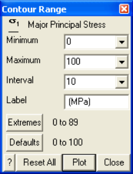

Legt den Konturbereich (Minimum, Maximum, Intervall ...) der aktuell dargestellten Kontur fest. Diese Routine kann entweder über die Schaltfläche oder einfach per Rechtsklick auf eine beliebige Kontur gestartet werden.

**abe u te a**

Oben ist der Konturbereich in horizontaler Ausrichtung dargestellt. Dies kann durch Aktivieren von Plot Options > Vertical Legend auf vertikale Ausrichtung umgestellt werden.

Minimum – legt den unteren Wert des Konturbereichs fest.

Maximum – legt den oberen Wert des Konturbereichs fest.

Interval – legt das Konturintervall fest. Das Intervall kann größer als 1/10 von Maximum minus Minimum gewählt werden, aber nicht kleiner.

Label – legt die Konturbeschriftung fest.

Extremes – zeigt die für diesen Parameter ermittelten unteren und oberen Extremwerte an. Mit dieser Schaltfläche wird der Konturbereich auf diese Werte gesetzt.

Defaults – zeigt den standardmäßigen unteren und oberen Konturbereich für diesen Parameter an. Mit dieser Schaltfläche wird der Konturbereich auf diese Werte gesetzt.

Reset All – setzt die Bereiche aller Darstellungsparameter auf die Standardwerte zurück.

Plot – erzeugt die Konturdarstellung neu.

Das Minimum des Konturbereichs muss nicht unbedingt kleiner als das Maximum sein. Bei der Konturdarstellung von Festigkeitsfaktoren kann es beispielsweise sinnvoll sein, das Minimum auf 2 und das Maximum auf 1 zu setzen, damit Festigkeitsfaktoren nahe eins rot dargestellt werden.
