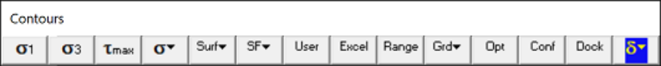
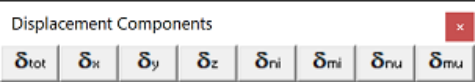
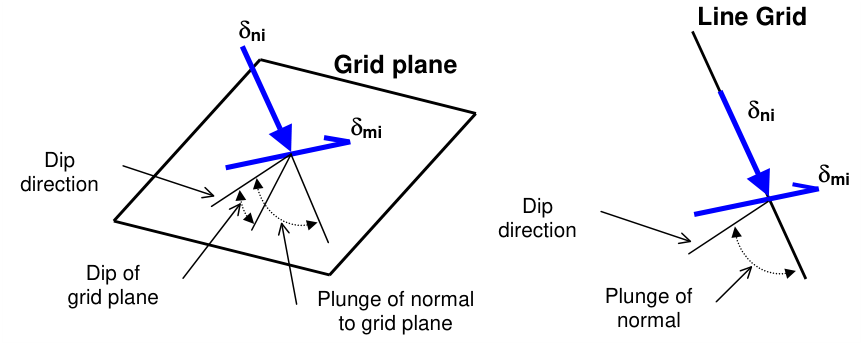
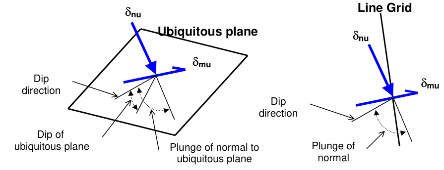

## 5.3.3.1 Gesamtverschiebung

Stellt die Verschiebungen als Konturen dar.

Auf diese Komponenten kann über die Symbolleiste Displacement Components wie folgt zugegriffen werden:

Diese Symbolleiste kann auf vertikale Ausrichtung umgestellt werden, indem sie an den rechten oder linken Rand des Hauptfensters gezogen wird.

Durch Ziehen an den oberen oder unteren Rand des Hauptfensters kann sie wieder horizontal ausgerichtet werden.

Mit der Schaltfläche in der Symbolleiste Contours wird die Symbolleiste Displacement Components aktiviert. Sie können diese Schaltfläche über die Konfigurationsschaltfläche zur Symbolleiste Contours hinzufügen.

Diese Symbolleiste bietet schnellen Zugriff auf die Verschiebungskomponenten.

Plot > Displacement > dtotal = ( dx² + dy² + dz² )½ Gesamtverschiebung   stellt die Gesamtverschiebung als Konturen dar Plot > Displacement > dx X-Verschiebung   stellt die x-Komponente der Verschiebung als Konturen dar Plot > Displacement > dy Y-Verschiebung   stellt die y-Komponente der Verschiebung als Konturen dar Plot > Displacement > dz Z-Verschiebung   stellt die z-Komponente der Verschiebung als Konturen dar

Zur Berechnung der Verschiebungen in der Ebene wird der Verschiebungszustand an jedem Punkt der Rasterebene umorientiert, um die maximale Verschiebung parallel zur Rasterebene und die Verschiebung normal zur Ebene zu bestimmen. Beachten Sie, dass dni normal zur Rasterebene und parallel zur Richtung eines Linienrasters orientiert ist.

Plot > Displacement > dni Normal in der Ebene   stellt die Verschiebungskomponente normal zur Rasterebene als Konturen dar.

Plot > Displacement > dmi Maximum in der Ebene   stellt die maximale Verschiebung tangential zur Rasterebene als Konturen dar.

Zur Berechnung der Verschiebungen der ubiquitären Ebene Nr. 1 wird der Verschiebungszustand an jedem Punkt der Rasterebene umorientiert, um die maximale Verschiebung parallel zur ubiquitären Ebene Nr. 1 und die Verschiebung normal zur Ebene zu bestimmen. Beachten Sie, dass dmi nicht normal zur Rasterebene orientiert ist.

Plot > Displacement > dnu Normal zur ubiquitären Ebene   stellt die Verschiebungskomponente normal zur ubiquitären Ebene als Konturen dar.

Plot > Displacement > dmu Maximum in der ubiquitären Ebene   stellt die maximale Verschiebung tangential zur ubiquitären Ebene als Konturen dar.

- Die Einfallsrichtung wird im Uhrzeigersinn von der y-Achse aus positiv gemessen.

- Das Einfallen der Ebene wird von der Horizontalen aus nach unten positiv gemessen (d. h. in Einfallsrichtung).

- Das Abtauchen der Normalen wird von der Horizontalen aus nach unten positiv (d. h. nach oben negativ) gemessen.

Hinweise:

Die Symbolleiste für die Verschiebung kann erst nach der Modellaufbauphase (CAD) aktiviert werden

Map3D-Analysephasen.

Die Orientierung der ubiquitären Scherebene wird festgelegt mit

Plot > Strength Factors > Ubiquitous Parameters

Der Konturbereich wird festgelegt mit

#### Plot > Range

Diese Komponente kann bei Bedarf der Konturen-Symbolleiste hinzugefügt werden

Tools > Configure Contouring Toolbar > Displacement

Es kann praktisch sein, die Schaltfläche

More Displacement Components

der Konturen-Symbolleiste hinzuzufügen, um schnell auf alle Verschiebungskomponenten zuzugreifen.
