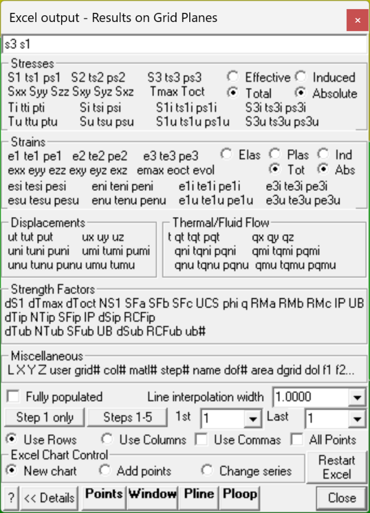

Stellt die angegebenen Rasterkomponenten in Excel dar.

Sie müssen Rasterergebnisse als Konturen darstellen, um sie für das Excel-Diagramm auswählen zu können (z. B. Plot > Stress > s1 Major Principal Stress).

Der erste Parameter wird als x-Achse des Diagramms verwendet (d. h. als Abszisse). Weitere Parameter definieren die y-Achsen des Diagramms (d. h. Datenreihen bzw. Ordinaten). Es können mehrere y-Achsenparameter angegeben werden.

Es können zwei Arten von Excel-Diagrammen erstellt werden:

- ausgewählte Konturpunkte.

- eine Reihe von Punkten entlang einer Polylinie.

Wenn Sie „s3 s1“, „si ti“ oder „su tu“ darstellen, liefert Map3D Informationen zur Ausgleichsgeraden (mittels linearer Regression), darunter:

- Achsenabschnitt

- Steigung

- Reibungswinkel

- Standardabweichung

- Variationskoeffizient

Fully populated   Legt fest, dass alle fehlenden Konturpunkte durch Interpolation erzeugt werden.

- Diese Option gilt nur für die Darstellung ausgewählter Konturpunkte (Points, Window und geschlossene Polylinie).

- Diese Option gilt nicht für die Darstellung auf einer offenen Polylinie.

- Map3D berechnet Ergebnisse auf einem dünn besetzten Raster, um Analysezeit zu sparen.

- Um die Lage der tatsächlichen Konturpunkte anzuzeigen, aktivieren Sie die Anzeige der Trajektorien (Plot > Options > Trajectories).

- Bei deaktivierter Option werden nur die tatsächlichen Konturpunkte in das Diagramm aufgenommen.

- Bei aktivierter Option werden alle fehlenden Konturpunkte in das Diagramm aufgenommen.

Line interpolation width   Legt den gewünschten Abstand fest, in dem Konturpunkte durch Interpolation erzeugt werden.

- Diese Option gilt nur für die Darstellung auf einer offenen Polylinie.

- Diese Option gilt nicht für die Darstellung ausgewählter Konturpunkte.

- Ist Line interpolation width auf null gesetzt, werden nur die Enden der offenen Polylinie dargestellt.

- Andernfalls werden entlang der Polylinie durch Interpolation Punkte im angegebenen Line interpolation width erzeugt.

Step # only   Legt fest, dass nur die Ergebnisse des Schritts # ausgegeben werden (# ist der aktuell angezeigte geladene Abbauschritt).

Steps 1-5   Legt fest, dass die Ergebnisse aller Schritte ausgegeben werden.

   - Beachten Sie, dass dies bei großen Datensätzen sehr lange dauern kann; haben Sie also Geduld und warten Sie, bis Map3D alle Schritte durchlaufen hat.

- 1st/Last   Legt fest, dass die Ergebnisse aller Schritte von einschließlich 1st bis einschließlich Last ausgegeben werden.

   - Beachten Sie, dass dies bei großen Datensätzen sehr lange dauern kann; haben Sie also Geduld und warten Sie, bis Map3D alle Schritte durchlaufen hat.

Use Commas   Legt fest, dass die nach Excel ausgegebenen Ergebnisse im Zahlenformat Kommas statt Dezimalpunkten verwenden.

Use Rows   Beim Ausgeben mehrerer Abbauschritte (siehe Steps 1-5 oben) erscheinen die Ergebnisse in sich anhäufenden Zeilen.

Use Columns   Beim Ausgeben mehrerer Abbauschritte (siehe Steps 1-5 oben) erscheinen die Ergebnisse in sich anhäufenden Spalten.

- Beachten Sie, dass es sinnvoll sein kann, All Points anzugeben, damit zwischen einander entsprechenden Zeilen keine Punkte fehlen.

All Points   Legt fest, dass alle Punkte nach Excel ausgegeben werden – einschließlich der Punkte innerhalb von Hohlräumen.

Restart Excel   Wenn Map3D die Verbindung zu Excel verliert, müssen Sie Excel neu starten (Restart Excel), um die Verbindung wiederherzustellen.

Points   aktiviert die grafische Auswahl einzelner Punkte.

- Der dem gewählten Punkt nächstgelegene Punkt wird dargestellt.

- Um die Lage der tatsächlichen Konturpunkte anzuzeigen, aktivieren Sie die Anzeige der Trajektorien (Plot > Options > Trajectories). Die Konturpunkte liegen dort, wo die Trajektorien gezeichnet werden.

Window   aktiviert ein rechteckiges Auswahlfenster.

- Sie werden aufgefordert, die beiden Ecken des Fensters jeweils mit einem einfachen Mausklick auszuwählen.

- Nur Rasterpunkte innerhalb des Fensters werden in das Diagramm aufgenommen.

- Um die Lage der tatsächlichen Konturpunkte anzuzeigen, aktivieren Sie die Anzeige der Trajektorien (Plot > Options > Trajectories). Die Konturpunkte liegen dort, wo die Trajektorien gezeichnet werden.

Pline (open)   aktiviert ein grafisches Auswahlpolygon.

- Sie können zwei Punkte auswählen, um ein einzelnes Liniensegment zu definieren.

- Wenn Sie die Umschalttaste gedrückt halten, können mehrere Liniensegmente ausgewählt werden.

- Mit dem Parameter Line interpolation width können Sie den gewünschten Abstand festlegen, in dem Konturpunkte durch Interpolation erzeugt werden.

- Es kann nützlich sein, den Konturen ein regelmäßiges Raster zu überlagern (Plot > Options > Grid Lines), um die Wahl der Polylinienlage zu erleichtern.

- Ist Line interpolation width auf null gesetzt, werden nur die Enden der offenen Polylinie dargestellt.

- Wenn Sie eine offene Polylinie definieren, wird eine Reihe von Punkten entlang der Polylinie dargestellt.

- Wenn Sie eine geschlossene Polygonform definieren, werden die im Polygon eingeschlossenen Konturpunkte dargestellt.

Pline (closed)   aktiviert ein grafisches Auswahlpolygon.

- Sie müssen die Umschalttaste gedrückt halten, damit mehrere Liniensegmente ausgewählt werden können.

- Eine geschlossene Polygonform wird definiert, indem Sie die Polylinie durch Auswahl des Startpunkts schließen.

- Wenn Sie eine geschlossene Polygonform definieren, werden die im Polygon eingeschlossenen Konturpunkte dargestellt.

- Wenn Sie eine offene Polylinie definieren, wird eine Reihe von Punkten entlang der Polylinie dargestellt.

- Um die Lage der tatsächlichen Konturpunkte anzuzeigen, aktivieren Sie die Anzeige der Trajektorien (Plot > Options > Trajectories). Die Konturpunkte liegen dort, wo die Trajektorien gezeichnet werden.

Ploop (closed)   entspricht Pline (closed), nur dass die Polylinie automatisch geschlossen wird und eine geschlossene Schleife bildet.

- Sie müssen die Umschalttaste gedrückt halten, damit mehrere Liniensegmente ausgewählt werden können.

#### Excel Chart Control:

New chart - erstellt ein neues Excel-Diagramm.

Extend existing chart - fügt dem vorhandenen Excel-Diagramm Daten hinzu. Alle Darstellungsparameter müssen mit den zuvor verwendeten übereinstimmen.

Change series - ändert Datenreihen eines vorhandenen Excel-Diagramms oder fügt neue hinzu. Nur der erste Darstellungsparameter muss gleich sein. Weitere Darstellungsparameter können nach Bedarf angegeben werden.

#### Stresses:

s1 ts1 ps1 größte Hauptspannung s1, ihre Streichrichtung und ihr Abtauchen.

s2 ts2 ps2 mittlere Hauptspannung s2, ihre Streichrichtung und ihr Abtauchen. s3 ts3 ps3 kleinste Hauptspannung s3, ihre Streichrichtung und ihr Abtauchen. sxx syy szz sxy syz sxz kartesische Spannungskomponenten. tmax maximale Schubspannung tmax = ½ ( s1 - s3 ) toct oktaedrische Schubspannung toct = ¹/3 [( s1 - s2 )² + ( s2 - s3 )² +( s3 - s1 )²]½ smean mittlere Spannung smean = ¹/3 ( s1 + s2 + s3 ) ti tti pti maximale Schubspannung in der Rasterebene, ihre Streichrichtung und ihr Abtauchen. si tsi psi Normalspannung in der Rasterebene, ihre Streichrichtung und ihr Abtauchen. s1i ts1i ps1i maximale Spannung tangential zur Rasterebene, ihre Streichrichtung und ihr Abtauchen. s3i ts3i ps3i minimale Spannung tangential zur Rasterebene, ihre Streichrichtung und ihr Abtauchen. tu ttu ptu maximale Schubspannung in der ubiquitären Ebene, ihre Streichrichtung und ihr Abtauchen. su tsu psu Spannung normal zur ubiquitären Ebene, ihre Streichrichtung und ihr Abtauchen. s1u ts1u ps1u maximale Spannung tangential zur ubiquitären Ebene, ihre Streichrichtung und ihr Abtauchen. s3u ts3u ps3u minimale Spannung tangential zur ubiquitären Ebene, ihre Streichrichtung und ihr Abtauchen. Die Orientierung der ubiquitären Ebene wird angegeben in

Plot > Strength Factors > Ubiquitous Parameters

Effective/Total Komponenten der effektiven Spannung oder der Gesamtspannung. Diese Optionen werden nur in Map3D Thermal-Fluid Flow verwendet, da dieser Code die Berechnung stationärer Porendruckverteilungen erlaubt. Induced/Absolute Komponenten der induzierten Spannung oder der absoluten Spannung (d. h. die Spannung ohne den Beitrag der Spannung vor dem Abbau).

#### Strains:

e1 te1 pe1 größte Hauptdehnung e1, ihre Streichrichtung und ihr Abtauchen. e2 te2 pe2 mittlere Hauptdehnung e2, ihre Streichrichtung und ihr Abtauchen. e3 te3 pe3 kleinste Hauptdehnung e3, ihre Streichrichtung und ihr Abtauchen. exx eyy ezz exy eyz exz kartesische Dehnungskomponenten. emax maximale Scherdehnung emax = ½ ( e1 - e3 ) eoct oktaedrische Scherdehnung eoct = ¹/3 [( e1 - e2 )² + ( e2 - e3 )² +( e3 - e1 )²]½ evol Volumendehnung evol = ( e1 + e2 + e3 ) esi tesi pesi maximale Scherdehnung in der Rasterebene, ihre Streichrichtung und ihr Abtauchen. eni teni peni Normaldehnung in der Rasterebene, ihre Streichrichtung und ihr Abtauchen. e1i te1i pe1i maximale Dehnung tangential zur Rasterebene, ihre Streichrichtung und ihr Abtauchen. e3i te3i pe3i minimale Dehnung tangential zur Rasterebene, ihre Streichrichtung und ihr Abtauchen. esu tesu pesu maximale Scherdehnung in der ubiquitären Ebene, ihre Streichrichtung und ihr Abtauchen. enu tenu penu Dehnung normal zur ubiquitären Ebene, ihre Streichrichtung und ihr Abtauchen. e1u te1u pe1u maximale Dehnung tangential zur ubiquitären Ebene, ihre Streichrichtung und ihr Abtauchen. e3u te3u pe3u minimale Dehnung tangential zur ubiquitären Ebene, ihre Streichrichtung und ihr Abtauchen. Elastic/Plastic/Total elastische, plastische oder gesamte Dehnungskomponenten. Diese Optionen werden nur in Map3D Non-Linear verwendet, da dieser Code die Berechnung nichtlinearer Dehnungen erlaubt. Induced/Absolute induzierte Dehnung oder absolute Dehnungskomponenten (d. h. ohne den Beitrag der Spannung vor dem Abbau).

#### Displacements:

ut tut put Gesamtverschiebung, ihre Streichrichtung und ihr Abtauchen. ux uy uz kartesische Verschiebungskomponenten. uni tuni puni Verschiebung normal zur Rasterebene, ihre Streichrichtung und ihr Abtauchen. umi tumi pumi maximale Verschiebung tangential zur Rasterebene, ihre Streichrichtung und ihr Abtauchen. unu tunu punu Verschiebung normal zur ubiquitären Ebene, ihre Streichrichtung und ihr Abtauchen. umu tumu pumu maximale Verschiebung tangential zur ubiquitären Ebene, ihre Streichrichtung und ihr Abtauchen.

#### Flow:

t Temperatur/Druckhöhe.

qt tqt pqt Gesamtfluss, seine Streichrichtung und sein Abtauchen. qx qy qz kartesische Flusskomponenten. qni tqni pqni Verschiebung normal zur Rasterebene, ihre Streichrichtung und ihr Abtauchen. qmi tqmi pqmi maximale Verschiebung tangential zur Rasterebene, ihre Streichrichtung und ihr Abtauchen. qnu tqnu pqnu Verschiebung normal zur ubiquitären Ebene, ihre Streichrichtung und ihr Abtauchen. qmu tqmu pqmu maximale Verschiebung tangential zur ubiquitären Ebene, ihre Streichrichtung und ihr Abtauchen.

#### Strength:

· ds1 überschüssige größte Hauptspannung Ds1 = s1 - ( _UCS_ + _q_ s3 )

- dtmax überschüssige maximale Schubspannung Dtmax = ½(s1 - s3) - [ _UCS_ + ½(s1+s3) ( _q_ -1) ]/( _q_ +1) = [s1 - ( _UCS_ + _q_ s3) ]/( _q_ +1)

- dtoct überschüssige oktaedrische Schubspannung Dtoct = toct - [ _UCS_ + ( _q_ –1) smean ] Ö(2) /( _q_ +2)

- NS1 Wahrscheinlichkeit nach der Normalverteilung N(Ds1 /std)

- SF-A Festigkeit/Spannung kann als ( _UCS_ + _q_ s3 )/ s1 bestimmt werden

- SF-B Festigkeit/Spannung kann als ( _UCS_ + _q_ s3 - s3 )/(s1 - s3) bestimmt werden

- SF-C Festigkeit/Spannung kann als [ _UCS_ + ½(s1+s3) ( _q_ -1) ]/[ ½(s1 - s3)( _q_ +1) ] bestimmt werden

- dTip überschüssige Schubspannung in der Ebene Dtip = tip - [ Cohesion + sip tan(j) ]

- NTip Wahrscheinlichkeit nach der Normalverteilung N(Dtip /std)

- SFip Festigkeit/Spannung kann als [ Cohesion + sip tan(j) ] / tip bestimmt werden

- dSip überschüssige Wandspannung in der Ebene Dsip = [ 3 s1i - s3i ] - UCS

- RCFip Gebirgszustandsfaktor (Rock Condition Factor) für die Wandspannung in der Ebene RCFip = [ 3 s1i - s3i ]/UCS

- dTub überschüssige Schubspannung in der ubiquitären Ebene Dtub

- NTub Wahrscheinlichkeit nach der Normalverteilung N(Dtub /std)

- SFub Festigkeit/Spannung kann als [ Cohesion + sub tan(j) ] / tub bestimmt werden

- dSub überschüssige Wandspannung in der ub-Ebene Dsub = [ 3 s1ub - s3ub ] - UCS

- RCFub Gebirgszustandsfaktor für die Wandspannung in der ub-Ebene RCFip = [ 3 s1ub - s3ub ]/UCS

- UB# Stellt die Nummer der UB-Schar (1, 2 oder 3) dar, die den größten Wert von Dtub hat

#### Miscellaneous:

L  Länge entlang einer Linie. Verwenden Sie den Befehl Polyline, um die gewünschte Linie auszuwählen.

X  Koordinatenwert. Y  Koordinatenwert. Z  Koordinatenwert. user benutzerdefinierter Wert.

grid# die Nummer des Rasters, in dem der Punkt liegt. col# die Farbnummer, die dem Raster zugewiesen ist, in dem der Punkt liegt.

matl# die Nummer des Materials, in dem der Punkt liegt. Das Nebengestein (host) ist Material Nummer 1. Bei Problemen mit mehreren Materialien können Ergebnisse in einer Zone mit abweichendem Material berechnet werden.

step# die Nummer des Abbauschritts. name der Name, der dem Raster zugewiesen ist, in dem der Punkt liegt.

dof#   eine eindeutige Nummer, die den Speicherort des Punkts in der Map3D-Datenbank angibt. area die Fläche des Segments, das dem ausgewählten Punkt auf der GPlane zugeordnet ist. dgrid Abstand zur nächsten Oberfläche von jedem Rasterpunkt aus. dol Abstand zum nächsten Raster _Dgrid_ geteilt durch den Rasterabstand _Lgrid_ .

f1 f2... benutzerdefinierte Materialparameter. Diese können mit Plot > Properties > Material Properties > User defined Parameters definiert werden.
