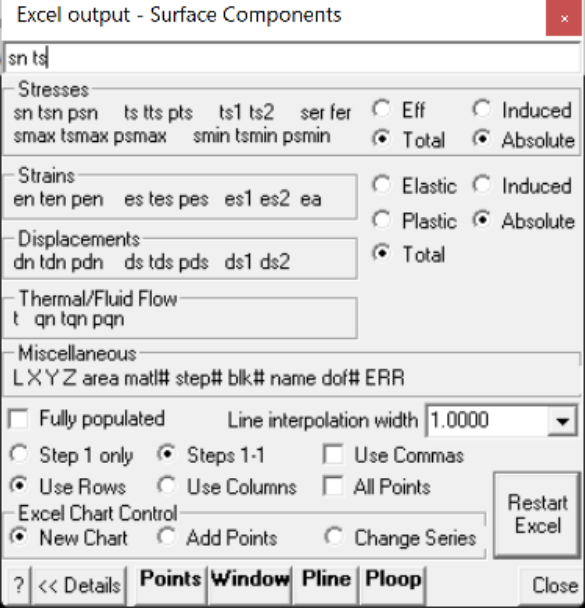

Stellt die angegebenen Oberflächenkomponenten in Excel dar.

Sie müssen Oberflächenergebnisse als Konturen darstellen, um sie für das Excel-Diagramm auswählen zu können (z. B. Plot > Surface Components > Ts Shear Stress).

Der erste Parameter wird als x-Achse des Diagramms verwendet (d. h. als Abszisse). Weitere Parameter definieren die y-Achsen des Diagramms (d. h. Datenreihen bzw. Ordinaten). Es können mehrere y-Achsenparameter angegeben werden.

Es können zwei Arten von Excel-Diagrammen erstellt werden:

- ausgewählte Konturpunkte.

- eine Reihe von Punkten entlang einer Polylinie.

Das Erstellen von Excel-Diagrammen über Map3D erfolgt mit dem Add-In Map3D.xla

- Diese Routine wird automatisch geladen, wenn Map3D Excel startet.

- Sie müssen die Ausführung dieses Makros zulassen, damit die Diagrammroutinen von Map3D funktionieren.

Fully populated   Legt fest, dass alle fehlenden Konturpunkte durch Interpolation erzeugt werden.

- Diese Option gilt nur für die Darstellung ausgewählter Konturpunkte (Points, Window und geschlossene Polylinie).

- Diese Option gilt nicht für die Darstellung auf einer offenen Polylinie.

- Map3D berechnet Ergebnisse auf einem dünn besetzten Raster, um Analysezeit zu sparen.

- Um die Lage der tatsächlichen Konturpunkte anzuzeigen, aktivieren Sie die Anzeige der Trajektorien (Plot > Options > Trajectories).

- Bei deaktivierter Option werden nur die tatsächlichen Konturpunkte in das Diagramm aufgenommen.

- Bei aktivierter Option werden alle fehlenden Konturpunkte in das Diagramm aufgenommen.

Line interpolation width   Legt den gewünschten Abstand fest, in dem Konturpunkte durch Interpolation erzeugt werden.

- Diese Option gilt nur für die Darstellung auf einer offenen Polylinie.

- Diese Option gilt nicht für die Darstellung ausgewählter Konturpunkte.

- Ist Line interpolation width auf null gesetzt, werden nur die Enden der offenen Polylinie dargestellt.

- Andernfalls werden entlang der Polylinie durch Interpolation Punkte im angegebenen Line interpolation width erzeugt.

Step # only   Legt fest, dass nur die Ergebnisse des Schritts # ausgegeben werden (# ist der aktuell angezeigte geladene Abbauschritt).

Steps 1-5   Legt fest, dass die Ergebnisse aller Schritte ausgegeben werden.

- Beachten Sie, dass dies bei großen Datensätzen sehr lange dauern kann; haben Sie also Geduld und warten Sie, bis Map3D alle Schritte durchlaufen hat.

Use Commas   Legt fest, dass die nach Excel ausgegebenen Ergebnisse im Zahlenformat Kommas statt Dezimalpunkten verwenden.

Restart Excel   Wenn Map3D die Verbindung zu Excel verliert, müssen Sie Excel neu starten (Restart Excel), um die Verbindung wiederherzustellen.

Points   aktiviert die grafische Auswahl einzelner Punkte.

- Der dem gewählten Punkt nächstgelegene Punkt wird dargestellt.

- Um die Lage der tatsächlichen Konturpunkte anzuzeigen, aktivieren Sie die Anzeige der Trajektorien (Plot > Options > Trajectories). Die Konturpunkte liegen dort, wo die Trajektorien gezeichnet werden.

Window   aktiviert ein rechteckiges Auswahlfenster.

- Sie werden aufgefordert, die beiden Ecken des Fensters jeweils mit einem einfachen Mausklick auszuwählen.

- Nur Rasterpunkte innerhalb des Fensters werden in das Diagramm aufgenommen.

- Um die Lage der tatsächlichen Konturpunkte anzuzeigen, aktivieren Sie die Anzeige der Trajektorien (Plot > Options > Trajectories). Die Konturpunkte liegen dort, wo die Trajektorien gezeichnet werden.

Polyline (closed)   aktiviert ein grafisches Auswahlpolygon.

- Sie müssen die Umschalttaste gedrückt halten, damit mehrere Liniensegmente ausgewählt werden können.

- Eine geschlossene Polygonform wird definiert, indem Sie die Polylinie durch Auswahl des Startpunkts schließen.

- Wenn Sie eine geschlossene Polygonform definieren, werden die im Polygon eingeschlossenen Konturpunkte dargestellt.

- Wenn Sie eine offene Polylinie definieren, wird eine Reihe von Punkten entlang der Polylinie dargestellt.

- Um die Lage der tatsächlichen Konturpunkte anzuzeigen, aktivieren Sie die Anzeige der Trajektorien (Plot > Options > Trajectories). Die Konturpunkte liegen dort, wo die Trajektorien gezeichnet werden.

Polyline (open)   aktiviert ein grafisches Auswahlpolygon.

- Sie können zwei Punkte auswählen, um ein einzelnes Liniensegment zu definieren.

- Wenn Sie die Umschalttaste gedrückt halten, können mehrere Liniensegmente ausgewählt werden.

- Mit dem Parameter Line interpolation width können Sie den gewünschten Abstand festlegen, in dem Konturpunkte durch Interpolation erzeugt werden.

- Es kann nützlich sein, den Konturen ein regelmäßiges Raster zu überlagern (View > Render > Grid Lines), um die Wahl der Polylinienlage zu erleichtern.

- Ist Line interpolation width auf null gesetzt, werden nur die Enden der offenen Polylinie dargestellt.

- Wenn Sie eine offene Polylinie definieren, wird eine Reihe von Punkten entlang der Polylinie dargestellt.

- Wenn Sie eine geschlossene Polygonform definieren, werden die im Polygon eingeschlossenen Konturpunkte dargestellt.

#### Excel Chart Control:

New chart - erstellt ein neues Excel-Diagramm.

Extend existing chart - fügt dem vorhandenen Excel-Diagramm Daten hinzu. Alle Darstellungsparameter müssen mit den zuvor verwendeten übereinstimmen.

Change series - ändert Datenreihen eines vorhandenen Excel-Diagramms oder fügt neue hinzu. Nur der erste Darstellungsparameter muss gleich sein. Weitere Darstellungsparameter können nach Bedarf angegeben werden.

#### Stresses:

sn tsn psn Spannung normal zur Oberfläche, ihre Streichrichtung und ihr Abtauchen.

ts tts pts maximale Schubspannung in der Oberflächenebene, ihre Streichrichtung und ihr Abtauchen. ts1 ts2   Schubspannungskomponenten in der Oberflächenebene. ts1 verläuft parallel zur ersten Seite (d. h. der durch x1 y1 z1 – x2 y2 z2 definierten Seite). ts2 steht senkrecht auf ts1 in Richtung der zweiten Seite (d. h. der durch x2 y2 z2 – x3 y3 z3 definierten Seite).

ser Oberflächenspannungsfehler. Iterative Löser arbeiten, indem sie den Fehler der aktuellen Lösung jeder simultanen Gleichung bestimmen und diese Fehler dann durch sukzessive Approximation verringern. Dieser Parameter gibt den Fehler für jede der Gleichungen an.

fer Fehler des Bruchkriteriums. Dieser Parameter wird nur bei nichtlinearen Kriechanalysen verwendet (einschließlich Störungsgleiten und 3D-Materialnichtlinearität). Er sollte stets nahe null liegen, es sei denn, es wurde eine Viskosität angegeben und das Problem wird nichtlinear. In diesem letzteren Fall kann viskoses Kriechen Spannungszustände oberhalb des Bruchkriteriums zulassen, was auf fehlendes statisches Gleichgewicht hinweist. Dieser Parameter gibt die viskose Spannung für jede der Gleichungen an.

smax tsmax psmax maximale Tangentialspannung, ihre Streichrichtung und ihr Abtauchen. smin tsmin psmin minimale Tangentialspannung, ihre Streichrichtung und ihr Abtauchen. Effective/Total – Komponenten der effektiven Spannung oder der Gesamtspannung. Diese Optionen werden nur in Map3D Thermal-Fluid Flow verwendet, da dieser Code die Berechnung stationärer Porendruckverteilungen erlaubt. Induced/Absolute Komponenten der induzierten Spannung oder der absoluten Spannung (d. h. die Spannung ohne den Beitrag der Spannung vor dem Abbau).

#### Strains:

en ten pen Dehnung in Richtung normal zur Oberfläche, ihre Streichrichtung und ihr Abtauchen. Dieser Parameter wird nur für DD-Ebenen verwendet und als normale Verschiebung (Konvergenz) geteilt durch die Dicke berechnet. es tes pes maximale Scherdehnung in der Oberflächenebene, ihre Streichrichtung und ihr Abtauchen. Dieser Parameter wird nur für DD-Ebenen verwendet und als Scherverschiebung (ride) geteilt durch die Dicke berechnet.

es1 es2   Scherdehnungskomponenten in der Oberflächenebene. es1 verläuft parallel zur ersten Seite (d. h. der durch x1 y1 z1 – x2 y2 z2 definierten Seite). es2 steht senkrecht auf es1 in Richtung der zweiten Seite (d. h. der durch x2 y2 z2 – x3 y3 z3 definierten Seite).

Elastic/Plastic/Total elastische, plastische oder gesamte Dehnungskomponenten. Diese Optionen werden für DD-Ebenen in Map3D Fault-Slip sowie in Map3D Non-Linear verwendet, da dieser Code die Berechnung nichtlinearer Dehnungen erlaubt.

Induced/Absolute induzierte Dehnung oder absolute Dehnungskomponenten (d. h. ohne den Beitrag der Spannung vor dem Abbau).

#### Displacements:

dn tdn pdn normale Verschiebung (Konvergenz) in Richtung normal zur Oberfläche, ihre Streichrichtung und ihr Abtauchen. Dieser Parameter wird nur für DD-Ebenen verwendet. Beachten Sie, dass der elastische, plastische oder gesamte Wert angegeben werden kann.

ds tds pds maximale Scherverschiebung (ride) in der Oberflächenebene, ihre Streichrichtung und ihr Abtauchen. Dieser Parameter wird nur für DD-Ebenen verwendet. Beachten Sie, dass der elastische, plastische oder gesamte Wert angegeben werden kann.

ds1 ds2   Komponenten der Scherverschiebung (ride) in der Oberflächenebene. ds1 verläuft parallel zur ersten Seite (d. h. der durch x1 y1 z1 – x2 y2 z2 definierten Seite). ds2 steht senkrecht auf ds1 in Richtung der zweiten Seite (d. h. der durch x2 y2 z2 – x3 y3 z3 definierten Seite).

#### Miscellaneous:

L  Länge entlang einer Linie. Verwenden Sie den Befehl Polyline, um die gewünschte Linie auszuwählen. X  Koordinatenwert. Y  Koordinatenwert. Z  Koordinatenwert. area   die Fläche der Oberfläche. matl# die Nummer des der Oberfläche zugewiesenen Materials. step# die Nummer des Abbauschritts. blk#   die Blocknummer. name der Blockname. dof#   die Nummer des Freiheitsgrads. ERR   Darstellung der Energiefreisetzungsrate.
