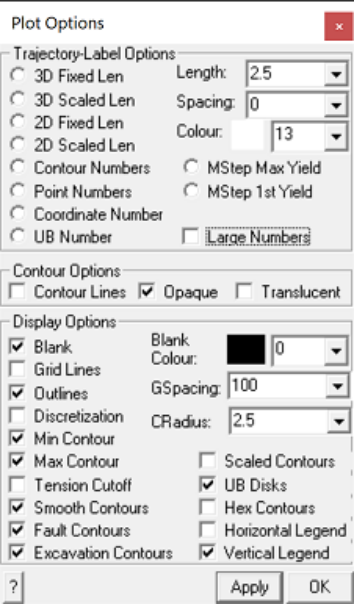

Legt die Optionen der Konturdarstellung fest.

Diese Routine kann entweder über die Schaltfläche oder einfach per Rechtsklick auf eine beliebige Kontur gestartet werden.

Diese Symbolleiste kann auf vertikale Ausrichtung umgestellt werden, indem sie an den rechten oder linken Rand des Hauptfensters gezogen wird.

Durch Ziehen an den oberen oder unteren Rand des Hauptfensters kann sie wieder horizontal ausgerichtet werden.

#### Trajectory-Label Options:

- 3D Fixed Length – zeigt 3D-Orientierungsanzeiger fester Länge an.

Der Anzeiger wird als 3D-Vektor aufgebaut, an dessen Ende eine Pfeilspitze sitzt, die von Ihnen weg zeigt (d. h. in die Anzeige hinein). So können Sie erkennen, ob der Vektor von Ihnen weg oder auf Sie zu einfällt. Vektoren, die als Punkte erscheinen, zeigen direkt in die Anzeige hinein oder aus ihr heraus.

Wenn Sie die Ansicht so ausrichten, dass Sie entlang der Kante eines Rasters blicken, sehen Sie die Vektoren aus der Konturebene hinein- und herausragen.

Die Länge der Vektoren wird mit dem Parameter TLength: festgelegt.

Die Dichte der Vektoren wird mit dem Parameter TSpacing: festgelegt.

- 3D Scaled Length – zeigt 3D-Orientierungsanzeiger mit skalierter Länge an.

Der Anzeiger wird wie oben beschrieben aufgebaut.

Die Länge der Vektoren wird auf die Spannungsgröße skaliert: Entspricht die Größe dem Minimum des Konturbereichs, wird der Vektor mit der Länge null gezeichnet. Entspricht die Größe dem Maximum des Konturbereichs, wird der Vektor mit der durch den Parameter TLength: angegebenen Länge gezeichnet.

- 2D Fixed Length – zeigt 2D-Orientierungsanzeiger fester Länge an.

Der Anzeiger wird als 2D-Projektion des echten 3D-Vektors in der Rasterebene aufgebaut.

Die Länge der Vektoren wird mit dem Parameter TLength: festgelegt.

Die Dichte der Vektoren wird mit dem Parameter TSpacing: festgelegt.

- 2D Scaled Length – zeigt 2D-Orientierungsanzeiger mit skalierter Länge an.

Der Anzeiger wird wie oben beschrieben aufgebaut.

Der Anzeiger wird als 2D-Projektion des echten 3D-Vektors in der Rasterebene aufgebaut.

Die Länge der Vektoren wird auf die Spannungsgröße skaliert: Entspricht die Größe dem Minimum des Konturbereichs, wird der Vektor mit der Länge null gezeichnet. Entspricht die Größe dem Maximum des Konturbereichs, wird der Vektor mit der durch den Parameter TLength: angegebenen Länge gezeichnet.

- Contour Numbers – zeigt Konturnummern auf den Konturen an. Die Nummer entspricht der Größe der Kontur an jedem Punkt.

- Point Numbers – zeigt Punktnummern auf den Konturen an. Die Nummer entspricht der Datensatznummer jedes Punkts.

- Coordinate Numbers – zeigt Koordinatenwerte auf den Konturen an. Die Zahlen entsprechen den x,y,z-Koordinaten jedes Punkts.

- UB Number – zeigt auf den Konturen die Nummer der ubiquitären Kluftschar (1, 2 oder 3) mit der größten Überschussschubspannung an. Siehe Ubiquitous Parameters

- MStep Max Yield – zeigt den Schritt an, in dem die größte Überschussspannung auftritt. Siehe Accumulated Damage

- MStep 1st Yield – zeigt den Schritt an, in dem erstmals Fließen auftritt. Siehe Accumulated Damage

- Large Numbers – zeigt Zahlen in großer oder kleiner Größe an.

- Length – legt die Länge fest, mit der die Orientierungsanzeiger gezeichnet werden. Ist dieser Parameter zu klein, sind die Trajektorienvektoren zu klein, um sichtbar zu sein. Ist er zu groß, überlappen sich die Trajektorienvektoren und die Anzeige wird unübersichtlich.

- Spacing – legt den Abstand zwischen benachbarten Orientierungsanzeigern oder Zahlen fest. Wird dieser Parameter auf null gesetzt, werden Trajektorien an allen Rasterpunkten gezeichnet. Bei fein diskretisierten Rastern können die Trajektorienvektoren zu dicht liegen und schwer unterscheidbar sein. Größere Werte dieses Parameters führen dazu, dass weniger Trajektoriensymbole gezeichnet werden.

- Colour – legt die Farbe fest, mit der die Trajektorien gezeichnet werden.

#### Contour Options:

- Contour Lines – zeichnet Linien zwischen den Konturfarben. Diese Linien helfen, die Grenze zwischen verschiedenen Konturintervallen hervorzuheben, und sind besonders für Schwarzweiß-Darstellungen nützlich.

- Opaque – zeichnet die Konturen in deckenden Farben. Sind diese Option und die Option „Translucent“ beide deaktiviert, werden nur Konturlinien (also keine farbigen Konturen) gezeichnet.

- Translucent - zeichnet die Konturen in durchscheinenden Farben. Sind diese Option und die Option „Opaque“ beide deaktiviert, werden nur Konturlinien (also keine farbigen Konturen) gezeichnet.

#### Display Options:

- Blank – wenn aktiviert, werden Konturen dort ausgeblendet, wo die Rasterebene durch Hohlraumblöcke verläuft. Dies ist nützlich, um die Ausdehnung der Hohlräume zu erkennen, wenn Teile des Modells ausgeblendet wurden. Es ist auch nützlich für die Erzeugung von 2D-Schnitten, da die Lage der Hohlräume deutlich sichtbar ist.

Blank Colour: - legt die für das Ausblenden verwendete Farbe fest.

Grid Lines – Konturen werden mit Linien in regelmäßigen Rasterintervallen gezeichnet. Das gewünschte Intervall wird mit dem Parameter Spacing: festgelegt.

Outlines – um die Rasterränder werden Umrisse gezeichnet. Bei mehreren Rastern möchten Sie diese Umrisse möglicherweise nicht sehen.

Discretization – die Rasterdiskretisierung wird den Konturen überlagert.

Min Contour – wenn deaktiviert, werden Konturen unterhalb des Minimums des Konturbereichs nicht gezeichnet. Dies ist nützlich, um Konturen darzustellen, bei denen nur der obere Teil des Konturbereichs wichtig ist.

Beispielsweise ist es bei der Darstellung nichtlinearer Dehnungskomponenten oder von Überschussspannungen oft sinnvoll, nur die von null verschiedenen Bereiche der Konturen sichtbar zu machen.

Hat der gewünschte Parameter einen negativen Wert, vertauschen Sie einfach Maximum und Minimum des Konturbereichs oder stellen Sie den Absolutwert des Parameters dar.

Max Contour – wenn deaktiviert, werden Konturen oberhalb des Maximums des Konturbereichs nicht gezeichnet.

- Tension Cutoff Symbol – wenn aktiviert, wird überall dort ein spezielles Zugsymbol dargestellt, wo der Spannungszustand unter der angegebenen Zugspannungsgrenze liegt. Diese Option wird nur für Darstellungen von Festigkeitsfaktoren verwendet.

- Smooth Contours – wenn die Option für lineare Analyse nicht aktiviert ist, werden Ergebnisse nur in der Mitte jedes Randelements berechnet, und Konturdarstellungen von Oberflächenwerten wirken stark schachbrettartig. Diese Option glättet diese Konturen, um die Interpretation zu erleichtern.

Wenn die Option für lineare Analyse aktiviert ist, werden die Ergebnisse an den Elementecken berechnet. Da keine Glättung erforderlich ist, wird diese Option ignoriert.

Diese Option hat keine Wirkung auf Raster-Darstellungen.

Fault contours – Konturen werden auf Störungsflächen gezeichnet. Dies sind DD-Oberflächen mit dem Materialtyp Störungsletten (fault-gouge).

Excavation contours – Konturen werden auf Hohlraumoberflächen gezeichnet. Dies sind FF- oder DD-Oberflächen mit dem Materialtyp 0.

Scalled Contours – zeigt Konturen als topografische Oberfläche an.

Die Höhe normal zur Ebene wird auf die Spannungsgröße skaliert: Entspricht die Größe dem Minimum des Konturbereichs, wird die Höhe mit der Länge null gezeichnet. Entspricht die Größe dem Maximum des Konturbereichs, wird der Vektor mit der durch den Parameter CRadius: angegebenen Länge gezeichnet.

Bei Linienrastern wird der Radius der Röhre skaliert.

UB disks – schaltet zwischen der ebenen Konturdarstellung und Scheiben um, die die Orientierung der UB-Ebene darstellen. Weitere Informationen finden Sie unter UB-Plane Parameters.

Hex contours – in der Visco-Plastic-Version von Map3D ermöglicht dies die Anzeige von an inneren Knotenpunkten berechneten Werten.

Horizontal Legend - richtet die Legende der Konturintervalle horizontal aus.

Vertical Banner - richtet die Legende der Konturintervalle vertikal aus.

GSpacing: - legt das Rasterintervall fest.

CRadius - legt den Radius für die Konturdarstellung von Linienrastern fest.

#### Miscellaneous:

Apply – erzeugt die Konturdarstellung neu.
