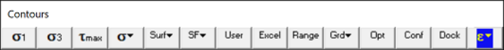
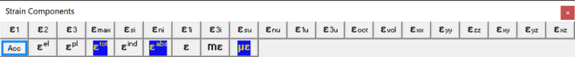
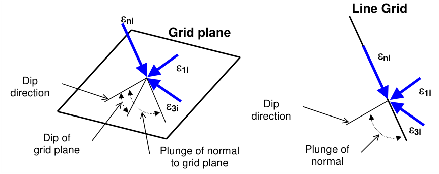
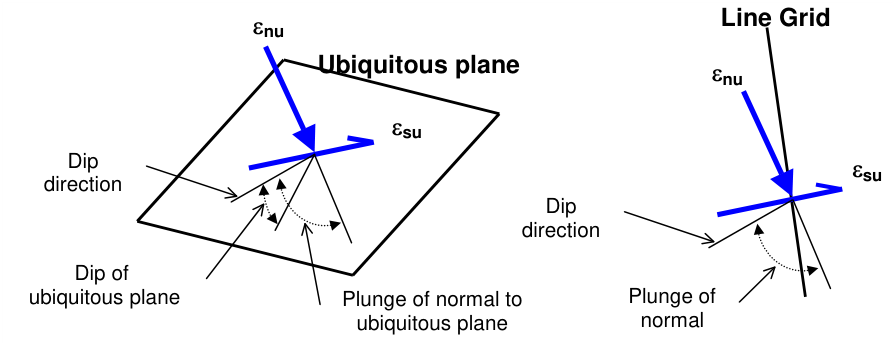
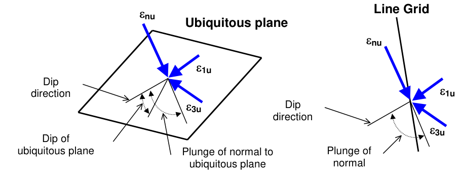

## 5.3.2.1 Größte Hauptdehnung

Stellt die größte, mittlere und kleinste Hauptdehnung als Konturen dar. Auf diese Komponenten kann über die Symbolleiste Strain Components wie folgt zugegriffen werden:

Diese Symbolleiste kann auf vertikale Ausrichtung umgestellt werden, indem sie an den rechten oder linken Rand des Hauptfensters gezogen wird.

Durch Ziehen an den oberen oder unteren Rand des Hauptfensters kann sie wieder horizontal ausgerichtet werden.

Mit der Schaltfläche in der Symbolleiste Contours wird die Symbolleiste Stress Components aktiviert.

Diese Symbolleiste kann auf vertikale Ausrichtung umgestellt werden, indem sie an den rechten oder linken Rand des Hauptfensters gezogen wird.

Durch Ziehen an den oberen oder unteren Rand des Hauptfensters kann sie wieder horizontal ausgerichtet werden.

Mit der Schaltfläche in der Symbolleiste Contours wird die Symbolleiste Strain Components aktiviert.

Sie können diese Schaltfläche über die Konfigurationsschaltfläche zur Symbolleiste Contours hinzufügen.

In der elastischen Analyse wird die größte Hauptspannung üblicherweise zusammen mit der kleinsten Hauptspannung und dem Festigkeitskriterium nach Mohr-Coulomb oder Hoek-Brown verwendet, um das Ausmaß der Schädigung durch Überbeanspruchung abzuschätzen. Dagegen können Spannungen in der nichtlinearen Analyse die Festigkeit nie überschreiten, es sei denn, es wird Kriechen verwendet. In diesem Fall kann viskoses Kriechen Spannungszustände oberhalb des Bruchkriteriums zulassen, was auf fehlendes statisches Gleichgewicht hinweist. Daher betrachtet man bei der nichtlinearen Analyse üblicherweise direkt das Ausmaß der nichtlinearen Dehnung oder die vom Modell vorhergesagte Dehnungsrate

Mohr-Coulomb in 3D FF blocks

#### Accumulated Damage:

Bei der plastischen Analyse kann die Funktion für kumulierte Schädigung aktiviert werden. Ist Acc nicht aktiviert, wird der aktuelle Wert der plastischen Dehnung verwendet. Ist Acc aktiviert, wird die Schädigung von Schritt 1 bis zum aktuellen Schritt über die gesamte Belastungsgeschichte des Modells verfolgt; dargestellt wird daher der ungünstigste (maximale) Wert der plastischen Dehnung.

Beachten Sie, dass sowohl der Schritt, in dem erstmals Fließen auftritt (MStep 1st Yield), als auch der Schritt, in dem die maximale plastische Dehnung auftritt (MStep Max Yield), verfolgt werden und als Trajektorienbeschriftungen angezeigt werden können.

#### Strain Components:

Beachten Sie, dass drei Dehnungskomponenten als Konturen dargestellt werden können:

Plot > Strain > Value > Elastic Plot > Strain > Value > Plastic Plot > Strain > Value > Total

Außerdem gibt es zwei verschiedene Arten, die Dehnung darzustellen:

Plot > Strain > Value > Induced Strain Plot > Strain > Value > Absolute Strain

Der Konturbereich wird festgelegt mit

#### Plot > Range

Jede dieser Komponenten kann bei Bedarf der Konturen-Symbolleiste hinzugefügt werden

Tools > Configure Contouring Toolbar > Strain

Es kann praktisch sein, die Schaltfläche

#### More Strain Components

der Konturen-Symbolleiste hinzuzufügen, um schnell auf alle Dehnungskomponenten zuzugreifen.

## 5.3.2.4 Maximale Scherdehnung

Stellt die maximale Scherdehnung ½( e1 - e3 ) als Konturen dar

Auf diese Komponente kann über die Symbolleiste Strain Components wie folgt zugegriffen werden:

Diese Symbolleiste kann auf vertikale Ausrichtung umgestellt werden, indem sie an den rechten oder linken Rand des Hauptfensters gezogen wird.

Durch Ziehen an den oberen oder unteren Rand des Hauptfensters kann sie wieder horizontal ausgerichtet werden.

Mit der Schaltfläche in der Symbolleiste Contours wird die Symbolleiste Stress Components aktiviert.

Sie können diese Schaltfläche über die Konfigurationsschaltfläche zur Symbolleiste Contours hinzufügen.

In der elastischen Analyse wird die größte Hauptspannung üblicherweise zusammen mit der kleinsten Hauptspannung und dem Festigkeitskriterium nach Mohr-Coulomb oder Hoek-Brown verwendet, um das Ausmaß der Schädigung durch Überbeanspruchung abzuschätzen. Dagegen können Spannungen in der nichtlinearen Analyse die Festigkeit nie überschreiten, es sei denn, es wird Kriechen verwendet. In diesem Fall kann viskoses Kriechen Spannungszustände oberhalb des Bruchkriteriums zulassen, was auf fehlendes statisches Gleichgewicht hinweist. Daher betrachtet man bei der nichtlinearen Analyse üblicherweise direkt das Ausmaß der nichtlinearen Dehnung oder die vom Modell vorhergesagte Dehnungsrate

Mohr-Coulomb in 3D FF blocks

Beachten Sie, dass drei Dehnungskomponenten als Konturen dargestellt werden können:

Plot > Strain > Value > Elastic Plot > Strain > Value > Plastic Plot > Strain > Value > Total

Außerdem gibt es zwei verschiedene Arten, die Dehnung darzustellen:

Plot > Strain > Value > Induced Strain Plot > Strain > Value > Absolute Strain

Der Konturbereich wird festgelegt mit

#### Plot > Range

Jede dieser Komponenten kann bei Bedarf der Konturen-Symbolleiste hinzugefügt werden

Tools > Configure Contouring Toolbar > Strain

Es kann praktisch sein, die Schaltfläche

#### More Strain Components

der Konturen-Symbolleiste hinzuzufügen, um schnell auf alle Dehnungskomponenten zuzugreifen.

## 5.3.2.5 Scherdehnung in der Ebene

Stellt die maximale Scherdehnung, die auf die Rasterebene wirkt, sowie die Dehnungskomponente normal zur Rasterebene oder parallel zu einem Linienraster als Konturen dar.

Auf diese Komponenten kann über die Symbolleiste Strain Components wie folgt zugegriffen werden:

Diese Symbolleiste kann auf vertikale Ausrichtung umgestellt werden, indem sie an den rechten oder linken Rand des Hauptfensters gezogen wird.

Durch Ziehen an den oberen oder unteren Rand des Hauptfensters kann sie wieder horizontal ausgerichtet werden.

Mit der Schaltfläche in der Symbolleiste Contours wird die Symbolleiste Stress Components aktiviert.

Sie können diese Schaltfläche über die Konfigurationsschaltfläche zur Symbolleiste Contours hinzufügen.

#### Plot > Grid Selection

Zur Berechnung der Dehnungen in der Ebene wird der Dehnungszustand an jedem Punkt der Rasterebene umorientiert, um die maximale Scherdehnung parallel zur Rasterebene und die Dehnung normal zur Ebene zu bestimmen. Beachten Sie, dass eip normal zur Rasterebene und parallel zur Richtung eines Linienrasters orientiert ist.

- Die Einfallsrichtung wird im Uhrzeigersinn von der y-Achse aus positiv gemessen.

- Das Einfallen der Ebene wird von der Horizontalen aus nach unten positiv gemessen (d. h. in Einfallsrichtung).

- Das Abtauchen der Normalen wird von der Horizontalen aus nach unten positiv (d. h. nach oben negativ) gemessen.

In der elastischen Analyse wird die maximale Schubspannung in der Ebene üblicherweise zusammen mit der Normalspannung in der Ebene und dem Festigkeitskriterium nach Mohr-Coulomb verwendet

Mohr-Coulomb in 3D FF blocks

um das Ausmaß der Schädigung durch Überbeanspruchung abzuschätzen. Dagegen können Spannungen in der nichtlinearen Analyse die Festigkeit nie überschreiten, es sei denn, es wird Kriechen verwendet. In diesem Fall kann viskoses Kriechen Spannungszustände oberhalb des Bruchkriteriums zulassen, was auf fehlendes statisches Gleichgewicht hinweist. Daher betrachtet man bei der nichtlinearen Analyse üblicherweise direkt das Ausmaß der nichtlinearen Dehnung oder die vom Modell vorhergesagte Dehnungsrate

Mohr-Coulomb in DD planes

um das Ausmaß des Gleitens durch Überbeanspruchung auf einer Störung, Kluftschar oder Schichtfläche abzuschätzen, die genauso orientiert ist wie die Rasterebene. Da diese Parameter richtungsabhängig sind, ist dieses Kriterium repräsentativ für die Standsicherheit eines anisotropen Gebirges.

Beachten Sie, dass drei Dehnungskomponenten als Konturen dargestellt werden können:

Plot > Strain > Value > Elastic Plot > Strain > Value > Plastic Plot > Strain > Value > Total

Außerdem gibt es zwei verschiedene Arten, die Dehnung darzustellen:

Plot > Strain > Value > Induced Strain Plot > Strain > Value > Absolute Strain

Der Konturbereich wird festgelegt mit

#### Plot > Range

Jede dieser Komponenten kann bei Bedarf der Konturen-Symbolleiste hinzugefügt werden

Tools > Configure Contouring Toolbar > Strain

Es kann praktisch sein, die Schaltfläche

#### More Strain Components

der Konturen-Symbolleiste hinzuzufügen, um schnell auf alle Dehnungskomponenten zuzugreifen.

Verwandte Themen:

Plot > Strain > e1i In-plane Maximum Plot > Strain > e3i In-plane Minimum Plot > Strain > esu Ubiquitous-plane Shear Plot > Strain > enu Ubiquitous-plane Normal

## 5.3.2.7 Maximale Dehnung in der Ebene

Stellt die maximalen und minimalen Dehnungen tangential zur aktuell ausgewählten Rasterebene oder senkrecht zu einem Linienraster als Konturen dar.

Auf diese Komponenten kann über die Symbolleiste Strain Components wie folgt zugegriffen werden:

Diese Symbolleiste kann auf vertikale Ausrichtung umgestellt werden, indem sie an den rechten oder linken Rand des Hauptfensters gezogen wird.

Durch Ziehen an den oberen oder unteren Rand des Hauptfensters kann sie wieder horizontal ausgerichtet werden.

Mit der Schaltfläche in der Symbolleiste Contours wird die Symbolleiste Stress Components aktiviert.

Sie können diese Schaltfläche über die Konfigurationsschaltfläche zur Symbolleiste Contours hinzufügen.

#### Plot > Grid Selection

Zur Berechnung der maximalen und minimalen Dehnungen in der Ebene werden die Dehnungen tangential zur Rasterebene bestimmt und anschließend aufgelöst, um den Maximal- und Minimalwert zu erhalten. Beachten Sie, dass eni normal zur Rasterebene und parallel zur Richtung eines Linienrasters orientiert ist. Beachten Sie außerdem, dass eni, e1i und e3i senkrecht aufeinander stehen.

- Die Einfallsrichtung wird im Uhrzeigersinn von der y-Achse aus positiv gemessen.

- Das Einfallen der Ebene wird von der Horizontalen aus nach unten positiv gemessen (d. h. in Einfallsrichtung).

- Das Abtauchen der Normalen wird von der Horizontalen aus nach unten positiv (d. h. nach oben negativ) gemessen.

Beachten Sie, dass drei Dehnungskomponenten als Konturen dargestellt werden können:

#### Plot > Strain > Value > Elastic

Plot > Strain > Value > Plastic Plot > Strain > Value > Total

Außerdem gibt es zwei verschiedene Arten, die Dehnung darzustellen:

Plot > Strain > Value > Induced Strain Plot > Strain > Value > Absolute Strain

Der Konturbereich wird festgelegt mit

Plot > Range

Diese Komponente kann bei Bedarf der Konturen-Symbolleiste hinzugefügt werden

Tools > Configure Contouring Toolbar > Strain

Es kann praktisch sein, die Schaltfläche

More Strain Components

der Konturen-Symbolleiste hinzuzufügen, um schnell auf alle Dehnungskomponenten zuzugreifen.

Verwandte Themen:

Plot > Strain > esi In-plane Shear Plot > Strain > eni In-plane Normal Plot > Strain > e1u Ubiquitous-plane Maximum. Plot > Strain > e3u Ubiquitous-plane Minimum.

## 5.3.2.9 Scherdehnung in der ubiquitären Ebene

Stellt die maximale Scherdehnung, die auf die ubiquitäre Ebene Nr. 1 wirkt, sowie die Dehnungskomponente normal zu dieser Ebene als Konturen dar.

Auf diese Komponenten kann über die Symbolleiste Strain Components wie folgt zugegriffen werden:

Diese Symbolleiste kann auf vertikale Ausrichtung umgestellt werden, indem sie an den rechten oder linken Rand des Hauptfensters gezogen wird.

Durch Ziehen an den oberen oder unteren Rand des Hauptfensters kann sie wieder horizontal ausgerichtet werden.

Mit der Schaltfläche in der Symbolleiste Contours wird die Symbolleiste Stress Components aktiviert.

Sie können diese Schaltfläche über die Konfigurationsschaltfläche zur Symbolleiste Contours hinzufügen.

Zur Berechnung der ubiquitären Dehnungen wird der Dehnungszustand an jedem Punkt der Rasterebene umorientiert, um die maximale Scherdehnung parallel zur ubiquitären Ebene und die Dehnung normal zur ubiquitären Ebene zu bestimmen. Beachten Sie, dass enu normal zur ubiquitären Ebene orientiert und nicht parallel zur Richtung eines Linienrasters ist.

- Die Einfallsrichtung wird im Uhrzeigersinn von der y-Achse aus positiv gemessen.

- Das Einfallen der Ebene wird von der Horizontalen aus nach unten positiv gemessen (d. h. in Einfallsrichtung).

- Das Abtauchen der Normalen wird von der Horizontalen aus nach unten positiv (d. h. nach oben negativ) gemessen.

Die Orientierung der ubiquitären Scherebene wird festgelegt mit

#### Plot > Strength Factors > Ubiquitous Parameters

Beachten Sie, dass drei Dehnungskomponenten als Konturen dargestellt werden können:

Plot > Strain > Value > Elastic Plot > Strain > Value > Plastic Plot > Strain > Value > Total

Außerdem gibt es zwei verschiedene Arten, die Dehnung darzustellen:

Plot > Strain > Value > Induced Strain Plot > Strain > Value > Absolute Strain

Der Konturbereich wird festgelegt mit

#### Plot > Range

Diese Komponente kann bei Bedarf der Konturen-Symbolleiste hinzugefügt werden

Tools > Configure Contouring Toolbar > Strain

Es kann praktisch sein, die Schaltfläche

#### More Strain Components

der Konturen-Symbolleiste hinzuzufügen, um schnell auf alle Dehnungskomponenten zuzugreifen.

Verwandte Themen:

Plot > Strain > e1u Ubiquitous-plane Maximum. Plot > Strain > e3u Ubiquitous-plane Minimum. Plot > Strain > esi In-plane Shear Plot > Strain > eni In-plane Normal

## 5.3.2.11 Maximale Dehnung in der ubiquitären Ebene

Stellt die maximalen und minimalen Dehnungen tangential zur ubiquitären Ebene Nr. 1 als Konturen dar. Auf diese Komponenten kann über die Symbolleiste Strain Components wie folgt zugegriffen werden:

Diese Symbolleiste kann auf vertikale Ausrichtung umgestellt werden, indem sie an den rechten oder linken Rand des Hauptfensters gezogen wird.

Durch Ziehen an den oberen oder unteren Rand des Hauptfensters kann sie wieder horizontal ausgerichtet werden.

Mit der Schaltfläche in der Symbolleiste Contours wird die Symbolleiste Stress Components aktiviert.

Sie können diese Schaltfläche über die Konfigurationsschaltfläche zur Symbolleiste Contours hinzufügen.

Zur Berechnung der ubiquitären Dehnungen wird der Dehnungszustand an jedem Punkt der Rasterebene umorientiert, um die maximale und minimale Dehnung parallel zur ubiquitären Ebene zu bestimmen. Beachten Sie, dass enu nicht normal zur ubiquitären Ebene orientiert und nicht parallel zur Richtung eines Linienrasters ist.

- Die Einfallsrichtung wird im Uhrzeigersinn von der y-Achse aus positiv gemessen.

- Das Einfallen der Ebene wird von der Horizontalen aus nach unten positiv gemessen (d. h. in Einfallsrichtung).

- Das Abtauchen der Normalen wird von der Horizontalen aus nach unten positiv (d. h. nach oben negativ) gemessen.

Die Orientierung der ubiquitären Scherebene wird festgelegt mit

#### Plot > Strength Factors > Ubiquitous Parameters

Beachten Sie, dass drei Dehnungskomponenten als Konturen dargestellt werden können:

Plot > Strain > Value > Elastic Plot > Strain > Value > Plastic Plot > Strain > Value > Total

Außerdem gibt es zwei verschiedene Arten, die Dehnung darzustellen:

Plot > Strain > Value > Induced Strain Plot > Strain > Value > Absolute Strain

Der Konturbereich wird festgelegt mit

#### Plot > Range

Diese Komponente kann bei Bedarf der Konturen-Symbolleiste hinzugefügt werden

Tools > Configure Contouring Toolbar > Strain

Es kann praktisch sein, die Schaltfläche

#### More Strain Components

der Konturen-Symbolleiste hinzuzufügen, um schnell auf alle Dehnungskomponenten zuzugreifen.

Verwandte Themen:

Plot > Strain > esi Ubiquitous-plane Shear

Plot > Strain > eni Ubiquitous-plane Normal

Plot > Strain > e1u In-plane Maximum.

Plot > Strain > e3u In-plane Minimum.

## 5.3.2.13 Oktaedrische Scherdehnung

Stellt die oktaedrische Scherdehnung als Konturen dar

eoct = ¹/3 [ (e1 - e2)² + (e2 - e3)² +(e3 - e1)² ]½

und die Volumendehnung

evvol = (e1 + e2 + e3)

Auf diese Komponenten kann über die Symbolleiste Strain Components wie folgt zugegriffen werden:

Diese Symbolleiste kann auf vertikale Ausrichtung umgestellt werden, indem sie an den rechten oder linken Rand des Hauptfensters gezogen wird.

Durch Ziehen an den oberen oder unteren Rand des Hauptfensters kann sie wieder horizontal ausgerichtet werden.

Mit der Schaltfläche in der Symbolleiste Contours wird die Symbolleiste Stress Components aktiviert.

Sie können diese Schaltfläche über die Konfigurationsschaltfläche zur Symbolleiste Contours hinzufügen.

In der elastischen Analyse wird die größte Hauptspannung üblicherweise zusammen mit der kleinsten Hauptspannung und dem Festigkeitskriterium nach Mohr-Coulomb oder Hoek-Brown verwendet, um das Ausmaß der Schädigung durch Überbeanspruchung abzuschätzen.

Dagegen können Spannungen in der nichtlinearen Analyse die Festigkeit nie überschreiten, es sei denn, es wird Kriechen verwendet. In diesem Fall kann viskoses Kriechen Spannungszustände oberhalb des Bruchkriteriums zulassen, was auf fehlendes statisches Gleichgewicht hinweist. Daher betrachtet man bei der nichtlinearen Analyse üblicherweise direkt das Ausmaß der nichtlinearen Dehnung oder die vom Modell vorhergesagte Dehnungsrate

Mohr-Coulomb in 3D FF blocks

Beachten Sie, dass drei Dehnungskomponenten als Konturen dargestellt werden können:

Plot > Strain > Value > Elastic Plot > Strain > Value > Plastic Plot > Strain > Value > Total

Außerdem gibt es zwei verschiedene Arten, die Dehnung darzustellen:

Plot > Strain > Value > Induced Strain Plot > Strain > Value > Absolute Strain

Der Konturbereich wird festgelegt mit

#### Plot > Range

Diese Komponente kann bei Bedarf der Konturen-Symbolleiste hinzugefügt werden

Tools > Configure Contouring Toolbar > Strain

Es kann praktisch sein, die Schaltfläche

#### More Strain Components

der Konturen-Symbolleiste hinzuzufügen, um schnell auf alle Dehnungskomponenten zuzugreifen.

## 5.3.2.15 Dehnungskomponente Exx

Stellt die kartesischen Dehnungskomponenten als Konturen dar. Auf diese Komponenten kann über die Symbolleiste Strain Components wie folgt zugegriffen werden:

Diese Symbolleiste kann auf vertikale Ausrichtung umgestellt werden, indem sie an den rechten oder linken Rand des Hauptfensters gezogen wird.

Durch Ziehen an den oberen oder unteren Rand des Hauptfensters kann sie wieder horizontal ausgerichtet werden.

Mit der Schaltfläche in der Symbolleiste Contours wird die Symbolleiste Stress Components aktiviert.

Sie können diese Schaltfläche über die Konfigurationsschaltfläche zur Symbolleiste Contours hinzufügen.

Plot > Strain >  exx Cartesian Strain Component   Normaldehnung in Richtung der x-Achse Plot > Strain >  eyy Cartesian Strain Component   Normaldehnung in Richtung der y-Achse Plot > Strain >  ezz Cartesian Strain Component   Normaldehnung in Richtung der z-Achse Plot > Strain >  exy Cartesian Strain Component   Normaldehnung in Richtung der x-y-Ebene Plot > Strain >  eyz Cartesian Strain Component   Normaldehnung in Richtung der y-z-Ebene Plot > Strain >  exz Cartesian Strain Component   Normaldehnung in Richtung der x-z-Ebene

Beachten Sie, dass drei Dehnungskomponenten als Konturen dargestellt werden können:

Plot > Strain > Value > Elastic Plot > Strain > Value > Plastic Plot > Strain > Value > Total

Außerdem gibt es zwei verschiedene Arten, die Dehnung darzustellen:

Plot > Strain > Value > Induced Strain Plot > Strain > Value > Absolute Strain

Der Konturbereich wird festgelegt mit

#### Plot > Range

Diese Komponente kann bei Bedarf der Konturen-Symbolleiste hinzugefügt werden

Tools > Configure Contouring Toolbar > Strain

Es kann praktisch sein, die Schaltfläche

More Strain Components

der Konturen-Symbolleiste hinzuzufügen, um schnell auf alle Dehnungskomponenten zuzugreifen.

## 5.3.2.21 Wert

5.3.2.21.1  Elastische Dehnung

Wählt die elastische, plastische oder gesamte Dehnungskomponente aus. Auf diese Komponenten kann über die Symbolleiste Strain Components wie folgt zugegriffen werden:

Diese Symbolleiste kann auf vertikale Ausrichtung umgestellt werden, indem sie an den rechten oder linken Rand des Hauptfensters gezogen wird.

Durch Ziehen an den oberen oder unteren Rand des Hauptfensters kann sie wieder horizontal ausgerichtet werden.

Mit der Schaltfläche in der Symbolleiste Contours wird die Symbolleiste Stress Components aktiviert.

Sie können diese Schaltfläche über die Konfigurationsschaltfläche zur Symbolleiste Contours hinzufügen.

Einzelheiten finden Sie unter

Mohr-Coulomb in 3D FF blocks.

### 5.3.2.21.4 Induzierte Dehnung

Stellt die induzierte oder absolute Dehnungskomponente dar.

Auf diese Komponente kann über die Symbolleiste Strain Components wie folgt zugegriffen werden:

Diese Symbolleiste kann auf vertikale Ausrichtung umgestellt werden, indem sie an den rechten oder linken Rand des Hauptfensters gezogen wird.

Durch Ziehen an den oberen oder unteren Rand des Hauptfensters kann sie wieder horizontal ausgerichtet werden.

Mit der Schaltfläche in der Symbolleiste Contours wird die Symbolleiste Stress Components aktiviert.

Sie können diese Schaltfläche über die Konfigurationsschaltfläche zur Symbolleiste Contours hinzufügen.

Die induzierte Dehnung ist die Dehnung ohne den Beitrag der Dehnung vor dem Abbau. Sie stellt die Dehnungsänderung gegenüber dem Zustand vor dem Abbau dar.

Die absolute Dehnung ist die Dehnung einschließlich des Beitrags der Dehnung vor dem Abbau.

Siehe auch:

Plot > Stress > Value > Induced Strain Plot > Stress > Value > Absolute Strain

### 5.3.2.21.6 Dehnung

Stellt die Dehnung dar:

- in nicht skalierten Einheiten (Dehnung/1),

- in Milli-Dehnung (Dehnung/1000),

- in Mikro-Dehnung (Dehnung/1000000).

Auf diese Komponente kann über die Symbolleiste Strain Components wie folgt zugegriffen werden:

Diese Symbolleiste kann auf vertikale Ausrichtung umgestellt werden, indem sie an den rechten oder linken Rand des Hauptfensters gezogen wird.

Durch Ziehen an den oberen oder unteren Rand des Hauptfensters kann sie wieder horizontal ausgerichtet werden.

Mit der Schaltfläche in der Symbolleiste Contours wird die Symbolleiste Stress Components aktiviert.

Sie können diese Schaltfläche über die Konfigurationsschaltfläche zur Symbolleiste Contours hinzufügen.

