## 5.3.6.1 Gebirgsparameter

### 5.3.6.1.1 Gebirgsfestigkeitsparameter

Legt die Festigkeitsparameter für die Erzeugung von Konturdarstellungen der Festigkeitsfaktoren in Abhängigkeit von den Hauptspannungskomponenten fest.

Auf diese Komponenten kann über die Symbolleiste Strength Factor Components wie folgt zugegriffen werden:

Diese Symbolleiste kann auf vertikale Ausrichtung umgestellt werden, indem sie an den rechten oder linken Rand des Hauptfensters gezogen wird.

Durch Ziehen an den oberen oder unteren Rand des Hauptfensters kann sie wieder horizontal ausgerichtet werden.

Mit der Schaltfläche in der Symbolleiste Contours wird die Symbolleiste Strength Factor Components aktiviert.

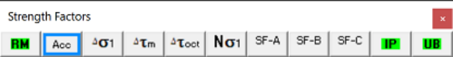

In der elastischen Analyse können die größte und die kleinste Hauptspannung mit den Festigkeitskriterien nach Mohr-Coulomb, Hoek-Brown oder Drucker-Prager verwendet werden, um das Ausmaß der Schädigung durch Überbeanspruchung abzuschätzen. Da keiner der Parameter richtungsabhängig ist, ist dieses Kriterium repräsentativ für die Standsicherheit eines homogenen Gebirges.

Dagegen können Spannungen in der nichtlinearen Analyse die Festigkeit nie überschreiten, es sei denn, es wird Kriechen verwendet. In diesem Fall kann viskoses Kriechen Spannungszustände oberhalb des Bruchkriteriums zulassen, was auf fehlendes statisches Gleichgewicht hinweist. Daher betrachtet man bei der nichtlinearen Analyse üblicherweise direkt das Ausmaß der nichtlinearen Dehnung oder die vom Modell vorhergesagte Dehnungsrate

Mohr-Coulomb in 3D FF blocks.

#### Mohr-Coulomb

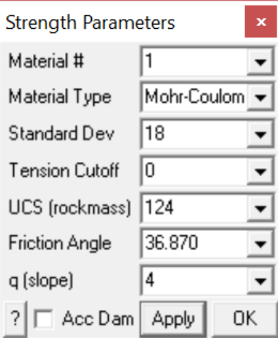

Material # legt die Materialnummer fest. Material Nr. 1 stellt das Nebengestein (host) dar. Andere Materialnummern dienen zur Definition von Zonen mit abweichendem Material wie Erz, Störungsletten (Gouge), Versatz usw.

Standard Deviation legt die Unsicherheit des Bruchkriteriums fest, gemessen in Richtung s1.

Material Type legt den Materialtyp fest: Mohr-Coulomb, Hoek-Brown, Drucker-Prager oder None.

Tension Cutoff, UCS, Friction Angle das Mohr-Coulomb-Kriterium definiert die Festigkeit in Abhängigkeit von den Hauptspannungen wie folgt:

#### Mohr-Coulomb

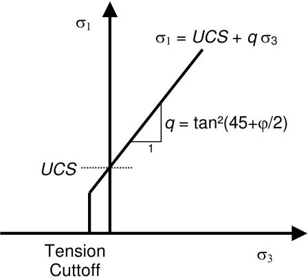

Zuggrenze (Tension Cutoff) und UCS werden in Spannungseinheiten angegeben (MPa oder psi). Der Reibungswinkel wird in Grad angegeben.

Apply – erzeugt die Konturdarstellung neu.

Acc Dam – stellt die akkumulierte Schädigung dar. Siehe Accumulated Damage

#### Hoek-Brown

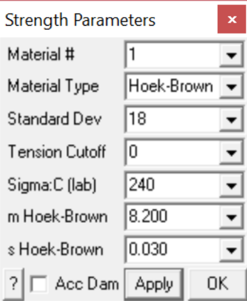

Material # legt die Materialnummer fest. Material Nr. 1 stellt das Nebengestein (host) dar. Andere Materialnummern dienen zur Definition von Zonen mit abweichendem Material wie Erz, Störungsletten (Gouge), Versatz usw.

Material Type legt den Materialtyp fest: Mohr-Coulomb, Hoek-Brown, Drucker-Prager oder None.

Standard Deviation legt die Unsicherheit des Bruchkriteriums fest, gemessen in Richtung s1 (angegeben in Spannungseinheiten, MPa oder psi).

Tension Cutoff, Sigma:C, m and s das Hoek-Brown-Kriterium definiert die Festigkeit in Abhängigkeit von den Hauptspannungen wie folgt:

#### Hoek-Brown

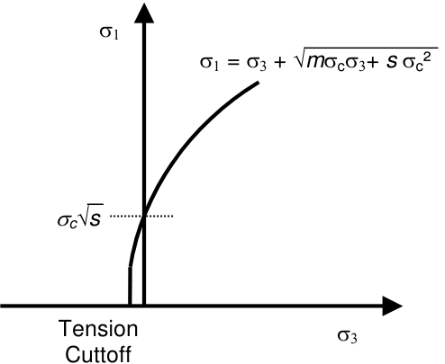

Zuggrenze (Tension Cutoff) und Sigma:C werden in Spannungseinheiten angegeben (MPa oder psi).

Apply – erzeugt die Konturdarstellung neu.

Acc Dam – stellt die akkumulierte Schädigung dar. Siehe Accumulated Damage

#### Drucker-Prager

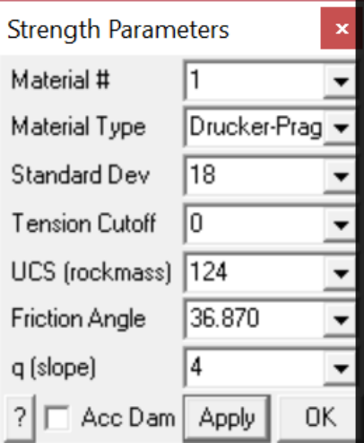

Material # legt die Materialnummer fest. Material Nr. 1 stellt das Nebengestein (host) dar. Andere Materialnummern dienen zur Definition von Zonen mit abweichendem Material wie Erz, Störungsletten (Gouge), Versatz usw. Material Type legt den Materialtyp fest: Mohr-Coulomb, Hoek-Brown, Drucker-Prager oder None.

Standard Deviation legt die Unsicherheit des Bruchkriteriums fest, gemessen in Richtung toct.

Tension Cutoff, UCS, Friction Angle das Drucker-Prager-Kriterium definiert die Festigkeit in Abhängigkeit von den Hauptspannungen wie folgt:

#### Drucker-Prager

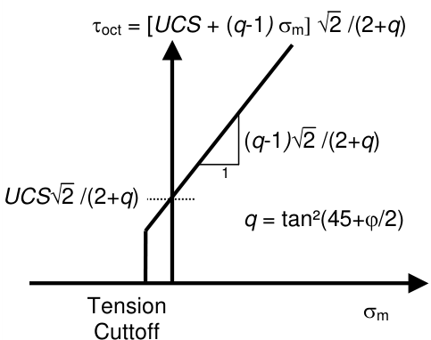

wobei

toct = ¹/3 [(s1 - s2)² + (s2 - s3)² +(s3 - s1)²]½

smean = ¹/3 (s1 + s2 + s3)

Zuggrenze (Tension Cutoff) und UCS werden in Spannungseinheiten angegeben (MPa oder psi). Der Reibungswinkel wird in Grad angegeben.

Beachten Sie, dass die Festigkeitsparameter so gewählt wurden, dass sich das Kriterium auf das Mohr-Coulomb-Kriterium vereinfacht, wenn s2 gleich s3 ist.

Apply – erzeugt die Konturdarstellung neu.

Acc Dam – stellt die akkumulierte Schädigung dar. Siehe Accumulated Damage

#### Verwandte Themen:

Plot > Strength Factor > Probability N-distribution

Plot > Strength Factor > SF-A - Strength/Stress Plot > Strength Factor > SF-B - Strength/Stress Plot > Strength Factors > SF-C - Strength/Stress Plot > Strength Factors > dS1 - Excess Stress Plot > Strength Factors > dTmax - Excess Stress

Plot > Strength Factors > dToct - Excess Stress

Plot > Strength Factors > In-plane Parameters

Plot > Strength Factors > Ubiquitous Parameters

### 5.3.6.1.2 Akkumulierte Schädigung

Stellt die akkumulierte Schädigung dar.

Auf diese Komponente kann über die Symbolleiste Strength Factor Components wie folgt zugegriffen werden:

Diese Symbolleiste kann auf vertikale Ausrichtung umgestellt werden, indem sie an den rechten oder linken Rand des Hauptfensters gezogen wird.

Durch Ziehen an den oberen oder unteren Rand des Hauptfensters kann sie wieder horizontal ausgerichtet werden.

Mit der Schaltfläche in der Symbolleiste Contours wird die Symbolleiste Strength Factor Components aktiviert.

Ist Acc nicht aktiviert, werden Überschussspannung, Bruchwahrscheinlichkeit, Festigkeitsfaktor und RCF für die aktuellen Spannungswerte dargestellt.

Ist Acc aktiviert, wird die Schädigung von Schritt 1 bis zum aktuellen Schritt über die gesamte Belastungsgeschichte des Modells verfolgt; dargestellt wird daher der ungünstigste Fall der Überschussspannung, der Bruchwahrscheinlichkeit, des Festigkeitsfaktors bzw. des RCF.

So lassen sich Ergebnisse der elastischen Spannungsanalyse ähnlich wie die akkumulierte Dehnung in einem Plastizitätsmodell verwenden.

Die Schädigungsverfolgung erfolgt getrennt für die folgenden 5 Fälle:

1. Gebirgsbruch (Überschuss-S1-Spannung, Wahrscheinlichkeit, Festigkeitsfaktor) 2. Scherbruch in der Ebene (Überschuss-Schubspannung, Wahrscheinlichkeit, Festigkeitsfaktor) 3. Scherbruch in der ub-Ebene (Überschuss-Schubspannung, Wahrscheinlichkeit, Festigkeitsfaktor)

4. Überschuss-Wandspannung in der Ebene (Überschussspannung, RCF)

5. Überschuss-Wandspannung in der ub-Ebene (Überschussspannung, RCF)

Beachten Sie, dass sowohl der Schritt, in dem erstmals Fließen auftritt (MStep 1st Yield), als auch der Schritt, in dem die maximale Überschussspannung auftritt (MStep Max Yield), verfolgt werden und als Trajektorienbeschriftungen angezeigt werden können.

### 5.3.6.1.3 S1-Überschussspannung

Stellt die überschüssige größte Hauptspannung und den Festigkeitsfaktor nach Methode „A“ als Konturen dar. Auf diese Komponenten kann über die Symbolleiste Strength Factor Components wie folgt zugegriffen werden:

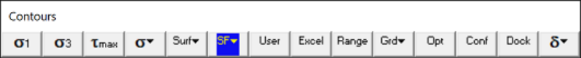

Diese Symbolleiste kann auf vertikale Ausrichtung umgestellt werden, indem sie an den rechten oder linken Rand des Hauptfensters gezogen wird.

Durch Ziehen an den oberen oder unteren Rand des Hauptfensters kann sie wieder horizontal ausgerichtet werden.

Mit der

Schaltfläche in der Symbolleiste Contours wird die Symbolleiste Strength Factor Components aktiviert.

In der elastischen Analyse können die größte und die kleinste Hauptspannung mit den Festigkeitskriterien nach Mohr-Coulomb oder Hoek-Brown verwendet werden

#### Plot > Strength Factors > Strength Parameters

um das Ausmaß der Schädigung durch Überbeanspruchung abzuschätzen. Da keiner der Parameter richtungsabhängig ist, ist dieses Kriterium repräsentativ für die Standsicherheit eines homogenen Gebirges.

Dagegen können Spannungen in der nichtlinearen Analyse die Festigkeit nie überschreiten, es sei denn, es wird Kriechen verwendet. In diesem Fall kann viskoses Kriechen Spannungszustände oberhalb des Bruchkriteriums zulassen, was auf fehlendes statisches Gleichgewicht hinweist. Daher betrachtet man bei der nichtlinearen Analyse üblicherweise direkt das Ausmaß der nichtlinearen Dehnung oder die vom Modell vorhergesagte Dehnungsrate

Mohr-Coulomb in 3D FF blocks.

Methode „A“ nimmt an, dass der Spannungspfad bis zum Bruch durch Erhöhung von s1 ohne Verlust des Einspanndrucks verläuft. Dies ist repräsentativ für das Versagen eines Pfeilers, bei dem s1 als treibende Kraft betrachtet wird.

#### Mohr-Coulomb

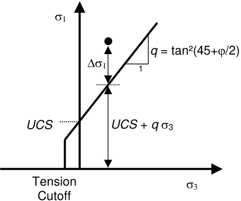

Plot > Strength Factors > SF-A   Strength/Stress kann bestimmt werden als ( _UCS_ + _q_ s3 )/ s1 Plot > Strength Factors > SF/A   Stress/Strength kann bestimmt werden als s1 / ( _UCS_ + _q_ s3 ) Plot > Strength Factors > Ds1   die Überschussspannung kann bestimmt werden als Ds1 = s1 - ( _UCS_ + _q_ s3 )

Plot > Strength Factors > N(Ds1 /std)   Wahrscheinlichkeit nach der Normalverteilung.

wie bei Methode „B“.

#### Hoek-Brown

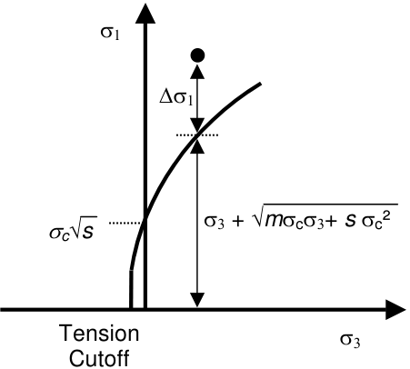

Plot > Strength Factors > SF-A   Strength/Stress kann bestimmt werden als [ s3 + Ö( _m_ scs3 + _s_ sc²) ] / s1

Plot > Strength Factors > SF/A   Stress/Strength kann bestimmt werden als s1 / [ s3 + Ö( _m_ scs3 + _s_ sc²) ]

Plot > Strength Factors > Ds1   die Überschussspannung kann bestimmt werden als Ds1 = s1 - [ s3 + Ö( _m_ scs3 + _s_ sc²) ]

Plot > Strength Factors > N(Ds1 /std)   Wahrscheinlichkeit nach der Normalverteilung.

wie bei Methode „B“.

Drucker-Prager ist nur mit Methode „C“ definiert.

Festigkeitsparameter werden eingerichtet mit

Plot > Strength Factors > Strength Parameters

Verwandte Themen:

Plot > Strength Factor > SF-B - Strength/Stress Plot > Strength Factors > SF-C - Strength/Stress Plot > Strength Factors > dTmax - Excess Stress Plot > Strength Factors > dToct - Excess Stress Plot > Strength Factors > In-plane Parameters Plot > Strength Factors > Ubiquitous Parameters

### 5.3.6.1.4 Tmax-Überschussspannung

Stellt die Überschuss-Schubspannung bzw. den Festigkeitsfaktor nach Methode „C“ als Konturen dar. Auf diese Komponenten kann über die Symbolleiste Strength Factor Components wie folgt zugegriffen werden:

Diese Symbolleiste kann auf vertikale Ausrichtung umgestellt werden, indem sie an den rechten oder linken Rand des Hauptfensters gezogen wird.

Durch Ziehen an den oberen oder unteren Rand des Hauptfensters kann sie wieder horizontal ausgerichtet werden.

Mit der Schaltfläche in der Symbolleiste Contours wird die Symbolleiste Strength Factor Components aktiviert.

In der elastischen Analyse können die größte und die kleinste Hauptspannung mit den Festigkeitskriterien nach Mohr-Coulomb oder Hoek-Brown verwendet werden

Plot > Strength Factors > Strength Parameters

um das Ausmaß der Schädigung durch Überbeanspruchung abzuschätzen. Da keiner der Parameter richtungsabhängig ist, ist dieses Kriterium repräsentativ für die Standsicherheit eines homogenen Gebirges.

Dagegen können Spannungen in der nichtlinearen Analyse die Festigkeit nie überschreiten, es sei denn, es wird Kriechen verwendet. In diesem Fall kann viskoses Kriechen Spannungszustände oberhalb des Bruchkriteriums zulassen, was auf fehlendes statisches Gleichgewicht hinweist. Daher betrachtet man bei der nichtlinearen Analyse üblicherweise direkt das Ausmaß der nichtlinearen Dehnung oder die vom Modell vorhergesagte Dehnungsrate

Mohr-Coulomb in 3D FF blocks.

Methode „C“ nimmt an, dass der Spannungspfad bis zum Bruch durch Erhöhung von s1 unter Verlust des Einspanndrucks verläuft. Dies ist repräsentativ für das Versagen eines Widerlagers (Abutment), bei dem s1 - s3 als treibende Kraft betrachtet wird.

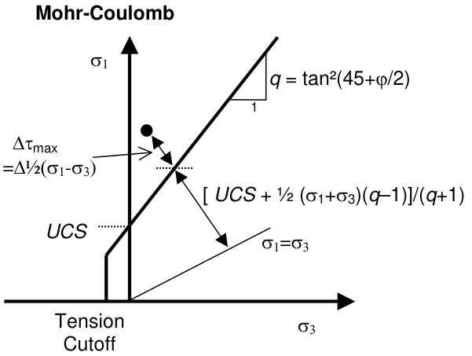

Plot > Strength Factors > SF-C   Strength/Stress kann bestimmt werden als [ _UCS_ + ½(s1+s3) ( _q_ - 1) ]/[ ½(s1 - s3)( _q_ +1) ]

Plot > Strength Factors > SF/C   Stress/Strength kann bestimmt werden als [ ½(s1 - s3)( _q_ +1) ]/ [ _UCS_ + ½(s1+s3) ( _q_ -1) ]

Plot > Strength Factors > Dtmax   die Überschussspannung kann bestimmt werden als

Dtmax = ½(s1 - s3) - [ _UCS_ + ½(s1+s3) ( _q_ -1) ]/( _q_ +1)

= [s1 - ( _UCS_ + _q_ s3) ]/( _q_ +1)

#### Hoek-Brown

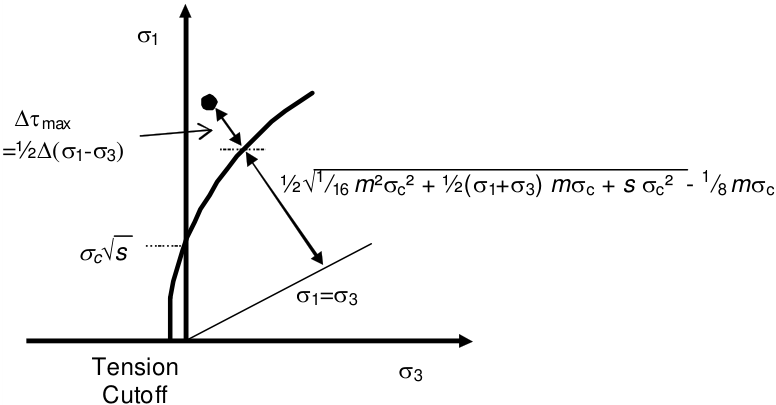

Plot > Strength Factors > SF-C   Strength/Stress kann bestimmt werden als &#123; Ö[1 /16 _m_ ²sc² + ½(s1 + s3) _m_ sc + _s_ sc²] - ¼ _m_ sc&#125;/(s1 - s3)

Plot > Strength Factors > SF/C   Stress/Strength kann bestimmt werden als (s1 - s3)/&#123; Ö[1 /16 _m_ ²sc² + ½(s1 + s3) _m_ sc + _s_ sc²] - ¼ _m_ sc &#125;

Plot > Strength Factors > Dtmax   die Überschussspannung kann bestimmt werden als

Dtmax = ½(s1 - s3) - ½&#123; Ö[1 /16 _m_ ²sc² + ½(s1 + s3) _m_ sc + _s_ sc²] - ¼ _m_ sc &#125;

#### Drucker-Prager

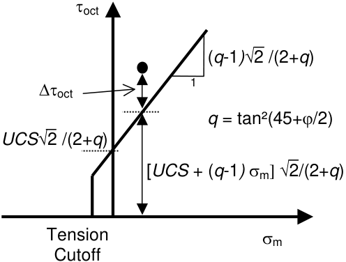

SF-C Strength/Stress   kann bestimmt werden als [ _UCS_ + ( _q_ –1) smean ] Ö(2) /[ toct ( _q_ +2) ]

SF-C Stress/Strength   kann bestimmt werden als toct /[ _UCS_ + ( _q_ –1) smean ] Ö(2) /( _q_ +2) Dtoct Excess   kann bestimmt werden als toct - [ _UCS_ + ( _q_ –1) smean ] Ö(2) /( _q_ +2)

wobei

_q_ = tan²(45+j/2) toct = ¹/3 Ö[( s1 - s2 )² + ( s2 - s3 )² +( s3 - s1 )²] smean = ¹/3 ( s1 + s2 + s3 )

Beachten Sie, dass die Festigkeitsparameter so gewählt wurden, dass sich das Kriterium auf das Mohr-Coulomb-Kriterium vereinfacht, wenn s2 gleich s3 ist.

Festigkeitsparameter werden eingerichtet mit

Plot > Strength Factors > Strength Parameters

Verwandte Themen:

Plot > Strength Factor > SF-A - Stress/Strength Plot > Strength Factors > SF-B - Stress/Strength Plot > Strength Factors > dS1 - Excess Stress Plot > Strength Factors > In-plane Parameters Plot > Strength Factors > Ubiquitous Parameters

5.3.6.1.6  NS1 Normalverteilungswahrscheinlichkeit

Stellt die überschüssige größte Hauptspannung und den Festigkeitsfaktor nach Methode „A“ als Konturen dar. Auf diese Komponenten kann über die Symbolleiste Strength Factor Components wie folgt zugegriffen werden:

Diese Symbolleiste kann auf vertikale Ausrichtung umgestellt werden, indem sie an den rechten oder linken Rand des Hauptfensters gezogen wird.

Durch Ziehen an den oberen oder unteren Rand des Hauptfensters kann sie wieder horizontal ausgerichtet werden.

Mit der Schaltfläche in der Symbolleiste Contours wird die Symbolleiste Strength Factor Components aktiviert.

In der elastischen Analyse können die größte und die kleinste Hauptspannung mit den Festigkeitskriterien nach Mohr-Coulomb oder Hoek-Brown verwendet werden

Plot > Strength Factors > Strength Parameters

um das Ausmaß der Schädigung durch Überbeanspruchung abzuschätzen. Da keiner der Parameter richtungsabhängig ist, ist dieses Kriterium repräsentativ für die Standsicherheit eines homogenen Gebirges.

Dagegen können Spannungen in der nichtlinearen Analyse die Festigkeit nie überschreiten, es sei denn, es wird Kriechen verwendet. In diesem Fall kann viskoses Kriechen Spannungszustände oberhalb des Bruchkriteriums zulassen, was auf fehlendes statisches Gleichgewicht hinweist. Daher betrachtet man bei der nichtlinearen Analyse üblicherweise direkt das Ausmaß der nichtlinearen Dehnung oder die vom Modell vorhergesagte Dehnungsrate

Mohr-Coulomb in 3D FF blocks.

Methode „A“ nimmt an, dass der Spannungspfad bis zum Bruch durch Erhöhung von s1 ohne Verlust des Einspanndrucks verläuft. Dies ist repräsentativ für das Versagen eines Pfeilers, bei dem s1 als treibende Kraft betrachtet wird.

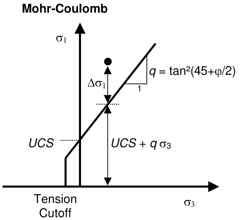

Plot > Strength Factors > SF-A   Strength/Stress kann bestimmt werden als ( _UCS_ + _q_ s3 )/ s1 Plot > Strength Factors > SF/A   Stress/Strength kann bestimmt werden als s1 / ( _UCS_ + _q_ s3 ) Plot > Strength Factors > Ds1   die Überschussspannung kann bestimmt werden als Ds1 = s1 - ( _UCS_ + _q_ s3 )

Plot > Strength Factors > N(Ds1 /std)   Wahrscheinlichkeit nach der Normalverteilung.

wie bei Methode „B“.

#### Hoek-Brown

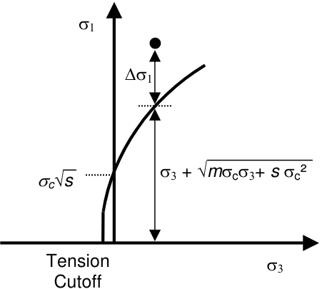

Plot > Strength Factors > SF-A   Strength/Stress kann bestimmt werden als [ s3 + Ö( _m_ scs3 + _s_ sc²) ] / s1

Plot > Strength Factors > SF/A   Stress/Strength kann bestimmt werden als s1 / [ s3 + Ö( _m_ scs3 + _s_ sc²) ]

Plot > Strength Factors > Ds1   die Überschussspannung kann bestimmt werden als Ds1 = s1 - [ s3 + Ö( _m_ scs3 + _s_ sc²) ]

Plot > Strength Factors > N(Ds1 /std)   Wahrscheinlichkeit nach der Normalverteilung.

wie bei Methode „B“.

Drucker-Prager ist nur mit Methode „C“ definiert.

Festigkeitsparameter werden eingerichtet mit

Plot > Strength Factors > Strength Parameters

Verwandte Themen:

Plot > Strength Factor > SF-B - Strength/Stress Plot > Strength Factors > SF-C - Strength/Stress Plot > Strength Factors > dTmax - Excess Stress Plot > Strength Factors > dToct - Excess Stress Plot > Strength Factors > In-plane Parameters Plot > Strength Factors > Ubiquitous Parameters

### 5.3.6.1.8 SF-B Festigkeit/Spannung

Stellt die überschüssige größte Hauptspannung und den Festigkeitsfaktor nach Methode „B“ als Konturen dar. Auf diese Komponenten kann über die Symbolleiste Strength Factor Components wie folgt zugegriffen werden:

Diese Symbolleiste kann auf vertikale Ausrichtung umgestellt werden, indem sie an den rechten oder linken Rand des Hauptfensters gezogen wird.

Durch Ziehen an den oberen oder unteren Rand des Hauptfensters kann sie wieder horizontal ausgerichtet werden.

Mit der

Schaltfläche in der Symbolleiste Contours wird die Symbolleiste Strength Factor Components aktiviert.

In der elastischen Analyse können die größte und die kleinste Hauptspannung mit den Festigkeitskriterien nach Mohr-Coulomb oder Hoek-Brown verwendet werden

#### Plot > Strength Factors > Strength Parameters

um das Ausmaß der Schädigung durch Überbeanspruchung abzuschätzen. Da keiner der Parameter richtungsabhängig ist, ist dieses Kriterium repräsentativ für die Standsicherheit eines homogenen Gebirges.

Dagegen können Spannungen in der nichtlinearen Analyse die Festigkeit nie überschreiten, es sei denn, es wird Kriechen verwendet. In diesem Fall kann viskoses Kriechen Spannungszustände oberhalb des Bruchkriteriums zulassen, was auf fehlendes statisches Gleichgewicht hinweist. Daher betrachtet man bei der nichtlinearen Analyse üblicherweise direkt das Ausmaß der nichtlinearen Dehnung oder die vom Modell vorhergesagte Dehnungsrate

Mohr-Coulomb in 3D FF blocks.

Methode „B“ nimmt an, dass der Spannungspfad bis zum Bruch durch Erhöhung von s1 ohne Verlust des Einspanndrucks verläuft. Dies ist repräsentativ für das Versagen eines Pfeilers, bei dem s1 - s3 als treibende Kraft betrachtet wird.

#### Mohr-Coulomb

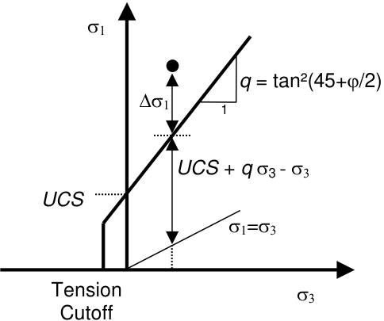

Plot > Strength Factors > SF-B   Strength/Stress kann bestimmt werden als ( _UCS_ + _q_ s3 - s3 )/(s1 - s3)

Plot > Strength Factors > SF/B   Stress/Strength kann bestimmt werden als (s1 - s3)/( _UCS_ + _q_ s3 - s3 )

Plot > Strength Factors > Ds1   die Überschussspannung kann bestimmt werden als Ds1 = s1 - ( _UCS_ + _q_ s3 )

Plot > Strength Factors > N(Ds1 /std)   Wahrscheinlichkeit nach der Normalverteilung.

wie bei Methode „A“.

#### Hoek-Brown

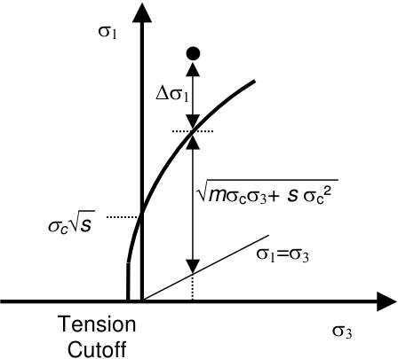

Plot > Strength Factors > SF-B   Strength/Stress kann bestimmt werden als Ö( _m_ scs3 + _s_ sc²)/(s1 - s3) Plot > Strength Factors > SF/B   Stress/Strength kann bestimmt werden als (s1 - s3)/Ö( _m_ scs3 + _s_ sc²) Plot > Strength Factors > Ds1   die Überschussspannung kann bestimmt werden als Ds1 = s1 - [ s3 + Ö( _m_ scs3 + _s_ sc²) ]

Plot > Strength Factors > N(Ds1 /std)   Wahrscheinlichkeit nach der Normalverteilung.

wie bei Methode „A“.

Drucker-Prager ist nur mit Methode „C“ definiert.

Festigkeitsparameter werden eingerichtet mit

Plot > Strength Factors > Strength Parameters

Verwandte Themen:

Plot > Strength Factor > SF-A - Strength/Stress Plot > Strength Factors > SF-C - Strength/Stress Plot > Strength Factors > dTmax - Excess Stress Plot > Strength Factors > dToct - Excess Stress Plot > Strength Factors > In-plane Parameters Plot > Strength Factors > Ubiquitous Parameters

### 5.3.6.1.9 SF-C Festigkeit/Spannung

Stellt die Überschuss-Schubspannung bzw. den Festigkeitsfaktor nach Methode „C“ als Konturen dar. Auf diese Komponenten kann über die Symbolleiste Strength Factor Components wie folgt zugegriffen werden:

Diese Symbolleiste kann auf vertikale Ausrichtung umgestellt werden, indem sie an den rechten oder linken Rand des Hauptfensters gezogen wird.

Durch Ziehen an den oberen oder unteren Rand des Hauptfensters kann sie wieder horizontal ausgerichtet werden.

Mit der Schaltfläche in der Symbolleiste Contours wird die Symbolleiste Strength Factor Components aktiviert.

In der elastischen Analyse können die größte und die kleinste Hauptspannung mit den Festigkeitskriterien nach Mohr-Coulomb oder Hoek-Brown verwendet werden

#### Plot > Strength Factors > Strength Parameters

um das Ausmaß der Schädigung durch Überbeanspruchung abzuschätzen. Da keiner der Parameter richtungsabhängig ist, ist dieses Kriterium repräsentativ für die Standsicherheit eines homogenen Gebirges.

Dagegen können Spannungen in der nichtlinearen Analyse die Festigkeit nie überschreiten, es sei denn, es wird Kriechen verwendet. In diesem Fall kann viskoses Kriechen Spannungszustände oberhalb des Bruchkriteriums zulassen, was auf fehlendes statisches Gleichgewicht hinweist. Daher betrachtet man bei der nichtlinearen Analyse üblicherweise direkt das Ausmaß der nichtlinearen Dehnung oder die vom Modell vorhergesagte Dehnungsrate

Mohr-Coulomb in 3D FF blocks.

Methode „C“ nimmt an, dass der Spannungspfad bis zum Bruch durch Erhöhung von s1 unter Verlust des Einspanndrucks verläuft. Dies ist repräsentativ für das Versagen eines Widerlagers (Abutment), bei dem s1 - s3 als treibende Kraft betrachtet wird.

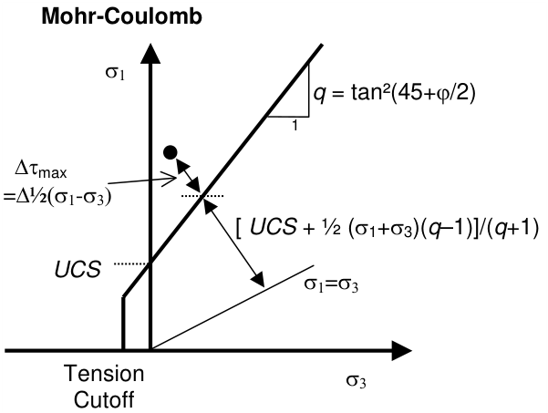

Plot > Strength Factors > SF-C   Strength/Stress kann bestimmt werden als [ _UCS_ + ½(s1+s3) ( _q_ - 1) ]/[ ½(s1 - s3)( _q_ +1) ]

Plot > Strength Factors > SF/C   Stress/Strength kann bestimmt werden als [ ½(s1 - s3)( _q_ +1) ]/ [ _UCS_ + ½(s1+s3) ( _q_ -1) ]

Plot > Strength Factors > Dtmax   die Überschussspannung kann bestimmt werden als

Dtmax = ½(s1 - s3) - [ _UCS_ + ½(s1+s3) ( _q_ -1) ]/( _q_ +1)

= [s1 - ( _UCS_ + _q_ s3) ]/( _q_ +1)

#### Hoek-Brown

Plot > Strength Factors > SF-C   Strength/Stress kann bestimmt werden als &#123; Ö[1 /16 _m_ ²sc² + ½(s1 + s3) _m_ sc + _s_ sc²] - ¼ _m_ sc&#125;/(s1 - s3)

Plot > Strength Factors > SF/C   Stress/Strength kann bestimmt werden als (s1 - s3)/&#123; Ö[1 /16 _m_ ²sc² + ½(s1 + s3) _m_ sc + _s_ sc²] - ¼ _m_ sc &#125;

Plot > Strength Factors > Dtmax   die Überschussspannung kann bestimmt werden als

Dtmax = ½(s1 - s3) - ½&#123; Ö[1 /16 _m_ ²sc² + ½(s1 + s3) _m_ sc + _s_ sc²] - ¼ _m_ sc &#125;

#### Drucker-Prager

SF-C Strength/Stress   kann bestimmt werden als [ _UCS_ + ( _q_ –1) smean ] Ö(2) /[ toct ( _q_ +2) ]

SF-C Stress/Strength   kann bestimmt werden als toct /[ _UCS_ + ( _q_ –1) smean ] Ö(2) /( _q_ +2) Dtoct Excess   kann bestimmt werden als toct - [ _UCS_ + ( _q_ –1) smean ] Ö(2) /( _q_ +2)

wobei

_q_ = tan²(45+j/2) toct = ¹/3 Ö[( s1 - s2 )² + ( s2 - s3 )² +( s3 - s1 )²] smean = ¹/3 ( s1 + s2 + s3 )

Beachten Sie, dass die Festigkeitsparameter so gewählt wurden, dass sich das Kriterium auf das Mohr-Coulomb-Kriterium vereinfacht, wenn s2 gleich s3 ist.

Festigkeitsparameter werden eingerichtet mit

Plot > Strength Factors > Strength Parameters

Verwandte Themen:

Plot > Strength Factor > SF-A - Stress/Strength Plot > Strength Factors > SF-B - Stress/Strength Plot > Strength Factors > dS1 - Excess Stress Plot > Strength Factors > In-plane Parameters Plot > Strength Factors > Ubiquitous Parameters

### 5.3.6.1.10 SF/A Spannung/Festigkeit

Stellt die überschüssige größte Hauptspannung und den Festigkeitsfaktor nach Methode „A“ als Konturen dar. Auf diese Komponenten kann über die Symbolleiste Strength Factor Components wie folgt zugegriffen werden:

Diese Symbolleiste kann auf vertikale Ausrichtung umgestellt werden, indem sie an den rechten oder linken Rand des Hauptfensters gezogen wird.

Durch Ziehen an den oberen oder unteren Rand des Hauptfensters kann sie wieder horizontal ausgerichtet werden.

Mit der Schaltfläche in der Symbolleiste Contours wird die Symbolleiste Strength Factor Components aktiviert.

In der elastischen Analyse können die größte und die kleinste Hauptspannung mit den Festigkeitskriterien nach Mohr-Coulomb oder Hoek-Brown verwendet werden

Plot > Strength Factors > Strength Parameters

um das Ausmaß der Schädigung durch Überbeanspruchung abzuschätzen. Da keiner der Parameter richtungsabhängig ist, ist dieses Kriterium repräsentativ für die Standsicherheit eines homogenen Gebirges.

Dagegen können Spannungen in der nichtlinearen Analyse die Festigkeit nie überschreiten, es sei denn, es wird Kriechen verwendet. In diesem Fall kann viskoses Kriechen Spannungszustände oberhalb des Bruchkriteriums zulassen, was auf fehlendes statisches Gleichgewicht hinweist. Daher betrachtet man bei der nichtlinearen Analyse üblicherweise direkt das Ausmaß der nichtlinearen Dehnung oder die vom Modell vorhergesagte Dehnungsrate

Mohr-Coulomb in 3D FF blocks.

Methode „A“ nimmt an, dass der Spannungspfad bis zum Bruch durch Erhöhung von s1 ohne Verlust des Einspanndrucks verläuft. Dies ist repräsentativ für das Versagen eines Pfeilers, bei dem s1 als treibende Kraft betrachtet wird.

Plot > Strength Factors > SF-A   Strength/Stress kann bestimmt werden als ( _UCS_ + _q_ s3 )/ s1 Plot > Strength Factors > SF/A   Stress/Strength kann bestimmt werden als s1 / ( _UCS_ + _q_ s3 ) Plot > Strength Factors > Ds1   die Überschussspannung kann bestimmt werden als Ds1 = s1 - ( _UCS_ + _q_ s3 )

Plot > Strength Factors > N(Ds1 /std)   Wahrscheinlichkeit nach der Normalverteilung.

wie bei Methode „B“.

#### Hoek-Brown

Plot > Strength Factors > SF-A   Strength/Stress kann bestimmt werden als [ s3 + Ö( _m_ scs3 + _s_ sc²) ] / s1

Plot > Strength Factors > SF/A   Stress/Strength kann bestimmt werden als s1 / [ s3 + Ö( _m_ scs3 + _s_ sc²) ]

Plot > Strength Factors > Ds1   die Überschussspannung kann bestimmt werden als Ds1 = s1 - [ s3 + Ö( _m_ scs3 + _s_ sc²) ]

Plot > Strength Factors > N(Ds1 /std)   Wahrscheinlichkeit nach der Normalverteilung.

wie bei Methode „B“.

Drucker-Prager ist nur mit Methode „C“ definiert.

Festigkeitsparameter werden eingerichtet mit

Plot > Strength Factors > Strength Parameters

Verwandte Themen:

Plot > Strength Factor > SF-B - Strength/Stress Plot > Strength Factors > SF-C - Strength/Stress Plot > Strength Factors > dTmax - Excess Stress Plot > Strength Factors > dToct - Excess Stress Plot > Strength Factors > In-plane Parameters Plot > Strength Factors > Ubiquitous Parameters

### 5.3.6.1.11 SF/B Spannung/Festigkeit

Stellt die überschüssige größte Hauptspannung und den Festigkeitsfaktor nach Methode „B“ als Konturen dar. Auf diese Komponenten kann über die Symbolleiste Strength Factor Components wie folgt zugegriffen werden:

Diese Symbolleiste kann auf vertikale Ausrichtung umgestellt werden, indem sie an den rechten oder linken Rand des Hauptfensters gezogen wird.

Durch Ziehen an den oberen oder unteren Rand des Hauptfensters kann sie wieder horizontal ausgerichtet werden.

Mit der

Schaltfläche in der Symbolleiste Contours wird die Symbolleiste Strength Factor Components aktiviert.

In der elastischen Analyse können die größte und die kleinste Hauptspannung mit den Festigkeitskriterien nach Mohr-Coulomb oder Hoek-Brown verwendet werden

#### Plot > Strength Factors > Strength Parameters

um das Ausmaß der Schädigung durch Überbeanspruchung abzuschätzen. Da keiner der Parameter richtungsabhängig ist, ist dieses Kriterium repräsentativ für die Standsicherheit eines homogenen Gebirges.

Dagegen können Spannungen in der nichtlinearen Analyse die Festigkeit nie überschreiten, es sei denn, es wird Kriechen verwendet. In diesem Fall kann viskoses Kriechen Spannungszustände oberhalb des Bruchkriteriums zulassen, was auf fehlendes statisches Gleichgewicht hinweist. Daher betrachtet man bei der nichtlinearen Analyse üblicherweise direkt das Ausmaß der nichtlinearen Dehnung oder die vom Modell vorhergesagte Dehnungsrate

Mohr-Coulomb in 3D FF blocks.

Methode „B“ nimmt an, dass der Spannungspfad bis zum Bruch durch Erhöhung von s1 ohne Verlust des Einspanndrucks verläuft. Dies ist repräsentativ für das Versagen eines Pfeilers, bei dem s1 - s3 als treibende Kraft betrachtet wird.

#### Mohr-Coulomb

Plot > Strength Factors > SF-B   Strength/Stress kann bestimmt werden als ( _UCS_ + _q_ s3 - s3 )/(s1 - s3)

Plot > Strength Factors > SF/B   Stress/Strength kann bestimmt werden als (s1 - s3)/( _UCS_ + _q_ s3 - s3 )

Plot > Strength Factors > Ds1   die Überschussspannung kann bestimmt werden als Ds1 = s1 - ( _UCS_ + _q_ s3 )

Plot > Strength Factors > N(Ds1 /std)   Wahrscheinlichkeit nach der Normalverteilung.

wie bei Methode „A“.

#### Hoek-Brown

Plot > Strength Factors > SF-B   Strength/Stress kann bestimmt werden als Ö( _m_ scs3 + _s_ sc²)/(s1 - s3) Plot > Strength Factors > SF/B   Stress/Strength kann bestimmt werden als (s1 - s3)/Ö( _m_ scs3 + _s_ sc²) Plot > Strength Factors > Ds1   die Überschussspannung kann bestimmt werden als Ds1 = s1 - [ s3 + Ö( _m_ scs3 + _s_ sc²) ]

Plot > Strength Factors > N(Ds1 /std)   Wahrscheinlichkeit nach der Normalverteilung.

wie bei Methode „A“.

Drucker-Prager ist nur mit Methode „C“ definiert.

Festigkeitsparameter werden eingerichtet mit

Plot > Strength Factors > Strength Parameters

Verwandte Themen:

Plot > Strength Factor > SF-A - Strength/Stress Plot > Strength Factors > SF-C - Strength/Stress Plot > Strength Factors > dTmax - Excess Stress Plot > Strength Factors > dToct - Excess Stress Plot > Strength Factors > In-plane Parameters Plot > Strength Factors > Ubiquitous Parameters

### 5.3.6.1.12 SF/C Spannung/Festigkeit

Stellt die Überschuss-Schubspannung bzw. den Festigkeitsfaktor nach Methode „C“ als Konturen dar. Auf diese Komponenten kann über die Symbolleiste Strength Factor Components wie folgt zugegriffen werden:

Diese Symbolleiste kann auf vertikale Ausrichtung umgestellt werden, indem sie an den rechten oder linken Rand des Hauptfensters gezogen wird.

Durch Ziehen an den oberen oder unteren Rand des Hauptfensters kann sie wieder horizontal ausgerichtet werden.

Mit der Schaltfläche in der Symbolleiste Contours wird die Symbolleiste Strength Factor Components aktiviert.

In der elastischen Analyse können die größte und die kleinste Hauptspannung mit den Festigkeitskriterien nach Mohr-Coulomb oder Hoek-Brown verwendet werden

#### Plot > Strength Factors > Strength Parameters

um das Ausmaß der Schädigung durch Überbeanspruchung abzuschätzen. Da keiner der Parameter richtungsabhängig ist, ist dieses Kriterium repräsentativ für die Standsicherheit eines homogenen Gebirges.

Dagegen können Spannungen in der nichtlinearen Analyse die Festigkeit nie überschreiten, es sei denn, es wird Kriechen verwendet. In diesem Fall kann viskoses Kriechen Spannungszustände oberhalb des Bruchkriteriums zulassen, was auf fehlendes statisches Gleichgewicht hinweist. Daher betrachtet man bei der nichtlinearen Analyse üblicherweise direkt das Ausmaß der nichtlinearen Dehnung oder die vom Modell vorhergesagte Dehnungsrate

Mohr-Coulomb in 3D FF blocks.

Methode „C“ nimmt an, dass der Spannungspfad bis zum Bruch durch Erhöhung von s1 unter Verlust des Einspanndrucks verläuft. Dies ist repräsentativ für das Versagen eines Widerlagers (Abutment), bei dem s1 - s3 als treibende Kraft betrachtet wird.

Plot > Strength Factors > SF-C   Strength/Stress kann bestimmt werden als [ _UCS_ + ½(s1+s3) ( _q_ - 1) ]/[ ½(s1 - s3)( _q_ +1) ]

Plot > Strength Factors > SF/C   Stress/Strength kann bestimmt werden als [ ½(s1 - s3)( _q_ +1) ]/ [ _UCS_ + ½(s1+s3) ( _q_ -1) ]

Plot > Strength Factors > Dtmax   die Überschussspannung kann bestimmt werden als

Dtmax = ½(s1 - s3) - [ _UCS_ + ½(s1+s3) ( _q_ -1) ]/( _q_ +1)

= [s1 - ( _UCS_ + _q_ s3) ]/( _q_ +1)

#### Hoek-Brown

Plot > Strength Factors > SF-C   Strength/Stress kann bestimmt werden als &#123; Ö[1 /16 _m_ ²sc² + ½(s1 + s3) _m_ sc + _s_ sc²] - ¼ _m_ sc&#125;/(s1 - s3)

Plot > Strength Factors > SF/C   Stress/Strength kann bestimmt werden als (s1 - s3)/&#123; Ö[1 /16 _m_ ²sc² + ½(s1 + s3) _m_ sc + _s_ sc²] - ¼ _m_ sc &#125;

Plot > Strength Factors > Dtmax   die Überschussspannung kann bestimmt werden als

Dtmax = ½(s1 - s3) - ½&#123; Ö[1 /16 _m_ ²sc² + ½(s1 + s3) _m_ sc + _s_ sc²] - ¼ _m_ sc &#125;

#### Drucker-Prager

SF-C Strength/Stress   kann bestimmt werden als [ _UCS_ + ( _q_ –1) smean ] Ö(2) /[ toct ( _q_ +2) ]

SF-C Stress/Strength   kann bestimmt werden als toct /[ _UCS_ + ( _q_ –1) smean ] Ö(2) /( _q_ +2) Dtoct Excess   kann bestimmt werden als toct - [ _UCS_ + ( _q_ –1) smean ] Ö(2) /( _q_ +2)

wobei

_q_ = tan²(45+j/2) toct = ¹/3 Ö[( s1 - s2 )² + ( s2 - s3 )² +( s3 - s1 )²] smean = ¹/3 ( s1 + s2 + s3 )

Beachten Sie, dass die Festigkeitsparameter so gewählt wurden, dass sich das Kriterium auf das Mohr-Coulomb-Kriterium vereinfacht, wenn s2 gleich s3 ist.

Festigkeitsparameter werden eingerichtet mit

Plot > Strength Factors > Strength Parameters

Verwandte Themen:

Plot > Strength Factor > SF-A - Stress/Strength Plot > Strength Factors > SF-B - Stress/Strength Plot > Strength Factors > dS1 - Excess Stress Plot > Strength Factors > In-plane Parameters Plot > Strength Factors > Ubiquitous Parameters

## 5.3.6.2 Parameter in der Ebene

5.3.6.2.1  Parameter in der Ebene

Legt die Festigkeitsparameter für die Erzeugung von Konturdarstellungen der Festigkeitsfaktoren in Abhängigkeit von den Spannungskomponenten in der Ebene fest.

Auf diese Komponenten kann über die Symbolleiste Strength Factor Components wie folgt zugegriffen werden:

Diese Symbolleiste kann auf vertikale Ausrichtung umgestellt werden, indem sie an den rechten oder linken Rand des Hauptfensters gezogen wird.

Durch Ziehen an den oberen oder unteren Rand des Hauptfensters kann sie wieder horizontal ausgerichtet werden.

Mit der Schaltfläche in der Symbolleiste Contours wird die Symbolleiste Strength Factor Components aktiviert.

Zur Berechnung der Schub- und Normalspannungen in der Ebene wird der Spannungszustand an jedem Punkt der Rasterebene umorientiert, um die maximale Schubspannung parallel zur Rasterebene und die Spannung normal zur Rasterebene zu bestimmen.

In der elastischen Analyse können die maximale Schubspannung und die Normalspannung in der Ebene mit dem Festigkeitskriterium nach Mohr-Coulomb verwendet werden, um das Ausmaß des Gleitens durch Überbeanspruchung auf einer Störung, Kluftschar oder Schichtfläche abzuschätzen, die genauso orientiert ist wie die Rasterebene. Da diese Parameter richtungsabhängig sind, ist dieses Kriterium repräsentativ für die Standsicherheit eines anisotropen Gebirges.

Dagegen können Spannungen in der nichtlinearen Analyse die Festigkeit nie überschreiten, es sei denn, es wird Kriechen verwendet. In diesem Fall kann viskoses Kriechen Spannungszustände oberhalb des Bruchkriteriums zulassen, was auf fehlendes statisches Gleichgewicht hinweist. Daher betrachtet man bei der nichtlinearen Analyse üblicherweise direkt das Ausmaß der nichtlinearen Dehnung oder die vom Modell vorhergesagte Dehnungsrate

Mohr-Coulomb in DD planes Fault-Gouge in DD planes Backfill-Hyperbolic in DD planes

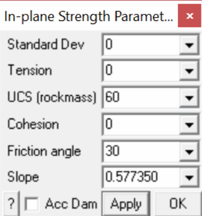

Das Mohr-Coulomb-Kriterium definiert die Scherfestigkeit in Abhängigkeit von Schubspannung und Normalspannung wie folgt:

#### Mohr-Coulomb

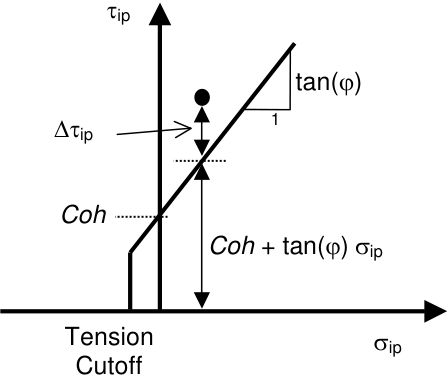

Zuggrenze (Tension Cutoff), UCS und Kohäsion werden in Spannungseinheiten angegeben (MPa oder psi).

Der Reibungswinkel wird in Grad angegeben.

Standard Deviation legt die Unsicherheit des Bruchkriteriums fest, gemessen in Richtung tip (angegeben in Spannungseinheiten, MPa oder psi).

Acc Dam – stellt die akkumulierte Schädigung dar. Siehe Accumulated Damage

Apply – erzeugt die Konturdarstellung neu.

Verwandte Themen:

Plot > Strength Factor > Probability N-distribution Plot > Strength Factor > SF-ip - Stress/Strength Plot > Strength Factors > SF-ub - Stress/Strength Plot > Strength Factors > dTip - Excess Stress Plot > Strength Factors > dTub - Excess Stress Plot > Strength Factors > Rockmass Strength Parameters Plot > Strength Factors > Ubiquitous Parameters

### 5.3.6.2.2 Akkumulierte Schädigung

Stellt die akkumulierte Schädigung dar.

Auf diese Komponente kann über die Symbolleiste Strength Factor Components wie folgt zugegriffen werden:

Diese Symbolleiste kann auf vertikale Ausrichtung umgestellt werden, indem sie an den rechten oder linken Rand des Hauptfensters gezogen wird.

Durch Ziehen an den oberen oder unteren Rand des Hauptfensters kann sie wieder horizontal ausgerichtet werden.

Mit der Schaltfläche in der Symbolleiste Contours wird die Symbolleiste Strength Factor Components aktiviert.

Ist Acc nicht aktiviert, werden Überschussspannung, Bruchwahrscheinlichkeit, Festigkeitsfaktor und RCF für die aktuellen Spannungswerte dargestellt.

Ist Acc aktiviert, wird die Schädigung von Schritt 1 bis zum aktuellen Schritt über die gesamte Belastungsgeschichte des Modells verfolgt; dargestellt wird daher der ungünstigste Fall der Überschussspannung, der Bruchwahrscheinlichkeit, des Festigkeitsfaktors bzw. des RCF.

So lassen sich Ergebnisse der elastischen Spannungsanalyse ähnlich wie die akkumulierte Dehnung in einem Plastizitätsmodell verwenden.

Die Schädigungsverfolgung erfolgt getrennt für die folgenden 5 Fälle:

1. Gebirgsbruch (Überschuss-S1-Spannung, Wahrscheinlichkeit, Festigkeitsfaktor) 2. Scherbruch in der Ebene (Überschuss-Schubspannung, Wahrscheinlichkeit, Festigkeitsfaktor) 3. Scherbruch in der ub-Ebene (Überschuss-Schubspannung, Wahrscheinlichkeit, Festigkeitsfaktor)

4. Überschuss-Wandspannung in der Ebene (Überschussspannung, RCF)

5. Überschuss-Wandspannung in der ub-Ebene (Überschussspannung, RCF)

Beachten Sie, dass sowohl der Schritt, in dem erstmals Fließen auftritt (MStep 1st Yield), als auch der Schritt, in dem die maximale Überschussspannung auftritt (MStep Max Yield), verfolgt werden und als Trajektorienbeschriftungen angezeigt werden können.

### 5.3.6.2.3 Überschuss-Schubspannung in der Ebene

Stellt die Festigkeit gegen Schub in der Ebene als Konturen dar.

Auf diese Komponenten kann über die Symbolleiste Strength Factor Components wie folgt zugegriffen werden:

Diese Symbolleiste kann auf vertikale Ausrichtung umgestellt werden, indem sie an den rechten oder linken Rand des Hauptfensters gezogen wird.

Durch Ziehen an den oberen oder unteren Rand des Hauptfensters kann sie wieder horizontal ausgerichtet werden.

Mit der

Schaltfläche in der Symbolleiste Contours wird die Symbolleiste Strength Factor Components aktiviert.

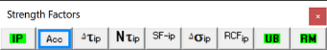

Zur Berechnung der Schub- und Normalspannungen in der Ebene wird der Spannungszustand an jedem Punkt der Rasterebene umorientiert, um die maximale Schubspannung parallel zur Rasterebene und die Spannung normal zur Rasterebene zu bestimmen.

In der elastischen Analyse können die maximale Schubspannung und die Normalspannung in der Ebene mit dem Festigkeitskriterium nach Mohr-Coulomb verwendet werden

#### Plot > Strength Factors > In-plane Parameters

um das Ausmaß des Gleitens durch Überbeanspruchung auf einer Störung, Kluftschar oder Schichtfläche abzuschätzen, die genauso orientiert ist wie die Rasterebene. Da diese Parameter richtungsabhängig sind, ist dieses Kriterium repräsentativ für die Standsicherheit eines anisotropen Gebirges.

Dagegen können Spannungen in der nichtlinearen Analyse die Festigkeit nie überschreiten, es sei denn, es wird Kriechen verwendet. In diesem Fall kann viskoses Kriechen Spannungszustände oberhalb des Bruchkriteriums zulassen, was auf fehlendes statisches Gleichgewicht hinweist. Daher betrachtet man bei der nichtlinearen Analyse üblicherweise direkt das Ausmaß der nichtlinearen Dehnung oder die vom Modell vorhergesagte Dehnungsrate

Mohr-Coulomb in DD planes

Fault-Gouge in DD planes

Backfill-Hyperbolic in DD planes

Hier wird angenommen, dass der Spannungspfad bis zum Bruch durch Erhöhung von tip ohne Verlust des Einspanndrucks verläuft.

#### Mohr-Coulomb

SF-ip Strength/Stress   kann bestimmt werden als [ Cohesion + sip tan(j) ] / tip SF-ip Stress/Strength   kann bestimmt werden als tip / [ Cohesion + sip tan(j) ] dTip Excess   kann bestimmt werden als Dtip = tip - [ Cohesion + sip tan(j) ]

NTip Probability   kann bestimmt werden als N(Dtip /std)

Festigkeitsparameter werden eingerichtet mit

Plot > Strength Factors > In-plane Parameters

Verwandte Themen:

Plot > Stress > Tip - In-plane Shear Plot > Stress > Sip - In-plane Normal Plot > Strength Factors > SF-ub Strength/Stress Plot > Strength Factors > dTub Excess

Plot > Strength Factors > NSub Probability

### 5.3.6.2.4 Überschuss-Wandspannung in der Ebene

Stellt die Festigkeit gegen Wandspannung in der Ebene als Konturen dar. Auf diese Komponenten kann über die Symbolleiste Strength Factor Components wie folgt zugegriffen werden:

Diese Symbolleiste kann auf vertikale Ausrichtung umgestellt werden, indem sie an den rechten oder linken Rand des Hauptfensters gezogen wird.

Durch Ziehen an den oberen oder unteren Rand des Hauptfensters kann sie wieder horizontal ausgerichtet werden.

Mit der

Schaltfläche in der Symbolleiste Contours wird die Symbolleiste Strength Factor Components aktiviert.

Zur Berechnung der Wandspannung in der Ebene wird der Spannungszustand an jedem Punkt der Rasterebene umorientiert, um die maximale und minimale Tangentialspannung parallel zur Rasterebene zu bestimmen.

Die maximale Wandspannung für einen virtuellen kreisförmigen Hohlraum, der senkrecht zur Rasterebene orientiert ist, lässt sich dann bestimmen als [ 3 s1i - s3i ].

Beachten Sie, dass sip normal zur Rasterebene und parallel zur Richtung eines Linienrasters orientiert ist. Beachten Sie außerdem, dass sip, s1i und s3i senkrecht aufeinander stehen.

- Die Einfallsrichtung wird im Uhrzeigersinn von der y-Achse aus positiv gemessen.

- Das Einfallen der Ebene wird von der Horizontalen aus nach unten positiv gemessen (d. h. in Einfallsrichtung).

- Das Abtauchen der Normalen wird von der Horizontalen aus nach unten positiv (d. h. nach oben negativ) gemessen.

dSip Excess   kann bestimmt werden als Dsip = [ 3 s1i - s3i ] - UCS

RCFip   kann bestimmt werden als RCFip = [ 3 s1i - s3i ]/UCS

Festigkeitsparameter werden eingerichtet mit

Plot > Strength Factors > In-plane Parameters

Verwandte Themen:

Plot > Stress > Tip - In-plane Shear Plot > Stress > Sip - In-plane Normal Plot > Stress > S1i - In-plane Maximum Plot > Stress > S3i - In-plane Minimum Plot > Strength Factors > SF-ub Strength/Stress Plot > Strength Factors > dTub Excess Plot > Strength Factors > dSub Excess Plot > Strength Factors > NSub Probability

### 5.3.6.2.6 NTip Normalverteilungswahrscheinlichkeit

Stellt die Festigkeit gegen Schub in der Ebene als Konturen dar. Auf diese Komponenten kann über die Symbolleiste Strength Factor Components wie folgt zugegriffen werden:

Diese Symbolleiste kann auf vertikale Ausrichtung umgestellt werden, indem sie an den rechten oder linken Rand des Hauptfensters gezogen wird.

Durch Ziehen an den oberen oder unteren Rand des Hauptfensters kann sie wieder horizontal ausgerichtet werden.

Mit der Schaltfläche in der Symbolleiste Contours wird die Symbolleiste Strength Factor Components aktiviert.

Zur Berechnung der Schub- und Normalspannungen in der Ebene wird der Spannungszustand an jedem Punkt der Rasterebene umorientiert, um die maximale Schubspannung parallel zur Rasterebene und die Spannung normal zur Rasterebene zu bestimmen.

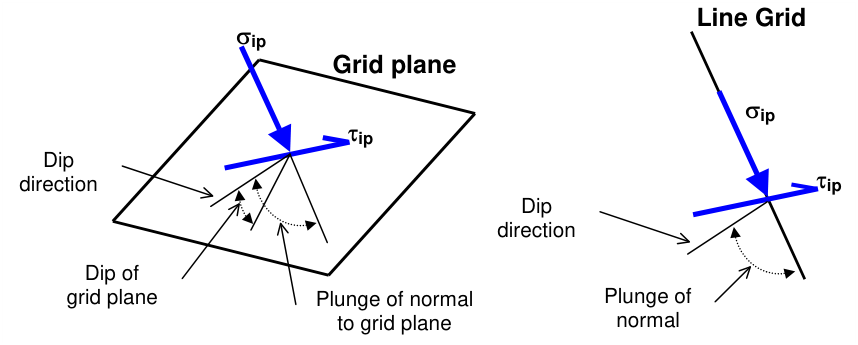

In der elastischen Analyse können die maximale Schubspannung und die Normalspannung in der Ebene mit dem Festigkeitskriterium nach Mohr-Coulomb verwendet werden

#### Plot > Strength Factors > In-plane Parameters

um das Ausmaß des Gleitens durch Überbeanspruchung auf einer Störung, Kluftschar oder Schichtfläche abzuschätzen, die genauso orientiert ist wie die Rasterebene. Da diese Parameter richtungsabhängig sind, ist dieses Kriterium repräsentativ für die Standsicherheit eines anisotropen Gebirges.

Dagegen können Spannungen in der nichtlinearen Analyse die Festigkeit nie überschreiten, es sei denn, es wird Kriechen verwendet. In diesem Fall kann viskoses Kriechen Spannungszustände oberhalb des Bruchkriteriums zulassen, was auf fehlendes statisches Gleichgewicht hinweist. Daher betrachtet man bei der nichtlinearen Analyse üblicherweise direkt das Ausmaß der nichtlinearen Dehnung oder die vom Modell vorhergesagte Dehnungsrate

Mohr-Coulomb in DD planes

Fault-Gouge in DD planes

Backfill-Hyperbolic in DD planes

Hier wird angenommen, dass der Spannungspfad bis zum Bruch durch Erhöhung von tip ohne Verlust des Einspanndrucks verläuft.

#### Mohr-Coulomb

SF-ip Strength/Stress   kann bestimmt werden als [ Cohesion + sip tan(j) ] / tip SF-ip Stress/Strength   kann bestimmt werden als tip / [ Cohesion + sip tan(j) ] dTip Excess   kann bestimmt werden als Dtip = tip - [ Cohesion + sip tan(j) ]

NTip Probability   kann bestimmt werden als N(Dtip /std)

Festigkeitsparameter werden eingerichtet mit

Plot > Strength Factors > In-plane Parameters

Verwandte Themen:

Plot > Stress > Tip - In-plane Shear Plot > Stress > Sip - In-plane Normal Plot > Strength Factors > SF-ub Strength/Stress Plot > Strength Factors > dTub Excess

Plot > Strength Factors > NSub Probability

## 5.3.6.3 UB-Ebenen-Parameter

5.3.6.3.1  Ubiquitäre Parameter

Legt die Festigkeitsparameter für die Erzeugung von Konturdarstellungen der Festigkeitsfaktoren in Abhängigkeit von den Spannungskomponenten in der ubiquitären Ebene fest.

Auf diese Komponenten kann über die Symbolleiste Strength Factor Components wie folgt zugegriffen werden:

Diese Symbolleiste kann auf vertikale Ausrichtung umgestellt werden, indem sie an den rechten oder linken Rand des Hauptfensters gezogen wird.

Durch Ziehen an den oberen oder unteren Rand des Hauptfensters kann sie wieder horizontal ausgerichtet werden.

Mit der

Schaltfläche in der Symbolleiste Contours wird die Symbolleiste Strength Factor Components aktiviert.

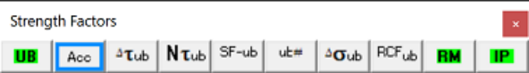

Zur Berechnung der ubiquitären Schub- und Normalspannungen wird der Spannungszustand an jedem Punkt der Rasterebene umorientiert, um die maximale Schubspannung parallel zur ubiquitären Scherebene und die Spannung normal zur ubiquitären Scherebene zu bestimmen.

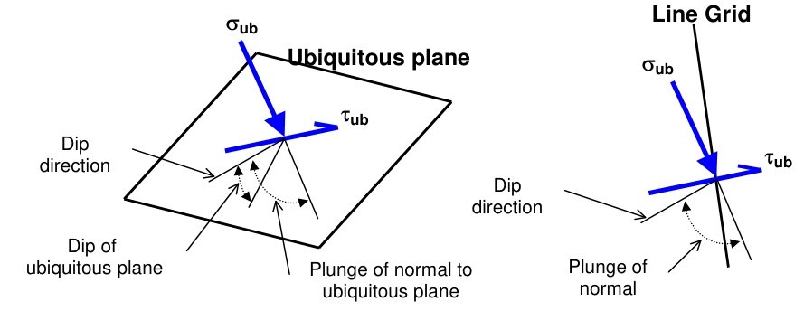

In der elastischen Analyse können die maximale Schubspannung und die Normalspannung in der ubiquitären Ebene mit dem Festigkeitskriterium nach Mohr-Coulomb verwendet werden, um das Ausmaß des Gleitens durch Überbeanspruchung auf einer Störung, Kluftschar oder Schichtfläche mit der angegebenen Orientierung abzuschätzen. Da diese Parameter richtungsabhängig sind, ist dieses Kriterium repräsentativ für die Standsicherheit eines anisotropen Gebirges.

Dagegen können Spannungen in der nichtlinearen Analyse die Festigkeit nie überschreiten, es sei denn, es wird Kriechen verwendet. In diesem Fall kann viskoses Kriechen Spannungszustände oberhalb des Bruchkriteriums zulassen, was auf fehlendes statisches Gleichgewicht hinweist. Daher betrachtet man bei der nichtlinearen Analyse üblicherweise direkt das Ausmaß der nichtlinearen Dehnung oder die vom Modell vorhergesagte Dehnungsrate

Mohr-Coulomb in DD planes

Fault-Gouge in DD planes

Backfill-Hyperbolic in DD planes

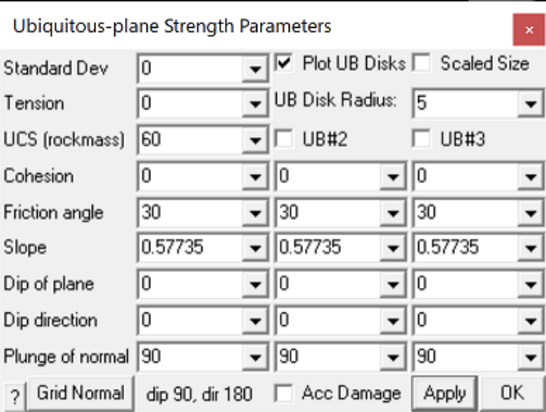

Cohesion und Friction Angle das Mohr-Coulomb-Kriterium definiert die Festigkeit in Abhängigkeit von den Hauptspannungen wie folgt:

#### Mohr-Coulomb

Zuggrenze (Tension Cutoff), UCS und Kohäsion werden in Spannungseinheiten angegeben (MPa oder psi). Der Reibungswinkel wird in Grad angegeben.

Standard Deviation legt die Unsicherheit des Bruchkriteriums fest, gemessen in Richtung tip (angegeben in Spannungseinheiten, MPa oder psi).

Dip of plane – legt das Einfallen der ubiquitären Ebene fest (in Grad). Das Einfallen der Normalen wird automatisch an Änderungen dieses Werts angepasst.

Dip Direction – legt die Einfallsrichtung der ubiquitären Ebene fest (in Grad).

Dip of Normal – legt das Einfallen der Normalen zur ubiquitären Ebene fest (in Grad). Das Einfallen der Ebene wird automatisch an Änderungen dieses Werts angepasst.

Grid Normal – setzt die ubiquitäre Ebene parallel zur aktuell ausgewählten Rasterebene. In diesem Fall sind alle Ergebnisse in der Ebene identisch mit den Ergebnissen der ubiquitären Ebene.

Acc Dam – stellt die akkumulierte Schädigung dar. Siehe Accumulated Damage

Plot UB DIsks – schaltet zwischen der ebenen Konturdarstellung und Scheiben um, die die Orientierung der UB-Ebene darstellen.

Scaled Size – skaliert die Größe der UB-Scheibe auf die Größenordnung.

UB DIsk Radius – legt den Radius der UB-Scheiben fest.

Apply – erzeugt die Konturdarstellung neu.

UB#2 & UB#3 – aktiviert die Festigkeitsparameter für die ubiquitäre Ebene Nr. 2 und/oder Nr. 3. Wenn aktiviert, wird das

Minimum aller aktiven ubiquitären Ebenen für alle Festigkeitsparameter angezeigt ( Plot > Strength Factor > Probability N-distribution, Plot > Strength Factors > SF-ub - Stress/Strength und Plot > Strength Factors > dTub - Excess Stress). Um zu bestimmen, welche ubiquitäre Ebene die minimale Festigkeit hat, können Sie Plot > Strength Factors > UB# with minimum strength) darstellen oder mit der linken Maustaste auf eine Festigkeitsparameter-Darstellung klicken.

Verwandte Themen:

Plot > Strength Factor > Probability N-distribution Plot > Strength Factors > SF-ub - Stress/Strength Plot > Strength Factor > SF-ip - Stress/Strength Plot > Strength Factors > dTub - Excess Stress Plot > Strength Factors > dTip - Excess Stress Plot > Strength Factors > UB# with minimum strength Plot > Strength Factors > Rockmass Strength Parameters

Plot > Strength Factors > In-plane Parameters

### 5.3.6.3.2 Akkumulierte Schädigung

Stellt die akkumulierte Schädigung dar. Auf diese Komponente kann über die Symbolleiste Strength Factor Components wie folgt zugegriffen werden:

Diese Symbolleiste kann auf vertikale Ausrichtung umgestellt werden, indem sie an den rechten oder linken Rand des Hauptfensters gezogen wird.

Durch Ziehen an den oberen oder unteren Rand des Hauptfensters kann sie wieder horizontal ausgerichtet werden.

Mit der Schaltfläche in der Symbolleiste Contours wird die Symbolleiste Strength Factor Components aktiviert.

Ist Acc nicht aktiviert, werden Überschussspannung, Bruchwahrscheinlichkeit, Festigkeitsfaktor und RCF für die aktuellen Spannungswerte dargestellt.

Ist Acc aktiviert, wird die Schädigung von Schritt 1 bis zum aktuellen Schritt über die gesamte Belastungsgeschichte des Modells verfolgt; dargestellt wird daher der ungünstigste Fall der Überschussspannung, der Bruchwahrscheinlichkeit, des Festigkeitsfaktors bzw. des RCF.

So lassen sich Ergebnisse der elastischen Spannungsanalyse ähnlich wie die akkumulierte Dehnung in einem Plastizitätsmodell verwenden.

Die Schädigungsverfolgung erfolgt getrennt für die folgenden 5 Fälle:

1. Gebirgsbruch (Überschuss-S1-Spannung, Wahrscheinlichkeit, Festigkeitsfaktor) 2. Scherbruch in der Ebene (Überschuss-Schubspannung, Wahrscheinlichkeit, Festigkeitsfaktor) 3. Scherbruch in der ub-Ebene (Überschuss-Schubspannung, Wahrscheinlichkeit, Festigkeitsfaktor)

4. Überschuss-Wandspannung in der Ebene (Überschussspannung, RCF)

5. Überschuss-Wandspannung in der ub-Ebene (Überschussspannung, RCF)

Beachten Sie, dass sowohl der Schritt, in dem erstmals Fließen auftritt (MStep 1st Yield), als auch der Schritt, in dem die maximale Überschussspannung auftritt (MStep Max Yield), verfolgt werden und als Trajektorienbeschriftungen angezeigt werden können.

- 5.3.6.3.3  Ubiquitäre Überschuss-Schubspannung

Stellt die Festigkeit gegen Schub in der ubiquitären Ebene als Konturen dar. Auf diese Komponenten kann über die Symbolleiste Strength Factor Components wie folgt zugegriffen werden:

Diese Symbolleiste kann auf vertikale Ausrichtung umgestellt werden, indem sie an den rechten oder linken Rand des Hauptfensters gezogen wird.

Durch Ziehen an den oberen oder unteren Rand des Hauptfensters kann sie wieder horizontal ausgerichtet werden.

Mit der Schaltfläche in der Symbolleiste Contours wird die Symbolleiste Strength Factor Components aktiviert.

Zur Berechnung der ubiquitären Schub- und Normalspannungen wird der Spannungszustand an jedem Punkt der Rasterebene umorientiert, um die maximale Schubspannung parallel zur ubiquitären Scherebene und die Spannung normal zur ubiquitären Scherebene zu bestimmen.

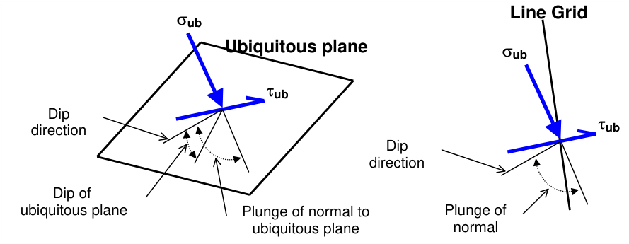

Die Orientierung der ubiquitären Scherebene wird festgelegt mit

#### Plot > Strength Factors > Ubiquitous Parameters

In der elastischen Analyse können die maximale Schubspannung und die Normalspannung in der ubiquitären Ebene mit dem Festigkeitskriterium nach Mohr-Coulomb verwendet werden, um das Ausmaß des Gleitens durch Überbeanspruchung auf einer Störung, Kluftschar oder Schichtfläche mit der angegebenen Orientierung abzuschätzen. Da diese Parameter richtungsabhängig sind, ist dieses Kriterium repräsentativ für die Standsicherheit eines anisotropen Gebirges.

Dagegen können Spannungen in der nichtlinearen Analyse die Festigkeit nie überschreiten, es sei denn, es wird Kriechen verwendet. In diesem Fall kann viskoses Kriechen Spannungszustände oberhalb des Bruchkriteriums zulassen, was auf fehlendes statisches Gleichgewicht hinweist. Daher betrachtet man bei der nichtlinearen Analyse üblicherweise direkt das Ausmaß der nichtlinearen Dehnung oder die vom Modell vorhergesagte Dehnungsrate

Mohr-Coulomb in DD planes

Fault-Gouge in DD planes

Backfill-Hyperbolic in DD planes

Hier wird angenommen, dass der Spannungspfad bis zum Bruch durch Erhöhung von tub ohne Verlust des Einspanndrucks verläuft.

#### Mohr-Coulomb

SF-ub Strength/Stress   kann bestimmt werden als [ Cohesion + sub tan(j) ] / tub SF-ub Stress/Strength   kann bestimmt werden als tub / [ Cohesion + sub tan(j) ] dTub Excess   kann bestimmt werden als Dtub = tub - [ Cohesion + sub tan(j) ] NTub Probability   kann bestimmt werden als N(Dtub /std)

Festigkeitsparameter werden eingerichtet mit

Plot > Strength Factors > Ubiquitous Parameters

Verwandte Themen:

Plot > Stress > Tub - Ubiquitous-plane Shear Plot > Stress > Sub - Ubiquitous-plane Normal Plot > Stress > S1u - Ubiquitous-plane Maximum Plot > Stress > S3u - Ubiquitous-plane Minimum Plot > Strength Factors > SF-ub Strength/Stress Plot > Strength Factors > dTip Excess Plot > Strength Factors > dSip Excess Plot > Strength Factors > NTip Probability

UB#2 & UB#3 – aktiviert die Festigkeitsparameter für die ubiquitäre Ebene Nr. 2 und/oder Nr. 3. Wenn aktiviert, wird das Minimum aller aktiven ubiquitären Ebenen für alle Festigkeitsparameter angezeigt ( Plot > Strength Factor > Probability N-distribution, Plot > Strength Factors > SF-ub - Stress/Strength und

Plot > Strength Factors > dTub - Excess Stress). To determine which ubiquitous plane has the minimum strength you can plot Plot > Strength Factors > UB# with minimum strength) or left click on and strength parameter plot.

### 5.3.6.3.4 Überschuss-Wandspannung der ubiquitären Ebene

Stellt die Festigkeit gegen Wandspannung in der ub-Ebene als Konturen dar.

Auf diese Komponenten kann über die Symbolleiste Strength Factor Components wie folgt zugegriffen werden:

Diese Symbolleiste kann auf vertikale Ausrichtung umgestellt werden, indem sie an den rechten oder linken Rand des Hauptfensters gezogen wird.

Durch Ziehen an den oberen oder unteren Rand des Hauptfensters kann sie wieder horizontal ausgerichtet werden.

Mit der Schaltfläche in der Symbolleiste Contours wird die Symbolleiste Strength Factor Components aktiviert.

Zur Berechnung der Wandspannung in der ub-Ebene wird der Spannungszustand an jedem Punkt der Rasterebene umorientiert, um die maximale und minimale Tangentialspannung parallel zur ub-Ebene zu bestimmen.

Die maximale Wandspannung für einen virtuellen kreisförmigen Hohlraum, der senkrecht zur ub-Ebene orientiert ist, lässt sich dann bestimmen als [ 3 s1u - s3u ].

Beachten Sie, dass sub normal zur ub-Ebene orientiert ist. Beachten Sie außerdem, dass sub, s1 und s3u senkrecht aufeinander stehen.

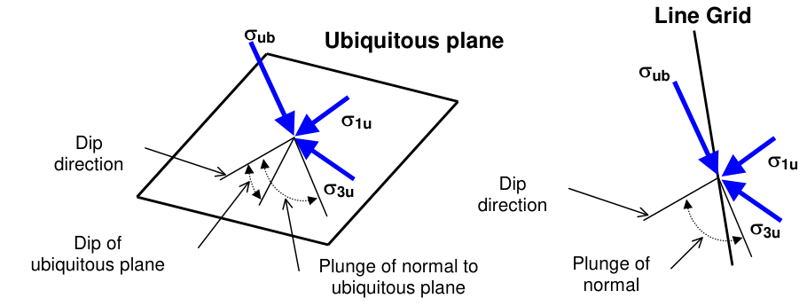

- Die Einfallsrichtung wird im Uhrzeigersinn von der y-Achse aus positiv gemessen.

- Das Einfallen der Ebene wird von der Horizontalen aus nach unten positiv gemessen (d. h. in Einfallsrichtung).

- Das Abtauchen der Normalen wird von der Horizontalen aus nach unten positiv (d. h. nach oben negativ) gemessen.

dSub Excess   kann bestimmt werden als Dsub = [ 3 s1u - s3u ] - UCS

RCFub   kann bestimmt werden als RCFub = [ 3 s1u - s3u ]/UCS

Die Orientierung der ubiquitären Scherebene wird festgelegt mit

Plot > Strength Factors > Ubiquitous Parameters

Verwandte Themen:

Plot > Stress > Tub - Ubiquitous-plane Shear Plot > Stress > Sub - Ubiquitous-plane Normal Plot > Stress > S1u - Ubiquitous-plane Maximum Plot > Stress > S3u - Ubiquitous-plane Minimum Plot > Strength Factors > SF-ub Strength/Stress Plot > Strength Factors > dTip Excess Plot > Strength Factors > dSip Excess Plot > Strength Factors > NTip Probability

### 5.3.6.3.6 NTub Normalverteilungswahrscheinlichkeit

Stellt die Festigkeit gegen Schub in der ubiquitären Ebene als Konturen dar. Auf diese Komponenten kann über die Symbolleiste Strength Factor Components wie folgt zugegriffen werden:

Diese Symbolleiste kann auf vertikale Ausrichtung umgestellt werden, indem sie an den rechten oder linken Rand des Hauptfensters gezogen wird.

Durch Ziehen an den oberen oder unteren Rand des Hauptfensters kann sie wieder horizontal ausgerichtet werden.

Mit der Schaltfläche in der Symbolleiste Contours wird die Symbolleiste Strength Factor Components aktiviert.

Zur Berechnung der ubiquitären Schub- und Normalspannungen wird der Spannungszustand an jedem Punkt der Rasterebene umorientiert, um die maximale Schubspannung parallel zur ubiquitären Scherebene und die Spannung normal zur ubiquitären Scherebene zu bestimmen.

Die Orientierung der ubiquitären Scherebene wird festgelegt mit

#### Plot > Strength Factors > Ubiquitous Parameters

In der elastischen Analyse können die maximale Schubspannung und die Normalspannung in der ubiquitären Ebene mit dem Festigkeitskriterium nach Mohr-Coulomb verwendet werden, um das Ausmaß des Gleitens durch Überbeanspruchung auf einer Störung, Kluftschar oder Schichtfläche mit der angegebenen Orientierung abzuschätzen. Da diese Parameter richtungsabhängig sind, ist dieses Kriterium repräsentativ für die Standsicherheit eines anisotropen Gebirges.

Dagegen können Spannungen in der nichtlinearen Analyse die Festigkeit nie überschreiten, es sei denn, es wird Kriechen verwendet. In diesem Fall kann viskoses Kriechen Spannungszustände oberhalb des Bruchkriteriums zulassen, was auf fehlendes statisches Gleichgewicht hinweist. Daher betrachtet man bei der nichtlinearen Analyse üblicherweise direkt das Ausmaß der nichtlinearen Dehnung oder die vom Modell vorhergesagte Dehnungsrate

Mohr-Coulomb in DD planes

Fault-Gouge in DD planes

Backfill-Hyperbolic in DD planes

Hier wird angenommen, dass der Spannungspfad bis zum Bruch durch Erhöhung von tub ohne Verlust des Einspanndrucks verläuft.

#### Mohr-Coulomb

SF-ub Strength/Stress   kann bestimmt werden als [ Cohesion + sub tan(j) ] / tub SF-ub Stress/Strength   kann bestimmt werden als tub / [ Cohesion + sub tan(j) ] dTub Excess   kann bestimmt werden als Dtub = tub - [ Cohesion + sub tan(j) ] NTub Probability   kann bestimmt werden als N(Dtub /std)

Festigkeitsparameter werden eingerichtet mit

Plot > Strength Factors > Ubiquitous Parameters

Verwandte Themen:

Plot > Stress > Tub - Ubiquitous-plane Shear Plot > Stress > Sub - Ubiquitous-plane Normal Plot > Stress > S1u - Ubiquitous-plane Maximum Plot > Stress > S3u - Ubiquitous-plane Minimum Plot > Strength Factors > SF-ub Strength/Stress Plot > Strength Factors > dTip Excess Plot > Strength Factors > dSip Excess Plot > Strength Factors > NTip Probability

UB#2 & UB#3 – aktiviert die Festigkeitsparameter für die ubiquitäre Ebene Nr. 2 und/oder Nr. 3. Wenn aktiviert, wird das Minimum aller aktiven ubiquitären Ebenen für alle Festigkeitsparameter angezeigt ( Plot > Strength Factor > Probability N-distribution, Plot > Strength Factors > SF-ub - Stress/Strength und

Plot > Strength Factors > dTub - Excess Stress). To determine which ubiquitous plane has the minimum strength you can plot Plot > Strength Factors > UB# with minimum strength) or left click on and strength parameter plot.
