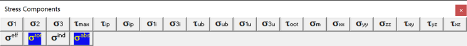
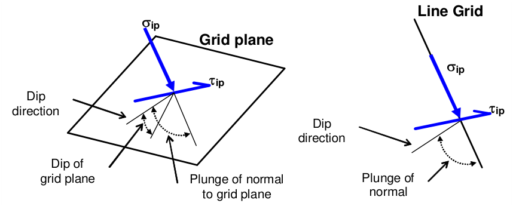
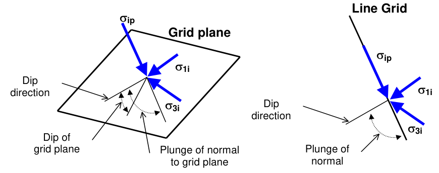
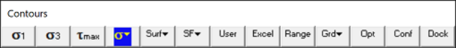
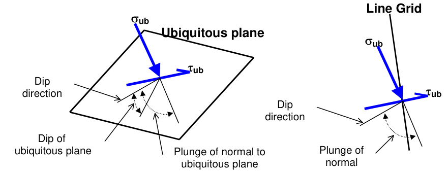
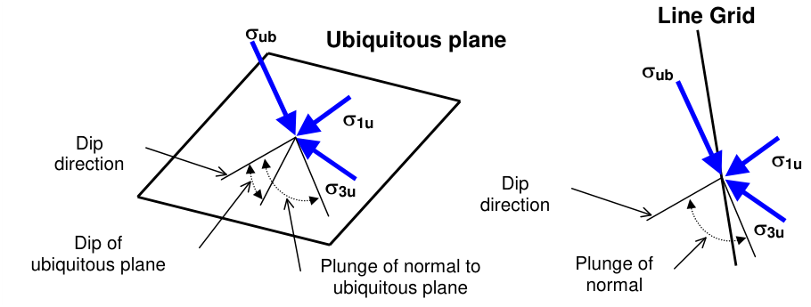

## 5.3.1.1 Größte Hauptspannung

Ermöglicht die Darstellung der Hauptspannungskomponenten s1 s2 s3. Auf diese Komponenten kann über die Symbolleiste Stress Components wie folgt zugegriffen werden:

Diese Symbolleiste kann auf vertikale Ausrichtung umgestellt werden, indem sie an den rechten oder linken Rand des Hauptfensters gezogen wird.

Durch Ziehen an den oberen oder unteren Rand des Hauptfensters kann sie wieder horizontal ausgerichtet werden.

Mit der Schaltfläche in der Symbolleiste Contours wird die Symbolleiste Stress Components aktiviert.

In der elastischen Analyse wird die größte Hauptspannung üblicherweise zusammen mit der kleinsten Hauptspannung und dem Festigkeitskriterium nach Mohr-Coulomb oder Hoek-Brown verwendet

#### Plot > Strength Factors > Strength Parameters

um das Ausmaß der Schädigung des Gebirges durch Überbeanspruchung abzuschätzen. Da keiner der Parameter richtungsabhängig ist, ist dieses Kriterium repräsentativ für die Standsicherheit eines homogenen Gebirges.

Dagegen können Spannungen in der nichtlinearen Analyse die Festigkeit nie überschreiten, es sei denn, es wird Kriechen verwendet. In diesem Fall kann viskoses Kriechen Spannungszustände oberhalb des Bruchkriteriums zulassen, was auf fehlendes statisches Gleichgewicht hinweist. Daher betrachtet man bei der nichtlinearen Analyse üblicherweise direkt das Ausmaß der nichtlinearen Dehnung oder die vom Modell vorhergesagte Dehnungsrate

Mohr-Coulomb in 3D FF blocks.

Die Überbeanspruchung kann in mehreren Formen dargestellt werden, darunter:

Plot > Strength Factor > SF-A Strength/Stress Plot > Strength Factor > SF-B Strength/Stress Plot > Strength Factors > SF-C Strength/Stress Plot > Strength Factors > dS1 Excess Stress Plot > Strength Factors > dTmax Excess Stress

Der Konturbereich wird festgelegt mit

#### Plot > Range

Jede dieser Komponenten kann bei Bedarf der Konturen-Symbolleiste hinzugefügt werden

Tools > Configure Contouring Toolbar > Stress

Es kann praktisch sein, die Schaltfläche

#### More Stress Components

der Konturen-Symbolleiste hinzuzufügen, um schnell auf alle Spannungskomponenten zuzugreifen.

Die mittlere Hauptspannung wird üblicherweise bei der Berechnung der oktaedrischen Schubspannung verwendet

Plot > Stress > Toct Octahedral shear Stress

oder der mittleren Spannung

Plot > Stress > Smean Mean Stress.

## 5.3.1.4 Maximale Schubspannung

Ermöglicht die Darstellung der Spannungskomponente tmax=½(s1 - s3). Auf diese Komponente kann über die Symbolleiste Stress Components wie folgt zugegriffen werden:

Diese Symbolleiste kann auf vertikale Ausrichtung umgestellt werden, indem sie an den rechten oder linken Rand des Hauptfensters gezogen wird.

Durch Ziehen an den oberen oder unteren Rand des Hauptfensters kann sie wieder horizontal ausgerichtet werden.

Mit der Schaltfläche in der Symbolleiste Contours wird die Symbolleiste Stress Components aktiviert.

In der elastischen Analyse wird die maximale Schubspannung üblicherweise zusammen mit der kleinsten Hauptspannung und dem Festigkeitskriterium nach Mohr-Coulomb oder Hoek-Brown verwendet

#### Plot > Strength Factors > Strength Parameters

um das Ausmaß der Schädigung durch Überbeanspruchung abzuschätzen. Da keiner der Parameter richtungsabhängig ist, ist dieses Kriterium repräsentativ für die Standsicherheit eines homogenen Gebirges.

Dagegen können Spannungen in der nichtlinearen Analyse die Festigkeit nie überschreiten, es sei denn, es wird Kriechen verwendet. In diesem Fall kann viskoses Kriechen Spannungszustände oberhalb des Bruchkriteriums zulassen, was auf fehlendes statisches Gleichgewicht hinweist. Daher betrachtet man bei der nichtlinearen Analyse üblicherweise direkt das Ausmaß der nichtlinearen Dehnung oder die vom Modell vorhergesagte Dehnungsrate

Mohr-Coulomb in 3D FF blocks.

Die Überbeanspruchung kann in mehreren Formen dargestellt werden, darunter:

Plot > Strength Factor > SF-A Strength/Stress Plot > Strength Factor > SF-B Strength/Stress Plot > Strength Factors > SF-C Strength/Stress Plot > Strength Factors > dS1 Excess Stress Plot > Strength Factors > dTmax Excess Stress

Der Konturbereich wird festgelegt mit

#### Plot > Range

Jede dieser Komponenten kann bei Bedarf der Konturen-Symbolleiste hinzugefügt werden

Tools > Configure Contouring Toolbar > Stress

Es kann praktisch sein, die Schaltfläche

#### More Stress Components

der Konturen-Symbolleiste hinzuzufügen, um schnell auf alle Spannungskomponenten zuzugreifen.

## 5.3.1.5 Schubspannung in der Ebene

Ermöglicht die Konturdarstellung der maximalen Schubspannung, die auf die Rasterebene wirkt, sowie der Spannungskomponente normal zur Rasterebene oder parallel zu einem Linienraster. Auf diese Komponenten kann über die Symbolleiste Stress Components wie folgt zugegriffen werden:

Diese Symbolleiste kann auf vertikale Ausrichtung umgestellt werden, indem sie an den rechten oder linken Rand des Hauptfensters gezogen wird.

Durch Ziehen an den oberen oder unteren Rand des Hauptfensters kann sie wieder horizontal ausgerichtet werden.

Mit der Schaltfläche in der Symbolleiste Contours wird die Symbolleiste Stress Components aktiviert.

Zur Berechnung der Spannungen in der Ebene wird der Spannungszustand an jedem Punkt der Rasterebene umorientiert, um die maximale Schubspannung parallel zur Rasterebene und die Spannung normal zur Ebene zu bestimmen. Beachten Sie, dass sip normal zur Rasterebene und parallel zur Richtung eines Linienrasters orientiert ist.

- Die Einfallsrichtung wird im Uhrzeigersinn von der y-Achse aus positiv gemessen.

- Das Einfallen der Ebene wird von der Horizontalen aus nach unten positiv gemessen (d. h. in Einfallsrichtung).

- Das Abtauchen der Normalen wird von der Horizontalen aus nach unten positiv (d. h. nach oben negativ) gemessen.

In der elastischen Analyse wird die maximale Schubspannung in der Ebene üblicherweise zusammen mit der Normalspannung in der Ebene und dem Festigkeitskriterium nach Mohr-Coulomb verwendet

Plot > Strength Factors > In-plane Parameters

um das Ausmaß des Gleitens durch Überbeanspruchung auf einer Störung, Kluftschar oder Schichtfläche abzuschätzen, die genauso orientiert ist wie die Rasterebene. Da diese Parameter richtungsabhängig sind, ist dieses Kriterium repräsentativ für die Standsicherheit eines anisotropen Gebirges.

Dagegen können Spannungen in der nichtlinearen Analyse die Festigkeit nie überschreiten, es sei denn, es wird Kriechen verwendet. In diesem Fall kann viskoses Kriechen Spannungszustände oberhalb des Bruchkriteriums zulassen, was auf fehlendes statisches Gleichgewicht hinweist. Daher betrachtet man bei der nichtlinearen Analyse üblicherweise direkt das Ausmaß der nichtlinearen Dehnung oder die vom Modell vorhergesagte Dehnungsrate

Mohr-Coulomb in DD planes Fault-Gouge in DD planes Backfill-Hyperbolic in DD planes.

Die Überbeanspruchung kann in mehreren Formen dargestellt werden, darunter:

Plot > Strength Factors > SF-ip Strength/Stress Plot > Strength Factors > dTip Excess Shear Stress

Der Konturbereich wird festgelegt mit

#### Plot > Range

Jede dieser Komponenten kann bei Bedarf der Konturen-Symbolleiste hinzugefügt werden

Tools > Configure Contouring Toolbar > Stress

Es kann praktisch sein, die Schaltfläche

#### More Stress Components

der Konturen-Symbolleiste hinzuzufügen, um schnell auf alle Spannungskomponenten zuzugreifen.

Verwandte Themen:

Plot > Stress > S1i In-plane Maximum Plot > Stress > S3i In-plane Minimum Plot > Stress > Tub Ubiquitous-plane Shear Plot > Stress > Sub Ubiquitous-plane Normal

## 5.3.1.7 Maximale Spannung in der Ebene

Ermöglicht die Konturdarstellung der maximalen und minimalen Spannungen tangential zur aktuell ausgewählten Rasterebene oder senkrecht zu einem Linienraster. Auf diese Komponenten kann über die Symbolleiste Stress Components wie folgt zugegriffen werden:

Diese Symbolleiste kann auf vertikale Ausrichtung umgestellt werden, indem sie an den rechten oder linken Rand des Hauptfensters gezogen wird.

Durch Ziehen an den oberen oder unteren Rand des Hauptfensters kann sie wieder horizontal ausgerichtet werden.

Mit der Schaltfläche in der Symbolleiste Contours wird die Symbolleiste Stress Components aktiviert.

Zur Berechnung der maximalen und minimalen Spannungen in der Ebene werden die Spannungen tangential zur Rasterebene bestimmt und anschließend aufgelöst, um den Maximal- und Minimalwert zu erhalten. Beachten Sie, dass sip normal zur Rasterebene und parallel zur Richtung eines Linienrasters orientiert ist. Beachten Sie außerdem, dass sip, s1i und s3i senkrecht aufeinander stehen.

- Die Einfallsrichtung wird im Uhrzeigersinn von der y-Achse aus positiv gemessen.

- Das Einfallen der Ebene wird von der Horizontalen aus nach unten positiv gemessen (d. h. in Einfallsrichtung).

- Das Abtauchen der Normalen wird von der Horizontalen aus nach unten positiv (d. h. nach oben negativ) gemessen.

Der Konturbereich wird festgelegt mit

#### Plot > Range

Diese Komponente kann bei Bedarf der Konturen-Symbolleiste hinzugefügt werden

#### Tools > Configure Contouring Toolbar > Stress

Es kann praktisch sein, die Schaltfläche

#### More Stress Components

der Konturen-Symbolleiste hinzuzufügen, um schnell auf alle Spannungskomponenten zuzugreifen.

Verwandte Themen:

Plot > Stress > Tip In-plane Shear Plot > Stress > Sip In-plane Normal Plot > Stress > S1u Ubiquitous-plane Maximum. Plot > Stress > S3u Ubiquitous-plane Minimum.

## 5.3.1.9 Schubspannung in der ubiquitären Ebene

Ermöglicht die Konturdarstellung der maximalen Schubspannung, die auf die ubiquitäre Ebene Nr. 1 wirkt, sowie der Spannungskomponente normal zu dieser Ebene. Auf diese Komponenten kann über die Symbolleiste Stress Components wie folgt zugegriffen werden:

Diese Symbolleiste kann auf vertikale Ausrichtung umgestellt werden, indem sie an den rechten oder linken Rand des Hauptfensters gezogen wird.

Durch Ziehen an den oberen oder unteren Rand des Hauptfensters kann sie wieder horizontal ausgerichtet werden.

Mit der Schaltfläche in der Symbolleiste Contours wird die Symbolleiste Stress Components aktiviert.

Zur Berechnung der ubiquitären Spannungen wird der Spannungszustand an jedem Punkt der Rasterebene umorientiert, um die maximale Schubspannung parallel zur ubiquitären Ebene und die Spannung normal zur ubiquitären Ebene zu bestimmen. Beachten Sie, dass sub normal zur ubiquitären Ebene orientiert und nicht parallel zur Richtung eines Linienrasters ist.

- Die Einfallsrichtung wird im Uhrzeigersinn von der y-Achse aus positiv gemessen.

- Das Einfallen der Ebene wird von der Horizontalen aus nach unten positiv gemessen (d. h. in Einfallsrichtung).

- Das Abtauchen der Normalen wird von der Horizontalen aus nach unten positiv (d. h. nach oben negativ) gemessen.

Die Orientierung der ubiquitären Scherebene wird festgelegt mit

#### Plot > Strength Factors > Ubiquitous Parameters

In der elastischen Analyse wird die maximale Schubspannung in der ubiquitären Ebene üblicherweise zusammen mit der Normalspannung auf die ubiquitäre Ebene und dem Festigkeitskriterium nach Mohr-Coulomb verwendet

#### Plot > Strength Factors > Ubiquitous Parameters

um das Ausmaß des Gleitens durch Überbeanspruchung auf einer Störung, Kluftschar oder Schichtfläche mit der angegebenen Orientierung abzuschätzen. Da diese Parameter richtungsabhängig sind, ist dieses Kriterium repräsentativ für die Standsicherheit eines anisotropen Gebirges.

Dagegen können Spannungen in der nichtlinearen Analyse die Festigkeit nie überschreiten, es sei denn, es wird Kriechen verwendet. In diesem Fall kann viskoses Kriechen Spannungszustände oberhalb des Bruchkriteriums zulassen, was auf fehlendes statisches Gleichgewicht hinweist. Daher betrachtet man bei der nichtlinearen Analyse üblicherweise direkt das Ausmaß der nichtlinearen Dehnung oder die vom Modell vorhergesagte Dehnungsrate

Mohr-Coulomb in DD planes Fault-Gouge in DD planes Backfill-Hyperbolic in DD planes.

Die Überbeanspruchung kann in mehreren Formen dargestellt werden, darunter:

Plot > Strength Factors > SF-ub Strength/Stress. Plot > Strength Factors > dTub Excess Shear Stress.

Der Konturbereich wird festgelegt mit

#### Plot > Range

Diese Komponente kann bei Bedarf der Konturen-Symbolleiste hinzugefügt werden

Tools > Configure Contouring Toolbar > Stress

Es kann praktisch sein, die Schaltfläche

#### More Stress Components

der Konturen-Symbolleiste hinzuzufügen, um schnell auf alle Spannungskomponenten zuzugreifen.

Verwandte Themen:

Plot > Stress > S1u Ubiquitous-plane Maximum Plot > Stress > S3u Ubiquitous-plane Minimum Plot > Stress > Tip In-plane Shear Plot > Stress > Sip In-plane Normal

Die Orientierung der ubiquitären Ebene wird angegeben in

Plot > Strength Factors > Ubiquitous Parameters

## 5.3.1.11 Maximale Spannung in der ubiquitären Ebene

Ermöglicht die Konturdarstellung der maximalen und minimalen Spannungen tangential zur ubiquitären Ebene Nr. 1. Auf diese Komponenten kann über die Symbolleiste Stress Components wie folgt zugegriffen werden:

Diese Symbolleiste kann auf vertikale Ausrichtung umgestellt werden, indem sie an den rechten oder linken Rand des Hauptfensters gezogen wird.

Durch Ziehen an den oberen oder unteren Rand des Hauptfensters kann sie wieder horizontal ausgerichtet werden.

Mit der Schaltfläche in der Symbolleiste Contours wird die Symbolleiste Stress Components aktiviert.

Zur Berechnung der maximalen und minimalen Spannungen in der ubiquitären Ebene werden die Spannungen tangential zur Ebene bestimmt und anschließend aufgelöst, um den Maximal- und Minimalwert zu erhalten. Beachten Sie, dass sub normal zur ubiquitären Ebene orientiert und nicht parallel zur Richtung eines Linienrasters ist. Beachten Sie außerdem, dass sub, s1u und s3u senkrecht aufeinander stehen.

- Die Einfallsrichtung wird im Uhrzeigersinn von der y-Achse aus positiv gemessen.

- Das Einfallen der Ebene wird von der Horizontalen aus nach unten positiv gemessen (d. h. in Einfallsrichtung).

- Das Abtauchen der Normalen wird von der Horizontalen aus nach unten positiv (d. h. nach oben negativ) gemessen.

Die Orientierung der ubiquitären Scherebene wird festgelegt mit

Plot > Strength Factors > Ubiquitous Parameters

Der Konturbereich wird festgelegt mit

#### Plot > Range

Diese Komponente kann bei Bedarf der Konturen-Symbolleiste hinzugefügt werden

#### Tools > Configure Contouring Toolbar > Stress

Es kann praktisch sein, die Schaltfläche

#### More Stress Components

der Konturen-Symbolleiste hinzuzufügen, um schnell auf alle Spannungskomponenten zuzugreifen.

Verwandte Themen:

Plot > Stress > Tub In-plane Shear Plot > Stress > Sub In-plane Normal Plot > Stress > S1i In-plane Maximum. Plot > Stress > S3i In-plane Minimum.

## 5.3.1.13 Oktaedrische Schubspannung

Stellt die oktaedrische Schubspannung als Konturen dar

toct = ¹/3 [ (s1 - s2)² + (s2 - s3)² +(s3 - s1)² ]½

und die mittlere Spannung

smean = ¹/3 (s1 + s2 + s3)

Auf diese Komponenten kann über die Symbolleiste Stress Components wie folgt zugegriffen werden:

Diese Symbolleiste kann auf vertikale Ausrichtung umgestellt werden, indem sie an den rechten oder linken Rand des Hauptfensters gezogen wird.

Durch Ziehen an den oberen oder unteren Rand des Hauptfensters kann sie wieder horizontal ausgerichtet werden.

Mit der Schaltfläche in der Symbolleiste Contours wird die Symbolleiste Stress Components aktiviert.

In der elastischen Analyse wird die oktaedrische Schubspannung üblicherweise zusammen mit der mittleren Spannung und dem Festigkeitskriterium nach Drucker-Prager verwendet

#### Plot > Strength Factors > Strength Parameters

um das Ausmaß der Schädigung durch Überbeanspruchung abzuschätzen. Da keiner der Parameter richtungsabhängig ist, ist dieses Kriterium repräsentativ für die Standsicherheit eines homogenen Gebirges.

Dagegen können Spannungen in der nichtlinearen Analyse die Festigkeit nie überschreiten, es sei denn, es wird Kriechen verwendet. In diesem Fall kann viskoses Kriechen Spannungszustände oberhalb des Bruchkriteriums zulassen, was auf fehlendes statisches Gleichgewicht hinweist. Daher betrachtet man bei der nichtlinearen Analyse üblicherweise direkt das Ausmaß der nichtlinearen Dehnung oder die vom Modell vorhergesagte Dehnungsrate

Mohr-Coulomb in 3D FF blocks.

Die Überbeanspruchung kann in mehreren Formen dargestellt werden, darunter:

Plot > Strength Factors > SF-C Strength/Stress Plot > Strength Factors > dToct Excess Stress Plot > Strength Factors > dS1 Excess Stress Plot > Strength Factors > dTmax Excess Stress

Der Konturbereich wird festgelegt mit

#### Plot > Range

Jede dieser Komponenten kann bei Bedarf der Konturen-Symbolleiste hinzugefügt werden

Tools > Configure Contouring Toolbar > Stress

Es kann praktisch sein, die Schaltfläche

#### More Stress Components

der Konturen-Symbolleiste hinzuzufügen, um schnell auf alle Spannungskomponenten zuzugreifen.

## 5.3.1.15 Kartesische Spannung Sxx

Stellt die kartesischen Spannungskomponenten als Konturen dar. Auf diese Komponenten kann über die Symbolleiste Stress Components wie folgt zugegriffen werden:

Diese Symbolleiste kann auf vertikale Ausrichtung umgestellt werden, indem sie an den rechten oder linken Rand des Hauptfensters gezogen wird.

Durch Ziehen an den oberen oder unteren Rand des Hauptfensters kann sie wieder horizontal ausgerichtet werden.

Mit der Schaltfläche in der Symbolleiste Contours wird die Symbolleiste Stress Components aktiviert.

Plot > Stress > sxx Cartesian Stress Component   Normalspannung in Richtung der x-Achse. Plot > Stress > syy Cartesian Stress Component   Normalspannung in Richtung der y-Achse. Plot > Stress > szz Cartesian Stress Component   Normalspannung in Richtung der z-Achse. Plot > Stress > txy Cartesian Stress Component   Schubspannung in der x-y-Ebene. Plot > Stress > tyz Cartesian Stress Component   Schubspannung in der y-z-Ebene. Plot > Stress > tzx Cartesian Stress Component   Schubspannung in der x-z-Ebene.

Der Konturbereich wird festgelegt mit

#### Plot > Range

Jede dieser Komponenten kann bei Bedarf der Konturen-Symbolleiste hinzugefügt werden

Tools > Configure Contouring Toolbar > Stress

Es kann praktisch sein, die Schaltfläche

#### More Stress Components

der Konturen-Symbolleiste hinzuzufügen, um schnell auf alle Spannungskomponenten zuzugreifen.

## 5.3.1.21 Wert

### 5.3.1.21.1 Effektive Spannung

Wählt die effektive Spannung oder die Gesamtspannungskomponente aus. Auf diese Komponenten kann über die Symbolleiste Stress Components wie folgt zugegriffen werden:

Diese Symbolleiste kann auf vertikale Ausrichtung umgestellt werden, indem sie an den rechten oder linken Rand des Hauptfensters gezogen wird.

Durch Ziehen an den oberen oder unteren Rand des Hauptfensters kann sie wieder horizontal ausgerichtet werden.

Mit der Schaltfläche in der Symbolleiste Contours wird die Symbolleiste Stress Components aktiviert.

Die effektive Spannung ist die Korngerüstspannung (d. h. ohne den Porendruckanteil). Die Gesamtspannung ist die Korngerüstspannung plus der Porendruck (bzw. der thermische Anteil).

Diese Option wird nur mit Map3D Thermal-Fluid Flow verwendet, der Version von Map3D für thermische Spannungs-/Strömungsanalysen.

Einzelheiten finden Sie unter Expansion Coefficient und Conductivity.

### 5.3.1.21.3 Induzierte Spannung

Stellt die induzierte oder absolute Spannungskomponente dar. Auf diese Komponenten kann über die Symbolleiste Stress Components wie folgt zugegriffen werden:

Diese Symbolleiste kann auf vertikale Ausrichtung umgestellt werden, indem sie an den rechten oder linken Rand des Hauptfensters gezogen wird.

Durch Ziehen an den oberen oder unteren Rand des Hauptfensters kann sie wieder horizontal ausgerichtet werden.

Mit der Schaltfläche in der Symbolleiste Contours wird die Symbolleiste Stress Components aktiviert.

Die induzierte Spannung ist die Spannung ohne den Beitrag der Spannung vor dem Abbau. Sie stellt die Spannungsänderung gegenüber dem Zustand vor dem Abbau dar.

Die absolute Spannung ist die Spannung einschließlich des Beitrags der Spannung vor dem Abbau.

Siehe auch:

Plot > Strain > Value > Induced Strain

Plot > Strain > Value > Absolute Strain
