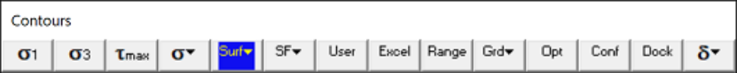
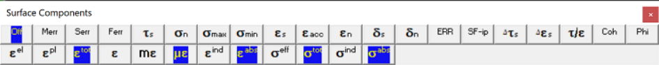
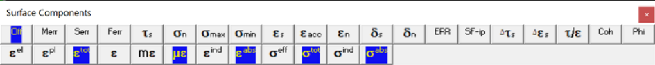
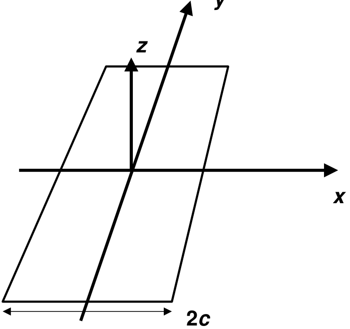
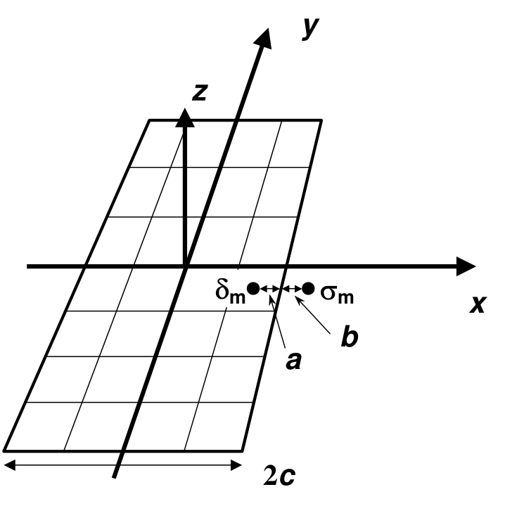
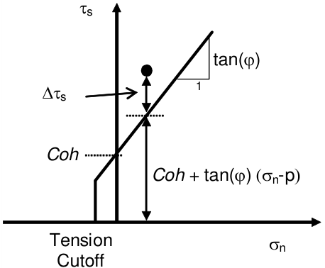

## 5.3.7.1 Oberflächenkonturen aus

Schaltet die Konturen aus.

Auf diese Komponente kann über die Symbolleiste Strength Factor Components wie folgt zugegriffen werden:

Diese Symbolleiste kann auf vertikale Ausrichtung umgestellt werden, indem sie an den rechten oder linken Rand des Hauptfensters gezogen wird.

Durch Ziehen an den oberen oder unteren Rand des Hauptfensters kann sie wieder horizontal ausgerichtet werden.

Mit der Schaltfläche in der Symbolleiste Contours wird die Symbolleiste Surface Components aktiviert.

## 5.3.7.2 Serr Spannungsfehler

Stellt den Oberflächenspannungsfehler als Konturen dar.

Auf diese Komponenten kann über die Symbolleiste Strength Factor Components wie folgt zugegriffen werden:

Diese Symbolleiste kann auf vertikale Ausrichtung umgestellt werden, indem sie an den rechten oder linken Rand des Hauptfensters gezogen wird.

Durch Ziehen an den oberen oder unteren Rand des Hauptfensters kann sie wieder horizontal ausgerichtet werden.

Mit der Schaltfläche in der Symbolleiste Contours wird die Symbolleiste Surface Components aktiviert.

Während der Matrixlösung versucht Map3D, die in der Koeffizientenmatrix gespeicherten simultanen Gleichungen zusammen mit allen weiteren Gleichungen, die Zonen mit abweichendem Material, Störungsgleiten, Kriechen usw. beschreiben, schrittweise zu lösen. Der iterative Löser arbeitet, indem er den Fehler der aktuellen Lösung jeder simultanen Gleichung (den Oberflächenspannungsfehler) bestimmt und diese Fehler dann durch sukzessive Approximation verringert.

Der Stress Error stellt den aktuellen Spannungsfehler auf allen Oberflächen als Konturen dar.

Der Maximum Stress Error stellt die Stellen, an denen die maximalen Spannungsfehler auftreten, als Konturen dar.

Eine konvergierte Lösung gilt als erreicht, wenn der maximale Oberflächenspannungsfehler und der maximale Fehler des Bruchkriteriums unter die vom Benutzer festgelegte Spannungstoleranz STOL fallen

Analysis > CParams

#### Related Topics:

Plot > Surface Components > Ferr - Failure Error

Analysis Dialog

## 5.3.7.3 Ferr Bruchfehler

Stellt den Fehler des Oberflächen-Bruchkriteriums als Konturen dar.

Auf diese Komponente kann über die Symbolleiste Strength Factor Components wie folgt zugegriffen werden:

Diese Symbolleiste kann auf vertikale Ausrichtung umgestellt werden, indem sie an den rechten oder linken Rand des Hauptfensters gezogen wird.

Durch Ziehen an den oberen oder unteren Rand des Hauptfensters kann sie wieder horizontal ausgerichtet werden.

Mit der Schaltfläche in der Symbolleiste Contours wird die Symbolleiste Surface Components aktiviert.

Während der Matrixlösung versucht Map3D, die in der Koeffizientenmatrix gespeicherten simultanen Gleichungen zusammen mit allen weiteren Gleichungen, die Zonen mit abweichendem Material, Störungsgleiten, Kriechen usw. beschreiben, schrittweise zu lösen. Der iterative Löser arbeitet, indem er den Fehler der aktuellen Lösung jeder simultanen Gleichung (den Oberflächenspannungsfehler) bestimmt und diese Fehler dann durch sukzessive Approximation verringert.

Eine konvergierte Lösung gilt als erreicht, wenn der maximale Oberflächenspannungsfehler und der maximale Fehler des Bruchkriteriums unter die vom Benutzer festgelegte Spannungstoleranz STOL fallen

Analysis > CParams

Der Fehler des Bruchkriteriums wird nur bei nichtlinearen Kriechanalysen verwendet (einschließlich Störungsgleiten und 3D-Materialnichtlinearität). Dieser Parameter sollte stets nahe null liegen, es sei denn, es wurde eine Viskosität angegeben und das Problem wird nichtlinear. In diesem letzteren Fall kann viskoses Kriechen Spannungszustände oberhalb des Bruchkriteriums zulassen, was auf fehlendes statisches Gleichgewicht hinweist.

#### Related Topics:

Plot > Surface Components > Serr - Stress Error

Analysis > Options > Creep Analysis Dialog

## 5.3.7.4 Schubspannung

Stellt die maximale Schubspannung in der Oberflächenebene als Konturen dar. Auf diese Komponente kann über die Symbolleiste Strength Factor Components wie folgt zugegriffen werden:

Diese Symbolleiste kann auf vertikale Ausrichtung umgestellt werden, indem sie an den rechten oder linken Rand des Hauptfensters gezogen wird.

Durch Ziehen an den oberen oder unteren Rand des Hauptfensters kann sie wieder horizontal ausgerichtet werden.

Mit der Schaltfläche in der Symbolleiste Contours wird die Symbolleiste Surface Components aktiviert.

In der elastischen Analyse wird die maximale Schubspannung in der Ebene üblicherweise zusammen mit der Normalspannung in der Ebene und dem Festigkeitskriterium nach Mohr-Coulomb verwendet, um das Ausmaß des Gleitens durch Überbeanspruchung auf einer Störung, Kluftschar oder Schichtfläche abzuschätzen.

Dagegen kann die maximale Schubspannung in der Ebene bei der nichtlinearen Analyse die Festigkeit nie überschreiten, es sei denn, es wird Kriechen verwendet. In diesem Fall kann viskoses Kriechen Spannungszustände oberhalb des Bruchkriteriums zulassen, was auf fehlendes statisches Gleichgewicht hinweist. Daher betrachtet man bei der nichtlinearen Analyse üblicherweise direkt das vom Modell vorhergesagte Ausmaß des Gleitens

Mohr-Coulomb in DD planes

Fault-Gouge in DD planes

Backfill-Hyperbolic in DD planes

Der Konturbereich wird festgelegt mit

Plot > Range

Diese Komponente kann bei Bedarf der Konturen-Symbolleiste hinzugefügt werden

Tools > Configure Contouring Toolbar

#### Related Topics:

Plot > Surface Components > Sn Normal Stress Plot > Surface Components > dTs - Excess Shear Stress Plot > Surface Components > dEs - Incremental Shear Strain Plot > Surface Components > Es - Shear Strain Plot > Surface Components > ds - Shear Displacement (Ride)

## 5.3.7.5 Normalspannung

Stellt die Spannung normal zur Oberfläche als Konturen dar.

Auf diese Komponente kann über die Symbolleiste Strength Factor Components wie folgt zugegriffen werden:

Diese Symbolleiste kann auf vertikale Ausrichtung umgestellt werden, indem sie an den rechten oder linken Rand des Hauptfensters gezogen wird.

Durch Ziehen an den oberen oder unteren Rand des Hauptfensters kann sie wieder horizontal ausgerichtet werden.

Mit der Schaltfläche in der Symbolleiste Contours wird die Symbolleiste Surface Components aktiviert.

In der elastischen Analyse wird die maximale Schubspannung in der Ebene üblicherweise zusammen mit der Normalspannung in der Ebene und dem Festigkeitskriterium nach Mohr-Coulomb verwendet, um das Ausmaß des Gleitens durch Überbeanspruchung auf einer Störung, Kluftschar oder Schichtfläche abzuschätzen.

Dagegen kann die maximale Schubspannung in der Ebene bei der nichtlinearen Analyse die Festigkeit nie überschreiten, es sei denn, es wird Kriechen verwendet. In diesem Fall kann viskoses Kriechen Spannungszustände oberhalb des Bruchkriteriums zulassen, was auf fehlendes statisches Gleichgewicht hinweist. Daher betrachtet man bei der nichtlinearen Analyse üblicherweise direkt das vom Modell vorhergesagte Ausmaß des Gleitens

Mohr-Coulomb in DD planes

Fault-Gouge in DD planes

Backfill-Hyperbolic in DD planes

Der Konturbereich wird festgelegt mit

Plot > Range

Diese Komponente kann bei Bedarf der Konturen-Symbolleiste hinzugefügt werden

Tools > Configure Contouring Toolbar

#### Related Topics:

Plot > Surface Components > Ts Shear Stress

Plot > Surface Components > dTs - Excess Shear Stress

Plot > Surface Components > dEs - Incremental Shear Strain

Plot > Surface Components > Es - Shear Strain

Plot > Surface Components > ds - Shear Displacement (Ride)

## 5.3.7.6 Maximale Tangentialspannung

Stellt die Spannungen tangential zur Oberfläche als Konturen dar. Auf diese Komponenten kann über die Symbolleiste Strength Factor Components wie folgt zugegriffen werden:

Diese Symbolleiste kann auf vertikale Ausrichtung umgestellt werden, indem sie an den rechten oder linken Rand des Hauptfensters gezogen wird.

Durch Ziehen an den oberen oder unteren Rand des Hauptfensters kann sie wieder horizontal ausgerichtet werden.

Mit der Schaltfläche in der Symbolleiste Contours wird die Symbolleiste Surface Components aktiviert.

Bei elastischen Analysen werden Tangentialspannungen nur auf Anforderung berechnet. Sie werden für den Lösungsprozess nicht benötigt und erfordern zusätzliche Analysezeit. Diese Berechnung wird durch Aktivieren von Analysis > Options > Calculate Tangential Stress Components angefordert.

Bei plastischen Analysen werden diese Werte standardmäßig berechnet.

Bei der elastischen Analyse wird die maximale Tangentialspannung oft als Randfaserspannung bezeichnet. Dies ist nützlich, um Stellen zu bestimmen, an denen die Spannungen die einaxiale Druckfestigkeit oder die Zugfestigkeit des Gebirges überschreiten.

Der Konturbereich wird festgelegt mit

Plot > Range

Diese Komponente kann bei Bedarf der Konturen-Symbolleiste hinzugefügt werden

Tools > Configure Contouring Toolbar

## 5.3.7.8 Scherdehnung

Stellt die Scherdehnung im Füllmaterial von DD-Elementen als Konturen dar. Auf diese Komponente kann über die Symbolleiste Strength Factor Components wie folgt zugegriffen werden:

Diese Symbolleiste kann auf vertikale Ausrichtung umgestellt werden, indem sie an den rechten oder linken Rand des Hauptfensters gezogen wird.

Durch Ziehen an den oberen oder unteren Rand des Hauptfensters kann sie wieder horizontal ausgerichtet werden.

Mit der Schaltfläche in der Symbolleiste Contours wird die Symbolleiste Surface Components aktiviert.

Die Scherdehnung wird bestimmt, indem die Scherverschiebung (ride) durch die Dicke der DD-Ebene geteilt wird.

CAD > Edit > Entity Properties > DDplane Thickess

Beachten Sie, dass drei Dehnungskomponenten als Konturen dargestellt werden können:

Plot > Surface Components > Value > Elastic Plot > Surface Components > Value > Plastic Plot > Surface Components > Value > Total

Außerdem gibt es zwei verschiedene Arten, die Dehnung darzustellen:

Plot > Strain > Value > Induced Strain Plot > Strain > Value > Absolute Strain

Beachten Sie, dass dies der aktuelle Wert der Scherdehnung ist, die auf die DD-Oberflächen wirkt.

Da die Verschiebung beim Gleiten die Richtung wechseln und sich sogar umkehren kann, kann die gesamte akkumulierte Scherdehnung andere Werte ergeben.

Der Konturbereich wird festgelegt mit

Plot > Range

Diese Komponente kann bei Bedarf der Konturen-Symbolleiste hinzugefügt werden

Tools > Configure Contouring Toolbar

#### Related Topics:

Plot > Surface Components > dEs - Incremental Shear Strain

Plot > Surface Components > ds - Shear Displacement (Ride)

## 5.3.7.10 Normaldehnung

Stellt die Normaldehnung im Füllmaterial von DD-Elementen als Konturen dar. Auf diese Komponente kann über die Symbolleiste Strength Factor Components wie folgt zugegriffen werden:

Diese Symbolleiste kann auf vertikale Ausrichtung umgestellt werden, indem sie an den rechten oder linken Rand des Hauptfensters gezogen wird.

Durch Ziehen an den oberen oder unteren Rand des Hauptfensters kann sie wieder horizontal ausgerichtet werden.

Mit der Schaltfläche in der Symbolleiste Contours wird die Symbolleiste Surface Components aktiviert.

Die Normaldehnung wird bestimmt, indem die Normalverschiebung (Konvergenz) durch die Dicke der DD-Ebene geteilt wird

#### CAD > Edit > Entity Properties > DDplane Thickess

Beachten Sie, dass drei Dehnungskomponenten als Konturen dargestellt werden können:

Plot > Surface Components > Value > Elastic Plot > Surface Components > Value > Plastic Plot > Surface Components > Value > Total

Der Konturbereich wird festgelegt mit

Plot > Range

Diese Komponente kann bei Bedarf der Konturen-Symbolleiste hinzugefügt werden

Tools > Configure Contouring Toolbar

#### Related Topics:

Plot > Surface Components > dn - Normal Displacement (Closure)

## 5.3.7.11 Scherverschiebung (Ride)

Stellt den Ride bzw. die Scherverschiebung auf DD-Elementen als Konturen dar. Auf diese Komponente kann über die Symbolleiste Strength Factor Components wie folgt zugegriffen werden:

Diese Symbolleiste kann auf vertikale Ausrichtung umgestellt werden, indem sie an den rechten oder linken Rand des Hauptfensters gezogen wird.

Durch Ziehen an den oberen oder unteren Rand des Hauptfensters kann sie wieder horizontal ausgerichtet werden.

Mit der Schaltfläche in der Symbolleiste Contours wird die Symbolleiste Surface Components aktiviert.

Beachten Sie, dass drei Komponenten der Scherverschiebung als Konturen dargestellt werden können:

Plot > Surface Components > Value > Elastic Plot > Surface Components > Value > Plastic Plot > Surface Components > Value > Total

Außerdem gibt es zwei verschiedene Arten, die Verschiebung darzustellen:

Plot > Strain > Value > Induced Strain Plot > Strain > Value > Absolute Strain

Der Konturbereich wird festgelegt mit

Plot > Range

Diese Komponente kann bei Bedarf der Konturen-Symbolleiste hinzugefügt werden

Tools > Configure Contouring Toolbar

#### Related Topics:

Plot > Surface Components > dEs - Incremental Shear Strain Plot > Surface Components > Es - Shear Strain

## 5.3.7.12 Normalverschiebung (Konvergenz)

Stellt die Konvergenz bzw. Normalverschiebung auf DD-Elementen als Konturen dar. Auf diese Komponente kann über die Symbolleiste Strength Factor Components wie folgt zugegriffen werden:

Diese Symbolleiste kann auf vertikale Ausrichtung umgestellt werden, indem sie an den rechten oder linken Rand des Hauptfensters gezogen wird.

Durch Ziehen an den oberen oder unteren Rand des Hauptfensters kann sie wieder horizontal ausgerichtet werden.

Mit der Schaltfläche in der Symbolleiste Contours wird die Symbolleiste Surface Components aktiviert.

Beachten Sie, dass drei Komponenten der Konvergenz als Konturen dargestellt werden können:

Plot > Surface Components > Value > Elastic Plot > Surface Components > Value > Plastic Plot > Surface Components > Value > Total

Der Konturbereich wird festgelegt mit

Plot > Range

Diese Komponente kann bei Bedarf der Konturen-Symbolleiste hinzugefügt werden

Tools > Configure Contouring Toolbar

#### Related Topics:

Plot > Surface Components > ds - Shear Displacement (Ride)

## 5.3.7.13 ERR

Berechnet die Energiefreisetzungsrate.

Auf diese Komponente kann über die Symbolleiste Strength Factor Components wie folgt zugegriffen werden:

Diese Symbolleiste kann auf vertikale Ausrichtung umgestellt werden, indem sie an den rechten oder linken Rand des Hauptfensters gezogen wird.

Durch Ziehen an den oberen oder unteren Rand des Hauptfensters kann sie wieder horizontal ausgerichtet werden.

Mit der Schaltfläche in der Symbolleiste Contours wird die Symbolleiste Surface Components aktiviert.

Mit dieser Routine kann der Benutzer die Energiefreisetzungsrate ( _ERR_ ) vor einer Abbaufront berechnen. Eine alternative Methode, mit der _ERR_ an jeder gewünschten Stelle berechnet werden kann, ist Analysis > Options > LERD/LSS

#### Crack-tip Formulation

Betrachten Sie einen ebenen Riss in einem unendlichen homogenen elastischen Medium. Bekanntlich zeigt die Rissöffnung d nahe der Rissspitze ein Ö _r_-Verhalten nahe der Front

und die Spannung s ein 1/Ö _r_-Verhalten

wobei _r_ den Abstand von der Rissspitze darstellt.

Die insgesamt freigesetzte Energie kann für ein kleines Vorrücken der Front a bestimmt werden, indem die Normalverschiebung (Konvergenz) mit der Spannung über dem Bereich a überlagert wird. Dazu muss das Koordinatensystem für d um den Abstand a versetzt werden, was ergibt

Die insgesamt freigesetzte Energie lässt sich dann berechnen aus (das Integral wird von 0 bis a genommen)

- _W_ = ½ ò s d _dr_

[4] = ½ _p_ d _p_ s ò Ö(a- _r_ )/Ö _r dr_ = ¼ p a _p_ d _p_ s

Die Energiefreisetzungsrate lässt sich nun durch Ableiten nach a bestimmen, was ergibt

Dieser Ausdruck setzt nur voraus, dass d nahe der Front ein Ö _r_-Verhalten und s nahe der Front ein 1/Ö _r_-Verhalten zeigt. Über die Geometrie wurden keine Annahmen getroffen. Es ist nicht erforderlich, dass _p_ d in irgendeiner Weise mit _p_ s zusammenhängt. Beachten Sie, dass diese Annahmen nur in einem unendlichen homogenen elastischen Medium zutreffen. In der Nähe von Bimaterial-Grenzflächen oder anderen Hohlraumoberflächen verlieren diese Annahmen ihre Gültigkeit.

#### Analytical Solution for a Planar Crack

Betrachten Sie einen ebenen Riss mit der Breite 2 _c_ und einer Länge vom Achtfachen der Breite.

Für eine solche Form lässt sich die Rissöffnung (Normalverschiebung bzw. Konvergenz) analytisch bestimmen als (im mittleren Querschnitt)

#### d = 4(1-n²)/ _E p_ Ö( _c_ ²- _x_ ²) [6]

wobei _E_ und n den Elastizitätsmodul (Gebirgsmaßstab – Verformungsmodul) nach Young bzw. die Poissonzahl darstellen und _p_ den homogenen Spannungszustand vor dem Abbau darstellt. Die Spannung vor der Rissspitze lässt sich ebenfalls analytisch bestimmen als

Die beim Verformen der Rissflächen geleistete Arbeit entspricht der insgesamt freigesetzten Energie und lässt sich wie folgt bestimmen (das Integral wird von - _c_ bis + _c_ genommen)

- _W_ = ½ ò _p_ d _dx_

[8] = 2p (1-n²) _p_ ²/ _E_ ò Ö( _c_ ²- _x_ ²) _dx_

- = p (1-n²) _p_ ² _c_ ²/ _E_

Mit zunehmender Risslänge lässt sich die pro Längeneinheit der Risserweiterung freigesetzte Energie durch Ableiten bestimmen als

Für die Erweiterung nur eines Rissendes erhalten wir die Energiefreisetzungsrate als die Hälfte dieses Werts

_ERR_ = p (1-n²) _p_ ² _c_ / _E_ [10]

#### Comparison with Planar Crack Solution

Vergleicht man nun die ebene Rissgeometrie mit der Rissspitzenformulierung, lässt sich beobachten, dass für den ebenen Riss (Vergleich der Gleichungen [1] und [2] mit [6] und [7])

_p_ d = 4(1-n²)/ _E p_ Ö(2 _c_ ) [11] _p_ s = _p_ Ö(c/2) [12]

Die Betrachtung dieser Gleichungen zeigt, dass diese beiden Parameter im Fall einer ebenen Rissgeometrie zusammenhängen über

_p_ d = 8(1-n²)/ _E p_ s [13]

Setzt man dies in Gleichung [5] für _ERR_ ein, ergibt sich

_ERR_ = p (1-n²) _p_ ² _c_ / _E_ [14]

dasselbe Ergebnis wie für den ebenen Riss (Gleichung [10]).

Durch verschiedene Substitutionen von _p_ d und _p_ s lässt sich bestimmen

_ERR_ = 2p (1-n²) p _p_ s²/ _E_ [15] und _ERR_ = 1/32 p _p_ d² _E_ /(1-n²) [16]

Diese letztere Gleichung ist derselbe Ausdruck, den Ryder und Jager hergeleitet haben (ihre Gleichung [11], S. 236, Rock Mechanics for Tabular Hard Rock Mines, 2002). Sie geben an, dass diese Gleichung zur Berechnung von _ERR_ in MINSIM verwendet wird. Offenbar ist auch eine Form von a-Randkorrektur (Ryder und Napier, Numerical Methods in Geomechanics, Nagoya, 1985) implementiert, doch die Einzelheiten, wie genau dies geschieht, sind unklar.

#### _ERR_ Calculation in Map3D

Sowohl _p_ d als auch _p_ s lassen sich aus der numerischen Modellierung bestimmen.

Beispielsweise lässt sich bei gegebener Normalverschiebung (Konvergenz) dm im Abstand _a_ hinter der vorrückenden Front _p_ d mit Gleichung [1] bestimmen als

Ebenso lässt sich bei gegebener Spannung sm im Abstand _b_ vor der vorrückenden Front _p_ s mit Gleichung [2] bestimmen als

Beachten Sie, dass es keinen Grund gibt, warum _a_ gleich _b_ sein müsste, und somit keine einheitlichen Randelementgrößen erforderlich sind.

Sobald _p_ d oder _p_ s oder beide bestimmt sind, lässt sich _ERR_ leicht aus Gleichung [5], [15] oder [16] berechnen.

Detaillierte Untersuchungen der Spannungs- und Verschiebungsverteilungen nahe der Rissspitze zeigen, dass bei konstanten DD-Elementen sowohl die Rissöffnung als auch die Spannung durchgängig überschätzt werden. Glücklicherweise hängt das Maß der Überschätzung eng mit der Elementgröße zusammen, und es zeigt sich, dass deutlich genauere Ergebnisse erzielt werden, wenn _a_ mit 3/2 und _b_ mit 2/3 multipliziert wird. Mit diesen Substitutionen und unter Verwendung der Gleichungen [17] und [18] lässt sich _ERR_ bestimmen aus

- _ERR_ = 1/6 p dm sm Ö(2/3 _b)_ / Ö(3/2 _a)_

- = 1/6 p dm sm Ö( _b_ / _a)_ [19]

Diese Gleichung wird zur Berechnung von _ERR_ in Map3D verwendet.

#### An Example

Mit _E_ von 60000 MPa, n von 0,25, _p_ von 100 MPa und _c_ von 100 m berechnen wir theoretische Werte von 707,11 für _p_ s, 0,088388 für _p_ d und 49,1 MN/m für _ERR_

Dies kann in Map3D mit einheitlichen Elementen der Breite _w_ modelliert werden, wobei sich folgende Ergebnisse ergeben:

|_w_(m)|_b_=_a_(m)|sm (MPa)|dm (m)|_ERR _(MN/m)|error|
|---|---|---|---|---|---|
|50|25|197.567|0.5209|53.9|+9.8%|
|25|12.5|262.669|0.3754|51.6|+5.2%|
|12.5|6.25|358.943|0.2679|50.3|+2.5%|
|10|5|398.56|0.2402|50.1|+2.1%|
|6.25|3.125|498.323|0.1903|49.6|+1.0%|
|5|2.5|554.58|0.1705|49.5|+0.9%|
|3.125|1.5625|697.764|0.1349|49.3|+0.4%|

Beachten Sie, dass die Spannung sm und die Normalverschiebung (Konvergenz) dm an den Elementmittelpunkten bestimmt werden. Da einheitliche Elementbreiten verwendet wurden, ist _a_ gleich _b_ gleich ½ _w_

## 5.3.7.14 SF-D Festigkeit/Spannung

Stellt das Verhältnis von Festigkeit zu Spannung auf DD-Elementen als Konturen dar. Auf diese Komponente kann über die Symbolleiste Strength Factor Components wie folgt zugegriffen werden:

Diese Symbolleiste kann auf vertikale Ausrichtung umgestellt werden, indem sie an den rechten oder linken Rand des Hauptfensters gezogen wird.

Durch Ziehen an den oberen oder unteren Rand des Hauptfensters kann sie wieder horizontal ausgerichtet werden.

Mit der Schaltfläche in der Symbolleiste Contours wird die Symbolleiste Surface Components aktiviert.

In der elastischen Analyse wird die maximale Schubspannung in der Ebene üblicherweise zusammen mit der Normalspannung in der Ebene und dem Festigkeitskriterium nach Mohr-Coulomb verwendet, um das Ausmaß des Gleitens durch Überbeanspruchung auf einer Störung, Kluftschar oder Schichtfläche abzuschätzen.

Dagegen kann die maximale Schubspannung in der Ebene bei der nichtlinearen Analyse die Festigkeit nie überschreiten, es sei denn, es wird Kriechen verwendet. In diesem Fall kann viskoses Kriechen Spannungszustände oberhalb des Bruchkriteriums zulassen, was auf fehlendes statisches Gleichgewicht hinweist. Daher betrachtet man bei der nichtlinearen Analyse üblicherweise direkt das vom Modell vorhergesagte Ausmaß des Gleitens

Mohr-Coulomb in DD planes

Fault-Gouge in DD planes

Backfill-Hyperbolic in DD planes

#### Mohr-Coulomb

Strength/Stress   kann bestimmt werden als  [ Cohesion + (sn-p) tan(j) ] / ts

dTs   Excess Shear Stress  kann bestimmt werden als Dts = ts - [ Cohesion + (sn-p) tan(j) ]

Wird der Fluiddruck als Teil des Stress State angegeben, wird die effektive Normalspannung (sn-p) verwendet (hier ist p der Fluiddruck).

Der Konturbereich wird festgelegt mit

Plot > Range

Diese Komponente kann bei Bedarf der Konturen-Symbolleiste hinzugefügt werden

Tools > Configure Contouring Toolbar

#### Related Topics:

Plot > Surface Components > dTs - Excess Shear Stress

## 5.3.7.15 Überschuss-Schubspannung

Stellt die Überschussspannung Dts auf DD-Elementen als Konturen dar.

Auf diese Komponente kann über die Symbolleiste Strength Factor Components wie folgt zugegriffen werden:

Diese Symbolleiste kann auf vertikale Ausrichtung umgestellt werden, indem sie an den rechten oder linken Rand des Hauptfensters gezogen wird.

Durch Ziehen an den oberen oder unteren Rand des Hauptfensters kann sie wieder horizontal ausgerichtet werden.

Mit der Schaltfläche in der Symbolleiste Contours wird die Symbolleiste Surface Components aktiviert.

Diese Funktion wird nur bei nichtlinearen Analysen verwendet (3D-FF-Blöcke in Map3D Non-Linear und DD-Ebenen in Map3D Fault-Slip). Einzelheiten finden Sie unter

CAD > Properties > Material Properties

In jedem Kriechschritt wird der Spannungszustand aller fließenden Elemente (Elemente, bei denen die Spannung die Festigkeit überschreitet) als Festigkeit plus Kriechwiderstand berechnet. Dies begrenzt die Größe des plastischen Kriechinkrements Deplastic an jedem fließenden Element

- ts = Strength + _C_ Deplastic /D _t_

- _C_ = _G_ D _t_

wobei der Kriechwiderstand als Kriechkoeffizient _C_ mal plastische Dehnungsrate bestimmt wird. Beachten Sie, dass der Benutzer sowohl den Kriechkoeffizienten _C_ als auch die Zeitschrittgröße D _t_ wählen und dann deren Quotienten als viskosen Modul _G_ angeben muss. Der Beitrag des Kriechinkrements zur Spannung ts ist die Überschussspannung, gegeben durch

Dts   = _C_ Deplastic /D _t_

Die akkumulierte plastische Dehnung eplastic wird als Summe der plastischen Kriechinkremente Deplastic aller Kriechschritte bestimmt.

#### Related Topics:

Plot > Surface Components > dEs - Incremental Shear Strain Plot > Surface Components > Ts - Shear Stress Plot > Surface Components > Es - Shear Strain

Analysis > Options > Creep

## 5.3.7.16 Inkrementelle Scherdehnung

Stellt das plastische Kriechinkrement Deplastic auf DD-Elementen als Konturen dar.

Auf diese Komponente kann über die Symbolleiste Strength Factor Components wie folgt zugegriffen werden:

Diese Symbolleiste kann auf vertikale Ausrichtung umgestellt werden, indem sie an den rechten oder linken Rand des Hauptfensters gezogen wird.

Durch Ziehen an den oberen oder unteren Rand des Hauptfensters kann sie wieder horizontal ausgerichtet werden.

Mit der Schaltfläche in der Symbolleiste Contours wird die Symbolleiste Surface Components aktiviert.

Diese Funktion wird nur bei nichtlinearen Analysen verwendet (3D-FF-Blöcke in Map3D Non-Linear und DD-Ebenen in Map3D Fault-Slip). Einzelheiten finden Sie unter

CAD > Properties > Material Properties

In jedem Kriechschritt wird der Spannungszustand aller fließenden Elemente (Elemente, bei denen die Spannung die Festigkeit überschreitet) als Festigkeit plus Kriechwiderstand berechnet. Dies begrenzt die Größe des plastischen Kriechinkrements Deplastic an jedem fließenden Element

- ts = Strength + _C_ Deplastic /D _t_

- _C_ = _G_ D _t_

wobei der Kriechwiderstand als Kriechkoeffizient _C_ mal plastische Dehnungsrate bestimmt wird. Beachten Sie, dass der Benutzer sowohl den Kriechkoeffizienten _C_ als auch die Zeitschrittgröße D _t_ wählen und dann deren Quotienten als viskosen Modul _G_ angeben muss. Der Beitrag des Kriechinkrements zur Spannung ts ist die Überschussspannung, gegeben durch

Dts   = _C_ Deplastic /D _t_

Die akkumulierte plastische Dehnung eplastic wird als Summe der plastischen Kriechinkremente Deplastic aller Kriechschritte bestimmt.

Beachten Sie: Da der Benutzer die Zeitschrittgröße D _t_ wählen muss, um den viskosen Modul _G_ zu definieren, lässt sich die Scherdehnungsrate aus der inkrementellen Scherdehnung Deplastic einfach durch Teilen durch die Zeitschrittgröße bestimmen.

#### Related Topics:

Plot > Surface Components > dTs - Excess Shear Stress

Plot > Surface Components > Ts - Shear Stress

Plot > Surface Components > Es - Shear Strain

Analysis > Options > Creep

## 5.3.7.17 Spannungs-/Dehnungsrate

Stellt die Überschussspannung geteilt durch das plastische Kriechinkrement Dts / Deplastic auf DD-Elementen als Konturen dar. Auf diese Komponente kann über die Symbolleiste Strength Factor Components wie folgt zugegriffen werden:

Diese Symbolleiste kann auf vertikale Ausrichtung umgestellt werden, indem sie an den rechten oder linken Rand des Hauptfensters gezogen wird.

Durch Ziehen an den oberen oder unteren Rand des Hauptfensters kann sie wieder horizontal ausgerichtet werden.

Mit der Schaltfläche in der Symbolleiste Contours wird die Symbolleiste Surface Components aktiviert.

Diese Funktion wird nur bei nichtlinearen Analysen verwendet (3D-FF-Blöcke in Map3D Non-Linear und DD-Ebenen in Map3D Fault-Slip). Einzelheiten finden Sie unter

CAD > Properties > Material Properties

In jedem Kriechschritt wird der Spannungszustand aller fließenden Elemente (Elemente, bei denen die Spannung die Festigkeit überschreitet) als Festigkeit plus Kriechwiderstand berechnet. Dies begrenzt die Größe des plastischen Kriechinkrements Deplastic an jedem fließenden Element

- ts = Strength + _C_ Deplastic /D _t_

- _C_ = _G_ D _t_

wobei der Kriechwiderstand als Kriechkoeffizient _C_ mal plastische Dehnungsrate bestimmt wird. Beachten Sie, dass der Benutzer sowohl den Kriechkoeffizienten _C_ als auch die Zeitschrittgröße D _t_ wählen und dann deren Quotienten als viskosen Modul _G_ angeben muss. Der Beitrag des Kriechinkrements zur Spannung ts ist die Überschussspannung, gegeben durch

Dts   = _C_ Deplastic /D _t_

Die akkumulierte plastische Dehnung eplastic wird als Summe der plastischen Kriechinkremente Deplastic aller Kriechschritte bestimmt.

#### Related Topics:

Plot > Surface Components > dTs - Excess Shear Stress Plot > Surface Components > dEs - Incremental Shear Strain Plot > Surface Components > Ts - Shear Stress Plot > Surface Components > Es - Shear Strain

#### Analysis > Options > Creep

## 5.3.7.18 Kohäsion

Stellt die Kohäsion und den Reibungswinkel des Störungsletten-Materials (Gouge) als Konturen dar. Auf diese Komponenten kann über die Symbolleiste Strength Factor Components wie folgt zugegriffen werden:

Diese Symbolleiste kann auf vertikale Ausrichtung umgestellt werden, indem sie an den rechten oder linken Rand des Hauptfensters gezogen wird.

Durch Ziehen an den oberen oder unteren Rand des Hauptfensters kann sie wieder horizontal ausgerichtet werden.

Mit der Schaltfläche in der Symbolleiste Contours wird die Symbolleiste Surface Components aktiviert.

Dies ist besonders interessant, wenn Sie den Materialtyp Equilibrated-Gouge verwenden, da Kohäsion und Reibungswinkel von Ort zu Ort variieren können.

## 5.3.7.20 Temperatur/Druckhöhe

Stellt die Temperatur oder die Druckhöhe als Konturen dar.

Mit Map3D Thermal-Fluid Flow lässt sich die stationäre Wärme-/Fluidströmung gekoppelt mit der Spannungsanalyse gleichzeitig lösen. Das Programm ist so aufgebaut, dass der Benutzer nur die Randbedingungen für Temperatur/Druckhöhe angeben muss; das gekoppelte Problem aus Spannung und thermischer/hydraulischer Strömung wird dann gleichzeitig gelöst. Diese Funktion ist nützlich zur Simulation von Erwärmungs- oder Abkühlungseffekten sowie des dränierten oder undränierten Verhaltens von Böden.

Weitere Einzelheiten finden Sie unter

#### Expansion Coefficient and Conductivity

Der Konturbereich wird festgelegt mit

Plot > Range

Diese Komponente kann bei Bedarf der Konturen-Symbolleiste hinzugefügt werden

Tools > Configure Contouring Toolbar

## 5.3.7.21 Normaler Fluss

Stellt die Durchflussrate normal zur Oberfläche als Konturen dar.

Mit Map3D Thermal-Fluid Flow lässt sich die stationäre Wärme-/Fluidströmung gekoppelt mit der Spannungsanalyse gleichzeitig lösen. Das Programm ist so aufgebaut, dass der Benutzer nur die Randbedingungen für Temperatur/Druckhöhe angeben muss; das gekoppelte Problem aus Spannung und thermischer/hydraulischer Strömung wird dann gleichzeitig gelöst. Diese Funktion ist nützlich zur Simulation von Erwärmungs- oder Abkühlungseffekten sowie des dränierten oder undränierten Verhaltens von Böden.

Weitere Einzelheiten finden Sie unter

Expansion Coefficient and Conductivity

Der Konturbereich wird festgelegt mit

Plot > Range

Diese Komponente kann bei Bedarf der Konturen-Symbolleiste hinzugefügt werden

Tools > Configure Contouring Toolbar

## 5.3.7.22 Wert

5.3.7.22.1  Elastische Dehnung

Wählt die elastische, plastische oder gesamte Dehnungskomponente aus. Auf diese Komponenten kann über die Symbolleiste Strain Components wie folgt zugegriffen werden:

Diese Symbolleiste kann auf vertikale Ausrichtung umgestellt werden, indem sie an den rechten oder linken Rand des Hauptfensters gezogen wird.

Durch Ziehen an den oberen oder unteren Rand des Hauptfensters kann sie wieder horizontal ausgerichtet werden.

Mit der Schaltfläche in der Symbolleiste Contours wird die Symbolleiste Stress Components aktiviert.

Sie können diese Schaltfläche über die Konfigurationsschaltfläche zur Symbolleiste Contours hinzufügen.

Einzelheiten finden Sie unter

Mohr-Coulomb in 3D FF blocks.

### 5.3.7.22.4 Absolute Dehnung

Stellt die induzierte oder absolute Dehnungskomponente dar.

Auf diese Komponente kann über die Symbolleiste Strain Components wie folgt zugegriffen werden:

Diese Symbolleiste kann auf vertikale Ausrichtung umgestellt werden, indem sie an den rechten oder linken Rand des Hauptfensters gezogen wird.

Durch Ziehen an den oberen oder unteren Rand des Hauptfensters kann sie wieder horizontal ausgerichtet werden.

Mit der Schaltfläche in der Symbolleiste Contours wird die Symbolleiste Stress Components aktiviert.

Sie können diese Schaltfläche über die Konfigurationsschaltfläche zur Symbolleiste Contours hinzufügen.

Die induzierte Dehnung ist die Dehnung ohne den Beitrag der Dehnung vor dem Abbau. Sie stellt die Dehnungsänderung gegenüber dem Zustand vor dem Abbau dar.

Die absolute Dehnung ist die Dehnung einschließlich des Beitrags der Dehnung vor dem Abbau.

Siehe auch:

Plot > Stress > Value > Induced Strain Plot > Stress > Value > Absolute Strain

### 5.3.7.22.6 Induzierte Spannung

Stellt die induzierte oder absolute Spannungskomponente dar. Auf diese Komponenten kann über die Symbolleiste Stress Components wie folgt zugegriffen werden:

Diese Symbolleiste kann auf vertikale Ausrichtung umgestellt werden, indem sie an den rechten oder linken Rand des Hauptfensters gezogen wird.

Durch Ziehen an den oberen oder unteren Rand des Hauptfensters kann sie wieder horizontal ausgerichtet werden.

Mit der Schaltfläche in der Symbolleiste Contours wird die Symbolleiste Stress Components aktiviert.

Die induzierte Spannung ist die Spannung ohne den Beitrag der Spannung vor dem Abbau. Sie stellt die Spannungsänderung gegenüber dem Zustand vor dem Abbau dar.

Die absolute Spannung ist die Spannung einschließlich des Beitrags der Spannung vor dem Abbau.

Siehe auch:

Plot > Strain > Value > Induced Strain

Plot > Strain > Value > Absolute Strain
