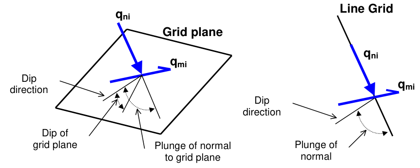
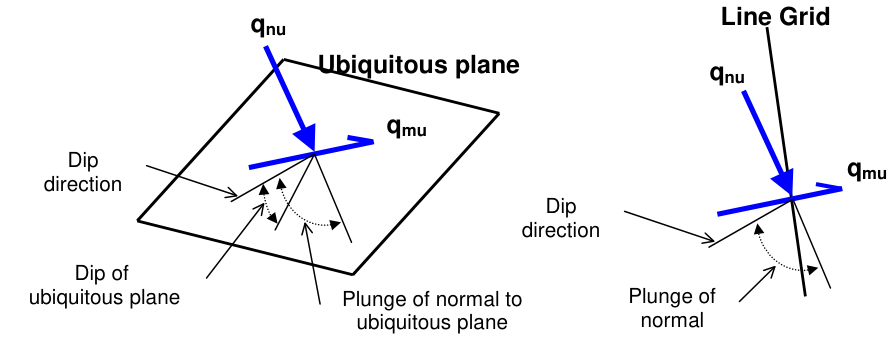

## 5.3.5.1 Plot > Thermal/Flux

Aktiviert die Symbolleiste Thermal/Flux – nach einer Map3D-BEM-Analyse der thermisch-hydraulischen Strömung.

Die Parameter für die Thermik-/Flussanalyse sind unter Expansion Coefficient und Conductivity beschrieben.

Diese Symbolleiste bietet schnellen Zugriff auf die Thermik- und Flusskomponenten.

Plot > Flux > t/h   Temperatur/Druckhöhe

Plot > Flux > qtotal = ( qx² + qy² + qz² )½ Gesamtfluss   stellt den Gesamtfluss als Konturen dar

Plot > Flux > qx X-Fluss   stellt die x-Komponente des Flusses als Konturen dar

Plot > Flux > qy Y-Fluss   stellt die y-Komponente des Flusses als Konturen dar

Plot > Flux > qz Z-Fluss   stellt die z-Komponente des Flusses als Konturen dar

Zur Berechnung des Flusses in der Ebene wird der Flusszustand an jedem Punkt der Rasterebene umorientiert, um den maximalen Fluss parallel zur Rasterebene und den Fluss normal zur Ebene zu bestimmen. Beachten Sie, dass qni normal zur Rasterebene und parallel zur Richtung eines Linienrasters orientiert ist.

Plot > Flux > qni Normal in der Ebene   stellt die Flusskomponente normal zur Rasterebene als Konturen dar.

Plot > Flux > qmi Maximum in der Ebene   stellt den maximalen Fluss tangential zur Rasterebene als Konturen dar.

Zur Berechnung des Flusses der ubiquitären Ebene Nr. 1 wird der Flusszustand an jedem Punkt der Rasterebene umorientiert, um den maximalen Fluss parallel zur ubiquitären Ebene Nr. 1 und den Fluss normal zur Ebene zu bestimmen. Beachten Sie, dass dmi nicht normal zur Rasterebene orientiert ist.

Plot > Flux > qnu Normal zur ubiquitären Ebene   stellt die Flusskomponente normal zur ubiquitären Ebene als Konturen dar.

Plot > Flux > qmu Maximum in der ubiquitären Ebene   stellt den maximalen Fluss tangential zur ubiquitären Ebene als Konturen dar.

- Die Einfallsrichtung wird im Uhrzeigersinn von der y-Achse aus positiv gemessen.

- Das Einfallen der Ebene wird von der Horizontalen aus nach unten positiv gemessen (d. h. in Einfallsrichtung).

- Das Abtauchen der Normalen wird von der Horizontalen aus nach unten positiv (d. h. nach oben negativ) gemessen.

#### Hinweise:

Die Symbolleiste für den Fluss kann erst nach der Modellaufbauphase (CAD) aktiviert werden

#### Map3D-Analysephasen.

Die Orientierung der ubiquitären Scherebene wird festgelegt mit

Plot > Strength Factors > Ubiquitous Parameters

Der Konturbereich wird festgelegt mit

#### Plot > Range

Diese Komponente kann bei Bedarf der Konturen-Symbolleiste hinzugefügt werden

Tools > Configure Contouring Toolbar > Displacement

Es kann praktisch sein, die Schaltfläche

#### More Flow Components

der Konturen-Symbolleiste hinzuzufügen, um schnell auf alle Strömungskomponenten zuzugreifen.
