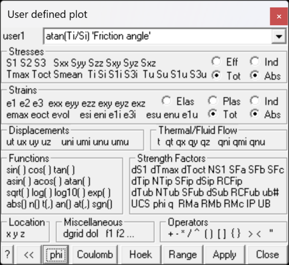

Stellt eine benutzerdefinierte Spannungskomponente als Konturen dar.

#### Stresses:

- S1 S2 S3 Hauptspannungskomponenten s1 s2 s3

- Sxx Syy Szz Sxy Syz Sxz kartesische Spannungskomponenten sxx syy szz txy tyz tzx

- Tmax maximale Schubspannung ½(s1 - s3)

- Toct oktaedrische Schubspannung toct = ¹/3 [(s1 - s2)² + (s2 - s3)² +(s3 - s1)²]½

- Smean mittlere Spannung smean = ¹/3 (s1 + s2 + s3)

- Ti Si maximale Schubspannung und Normalspannung in der Rasterebene tip sip

- S1i S3i maximale und minimale Spannung tangential zur Rasterebene s1i s3i

- Tu Su maximale Schubspannung und Normalspannung in der ubiquitären Ebene tub sub. Die Orientierung der ubiquitären Scherebene wird festgelegt mit

- S1u S3u maximale und minimale Spannung tangential zur ubiquitären Ebene s1u s3u \]

- Effective/Total Komponenten der effektiven Spannung oder der Gesamtspannung. Diese Optionen werden nur in Map3D Thermal-Fluid Flow verwendet, da dieser Code die Berechnung stationärer Porendruckverteilungen erlaubt.

- Induced/Absolute Komponenten der induzierten Spannung oder der absoluten Spannung (d. h. die Spannung ohne den Beitrag der Spannung vor dem Abbau).

#### Strains:

- e1 e2 e3 größte Hauptdehnung e1 e2 e3

- exx eyy ezz exy eyz exz kartesische Dehnungskomponenten exx eyy ezz exy eyz ezx

- emax maximale Scherdehnung ½(e1 - e3)

- eoct oktaedrische Scherdehnung eoct = ¹/3 [(e1 - e2)² + (e2 - e3)² +(e3 - e1)²]½

- evol Volumendehnung evol = (e1 + e2 + e3)

- esi eni maximale Scherdehnung und Normaldehnung in der Rasterebene esi eni

- e1i e3i maximale und minimale Dehnung tangential zur Rasterebene e1i e3i

- esu enu maximale Scherdehnung und Normaldehnung in der ubiquitären Ebene esu enu

- e1u e3u maximale und minimale Dehnung tangential zur ubiquitären Ebene e1u e3u

- Elastic/Plastic/Total elastische, plastische oder gesamte Dehnungskomponenten. Diese Optionen werden nur in Map3D Non-Linear verwendet, da dieser Code die Berechnung nichtlinearer Dehnungen erlaubt.

- Induced/Absolute induzierte Dehnung oder absolute Dehnungskomponenten (d. h. ohne den Beitrag der Spannung vor dem Abbau).

#### Displacements:

- ut Gesamtverschiebung, ihre Streichrichtung und ihr Abtauchen dt

- · ux uy uz kartesische Verschiebungskomponenten dx dy dz

- uni Verschiebung normal zur Rasterebene dni

- umi maximale Verschiebung tangential zur Rasterebene dmi

- unu Verschiebung normal zur ubiquitären Ebene dnu

- umu maximale Verschiebung tangential zur ubiquitären Ebene dmu

#### Thermal/Fluid Flow:

- t Temperatur/Druckhöhe

- qt Gesamtfluss, seine Streichrichtung und sein Abtauchen.

- qx qy qz kartesische Flusskomponenten.

- qni Verschiebung normal zur Rasterebene.

- qmi maximale Verschiebung tangential zur Rasterebene.

- qnu Verschiebung normal zur ubiquitären Ebene.

- qmu maximale Verschiebung tangential zur ubiquitären Ebene.

#### Functions:

- sin() cos() tan()   trigonometrische Funktionen Sinus, Kosinus und Tangens.

- asin() acos() atan()   inverse trigonometrische Funktionen.

- sqrt()   Quadratwurzelfunktion.

- log()   natürliche Logarithmusfunktion.

- log10()   Logarithmusfunktion zur Basis 10.

- exp()   Exponentialfunktion (Antilogarithmus).

- abs()   Absolutwert.

- n() an()   Normalverteilung und inverse Normalverteilung. Das bei der Normalverteilung verwendete Argument ist (Ds1/ _s_ ), das die überschüssige größte Hauptspannung geteilt durch die Standardabweichung darstellt (siehe ).

- t(,) at(,)   t-Verteilung und inverse t-Verteilung. Das bei der t-Verteilung verwendete Argument ist (Ds1/ ( _sg),n_ -2), wobei Ds1 die überschüssige größte Hauptspannung, _s_ die Standardabweichung, _n_ die Anzahl der Datenpunkte und _g_ den Faktor  [1 + 1/ _n_ + (s3 - sm) ²/s3²/( _n_ -1)]½ darstellt, wobei sm den Mittelwert von s3 und s3 die Standardabweichung von s3 darstellt.

- sgn()   Vorzeichenfunktion, die +1 für positive Werte, -1 für negative Werte und 0 für Werte mit einem Betrag kleiner als 10-12 liefert.

#### Strength:

- ds1 überschüssige größte Hauptspannung Ds1 = s1 - ( _UCS_ + _q_ s3 )

- dtmax überschüssige maximale Schubspannung Dtmax = ½(s1 - s3) - [ _UCS_ + ½(s1+s3) ( _q_ -1) ]/( _q_ +1) = [s1 - ( _UCS_ + _q_ s3) ]/( _q_ +1)

- dtoct überschüssige oktaedrische Schubspannung Dtoct = toct - [ _UCS_ + ( _q_ –1) smean ] Ö(2) /( _q_ +2)

- NS1 Wahrscheinlichkeit nach der Normalverteilung N(Ds1 /std)

- SFA Festigkeit/Spannung kann für Mohr-Coulomb als ( _UCS_ + _q_ s3 )/ s1 bestimmt werden

- oder für Hoek-Brown als [ s3 + Ö( _m_ scs3 + _s_ sc²) ] / s1

- SFB Festigkeit/Spannung kann für Mohr-Coulomb als ( _UCS_ + _q_ s3 - s3 )/(s1 - s3) oder für Hoek-Brown als [ s3 + Ö( _m_ scs3 + _s_ sc²) ] / (s1 - s3) bestimmt werden

- SFC Festigkeit/Spannung kann für Mohr-Coulomb als [ _UCS_ + ½(s1+s3) ( _q_ -1) ]/[ ½(s1 - s3)( _q_ +1) ] bestimmt werden

oder für Hoek-Brown als &#123;Ö[1 /16 _m_ ²sc² + ½(s1 + s3) _m_ sc + _s_ sc²] - ¼ _m_ sc&#125;/(s1 - s3)

- dTip überschüssige Schubspannung in der Ebene Dtip = tip - [ Cohesion + sip tan(j) ]

- NTip Wahrscheinlichkeit nach der Normalverteilung N(Dtip /std)

- SFip Festigkeit/Spannung kann als [ Cohesion + sip tan(j) ] / tip bestimmt werden

- dSip überschüssige Wandspannung in der Ebene Dsip = [ 3 s1i - s3i ] - UCS

- RCFip Gebirgszustandsfaktor (Rock Condition Factor) für die Wandspannung in der Ebene RCFip = [ 3 s1i - s3i ]/UCS

- dTub überschüssige Schubspannung in der ubiquitären Ebene Dtub

- NTub Wahrscheinlichkeit nach der Normalverteilung N(Dtub /std)

- SFub Festigkeit/Spannung kann als [ Cohesion + sub tan(j) ] / tub bestimmt werden

- dSub überschüssige Wandspannung in der ub-Ebene Dsub = [ 3 s1ub - s3ub ] - UCS

- RCFub Gebirgszustandsfaktor für die Wandspannung in der ub-Ebene RCFip = [ 3 s1ub - s3ub ]/UCS

- UB# Stellt die Nummer der UB-Schar (1, 2 oder 3) dar, die den größten Wert von Dtub hat

- _UCS phi q_ Mohr-Coulomb-Festigkeitsparameter, definiert mit Plot > Strength Factors > Rockmass Strength Parameters; beachten Sie, dass diese Parameter nur definiert sind, wenn das Festigkeitskriterium nach Mohr-Coulomb oder Drucker-Prager angegeben wurde

- _RMa_ Gebirgsfestigkeit, definiert für Mohr-Coulomb als ( _UCS_ + _q_ s3 )

oder für Hoek-Brown als [ s3 + Ö( _m_ scs3 + _s_ sc²) ]

- _RMb_ Gebirgsfestigkeit, definiert für Mohr-Coulomb als ( _UCS_ + _q_ s3 - s3 )

- oder für Hoek-Brown als [ Ö( _m_ scs3 + _s_ sc²) ]

- _RMc_ Gebirgsfestigkeit, definiert für Mohr-Coulomb als [ _UCS_ + ½(s1+s3) ( _q_ -1) ]/( _q_ +1) oder für Hoek-Brown als &#123;Ö[1 /16 _m_ ²sc² + ½(s1 + s3) _m_ sc + _s_ sc²] - ¼ _m_ sc&#125;/2

- _IP_ Festigkeit in der Ebene, definiert mit Mohr-Coulomb als [ Cohesion + sip tan(j) ]

- _UB_ Ubiquitäre Festigkeit, definiert mit Mohr-Coulomb als [ Cohesion + sub tan(j) ]

- _sc_ Hoek-Brown-Festigkeitsparameter, definiert mit Plot > Strength Factors > Rockmass Strength Parameters; beachten Sie, dass dieser Parameter nur definiert ist, wenn das Festigkeitskriterium nach Hoek-Brown angegeben wurde

#### Location:

- x y z   Koordinate des Rasterpunkts.

#### Miscellaneous:

- Dgrid Abstand zur nächsten Oberfläche von jedem Rasterpunkt aus.

- Dol Abstand zum nächsten Raster _Dgrid_ geteilt durch den Rasterabstand _Lgrid_ .

- f1 f2... benutzerdefinierte Materialparameter. Diese können mit Plot > Properties > Material Properties > User defined Parameters definiert werden.

#### Operators:

- + - * / ^   Operatoren für Addition, Subtraktion, Multiplikation, Division und Potenzierung. Beachten Sie, dass zuerst Potenzen berechnet werden, dann Multiplikation und Division und zuletzt Addition und Subtraktion.

- () [] &#123;&#125;   Klammerarten. Klammerpaare müssen zusammenpassen.

- >   Maximalwert. Wird die Darstellungsgleichung beispielsweise als s1 > 10 angegeben, wird der größere der Werte s1 und 10 dargestellt.

- &lt;   Minimalwert. Wird die Darstellungsgleichung beispielsweise als s1 &lt; 10 angegeben, wird der kleinere der Werte s1 und 10 dargestellt.

- " "   Kommentar.

#### Other:

- phi:   atan(Ti/Si) stellt den Reibungswinkel dar, der nötig ist, um dem Gleiten auf einer Störung, Kluftschar oder Schichtfläche zu widerstehen, die genauso orientiert ist wie die Rasterebene.

- Mohr-Coulomb:   60 + S3*tan(45+30/2)^2   stellt die Festigkeit für ein Mohr-Coulomb-Kriterium mit einer UCS von 60 und einem Reibungswinkel von 30° dar. Hier kann auch die Gleichung _UCS_ + S3* _q_ oder alternativ _UCS_ +S3*tan(45+ _phi_ /2)^2 verwendet werden, wenn die Festigkeitsparameter zuvor

- mit Plot > Strength Factors > Rockmass Strength Parameters definiert wurden.

- Hoek:     S3 + sqrt( 0.1*60*S3 + 0.005*60^2 )   stellt die Festigkeit für ein Hoek-Brown-Kriterium mit sc von 60, m von 0.1 und s von 0.005 dar.

- Range – legt den Konturbereich fest.

- Plot – erzeugt die Konturdarstellung neu.

Im Dropdown-Fenster können bis zu 20 verschiedene Gleichungen gespeichert werden. Diese werden zwischen Map3D-Sitzungen in der Datei map3d.ini gespeichert.
