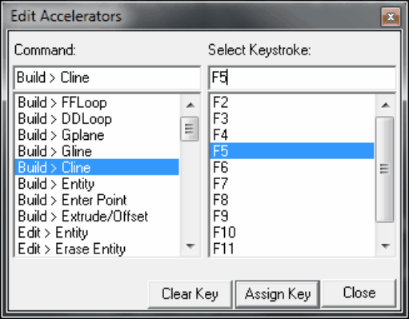

Ermöglicht die Festlegung benutzerdefinierter Tastenkürzel.

Um beispielsweise die Taste F5 der Funktion Build > Cline zuzuweisen, weisen Sie die Funktionstaste wie folgt zu:

- Beachten Sie, dass Funktionstastenzuweisungen sitzungsübergreifend in der Datei Map3D.cfg gespeichert werden.
