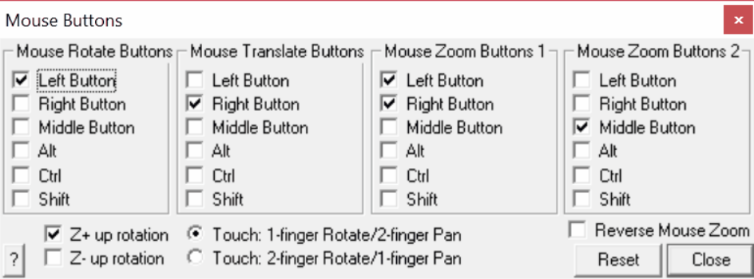

## 5.6.1.1 Maustasten

Ermöglicht es Ihnen, benutzerdefinierte Funktionen für Drehen, Verschieben und Zoomen mit der Maus festzulegen.

Beachten Sie, dass für jede Funktion höchstens zwei Tasten festgelegt werden können. Diese Tasten werden von Sitzung zu Sitzung gespeichert.

Z+ up rotation – legt fest, dass die Z+-Achse vertikal ausgerichtet bleibt, sodass bei nach oben zeigender Z+-Achse das Ziehen der Maus nach links das Modell nach links dreht.

Z- up rotation – kehrt die obige Annahme um. In diesem Fall bleibt die Z+-Achse vertikal ausgerichtet, sodass bei nach oben zeigender Z+-Achse das Ziehen der Maus nach links das Modell nach rechts dreht.

Touch: 1-finger Rotate/2-finger Pan – Touchscreen-Steuerung, bei der Ziehen mit 1 Finger das Modell dreht und Ziehen mit 2 Fingern es verschiebt.

Touch: 2-finger Rotate/1-finger Pan – Touchscreen-Steuerung, bei der Ziehen mit 2 Fingern das Modell dreht und Ziehen mit 1 Finger es verschiebt.

Touch Zoom – Zusammenziehen mit zwei Fingern zoomt das Modell.

Reverse Mouse Wheel – kehrt die Wirkung des Mausrads um, sodass Vorwärtsdrehen das Modell vergrößert statt verkleinert.

## 5.6.1.2 Doppelklickzeit

Legt die Zeit (in Millisekunden) zwischen den beiden Klicks eines Doppelklicks fest.

Doppelklicks werden verwendet, um Bearbeitungsfunktionen zu aktivieren

CAD > Edit

## 5.6.1.3 Wartezeit für Ziehen

Legt die Zeit (in Millisekunden) fest, die Sie eine Maustaste gedrückt halten müssen, bevor der Ziehen-Mauszeiger erscheint.

Der Ziehen-Mauszeiger wird zum Drehen, Verschieben und Zoomen des Modells verwendet.
