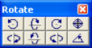
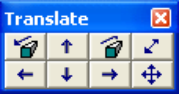
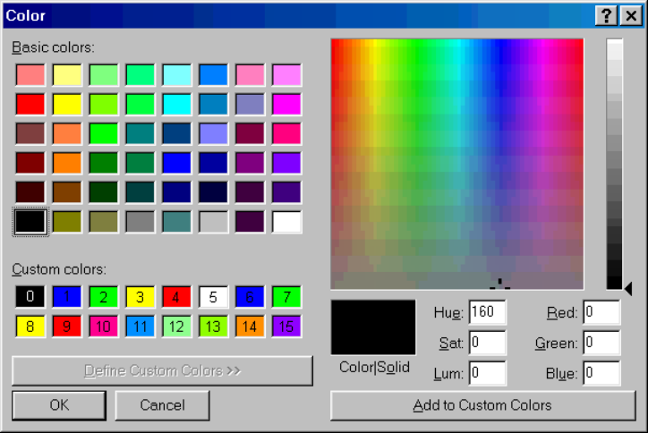

## 5.6.2.1 Drehen-Symbolleiste

Aktiviert die Symbolleiste zum Drehen.

Das Modell kann mit diesen Schaltflächen oder durch Ziehen des Orientierungssymbols in die gewünschte Position gedreht werden.

Rotate Counter clockwise (Einfg-Taste)

Rotate Up (Pos1-Taste oder Umschalt+Pfeil nach oben)

Rotate Clockwise (Bild-auf-Taste)

Rotate Left (Entf-Taste oder Umschalt+Pfeil nach links)

Rotate Down (Ende-Taste oder Umschalt+Pfeil nach unten)

Rotate Right (Bild-ab-Taste oder Umschalt+Pfeil nach rechts)

View > Centre of Rotation

View > Rotation Increment

Hinweise:

Ist die Symbolleiste zum Drehen nicht sichtbar, kann sie aktiviert werden mit

Tools > Rotation Toolbar

Bevor Sie das Modell drehen, sollten Sie den gewünschten Drehmittelpunkt festlegen

View > Centre of Rotation

## 5.6.2.2 Verschieben-Symbolleiste

Aktiviert die Symbolleiste zum Verschieben.

Das Modell kann mit diesen Schaltflächen oder durch Ziehen des Modells in die gewünschte Position verschoben werden.

Zoom In (Eingabetaste oder „+“-Taste) Translate Up (Pfeil nach oben) Zoom Out (Strg+Eingabe oder „-“-Taste) Translate Left (Pfeil nach links) Translate Down (Pfeil nach unten) Translate Right (Pfeil nach rechts) View > Zoom Factor

View > Translation Increment

Hinweise:

Ist die Symbolleiste zum Verschieben nicht sichtbar, kann sie aktiviert werden mit

Tools > Translation Toolbar

Bevor Sie hineinzoomen

Zoom In

sollten Sie den gewünschten Drehmittelpunkt festlegen

View > Centre of Rotation

## 5.6.2.3 Konturen-Symbolleiste

Aktiviert die Konturen-Symbolleiste – nach einer Map3D-BEM-Analyse.

Die Standardkonfiguration dieser Symbolleiste ist wie folgt:

Diese Symbolleiste bietet schnellen Zugriff auf häufig verwendete Spannungsparameter.

Plot > Stress > S1 Major Principal Stress

Plot > Stress > S3 Minor Principal Stress

Plot > Stress > Tmax Maximum Shear Stress

Plot > Stress aktiviert die Spannungs-Symbolleiste. Diese Symbolleiste enthält alle Spannungskomponenten.

Plot > Surface Components aktiviert die Oberflächen-Symbolleiste. Diese Symbolleiste enthält alle Oberflächenkomponenten.

Plot > Strength Factors aktiviert die Symbolleiste für Festigkeitsfaktoren. Diese Symbolleiste enthält alle Komponenten der Festigkeitsparameter.

Plot > Stress > User Benutzerdefinierte Spannungsdarstellung.

Plot > Range legt den Konturbereich (Minimum, Maximum, Intervall ...) der aktuell dargestellten Kontur fest.

Plot > Grid Selection Aktiviert die Symbolleiste zur Rasterauswahl.

Plot > Surface Components > Options legt die Optionen der Konturdarstellung fest (Trajektorien, Konturlinien ...).

Tools > Contouring Toolbar Configure fügt der Konturen-Symbolleiste Schaltflächen hinzu oder entfernt sie.

Hinweise:

Schaltflächen können auf der Symbolleiste verschoben werden, indem Sie einfach die linke Maustaste gedrückt halten und die Schaltfläche an die gewünschte Position ziehen.

Die Konturen-Symbolleiste kann erst nach der Modellaufbauphase (CAD) aktiviert werden

Map3D-Analysephasen.

## 5.6.2.4 Konturen-Symbolleiste konfigurieren

Fügt der Konturen-Symbolleiste Schaltflächen hinzu oder entfernt sie.

Aktivieren oder deaktivieren Sie einfach das gewünschte Element, um es der Symbolleiste hinzuzufügen oder davon zu entfernen.

Hinweise:

Die Konturen-Symbolleiste kann erst aktiviert werden

#### Tools > Contouring toolbar

nach der Modellaufbauphase (CAD)

Map3D-Analysephasen.

Schaltflächen können auf der Symbolleiste verschoben werden, indem Sie einfach die linke Maustaste gedrückt halten und die Schaltfläche an die gewünschte Position ziehen.

Die Konfiguration der Symbolleiste wird zwischen Analysen in der Datei map3d.ini gespeichert.

## 5.6.2.5 Lösen-Symbolleiste

Aktiviert die Symbolleiste zum Lösen – während der Map3D-BEM-Analyse.

Die Standardkonfiguration dieser Symbolleiste ist wie folgt:

Diese Symbolleiste bietet schnellen Zugriff auf Parameter, die in der Lösungsphase der Map3D-BEM-Analyse wichtig sind

#### Analysis > BEM Analysis

Plot > Surface Components > Serr Stress Error Plot > Surface Components > Ferr Failure Error Plot > Surface Components > Shear Stress Plot > Surface Components > Normal Stress Plot > Surface Components > Shear Displacement (Ride)

Plot > Surface Components aktiviert die Oberflächen-Symbolleiste mit allen Oberflächenkomponenten. Plot > Range legt den Konturbereich (Minimum, Maximum, Intervall ...) der aktuell dargestellten Kontur fest.

Plot > Surface Components > Options legt die Optionen der Konturdarstellung fest (Trajektorien, Konturlinien ...).

Tools > Solve Toolbar Configure fügt der Lösen-Symbolleiste Schaltflächen hinzu oder entfernt sie.

Hinweise:

Während der Analyse wird die Lösen-Symbolleiste angezeigt, wenn Sie die Analyse unterbrechen

#### Analysis > Suspend.

Ist diese Option nicht aktiviert, wird die Lösen-Symbolleiste beim Unterbrechen der Map3D-BEM-Analyse nicht aktiviert.

Schaltflächen können auf der Symbolleiste verschoben werden, indem Sie einfach die linke Maustaste gedrückt halten und die Schaltfläche an die gewünschte Position ziehen.

Die Lösen-Symbolleiste kann erst nach der Modellaufbauphase (CAD) aktiviert werden

#### Map3D-Analysephasen.

Verwandte Themen:

Analysis > Auto Plot.

Analysis > Auto Range.

## 5.6.2.6 Lösen-Symbolleiste konfigurieren

Fügt der Lösen-Symbolleiste Schaltflächen hinzu oder entfernt sie.

Aktivieren oder deaktivieren Sie einfach das gewünschte Element, um es der Symbolleiste hinzuzufügen oder davon zu entfernen.

Hinweise:

Die Lösen-Symbolleiste kann erst aktiviert werden

#### Tools > Solve toolbar

nach der Modellaufbauphase (CAD)

#### Map3D-Analysephasen

Während der Analyse wird die Lösen-Symbolleiste angezeigt, wenn Sie die Analyse unterbrechen

#### Analysis > Suspend

Schaltflächen können auf der Symbolleiste verschoben werden, indem Sie einfach die linke Maustaste gedrückt halten und die Schaltfläche an die gewünschte Position ziehen.

Die Konfiguration der Symbolleiste wird zwischen Analysen in der Datei map3d.ini gespeichert.

## 5.6.2.7 Ansicht-Symbolleiste

Aktiviert die Ansicht-Symbolleiste.

Die Standardkonfiguration dieser Symbolleiste ist wie folgt

Diese Symbolleiste bietet schnellen Zugriff auf verschiedene Ansichtsfunktionen.

View > Centre of Rotation   Legt den Drehmittelpunkt fest. Dieser Punkt bleibt fest, während Sie die Anzeige drehen und zoomen.

View > Zoom   aktiviert ein grafisches Zoomfenster. Sie werden aufgefordert, die beiden Ecken des Fensters jeweils mit einem einfachen Mausklick auszuwählen.

View > Pan   aktiviert ein grafisches Verschieben. Sie werden aufgefordert, die beiden Enden des Verschiebungsvektors jeweils mit einem einfachen Mausklick auszuwählen.

View > Length   aktiviert ein grafisches Längenmesswerkzeug. Sie werden aufgefordert, die beiden Enden des Längenvektors jeweils mit einem einfachen Mausklick auszuwählen. Diese Punkte müssen auf dem Modell oder auf einer Kontur ausgewählt werden. Länge, Einfallen und Einfallsrichtung des ausgewählten Vektors werden angegeben. Wenn Sie beim Auswählen der Punkte die Umschalttaste gedrückt halten, können Sie eine Linie aus mehreren Segmenten definieren und die Gesamtlänge ermitteln. Wenn Sie auf einer Konturdarstellung eine geschlossene Polygonform definieren (durch Gedrückthalten der Umschalttaste beim Auswählen der Punkte), wird der mittlere Konturwert innerhalb des Polygons angegeben (siehe Plot > Polygon Box). Einfache rechteckige Fenster können definiert werden, indem Sie die Umschalttaste gedrückt halten und ein Fenster aufziehen.

View > Hide aktiviert die Ausblenden-Symbolleiste.

View > Hide Block Colours aktiviert die Symbolleiste zum Ausblenden von Blockfarben.

View > Hide CLine Colours aktiviert die Symbolleiste zum Ausblenden von Konstruktionslinienfarben.

File > Mining Step aktiviert die Symbolleiste zur Auswahl des Abbauschritts.

Tools > View Toolbar Configure fügt der Ansicht-Symbolleiste Schaltflächen hinzu oder entfernt sie.

Hinweise:

Schaltflächen können auf der Symbolleiste verschoben werden, indem Sie einfach die linke Maustaste gedrückt halten und die Schaltfläche an die gewünschte Position ziehen.

## 5.6.2.8 Ansicht-Symbolleiste konfigurieren

Fügt der Ansicht-Symbolleiste Schaltflächen hinzu oder entfernt sie.

Aktivieren oder deaktivieren Sie einfach das gewünschte Element, um es der Symbolleiste hinzuzufügen oder davon zu entfernen.

Hinweise:

Schaltflächen können auf der Symbolleiste verschoben werden, indem Sie einfach die linke Maustaste gedrückt halten und die Schaltfläche an die gewünschte Position ziehen.

Die Konfiguration der Symbolleiste wird zwischen Analysen in der Datei map3d.ini gespeichert.

## 5.6.2.9 CAD-Symbolleiste

Aktiviert die CAD-Symbolleiste.

Die Standardkonfiguration dieser Symbolleiste ist wie folgt:

Diese Symbolleiste bietet schnellen Zugriff auf CAD-Funktionen, die in der Phase des Modellaufbaus und der Modellbearbeitung der Map3D-BEM-Analyse verwendet werden

#### Analysis > Go to CAD

CAD > Build Aktiviert die Aufbau-Symbolleiste zum Erstellen neuer Modellobjekte.

CAD > Snap Aktiviert die Fang-Symbolleiste (Snap) zum Einstellen des Fangmodus. CAD > Edit Aktiviert die Bearbeiten-Symbolleiste zum Ändern von Modellobjekten. CAD > Grid Selection Aktiviert die Symbolleiste zur Rasterauswahl zum Anzeigen von Rastern. Tools > CAD Toolbar > Configure Fügt Schaltflächen hinzu oder entfernt sie.

Hinweise:

Die CAD-Symbolleiste wird nur während der Phase des Modellaufbaus und der Modellbearbeitung der Analyse angezeigt

#### Analysis > Go to CAD

Ist diese Option nicht aktiviert, wird die CAD-Symbolleiste während der Phase des Modellaufbaus und der Modellbearbeitung nicht aktiviert.

Schaltflächen können auf der Symbolleiste verschoben werden, indem Sie einfach die linke Maustaste gedrückt halten und die Schaltfläche an die gewünschte Position ziehen.

Verwandte Themen:

Map3D Analysis Stages

## 5.6.2.10 CAD-Symbolleiste konfigurieren

Fügt der CAD-Symbolleiste Schaltflächen hinzu oder entfernt sie.

Aktivieren oder deaktivieren Sie einfach das gewünschte Element, um es der Symbolleiste hinzuzufügen oder davon zu entfernen.

Hinweise:

Die CAD-Symbolleiste kann erst aktiviert werden

#### Tools > CAD toolbar

während der Modellaufbauphase (CAD)

#### Map3D-Analysephasen

Schaltflächen können auf der Symbolleiste verschoben werden, indem Sie einfach die linke Maustaste gedrückt halten und die Schaltfläche an die gewünschte Position ziehen.

Die Konfiguration der Symbolleiste wird zwischen Analysen in der Datei map3d.ini gespeichert.

## 5.6.2.11 Blockfarben

Weist benutzerdefinierte Farben für das Rendern von Blöcken zu.

Map3D verwendet 16 Grundfarben für das Rendering.

Der Benutzer kann den Grundfarben beliebige Farben zuweisen, und Map3D erzeugt daraus automatisch Schattierungen für das Rendering.

Die Farben werden wie folgt verwendet:

- Colour 0 - Bildschirmhintergrundfarbe.

- Colour 1-4 – Farben für Gummiband und Markierungen.

- Colour 5 – Vordergrundfarbe, verwendet für Text, Blockumrisse, Trajektoriensymbole und Rasterlinien.

- Colour 6 – Blockfarbnummer 1, 11, 21, 31, ...

- Colour 7 - Blockfarbnummer 2, 12, 22, 32, ...

- Colour 8 - Blockfarbnummer 3, 13, 23, 33, ...

- Colour 9 - Blockfarbnummer 4, 14, 24, 34, ...

- Colour 10 - Blockfarbnummer 5, 15, 25, 35, ...

- Colour 11 - Blockfarbnummer 6, 16, 26, 36, ...

- Colour 12 - Blockfarbnummer 7, 17, 27, 37, ...

- Colour 13 - Blockfarbnummer 8, 18, 28, 38, ...

- Colour 14 - Blockfarbnummer 9, 19, 29, 39, ...

- Colour 15 - Blockfarbnummer 10, 20, 30, 40, ...

Das Neuzuweisen einer Farbe erfolgt in drei Schritten:

1. Wählen Sie die Farbe, die Sie neu definieren möchten, aus einer der „Custom Colors:“ aus.

2. Legen Sie die gewünschte neue Farbe fest, indem Sie sie aus den „Basic Colors:“ oder der „Color Matrix“ auswählen oder „Hue: Sat: Lum: Red: Green: Blue:“ einstellen.

3. Klicken Sie auf die Schaltfläche „Add to Custom Colors“.

Alle Farben können auf die ursprünglichen Map3D-Standardwerte zurückgesetzt werden, indem Sie

#### Tools > Set Default Block Colours

auswählen. Die benutzerdefinierten Farben werden zwischen Analysen in der Datei map3d.ini gespeichert.

## 5.6.2.12 Konturfarben

Weist benutzerdefinierte Farben für das Rendern von Konturen zu.

Map3D verwendet 16 Grundfarben für die Konturdarstellung.

Die Farben werden wie folgt verwendet:

- Colour 0 - Bildschirmhintergrundfarbe.

- Colour 1 – Konturfarbe unterhalb des Bereichs.

- Colour 2 bis 11 – Konturfarben.

- Colour 12 Konturfarbe oberhalb des Bereichs.

- Colour 13 – Farbe der Zuggrenze.

- Colour 15 – Vordergrundfarbe, verwendet für Text, Blockumrisse, Trajektoriensymbole und Rasterlinien.

Das Neuzuweisen einer Farbe erfolgt in drei Schritten:

1. Wählen Sie die Farbe, die Sie neu definieren möchten, aus einer der „Custom Colors:“ aus.

2. Legen Sie die gewünschte neue Farbe fest, indem Sie sie aus den „Basic Colors:“ oder der „Color Matrix“ auswählen oder „Hue: Sat: Lum: Red: Green: Blue:“ einstellen.

3. Klicken Sie auf die Schaltfläche „Add to Custom Colors“.

Die benutzerdefinierten Farben werden zwischen Analysen in der Datei map3d.ini gespeichert.

Die Konturfarben können auf die Map3D-Standardwerte zurückgesetzt werden, indem Sie

Tools > Set Contour Colours

auswählen.

## 5.6.2.13 Standard-Blockfarben festlegen

Setzt alle Farben auf die ursprünglichen Map3D-Standardwerte zurück.

Benutzerdefinierte Farben können festgelegt werden mit

Tools > Custom Colours

## 5.6.2.14 Konturfarben festlegen 1

Setzt alle Farben auf die ursprünglichen Map3D-Standardwerte zurück.

Benutzerdefinierte Farben können festgelegt werden mit

#### Tools > Contour Colours

## 5.6.2.18 Schaltflächenschrift konfigurieren

Weist den Schaltflächen eine benutzerdefinierte Schriftart, -größe, -farbe usw. zu.

Map3D verwendet die „Windows System Font“, um alle Schaltflächen zu zeichnen.

Der Benutzer kann diese Schriftart und ihre Darstellungsmerkmale neu definieren.

Die Schriftart kann auf den ursprünglichen Map3D-Standardwert zurückgesetzt werden, indem Sie

#### Tools > Reset Default Font

auswählen. Die benutzerdefinierte Schriftart wird zwischen Analysen in der Datei map3d.ini gespeichert.

## 5.6.2.19 Standardschrift zurücksetzen

Setzt die Schaltflächenschrift auf den ursprünglichen Map3D-Standardwert zurück.

Eine benutzerdefinierte Schriftart kann festgelegt werden mit

Tools > Configure Button Font

## 5.6.2.20 Kleine Schaltflächen

Ermöglicht es Ihnen, die Größe der Symbolleistenschaltflächen festzulegen.
