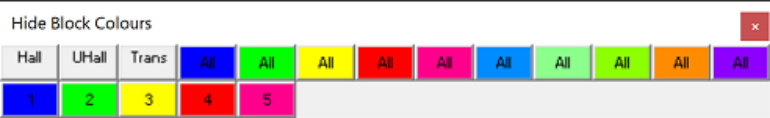

## 5.2.2.1 Alle ausblenden

Hiermit können Sie alle Blöcke mit der gewählten Farbnummer ausblenden.

Diese Symbolleiste kann in eine senkrechte Ausrichtung gebracht werden, indem man die Ansichts-Symbolleiste an den rechten oder linken Rand des Hauptfensters zieht.

Zurück in die waagerechte Ausrichtung gelangt sie, indem man sie an den oberen oder unteren Rand des Hauptfensters zieht.

Die Schaltfläche in der Ansichts-Symbolleiste aktiviert die Symbolleiste Hide Block Colours.

View > Hide Block Colours > Hide All   Blendet alle Blockoberflächen aus.

View > Hide Block Colours > Unhide All   Blendet alle ausgeblendeten Oberflächen wieder ein.

Die erste Zeile blendet alle Blöcke der zugehörigen Farbe aus und ein.

Die übrigen Schaltflächen sind mit der zugehörigen Blockfarbnummer beschriftet und dienen zum Ausblenden dieser Blöcke. Der zu jeder Farbnummer gehörende Blockname wird im Tooltip und in der Menüliste angezeigt.

Beachten Sie, dass die Symbolleiste scrollbar und in der Größe veränderbar ist.

Um die Größe zu ändern, ziehen Sie einfach eine Kante oder Ecke auf die gewünschte Größe und Form. Bildlaufleisten erscheinen nur, wenn bei der aktuellen Größe und Form zu viele Schaltflächen angezeigt werden müssen.
