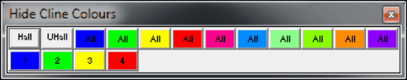

## 5.2.4.1 Alle ausblenden

Hiermit können Sie alle Konstruktionslinien der gewählten Farbe ausblenden.

Diese Symbolleiste kann in eine senkrechte Ausrichtung gebracht werden, indem man sie an den rechten oder linken Rand des Hauptfensters zieht.

Zurück in die waagerechte Ausrichtung gelangt sie, indem man sie an den oberen oder unteren Rand des Hauptfensters zieht.

Die Schaltfläche in der Ansichts-Symbolleiste aktiviert die Symbolleiste Hide Cline Colours.

View > Hide Cline Colours > Hide All   Blendet alle Konstruktionslinien aus.

View > Hide Cline Colours > Unhide All   Blendet alle ausgeblendeten Konstruktionslinien wieder ein.

Die erste Zeile blendet alle Konstruktionslinien der zugehörigen Farbe aus und ein.

Die übrigen Schaltflächen sind mit der zugehörigen Farbnummer der Konstruktionslinien beschriftet und dienen zum Ausblenden dieser Linien.

Beachten Sie, dass die Symbolleiste scrollbar und in der Größe veränderbar ist.

Um die Größe zu ändern, ziehen Sie einfach eine Kante oder Ecke auf die gewünschte Größe und Form. Bildlaufleisten erscheinen nur, wenn bei der aktuellen Größe und Form zu viele Schaltflächen angezeigt werden müssen.
