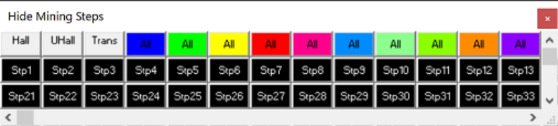

## 5.2.3.1 Alle ausblenden

Hiermit können Sie alle Blöcke ausblenden, die im angegebenen Schritt ausgebrochen werden.

Diese Symbolleiste kann in eine senkrechte Ausrichtung gebracht werden, indem man sie an den rechten oder linken Rand des Hauptfensters zieht.

Zurück in die waagerechte Ausrichtung gelangt sie, indem man sie an den oberen oder unteren Rand des Hauptfensters zieht.

#### Die

Schaltfläche in der Ansichts-Symbolleiste aktiviert die Symbolleiste Hide Excavation Steps.

View > Hide Block Colours > Hide All   Blendet alle Blockoberflächen aus.

View > Hide Block Colours > Unhide All   Blendet alle ausgeblendeten Oberflächen wieder ein.

Die erste Zeile blendet alle Blöcke der zugehörigen Farbe aus und ein.

Die übrigen Schaltflächen sind mit Ausbruchsschrittnummern beschriftet und dienen zum Ausblenden dieser Ausbruchsschritte.

Beachten Sie, dass die Symbolleiste scrollbar und in der Größe veränderbar ist.

Um die Größe zu ändern, ziehen Sie einfach eine Kante oder Ecke auf die gewünschte Größe und Form. Bildlaufleisten erscheinen nur, wenn bei der aktuellen Größe und Form zu viele Schaltflächen angezeigt werden müssen.
