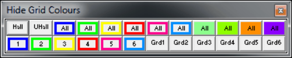

## 5.2.5.1 Alle ausblenden

Hiermit können Sie alle Raster der gewählten Farbe ausblenden.

Diese Symbolleiste kann in eine senkrechte Ausrichtung gebracht werden, indem man sie an den rechten oder linken Rand des Hauptfensters zieht.

Zurück in die waagerechte Ausrichtung gelangt sie, indem man sie an den oberen oder unteren Rand des Hauptfensters zieht.

Diese Schaltfläche aktiviert die Symbolleiste Hide Grid Colours.

View > Hide Grid Colours > Hide All   Blendet alle Raster aus.

View > Hide Grid Colours > Unhide All   Blendet alle ausgeblendeten Raster wieder ein.

Die erste Zeile blendet alle Raster der zugehörigen Farbe aus und ein.

Die mit der zugehörigen Rasterfarbnummer beschrifteten Schaltflächen dienen zum Ausblenden dieser Raster. Der zu jeder Farbnummer gehörende Rastername wird im Tooltip und in der Menüliste angezeigt.

Die übrigen Schaltflächen dienen wie in Grid Selection zum Ausblenden einzelner Raster.

Beachten Sie, dass die Symbolleiste scrollbar und in der Größe veränderbar ist.

Um die Größe zu ändern, ziehen Sie einfach eine Kante oder Ecke auf die gewünschte Größe und Form. Bildlaufleisten erscheinen nur, wenn bei der aktuellen Größe und Form zu viele Schaltflächen angezeigt werden müssen.
