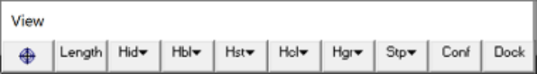
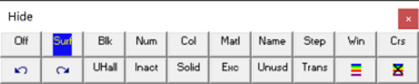

- **5.2.1.1** **Off**

Mit diesen Werkzeugen lassen sich verschiedene Teile der Geometrie leicht ausblenden.

Mit der Schaltfläche in der Symbolleiste View wird die Symbolleiste Hide aktiviert

Beachten Sie: Wenn sich die Schaltfläche nicht in der Symbolleiste View befindet, kann sie hinzugefügt werden, indem Sie die Schaltfläche verwenden und dann Hide > Hide More auswählen.

View > Hide > Off   Schaltet die Ausblendfunktion aus.

View > Hide > Surfaces   Blendet Oberflächen aus, indem sie einzeln ausgewählt werden.

View > Hide > Blocks   Blendet alle Oberflächen aus, die den ausgewählten Block bilden.

View > Hide > Numbers   Blendet alle Oberflächen mit der ausgewählten Blockfarbnummer aus.

View > Hide > Colour   Blendet alle Oberflächen mit der ausgewählten Farbe aus.

View > Hide > Materials   Blendet alle Oberflächen mit der ausgewählten Materialnummer aus. Derselbe Block kann je nach aktuell aktivem Abbauschritt unterschiedliche Materialien enthalten.

Achten Sie bei Verwendung dieser Funktion darauf, den passenden Abbauschritt auszuwählen

File > Mining Step

View > Hide > Names   Blendet alle Oberflächen mit dem ausgewählten Blocknamen aus.

View > Hide > Steps   Blendet alle Oberflächen aus, die im ausgewählten Schritt abgebaut werden.

View > Hide > Window   Blendet alle Oberflächen innerhalb des ausgewählten Fensters aus. Objekte werden nur ausgewählt, wenn sie vollständig im Fenster liegen.

View > Hide > Crossing   Blendet alle Oberflächen innerhalb des Kreuzungsfensters aus. Objekte werden bereits ausgewählt, wenn nur ein Teil des Objekts im Fenster liegt.

View > Hide > Undo last Hide   Macht den letzten Ausblendvorgang rückgängig (derzeit werden maximal 10 gespeichert).

View > Hide > Redo last Hide   Wiederholt den vorherigen Ausblendvorgang (derzeit werden maximal 10 gespeichert).

View > Hide > Unhide All   Blendet alle aktuell ausgeblendeten Oberflächen wieder ein.

View > Hide > Inactive   Wenn aktiviert, werden inaktive Elemente angezeigt. Inaktive Oberflächen dienen zur Anzeige von Elementen, die nur zu Visualisierungszwecken enthalten sind und nicht für die eigentliche Spannungsanalyse verwendet werden sollen

#### CAD > Edit > Entity Properties

View > Hide > Solids   Wenn aktiviert, werden Festkörper ausgeblendet. Festkörper sind 3D-Blöcke oder DD-Ebenen, die nicht abgebaut werden.

Im Verlauf der Abbaufolge

#### File > Mining Step

werden unterschiedliche Blöcke abgebaut. Um nur die Hohlräume anzuzeigen, aktivieren Sie diese Option.

View > Hide > Excavations   Wenn aktiviert, werden Hohlräume ausgeblendet.

View > Hide > Unused   Wenn aktiviert, werden ungenutzte Elemente ausgeblendet. Ungenutzte Elemente sind Oberflächen von 3D-Blöcken oder DD-Ebenen, die in der Analyse nicht verwendet werden. Solche Elemente gibt es dort, wo eine Störung einen Hohlraum durchschneidet oder wo ein Material mit niedrigerer Materialnummer in einer Zone mit höherer Materialnummer liegt (z. B. ein Gang, der eine Erzzone durchschneidet).

Im Verlauf der Abbaufolge

#### File > Mining Step

kann sich dies ändern. Um ungenutzte Oberflächen auszublenden, aktivieren Sie diese Option. Weitere Erläuterungen finden Sie unter

Analysis > Options > Closure

#### Constructing Alternate Material Zones

View > Hide > Translucent   Wenn aktiviert, werden ausgeblendete Oberflächen durchscheinend dargestellt.

View > Hide > Show Errors   Blendet Fehler aus/ein (wenn aktiviert, werden nur Elementfehler angezeigt). Beachten Sie, dass diese Option zusammen mit der Option View > Hide > Translucent verwendet werden kann.

View > Hide > Hide Errors   Blendet Fehler aus/ein (wenn aktiviert, werden keine

#### Elementfehler angezeigt).

In der CAD-Phase kennzeichnen die verschiedenen Farben folgende Probleme:

- Violett – Lücken wurden gefunden und gefüllt, das Problem ist damit behoben. Diese Meldung weist nicht auf einen Fehler hin und dient nur zur Information.

- Grün – doppelte Blöcke wurden gefunden und gelöscht, das Problem ist damit behoben. Diese Meldung weist nicht auf einen Fehler hin und dient nur zur Information.

- Blau – schmale Lücken wurden erkannt. Diese Lücken weisen nicht auf einen Fehler hin und sind nicht zwingend ein Problem. Treten jedoch bei der Schnittanalyse oder der BEM-Analyse Probleme auf, sind diese Stellen die wahrscheinlichste Ursache. Diese Meldung weist nicht auf einen Fehler hin und dient als Warnung.

- Weiß – in falscher Richtung verknüpfte Kanten wurden erkannt. Bei geschlossenen Blöcken müssen alle Kanten einheitlich verknüpft sein, damit Innen- und Außenseite eines Blocks eindeutig bestimmt werden können. Weiße Kanten erfüllen diese Anforderung nicht. Diese Meldung weist auf einen Fehler hin, der vor dem Fortsetzen der Analyse behoben werden sollte.

- Orange – Kanten, die nicht mit anderen Kanten verknüpft sind, wurden erkannt. Bei geschlossenen Blöcken muss jede Kante mit einer anderen Kante verknüpft sein, damit ein geschlossener Block entsteht. Orange Kanten erfüllen diese Anforderung nicht. Diese Meldung weist auf einen Fehler hin, der vor dem Fortsetzen der Analyse behoben werden sollte.

- Gelb – Kanten, die mit mehr als einer anderen Kante verknüpft sind, wurden erkannt. Bei geschlossenen Blöcken muss jede Kante mit genau einer anderen Kante verknüpft sein, damit ein geschlossener Block entsteht. Gelbe Kanten erfüllen diese Anforderung nicht. Diese Meldung weist auf einen Fehler hin, der vor dem Fortsetzen der Analyse behoben werden sollte.

- Rot – hebt viskoplastische Zonen mit ungültigen Hexaederformen hervor. In Map3D Visco-Plastic sind für plastische Zonen nur Hexaederformen (4 Ecken oben und 4 Ecken unten) oder entartete Formen davon, etwa Tetraeder, zulässig.

In der INTERSECTION-Phase kennzeichnen die verschiedenen Farben folgende Probleme:

- Violett – eine Oberfläche wurde wegen eines nicht auflösbaren Kontakts deaktiviert. Bei der Analyse der Kontakte zwischen den verschiedenen Blockoberflächen konnte nicht aufgelöst werden, wie diese Oberfläche an eine andere angrenzt; die Oberfläche wurde daher deaktiviert und wird in der BEM-Spannungsanalyse nicht verwendet. Die wahrscheinlichste Ursache ist eine sehr ungewöhnliche Form, etwa ein extrem schmales Dreieck. Obwohl dies ein Fehler ist, kann er normalerweise ignoriert werden, da extrem schmale Formen kaum zu den Analyseergebnissen beitragen.

- Grün – eine Oberfläche wurde wegen einer nicht auflösbaren Schließung deaktiviert. Bei der Analyse der Schließung eines Blocks konnte nicht aufgelöst werden, wie diese Oberfläche an den Block angrenzt; die Oberfläche wurde daher deaktiviert und wird in der BEM-Spannungsanalyse nicht verwendet. Die wahrscheinlichste Ursache ist eine sehr ungewöhnliche Form, etwa ein extrem schmales Dreieck. Obwohl dies ein Fehler ist, kann er normalerweise ignoriert werden, da extrem schmale Formen kaum zu den Analyseergebnissen beitragen.

- Blau – schmale Lücken wurden erkannt. Diese Lücken weisen nicht auf einen Fehler hin und sind nicht zwingend ein Problem. Treten jedoch bei der Schnittanalyse oder der BEM-Analyse Probleme auf, sind diese Stellen die wahrscheinlichste Ursache. Diese Meldung weist nicht auf einen Fehler hin und dient als Warnung.

- Weiß – nicht geschlossene Oberflächen wurden erkannt. Bei der Analyse der Schließung eines Blocks stellte sich heraus, dass Innen- und Außenseite des Blocks nicht eindeutig bestimmt werden konnten. Diese Meldung weist auf einen Fehler hin, der vor dem Fortsetzen der Analyse behoben werden sollte.

- Orange – Kanten, die nicht mit anderen Kanten verknüpft sind, wurden erkannt. Bei geschlossenen Blöcken muss jede Kante mit einer anderen Kante verknüpft sein, damit ein geschlossener Block entsteht. Orange Kanten erfüllen diese Anforderung nicht. Diese Meldung weist auf einen Fehler hin, der vor dem Fortsetzen der Analyse behoben werden sollte.

- Gelb – eine Oberfläche wurde wegen einer nicht auflösbaren Form deaktiviert. Die wahrscheinlichste Ursache ist eine sehr ungewöhnliche Form, etwa ein extrem schmales Dreieck. Obwohl dies ein Fehler ist, kann er normalerweise ignoriert werden, da extrem schmale Formen kaum zu den Analyseergebnissen beitragen.
