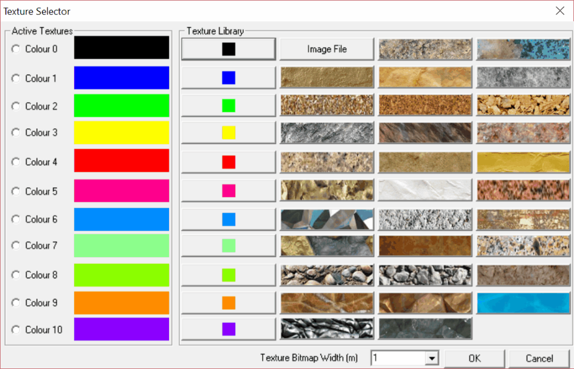

## 5.2.6.1 Block Outlines

Legt die Rendering-Optionen für das Modell fest.

View > Render > Block Outlines - Blöcke werden mit Umrissen gezeichnet, die ihre Kanten zeigen.

View > Render > Grid Lines - Blöcke werden mit Linien in regelmäßigen Rasterintervallen gezeichnet. Beim Aktivieren dieser Funktion werden Sie nach dem Rasterintervall gefragt.

View > Render > Block Colours - Blöcke werden mit Farbschattierung gezeichnet. Schalten Sie diese Funktion für eine Drahtgitteransicht aus.

View > Render > Material Numbers - Blöcke werden entsprechend der im Block hinterlegten Materialeigenschaft eingefärbt. Derselbe Block kann je nach aktuell aktivem Abbauschritt unterschiedliche Materialien enthalten.

Achten Sie bei Verwendung dieser Funktion darauf, den passenden Abbauschritt auszuwählen

#### File > Mining Step

View > Render > Mining Step Numbers - Blöcke werden entsprechend dem Abbauschritt eingefärbt, in dem sie abgebaut werden.

View > Render > Dark Shading - Blöcke werden mit einem dunklen Lichtquellen-Schattierungsmodell gezeichnet. Beim Aktivieren dieser Funktion werden Sie nach einem Kantenradius gefragt. Der Kantenradius dient dazu, Kanten und Ecken zu schattieren, damit sie abgerundet erscheinen. Der Kantenradius sollte als Bruchteil der Blockdicke angegeben werden. Die Schattierung kann die Bildwiederholrate erheblich verlangsamen.

View > Render > Bright Shading - Blöcke werden mit einem hellen Lichtquellen-Schattierungsmodell gezeichnet. Beim Aktivieren dieser Funktion werden Sie nach einem Kantenradius gefragt. Der Kantenradius dient dazu, Kanten und Ecken zu schattieren, damit sie abgerundet erscheinen. Der Kantenradius sollte als Bruchteil der Blockdicke angegeben werden. Die Schattierung kann die Bildwiederholrate erheblich verlangsamen.

View > Render > Texture Rendering - schaltet das Textur-Rendering ein bzw. aus. Mit dem Textur-Rendering können Sie Oberflächen mit einem Bitmap-Bild statt mit einer einfarbigen Fläche einfärben. Siehe Assign Bock Textures

View > Render > Block Numbers - Blöcke werden mit Nummern auf ihren Oberflächen gezeichnet. Diese Nummern entsprechen dem aktuell gewählten Darstellungsmodus: Block Colours, Material Numbers oder Mining Step Numbers.

View > Render > Block Names - Blöcke werden mit den Blocknamen auf ihren Oberflächen gezeichnet.

View > Render > Coordinate Numbers - Blöcke werden mit den Blocknamen auf ihren Oberflächen gezeichnet.

View > Render > Backfacing Surfaces - wenn aktiviert, werden die Rückseiten von 3D-FF-Blöcken gezeichnet. Im Allgemeinen benötigt oder wünscht der Benutzer diese Oberflächen nicht.

View > Render > Fixed With Spacing - wenn aktiviert, werden Oberflächen mit festgelegter fester Breitendiskretisierung unter Anzeige der Diskretisierung gerendert.

View > Render > Discretize - schaltet zwischen diskretisierter und nicht diskretisierter Ansicht des Modells um. View > Render > Perspective - schaltet zwischen perspektivischer und orthogonaler Ansicht um. Im orthogonalen Modus werden alle Abmessungen maßstabsgetreu gezeichnet. In der perspektivischen Ansicht werden Objekte, die weiter vom Betrachter entfernt sind, kleiner gezeichnet.

View > Render > Clines Dot Radius - legt den Radius der Punkte fest, die an allen Eckpunkten der Konstruktionslinien gezeichnet werden. Dies verlangsamt das Zeichnen erheblich und sollte nur bei Bedarf verwendet werden. Der Wert null bedeutet, dass keine Punkte gezeichnet werden.

View > Render > Point Size - legt den Radius der Punkte fest, die bei der Auswahl an allen Eckpunkten gezeichnet werden.

View > Render > Line Width - legt die Breite der Blockumrisse und Konturlinien fest.

## 5.2.6.9 Assign Block Textures

Mit dem Textur-Rendering können Sie Oberflächen mit einem Bitmap-Bild statt mit einer einfarbigen Fläche einfärben. Gehen Sie dazu wie folgt vor:

1. Wählen Sie die Farbnummer aus, der Sie die Textur zuweisen möchten (z. B. Colour 0, Colour 1 ...)

2. Wählen Sie eines der vordefinierten Bitmaps aus oder wählen Sie mit „Image File“ Ihr eigenes Bitmap.

3. Um das Bitmap-Bild auf jede Oberfläche abzubilden, müssen Sie „Texture Bitmap With“ angeben. „Texture Bitmap With“ skaliert das angegebene Bitmap so, dass sich das Muster in der angegebenen geometrischen Breite wiederholt.

Wenn Sie beispielsweise 1 m als Breite angeben, wird das Bitmap so skaliert, dass es auf Ihren Blockoberflächen mit einer Breite von 1 m gezeichnet wird.

## 5.2.6.10 Small Block Numbers

Legt die Rendering-Optionen für das Modell fest.

View > Render > Block Outlines - Blöcke werden mit Umrissen gezeichnet, die ihre Kanten zeigen.

View > Render > Grid Lines - Blöcke werden mit Linien in regelmäßigen Rasterintervallen gezeichnet. Beim Aktivieren dieser Funktion werden Sie nach dem Rasterintervall gefragt.

View > Render > Block Colours - Blöcke werden mit Farbschattierung gezeichnet. Schalten Sie diese Funktion für eine Drahtgitteransicht aus.

View > Render > Material Numbers - Blöcke werden entsprechend der im Block hinterlegten Materialeigenschaft eingefärbt. Derselbe Block kann je nach aktuell aktivem Abbauschritt unterschiedliche Materialien enthalten.

Achten Sie bei Verwendung dieser Funktion darauf, den passenden Abbauschritt auszuwählen

#### File > Mining Step

View > Render > Mining Step Numbers - Blöcke werden entsprechend dem Abbauschritt eingefärbt, in dem sie abgebaut werden.

View > Render > Dark Shading - Blöcke werden mit einem dunklen Lichtquellen-Schattierungsmodell gezeichnet. Beim Aktivieren dieser Funktion werden Sie nach einem Kantenradius gefragt. Der Kantenradius dient dazu, Kanten und Ecken zu schattieren, damit sie abgerundet erscheinen. Der Kantenradius sollte als Bruchteil der Blockdicke angegeben werden. Die Schattierung kann die Bildwiederholrate erheblich verlangsamen.

View > Render > Bright Shading - Blöcke werden mit einem hellen Lichtquellen-Schattierungsmodell gezeichnet. Beim Aktivieren dieser Funktion werden Sie nach einem Kantenradius gefragt. Der Kantenradius dient dazu, Kanten und Ecken zu schattieren, damit sie abgerundet erscheinen. Der Kantenradius sollte als Bruchteil der Blockdicke angegeben werden. Die Schattierung kann die Bildwiederholrate erheblich verlangsamen.

View > Render > Texture Rendering - schaltet das Textur-Rendering ein bzw. aus. Mit dem Textur-Rendering können Sie Oberflächen mit einem Bitmap-Bild statt mit einer einfarbigen Fläche einfärben. Siehe Assign Bock Textures

View > Render > Block Numbers - Blöcke werden mit Nummern auf ihren Oberflächen gezeichnet. Diese Nummern entsprechen dem aktuell gewählten Darstellungsmodus: Block Colours, Material Numbers oder Mining Step Numbers.

View > Render > Block Names - Blöcke werden mit den Blocknamen auf ihren Oberflächen gezeichnet.

View > Render > Coordinate Numbers - Blöcke werden mit den Blocknamen auf ihren Oberflächen gezeichnet.

View > Render > Backfacing Surfaces - wenn aktiviert, werden die Rückseiten von 3D-FF-Blöcken gezeichnet. Im Allgemeinen benötigt oder wünscht der Benutzer diese Oberflächen nicht.

View > Render > Fixed With Spacing - wenn aktiviert, werden Oberflächen mit festgelegter fester Breitendiskretisierung unter Anzeige der Diskretisierung gerendert.

View > Render > Discretize - schaltet zwischen diskretisierter und nicht diskretisierter Ansicht des Modells um. View > Render > Perspective - schaltet zwischen perspektivischer und orthogonaler Ansicht um. Im orthogonalen Modus werden alle Abmessungen maßstabsgetreu gezeichnet. In der perspektivischen Ansicht werden Objekte, die weiter vom Betrachter entfernt sind, kleiner gezeichnet.

View > Render > Clines Dot Radius - legt den Radius der Punkte fest, die an allen Eckpunkten der Konstruktionslinien gezeichnet werden. Dies verlangsamt das Zeichnen erheblich und sollte nur bei Bedarf verwendet werden. Der Wert null bedeutet, dass keine Punkte gezeichnet werden.

View > Render > Point Size - legt den Radius der Punkte fest, die bei der Auswahl an allen Eckpunkten gezeichnet werden.

View > Render > Line Width - legt die Breite der Blockumrisse und Konturlinien fest.
