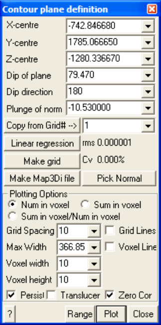
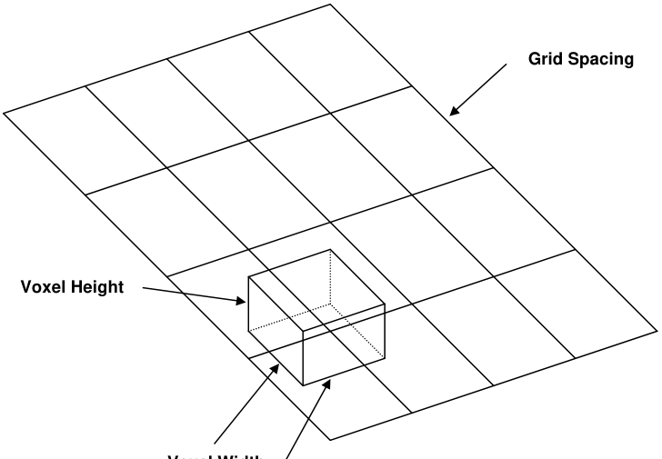
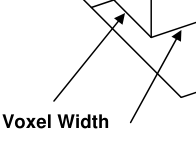

Ermöglicht die Einrichtung der Ebene, die für die Konturdarstellung von Visualisierungspunktdaten verwendet wird (siehe Visualization).

**X-centre** – der x-Koordinatenwert des Mittelpunkts der Konturebene.

**Y-centre** – der y-Koordinatenwert des Mittelpunkts der Konturebene. **Z-centre** – der z-Koordinatenwert des Mittelpunkts der Konturebene. **Dip of plane** – das Einfallen der Konturebene.

**Dip direction** – die Einfallsrichtung der Konturebene.

**Dip of normal** – das Einfallen der Normalen zur Konturebene (dieser Wert liegt 90° vom Einfallen der Ebene entfernt).

**Pick Normal** - aktiviert den Cursor zur interaktiven Auswahl einer Oberfläche. Mittelpunkt, Einfallen und Einfallsrichtung der Konturebene werden parallel zur ausgewählten Oberfläche gesetzt.

**Copy from Grid#** – kopiert die Lage- und Orientierungsparameter von einer Rasterebene des Modells. **Linear regression** – ermittelt die Ausgleichsebene durch die seismischen Daten, indem der Normalabstand

aller Punkte zur Ebene minimiert wird.

**Make Grid** – erzeugt aus der Konturebene eine Rasterebene des Modells.

**Make Map3Di file** – erzeugt aus den dargestellten Konturdaten eine Datendatei für die seismische Belastung in einer **Map3Di**-Analyse (mehr dazu weiter unten).

#### Contour Plane Options:

**Num in voxel** – die Anzahl der Punkte in jedem Voxel wird als Konturen dargestellt. **Sum in voxel** – die Summe der Werte der Darstellungsgleichung für alle im Voxel liegenden Punkte wird als Konturen dargestellt.

**Sum/Num in voxel** – der Quotient der beiden Werte wird als Konturen dargestellt.

- **Grid spacing** – der Rasterabstand, der für die Konturdarstellung der seismischen Daten verwendet wird. Da das Voxel an jeder Rasterecke zentriert ist, steuert dieser Parameter die Dichte der Voxel. Beachten Sie: Ist der Rasterabstand kleiner als die Voxelbreite, überlappen sich benachbarte Voxel.

**Voxel width** – die Voxelbreite wird parallel zu den Kanten der Rasterebene gemessen.

**Voxel height** – die Voxelhöhe wird senkrecht zur Rasterebene gemessen. So kann der Benutzer

den Abstand zur Rasterebene begrenzen, innerhalb dessen Daten in die Konturdarstellung einbezogen werden.

**Outlines** – zeichnet die tatsächlichen Voxelumrisse.

- **Persist** – wenn aktiviert, werden die Punkte jedes Mal neu dargestellt, wenn das Modell gedreht, verschoben oder gezoomt wird. Da dies bei großen Modellen zeitaufwendig sein kann, ist diese Option nicht immer erwünscht.

**Translucent** - zeichnet die Punkte als durchscheinende Kugeln.

**Zero Contour** - wenn deaktiviert, werden Konturen unterhalb des Minimums des Konturbereichs nicht gezeichnet. Dies

ist nützlich, um Konturen darzustellen, bei denen nur der obere Teil des Konturbereichs wichtig ist. **Range** – legt Minimum, Maximum und Intervall für die Radiusskalierung und die Konturen fest.

- Plot erzeugt die Darstellung neu. Diese Schaltfläche kann entweder in der Ansicht-Symbolleiste (Tools >

- View Toolbar Configure) oder in der Konturen-Symbolleiste (Tools > Contour Toolbar Configure) platziert werden.

#### Linear Regression:

Die lineare Regression wird durchgeführt, indem die Ebene mit dem minimalen **_rms_**-Wert (Wurzel aus dem mittleren Quadrat, d. h. mittlerer Abstand aller Punkte zur angepassten Ebene) gesucht wird.

Die Standardtheorie des Korrelationskoeffizienten ist hier als Maß für die Anpassungsgüte nicht geeignet. Denn uns interessiert nicht das „Maß für den Grad des Zusammenhangs zwischen Variablen“, sondern ein Maß dafür, wie gut die angepasste Ebene unsere Daten darstellt. Beachten Sie: Liegen alle Daten in einer einzigen horizontalen Ebene, ist die Ebenenanpassung perfekt. Per Definition ist die Korrelation jedoch null

(und der Korrelationskoeffizient damit gleich null), weil der z-Wert nicht von den x- oder y-Werten abhängt. Das ist nicht, was wir wollen.

Hier wird ein Parameter ähnlich einem Variationskoeffizienten definiert (ein Maß für die Variabilität geteilt durch die Größenordnung). **_Cv_** ist einfach definiert als der **_rms_**-Wert (der mittlere Abstand aller Punkte zur angepassten Ebene) geteilt durch den mittleren Abstand aller Punkte zum Schwerpunkt. Dies misst, wie gut die Ebene die Daten darstellt. Dieses Verhältnis wird üblicherweise in Prozent angegeben. So definiert ergeben Zufallsdaten ein **Cv** =100 % (100 % Variabilität). Eine perfekte Anpassung ergibt **_Cv_** =0 (0 % Variabilität). Beachten Sie, dass **_Cv_** 100 % überschreiten kann. Sie können sich diesen Parameter als das Verhältnis der Variabilität um die Ebene zur physischen Breite des Datensatzes vorstellen.

Dies entspricht sehr genau der formalen Definition des Variationskoeffizienten, der die Standardabweichung geteilt durch den Mittelwert ist. Die meisten geologischen Materialien haben Eigenschaften mit einem **_Cv_** in der Größenordnung von 20 bis 30 %. **_Cv_** könnte mithilfe von

**_r_ = (1-** **_Cv_ ²)****½**

in einen äquivalenten Korrelationskoeffizienten umgerechnet werden, aber das ist nicht wirklich der richtige Parameter, und für Fälle, in denen **_Cv_** größer als 1 ist, gibt es Definitionsprobleme.

Sowohl **rms** als auch **_Cv_** werden für die aktuelle Ebene angezeigt, wann immer Daten dargestellt werden.

#### Make Map3Di file:

Um eine Map3Di-Belastungsdatei zu erstellen, muss die durch die Seismizität angezeigte Verteilung der Scherverschiebung (ride) bestimmt werden. Dazu sind mehrere Annahmen nötig (siehe A. McGarr, „Some Applications of Seismic Source Mechanism Studies to Assessing Underground Hazard“, Proc. 1st International Symposium on Rockbursts and Seismicity in Mines, SAIMM, Johannesburg, 1984, S. 199-208, und Hoffman, G, R. Sewjee and G. van Aswegan, „First steps in the integration of numerical modelling and seismic monitoring“, 5th International Symposium on Rockburst and Seismicity in Mines, SAIMM, Johannesburg, 2000, S. 397-404.), die hier skizziert werden:

1) Annahme eines Gleitmodells. Hier kann entweder ein elliptisches Rissmodell (Brune) oder ein Asperitätenmodell mit weichen Rändern infolge Kriechens betrachtet werden (Walsh, J.J. and J. Waterson, „Distribution of cumulative displacements and seismic slip on a single normal fault surface“, J. Struct. Geol., V. 9, 1987, S. 1039-1046). In der Regel wird eine kreisförmige (münzförmige) Gestalt verwendet, sofern der Benutzer keine Möglichkeit hat, eine andere Form zu definieren.

2) Der mittlere Gleitbetrag lässt sich aus dem seismischen Moment **_Mo_ =** m **_AD_** bestimmen, wobei m der Schubmodul, **_A_** die Herdfläche (aus dem Herdradius bestimmt) und **_D_** der mittlere Gleitbetrag auf der Störung ist. Er kann auch aus dem „Seismic Strain Drop“ bestimmt werden.

3) Der Radius der Gleitfläche kann aus dem Brune-Radius abgeschätzt werden, wobei b die Scherwellengeschwindigkeit und **_fo_** die Eckfrequenz ist. Für ein Asperitätenmodell ist der Radius **_a_ = 2.34** b **/(2** p **_fo_ )**, wobei b aus dem Radius des „Apparent Volume“ bestimmt wird, wahrscheinlich besser geeignet.

4) Die Gleitorientierung kann aus dem seismischen Momententensor, falls verfügbar, oder aus dem Spannungszustand der Modellierung bestimmt werden.

Aus diesen 4 Punkten lässt sich das vom seismischen Ereignis angezeigte Gleitprofil bestimmen.

Für ein elliptisches Profil ergibt sich die Verteilung der Scherverschiebung (ride) zu

**1.50** **_D_ (1-** **_r_ ²/** **_a_ ²)****½**

Für ein Asperitätenprofil ergibt sich die Verteilung der Scherverschiebung (ride) zu

#### 2.89 _D_ (1- _r_ / _a_ )(1+2 _r_ / _a_ -3 _r_ ²/ _a_ ²)½

Eine seismische Belastungsdatei für Map3Di kann wie folgt erzeugt werden:

- 1) Erstellen Sie eine seismische Datendatei als Reihe von Punkten:

**x1 y1 z1 f1 f2 … x2 y2 z2 f1 f2 … x3 y3 z3 f1 f2 … ...**

wobei **xi yi zi** die Koordinaten jedes Punkts darstellen,

**f1** den mittleren Gleitbetrag **_D_** und **f2** den Herdradius **_a_** angibt.

- 2) Geben Sie in der Routine Visualization für ein elliptisches Profil die Darstellungsgleichung wie folgt an

   - **1.50*f1*sqrt(1-rip^2/f2^2)**

Für ein Asperitätenprofil verwenden Sie

#### 2.89*f1*(1-rip/f2)*sqrt(1+2*rip/f2-3*rip^2/f2^2)

3) Wählen Sie die gewünschte Ebene und den Rasterabstand und legen Sie die gewünschte Voxelhöhe und -breite fest. Mit der Voxelhöhe lassen sich Ereignisse außerhalb der Ebene ausblenden. Es ist wichtig, die Voxelbreite gleich dem größten gewünschten Ereignisradius zu wählen, damit die Scherverschiebung (ride) auf alle betroffenen Voxel verteilt wird.

- 4) Stellen Sie die Darstellungsoptionen auf „Sum in Voxel“ und führen Sie Plot aus.

- 5) Make Map3Di file.

- 6) Sehen Sie sich die Map3Di-Datei mit CAD > Properties > Map3Di Setup an und prüfen Sie den Parameter f2.

Einzelheiten zum Datenformat finden Sie unter **CAD > Properties > Map3Di**.
