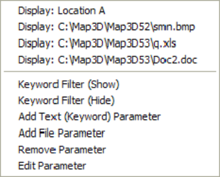

Mit dieser Funktion lässt sich eine Datenbank mit nützlichen geologischen Informationen wie Gehalt, Gebirgsqualität usw. anzeigen.

Jeder Punkt kann mit einer Reihe von Elementen versehen werden:

- numerische Werte (z. B. Farbe, Betrag, Orientierung usw.)

- Schlüsselwörter

- Textnachrichten

- Dateinamen (z. B. Grafikdateien, Dokumente, Tabellenkalkulationen usw.)

Um diese Funktion zu aktivieren, klicken Sie mit der rechten Maustaste auf einen Visualisierungsdatenpunkt (siehe Visualization).

Wenn keine Visualisierungspunkte vorhanden sind, kann mit Make Point ein neuer Punkt angelegt werden.

Beim Rechtsklick erscheint ein Kontextmenü mit den folgenden Optionen:

Die „Display“-Einträge im oberen Teil dieses Menüs sind Daten, die dem Datenpunkt zugeordnet sind (jeweils eine Textzeichenfolge, eine Bitmap, eine Tabellenkalkulation und ein Dokument). Wenn Sie einen davon auswählen, wird dieses Element angezeigt.

Die Einträge im unteren Teil des Menüs sind Funktionen, die auf die Datenbank zugreifen:

- **Keyword Filter (Show)** – dient zum Festlegen einer Reihe von Schlüsselwortfiltern für die Anzeige. Nur Punktdaten, denen eines dieser Schlüsselwörter zugeordnet ist, sind sichtbar, alle anderen werden ausgeblendet. So lässt sich die Anzeige der gewünschten Datenbankeinträge filtern.

- **Keyword Filter (Hide)** – dient zum Festlegen einer Reihe von Schlüsselwortfiltern zum Ausblenden. Punktdaten, denen eines dieser Schlüsselwörter zugeordnet ist, werden ausgeblendet, alle anderen sind sichtbar. So lässt sich die Anzeige unerwünschter Datenbankeinträge herausfiltern.

- **Add Text (Keyword) Parameter** - dient zum Hinzufügen einer Textzeichenfolge zu einem Datenpunkt. Dieser Text wird für die Schlüsselwortfilterung verwendet und der Anzeigeliste hinzugefügt.

- **Add File Parameter** - dient zum Hinzufügen eines Dateiparameters zu einem Datenpunkt. Der Dateiname wird für die Schlüsselwortfilterung verwendet, und die Datei wird der Anzeigeliste hinzugefügt. Hier kann jeder beliebige Dateiname angegeben werden (z. B. Grafikdateien, Tabellenkalkulationsdateien, Dokumentdateien usw.). Ist der Dateityp mit einer Anwendung verknüpft, wird diese Anwendung automatisch gestartet, um die angegebene Datei anzuzeigen.

**Remove Parameter** - dient zum Entfernen eines Parameters vom Datenpunkt.

**Edit Parameter** - dient zum Bearbeiten bzw. Ändern eines Parameters.
