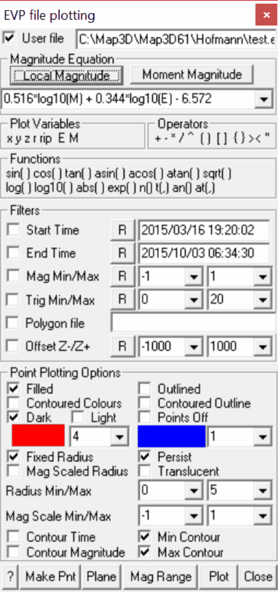

Mit dieser Option lassen sich Punktdaten im EVP-Dateiformat (von seismischen IMS-Systemen) visualisieren. Punkte können als lichtquellenschattierte Kugeln dargestellt werden, deren Durchmesser und/oder Farbe mit der Magnitude variieren, und auf einer Ebene als Konturen dargestellt werden, um Dichte usw. anzuzeigen.

Map3D unterstützt außerdem die Visualisierung von Dateien im Textformat.

Jeder Punkt kann mit einer Reihe von Elementen versehen werden:

- numerische Werte (z. B. Farbe, Magnitude, Orientierung usw.)

- Textnachrichten

- Dateinamen (z. B. Grafikdateien, Dokumente, Tabellenkalkulationen usw.)

Beim Linksklick auf einen Punkt werden Lage, Magnitude und Textnachricht in der Statusleiste angezeigt.

Ein Rechtsklick auf einen Punkt aktiviert die visuelle Datenbank (Visual Database). Mit dieser Funktion lässt sich eine Datenbank mit nützlichen geologischen Informationen wie Gehalt, Gebirgsqualität usw. anzeigen. Jeder Punkt kann mit einer Reihe von Elementen versehen werden:

- numerische Werte (z. B. Farbe, Magnitude, Orientierung usw.)

- Textnachrichten

- Dateinamen (z. B. Grafikdateien, Dokumente, Tabellenkalkulationen usw.)

#### Event File:

Die Ereignisdatei liegt im Dateiformat *.EVP vor.

EVP-Ereignisdateien werden von seismischen IMS-Systemen erzeugt.

Seismische Daten werden als Reihe von Punkten wie folgt gespeichert:

**date time le x1 y1 z1 M  E Mp Ep Ms Es trigs... "text message" "file name"... date time le x2 y2 z2 M  E Mp Ep Ms Es trigs... "text message" "file name"... date time le x3 y3 z3 M  E Mp Ep Ms Es trigs... "text message" "file name"...**

wobei **xi yi zi** die Koordinaten jedes Punkts darstellen,

**M** das seismische Moment darstellt, **E** die abgestrahlte Energie darstellt, **trigs** die Anzahl der Trigger darstellt,

**text message** kennzeichnet eine optionale Reihe von Zeichenfolgen, die in doppelte Anführungszeichen gesetzt werden müssen. **file name** kennzeichnet eine optionale Reihe von Dateinamen, die in doppelte Anführungszeichen gesetzt werden müssen.

- Die Textnachricht und der Dateiname werden in der Statusleiste am unteren Bildschirmrand angezeigt, wenn Sie ein Ereignis mit der linken Maustaste auswählen.

- Sie können auch bearbeitet werden, indem Sie ein Ereignis mit der rechten Maustaste auswählen.

- Die Auswahl mit der rechten Maustaste ermöglicht außerdem die Anzeige der Datei, sofern der Dateiname mit einer Anwendung verknüpft ist (siehe die Windows-Dokumentation zum „Verknüpfen einer Datei mit einem Programm“).

#### Mehrere Dateien in einer Datenbank zusammenführen

Sie können mehrere Dateien gleichzeitig auswählen, indem Sie für die Mehrfachauswahl die üblichen Windows-Tasten „Umschalt“ oder „Strg“ gedrückt halten.

Diese Dateien werden in einer Datenbank zusammengeführt.

So können Sie einzelne Teile Ihrer Visualisierungsdaten in verschiedenen Dateien aufbewahren und sie dann einfach in einer Datenbank zusammenführen.

#### Magnitude Equation:

Definiert den darzustellenden Parameter, z. B. **(0.516*log10(M) + 0.344*log10(E) - 6.572**

Im Dropdown-Fenster können bis zu 20 verschiedene Gleichungen gespeichert werden. Diese werden zwischen Map3D-Sitzungen in der Datei map3d.ini gespeichert.

#### Plot Variables:

**E M** Datenfelder in der Ereignisdatei.

#### Functions:

**sin() cos() tan()** trigonometrische Funktionen Sinus, Kosinus und Tangens **asin() acos() atan()** inverse trigonometrische Funktionen **sqrt()** Quadratwurzelfunktion

**log()** natürliche Logarithmusfunktion **log10()** Logarithmusfunktion zur Basis 10 **abs()** Absolutwert **exp()** Exponentialfunktion (Antilogarithmus) **n() t(,)** Normal- und t-Verteilung **an() at(,)** inverse Normal- und inverse t-Verteilung

#### Location:

**x y z** Koordinate des Rasterpunkts.

#### Operators:

- **+ - * /** ^   Operatoren für Addition, Subtraktion, Multiplikation, Division und Potenzierung. Beachten Sie, dass zuerst Potenzen berechnet werden, dann Multiplikation und Division und zuletzt Addition und Subtraktion.

- **() [] &#123;&#125;** Klammerarten. Klammerpaare müssen zusammenpassen.

- Maximalwert. Wird die Darstellungsgleichung beispielsweise als f1 > 10 angegeben, wird der größere der Werte f1 und 10 dargestellt.

- **&lt;** Minimalwert. Wird die Darstellungsgleichung beispielsweise als f1 &lt; 10 angegeben, wird der kleinere der Werte f1 und 10 dargestellt.

#### Filters:

**Start/End Time** – die untere und obere Grenze des Datums-/Zeitfilters. **Mag Min/Max** – die untere und obere Grenze des Magnitudenfilters. **Trig Min/Max** – die untere und obere Grenze des Filters für die Anzahl der Trigger.

**Polygon File** – der Name der Datei, die den Polygonfilter enthält. Diese Datei muss im Dateiformat *.pnt vorliegen. Zur Erstellung dieser Datei können Sie mit der Funktion **Plane** das UDCS (benutzerdefiniertes Koordinatensystem) auf die Ausgleichsebene setzen.

**Offset Z-/Z+** – die untere und obere Grenze des Z-Versatzes vom Polygonfilter.

#### Point Plotting Options:

**Filled** – Punkte werden mit der angegebenen Farbe, der Konturfarbe und/oder schattiert gefüllt. **Contoured Colours** – die Füllfarbe wird entsprechend der aus **Plot Equation** ermittelten Magnitude angepasst.

- **Dark** – die Füllfarbe wird so schattiert, dass lichtquellenschattierte Kugeln mit einem dunklen, satten Farbschema erscheinen.

- **Light** – die Füllfarbe wird so schattiert, dass lichtquellenschattierte Kugeln mit einem hellen, glänzenden Farbschema erscheinen.

**Outlined** – Punkte werden mit der angegebenen Farbe oder der Konturfarbe umrandet.

**Contoured Outline** – Punkte werden mit Konturfarben gezeichnet, die entsprechend der aus **Plot Equation** ermittelten Magnitude angepasst werden.

**Contour Plane** – aktiviert oder deaktiviert die Anzeige einer Konturebene (siehe **Plane** ).

**Fixed Radius** – Punkte werden als Kugeln mit dem angegebenen Parameter **Radius:** dargestellt.

**Magnitude Scaled Radius** – Punkte werden als Kugeln dargestellt, deren Radius auf die Magnitude (ermittelt aus **Magnitude Equation** ) skaliert ist. Ist die Magnitude kleiner als das Minimum des Konturbereichs, wird die Kugel mit dem durch den Parameter **Radius:** angegebenen Mindestradius gezeichnet. Überschreitet die Magnitude das Maximum des Konturbereichs, wird der Vektor mit dem durch den Parameter **Radius:** angegebenen Maximalradius gezeichnet.

#### Other:

- **Persist** – wenn aktiviert, werden die Punkte jedes Mal neu dargestellt, wenn das Modell gedreht, verschoben oder gezoomt wird. Da dies bei großen Modellen zeitaufwendig sein kann, ist diese Option nicht immer erwünscht.

**Translucent** - zeichnet die Punkte als durchscheinende Kugeln.

**Min Contour** - wenn deaktiviert, werden Konturen unterhalb des Minimums des Konturbereichs nicht gezeichnet. Dies ist nützlich, um Konturen darzustellen, bei denen nur der obere Teil des Konturbereichs wichtig ist.

**Max Contour** - wenn deaktiviert, werden Konturen oberhalb des Maximums des Konturbereichs nicht gezeichnet. Dies

ist nützlich, um Konturen darzustellen, bei denen nur der untere Teil des Konturbereichs wichtig ist. **Make Point** - fügt einen neuen Punkt hinzu.

**Plane** – ermöglicht die Einrichtung der Konturebene.

**Range** – legt Minimum, Maximum und Intervall für die Radiusskalierung und die Konturen fest.

Plot erzeugt die Darstellung neu. Diese Schaltfläche kann entweder in der Ansicht-Symbolleiste (Tools > View Toolbar Configure) oder in der Konturen-Symbolleiste (Tools > Contour Toolbar Configure) platziert werden.
