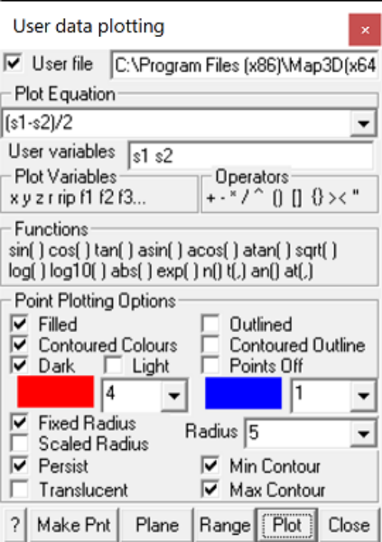

Mit dieser Option lassen sich Punktdaten im Textdateiformat visualisieren. Punkte können als lichtquellenschattierte Kugeln dargestellt werden, deren Durchmesser und/oder Farbe mit der Größenordnung (Magnitude) variieren, und auf einer Ebene als Konturen dargestellt werden, um Dichte usw. anzuzeigen.

Map3D unterstützt außerdem die Visualisierung von Dateien im EVP-Format.

Jeder Punkt kann mit einer Reihe von Elementen versehen werden:

- numerische Werte (z. B. Farbe, Magnitude, Orientierung usw.)

- Textnachrichten

- Dateinamen (z. B. Grafikdateien, Dokumente, Tabellenkalkulationen usw.)

Beim Linksklick auf einen Punkt werden Lage, Magnitude und Textnachricht in der Statusleiste angezeigt.

Ein Rechtsklick auf einen Punkt aktiviert die visuelle Datenbank (Visual Database). Mit dieser Funktion lässt sich eine Datenbank mit nützlichen geologischen Informationen wie Gehalt, Gebirgsqualität usw. anzeigen. Jeder Punkt kann mit einer Reihe von Elementen versehen werden:

- numerische Werte (z. B. Farbe, Magnitude, Orientierung usw.)

- Textnachrichten

- Dateinamen (z. B. Grafikdateien, Dokumente, Tabellenkalkulationen usw.)

#### Event File:

Die Ereignisdatei ist einfach eine Textdatei (*.txt).

Dieses Format eignet sich zum Austausch roher Modelldaten mit anderer CAD-Software.

Kommentarzeilen müssen mit einem Sternchen „*“ oder einer Raute „#“ beginnen.

Seismische Daten werden als Reihe von Punkten wie folgt gespeichert:

**x1 y1 z1 f1 f2 f3 … "text message" "file name"... x2 y2 z2 f1 f2 f3 … "text message" "file name"... x3 y3 z3 f1 f2 f3 … "text message" "file name"...**

wobei **xi yi zi** die Koordinaten jedes Punkts darstellen,

**f1 f2 f3…** eine optionale Reihe numerischer Werte kennzeichnet (z. B. Farbe, Magnitude, Orientierung usw.), **text message** eine optionale Reihe von Zeichenfolgen kennzeichnet, die in doppelte Anführungszeichen gesetzt werden müssen. **file name** kennzeichnet eine optionale Reihe von Dateinamen, die in doppelte Anführungszeichen gesetzt werden müssen.

- Die Textnachricht und der Dateiname werden in der Statusleiste am unteren Bildschirmrand angezeigt, wenn Sie ein Ereignis mit der linken Maustaste auswählen.

- Sie können auch bearbeitet werden, indem Sie ein Ereignis mit der rechten Maustaste auswählen.

- Die Auswahl mit der rechten Maustaste ermöglicht außerdem die Anzeige der Datei, sofern der Dateiname mit einer Anwendung verknüpft ist (siehe die Windows-Dokumentation zum „Verknüpfen einer Datei mit einem Programm“).

#### Mehrere Dateien in einer Datenbank zusammenführen

Sie können mehrere Dateien gleichzeitig auswählen, indem Sie für die Mehrfachauswahl die üblichen Windows-Tasten „Umschalt“ oder „Strg“ gedrückt halten.

Diese Dateien werden in einer Datenbank zusammengeführt.

So können Sie einzelne Teile Ihrer Visualisierungsdaten in verschiedenen Dateien aufbewahren und sie dann einfach in einer Datenbank zusammenführen.

#### Plot Equation:

Definiert den darzustellenden Parameter, z. B. **(f1-f2)/2** oder gleichbedeutend **(sig1-sig3)/2**

- Im Dropdown-Fenster können bis zu 20 verschiedene Gleichungen gespeichert werden. Diese werden zwischen Map3D-Sitzungen in der Datei map3d.ini gespeichert.

#### Plot Variables:

**f1 f2 f3…** Datenfelder in der Ereignisdatei.

Benutzerdefinierte Variablen (zum Beispiel **sig1 sig3 …** ) können definiert werden, um die Spaltenüberschriften zu **f1 f2 f3…** anzugeben.

Diese können in der Kommentarzeile definiert werden, also in jeder Zeile, die mit „*“ oder „#“ beginnt **.** Geben Sie die benutzerdefinierten Darstellungsvariablen einfach beispielsweise wie folgt an:

*** x y z sig1 sig2 ...**

#### Functions:

**sin() cos() tan()** trigonometrische Funktionen Sinus, Kosinus und Tangens **asin() acos() atan()** inverse trigonometrische Funktionen **sqrt()** Quadratwurzelfunktion **log()** natürliche Logarithmusfunktion **log10()** Logarithmusfunktion zur Basis 10 **abs()** Absolutwert **exp()** Exponentialfunktion (Antilogarithmus) **n() t(,)** Normal- und t-Verteilung **an() at(,)** inverse Normal- und inverse t-Verteilung

#### Location:

**x y z** Koordinate des Rasterpunkts.

#### Operators:

- **+ - * /** ^   Operatoren für Addition, Subtraktion, Multiplikation, Division und Potenzierung. Beachten Sie, dass zuerst Potenzen berechnet werden, dann Multiplikation und Division und zuletzt Addition und Subtraktion.

- **() [] &#123;&#125;** Klammerarten. Klammerpaare müssen zusammenpassen.

- Maximalwert. Wird die Darstellungsgleichung beispielsweise als f1 > 10 angegeben, wird der größere der Werte f1 und 10 dargestellt.

- **&lt;** Minimalwert. Wird die Darstellungsgleichung beispielsweise als f1 &lt; 10 angegeben, wird der kleinere der Werte f1 und 10 dargestellt.

#### Point Plotting Options:

**Filled** – Punkte werden mit der angegebenen Farbe, der Konturfarbe und/oder schattiert gefüllt.

**Contoured Colours** – die Füllfarbe wird entsprechend der aus **Plot Equation** ermittelten Magnitude angepasst.

**Dark** – die Füllfarbe wird so schattiert, dass lichtquellenschattierte Kugeln mit einem dunklen, satten Farbschema erscheinen.

**Light** – die Füllfarbe wird so schattiert, dass lichtquellenschattierte Kugeln mit einem hellen, glänzenden Farbschema erscheinen.

**Outlined** – Punkte werden mit der angegebenen Farbe oder der Konturfarbe umrandet.

**Contoured Outline** – Punkte werden mit Konturfarben gezeichnet, die entsprechend der aus **Plot Equation** ermittelten Magnitude angepasst werden.

**Contour Plane** – aktiviert oder deaktiviert die Anzeige einer Konturebene (siehe **Plane** ).

**Fixed Radius** – Punkte werden als Kugeln mit dem angegebenen Parameter **Radius:** dargestellt.

**Scaled Radius** – Punkte werden als Kugeln dargestellt, deren Radius auf die Magnitude (ermittelt

aus **Plot Equation** ) skaliert ist. Ist die Magnitude kleiner als das Minimum des Konturbereichs, wird die Kugel mit Radius null gezeichnet. Entspricht die Magnitude dem Maximum des Konturbereichs, wird der Vektor mit dem durch den Parameter **Radius:** angegebenen Radius gezeichnet.

#### Other:

**Persist** – wenn aktiviert, werden die Punkte jedes Mal neu dargestellt, wenn das Modell gedreht, verschoben oder gezoomt wird. Da dies bei großen Modellen zeitaufwendig sein kann, ist diese Option nicht immer erwünscht.

**Translucent** - zeichnet die Punkte als durchscheinende Kugeln.

**Zero Contour** - wenn deaktiviert, werden Konturen unterhalb des Minimums des Konturbereichs nicht gezeichnet. Dies

ist nützlich, um Konturen darzustellen, bei denen nur der obere Teil des Konturbereichs wichtig ist.

**Make Point** - fügt einen neuen Punkt hinzu.

**Plane** – ermöglicht die Einrichtung der Konturebene.

**Range** – legt Minimum, Maximum und Intervall für die Radiusskalierung und die Konturen fest.

Plot erzeugt die Darstellung neu. Diese Schaltfläche kann entweder in der Ansicht-Symbolleiste (Tools > View Toolbar Configure) oder in der Konturen-Symbolleiste (Tools > Contour Toolbar Configure) platziert werden.
