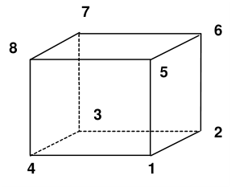
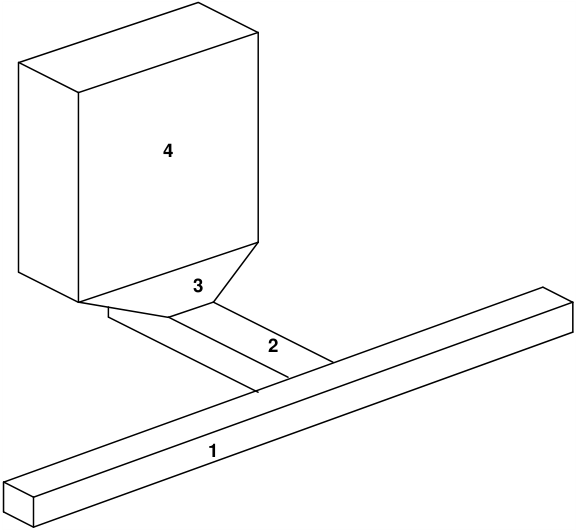

Bei vielen Problemen kommt es nicht auf die genaue Form der Hohlraumoberflächen an, da eine eher globale Bewertung der Stabilität gesucht wird, etwa der Verhältnisse in Pfeilern, Widerlagern oder im Hangenden. Da es sehr mühsam ist, Lage und Verbindungen jeder einzelnen Fläche zu beschreiben, können Modelle in Map3D auch aus dreidimensionalen Bausteinen zusammengesetzt werden.

CAD > Build > Block

CAD > Build > DD Loop CAD > Build > FF Loop

#### CAD > Build > Tunnel

Diese Blöcke dienen zur Erstellung dreidimensionaler Hohlräume, alternativer Materialzonen und versetzter Bereiche. Sie werden durch eine Ober- und eine Unterseite mit jeweils 4 Eckpunkten definiert. Die Eckpunkte können im oder gegen den Uhrzeigersinn eingegeben werden, sofern Ober- und Unterseite zueinander ausgerichtet sind (d. h. Eckpunkt 5 muss Eckpunkt 1 gegenüberliegen, 2 gegenüber 6 usw.). Die Seiten müssen weder parallel noch eben sein, und jeder Eckpunkt kann wiederholt werden, um dreiseitige Formen und Keile zu definieren.

Diese Blöcke können gestapelt werden, um komplexe Hohlraumformen oder Erzzonengrenzen zu erzeugen. Sie sind entweder über gemeinsame Eckpunkte oder dadurch miteinander verbunden, dass sie sich schneiden. Seiten, die mehreren Blöcken gemeinsam sind oder in andere Blöcke eindringen, werden automatisch abgeschnitten und gelöscht. Das von der Blockstruktur umschlossene Volumen definiert einen Hohlraum, eine Erzzone, eine Fließzone, versetzte Bereiche usw.

Zur Veranschaulichung betrachten wir eine einfache Abzugsstellen-Konfiguration, die aus 4 Blöcken zusammengesetzt ist. Block 1 stellt die Abzugsstrecke dar, Block 2 den Querschlag, Block 3 die Abzugsstelle und Block 4 die Abbaukammer. Der Präprozessor von Map3D erkennt die Verbindungen zwischen diesen Blöcken, schneidet sie ab und löscht die Flächen, die benachbarten Blöcken gemeinsam sind.
