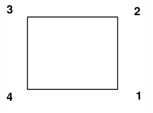
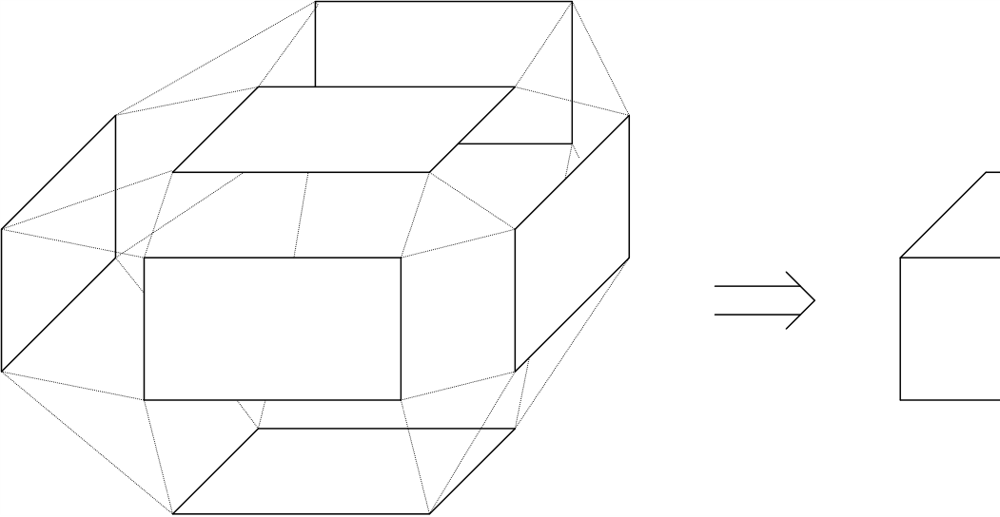
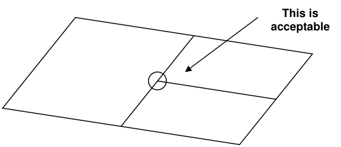

Modelle können aus einzelnen Flächenstücken aufgebaut werden.

CAD > Build > Block

#### CAD > Build > DD Loop

Diese werden durch drei- oder vierseitige Polygone definiert, die nicht eben sein müssen. Die Eckpunkte können im oder gegen den Uhrzeigersinn eingegeben werden. Jeder Eckpunkt kann wiederholt werden, um dreiseitige Formen und Keile zu definieren.

Bei Bedarf können Flächenstücke auch zur Erstellung von Hohlraumoberflächen und komplexen Erzumrissen verwendet werden. Die Routine

#### CAD > Build > FF Loop

hilft Ihnen, komplexe Bestandslayouts mühelos zu erstellen. Die Routine zeichnet mehrere Sohlenrisse oder Schnitte nach und verbindet sie anschließend automatisch.

Dies ist oft der beste Ansatz, insbesondere wenn Bestandsmodelle von Bauwerken erstellt werden sollen, deren genaue Form gut bekannt ist. Der Ansatz eignet sich für sehr detaillierte Analysen vieler Ingenieurbauwerke, bei denen Spannungskonzentrationen und die Bewertung lokaler Instabilitäten im Vordergrund stehen.

Diese Formen können mit den in Map3D integrierten CAD-Funktionen erstellt oder aus anderen CAD-Paketen in einem der folgenden Formate importiert werden:

- AutoCAD-DXF-Format. Ein verbreitetes Zeichnungsaustauschformat mit der Endung „.DXF“.

- Das Punktdateiformat ist eine universelle ASCII-Datendatei mit der Endung „.PNT“.

Selbst bei einfachen Formen kann dieses Konstruktionsverfahren schnell unübersichtlich werden. Da eine Reihe von Flächenstücken erzeugt werden muss, die zusammen eine nahtlose, überlappungsfreie, durchgehende Hülle bilden, dürfen keine Lücken oder Löcher bleiben.

Wenn Modelle auf diese Weise erstellt werden, prüft Map3D, ob geschlossene Flächen entstehen

#### Analysis > Options > Closure

Außerdem werden alle Flächen einheitlich neu nummeriert, damit sie positive Volumen bilden

#### Analysis > Options > Renumber

Diese Neunummerierung kann fehlschlagen, wenn Flächen nicht geschlossen sind, d. h. wenn der Hohlraum aufgrund fehlender Teile Löcher aufweist.

Anders als bei anderen Analyseprogrammen (isoparametrische Randelementmethoden sowie Finite-Elemente- oder Finite-Differenzen-Methoden) müssen diese Platten keine gemeinsamen Eckpunkte haben. Sie können Elemente mit Unterteilungen in der Mitte ihrer Kanten definieren, sofern keine Lücken entstehen. Obwohl Modelle mit dieser Flächenmodellierung erstellt werden können, ist die Volumenmodellierung einfacher und zuverlässiger

Modelle aus Blöcken erstellen
