In diesem Abschnitt werden einige häufige Konstruktionsfehler beschrieben und Vorschläge gegeben, wie Sie diese vermeiden und beheben können.

#### Querschlag an eine gerade Strecke anschließen

In diesem Beispiel lässt sich der Querschlag leicht erstellen, indem seine Eckpunkte an die Kante der Zugangsstrecke gefangen werden. Verwenden Sie zum Auswählen der angegebenen Punkte den Fangmodus „nächste Kante“

#### CAD > Snap > Nearest Edge

Die integrierten booleschen Schnittfunktionen von Map3D erzeugen den Schnitt zwischen beiden Blöcken in Phase 2 der Analyse automatisch. Diese Konstruktion funktioniert einwandfrei.

Bei einfachen Geometrien funktioniert das gut, in vielen Situationen ist der Anschluss jedoch nicht so einfach.

Betrachten wir eine komplexere Geometrie, bei der die Abschnitte der Zugangsstrecke im Liegenden nicht mit den gewünschten Positionen der Querschläge übereinstimmen.

#### Querschlag an eine komplexe Strecke anschließen

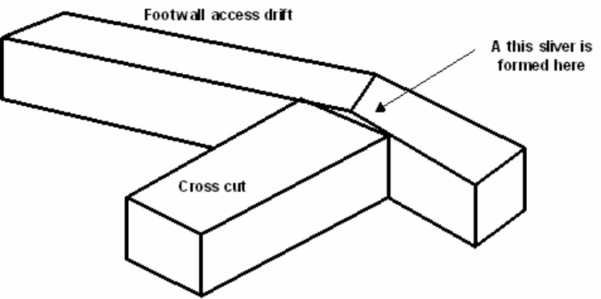

In diesem Beispiel schließt der Querschlag nicht korrekt an die Zugangsstrecke im Liegenden an. Am Ende des Querschlags entsteht ein dünner Pfeiler. Map3D erkennt diesen Pfeiler und versucht, ihn zu analysieren, vermutlich ohne Erfolg. So wie diese Struktur in der Realität physikalisch instabil wäre, ist sie auch numerisch instabil. Map3D kann sie tatsächlich erfolgreich analysieren, aber nur, wenn die angrenzenden Pfeilerflächen mit Randelementen diskretisiert werden, deren Größe etwa der Pfeilerdicke entspricht. Das ist jedoch nicht wünschenswert, da sehr viele Elemente erforderlich wären und dieser Pfeiler in Wirklichkeit gar nicht existiert.

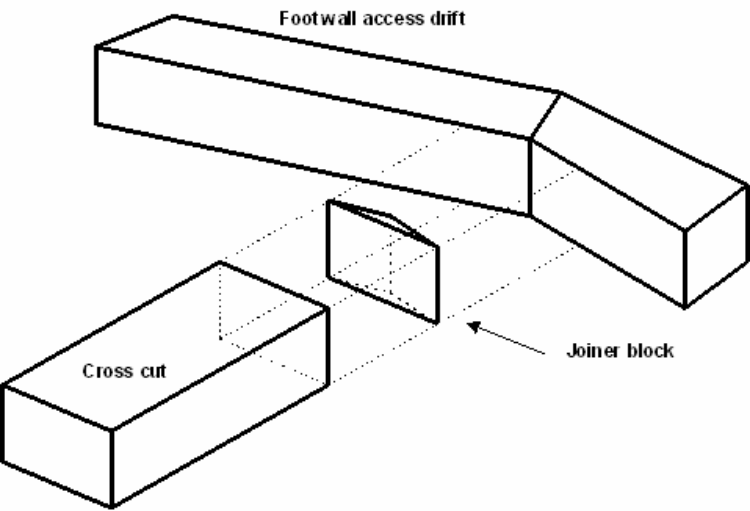

Um dieses Problem zu vermeiden, kann ein zusätzlicher Verbindungsblock erstellt werden, wie in der nebenstehenden Explosionsdarstellung gezeigt. Verwenden Sie den Fangmodus „nächster Eckpunkt“, damit dieser neue Block korrekt an Strecke und Querschlag anschließt. Der Verbindungsblock baut den unerwünschten Pfeiler gewissermaßen ab und verbindet so den Querschlag korrekt mit der Zugangsstrecke im Liegenden.

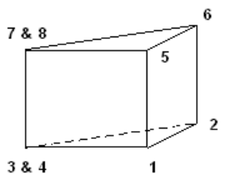

Beachten Sie, dass der Verbindungsblock auf Ober- und Unterseite nur drei Punkte hat. Dies lässt sich leicht erreichen, indem einer der Eckpunkte zweimal an derselben Stelle gewählt wird (z. B. Punkte 3 und 4 sowie 7 und 8).

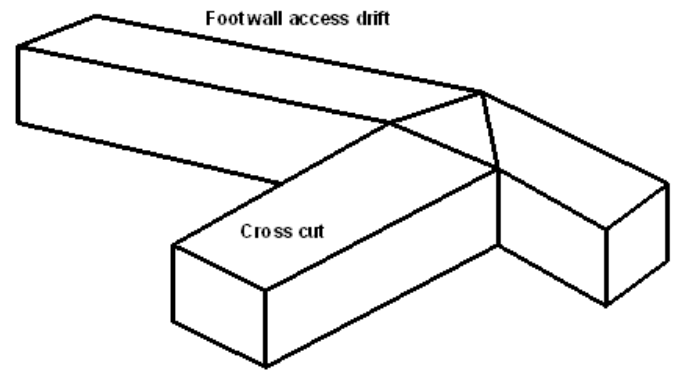

Dieses Problem lässt sich ganz vermeiden, wenn die Abschnitte der Zugangsstrecke im Liegenden so erstellt werden, dass sie mit den gewünschten Positionen der Querschläge übereinstimmen. Dazu wird die Zugangsstrecke einfach wie gezeigt unterteilt. Etwas Vorausplanung erleichtert die Konstruktion oft erheblich.

#### Nicht passende Abbaukammerblöcke verbinden

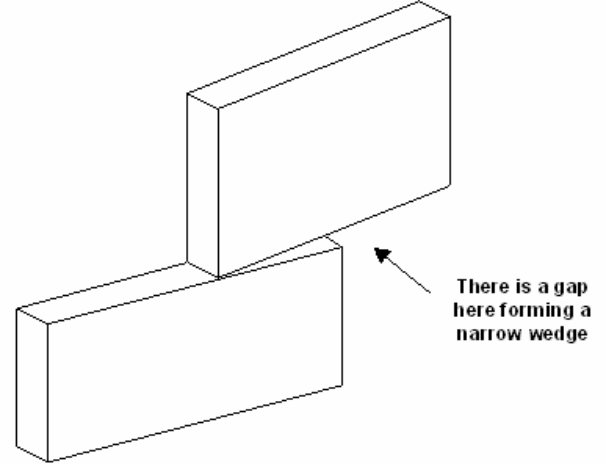

Häufig müssen mehrere Abbaukammerblöcke entlang ihrer gemeinsamen Kanten verbunden werden.

Lägen in diesem Beispiel die Unterseite des oberen Blocks und die Oberseite des unteren Blocks auf derselben Höhe, würden die integrierten booleschen Schnittfunktionen von Map3D den Schnitt zwischen beiden Blöcken in Phase 2 der Analyse automatisch erzeugen. Diese Konstruktion funktioniert einwandfrei.

Das Problem entsteht bei der Konstruktion, wenn man versucht, die Eckpunkte eines Blocks an die Seite des anderen zu fangen. In diesem Beispiel wurde der obere Block an die obere Kante des unteren Blocks gefangen, wodurch eine Lücke entsteht.

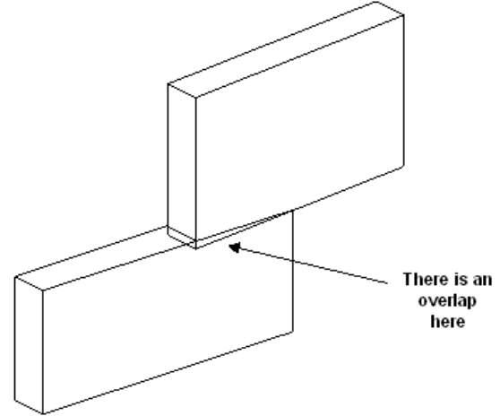

Um diese Lücke zu schließen, könnte man die Eckpunkte des unteren Blocks mit der Dehnfunktion (Stretch) an die untere Kante des oberen Blocks fangen. Dadurch entsteht jedoch eine Überlappung, sodass das Problem nicht behoben ist.

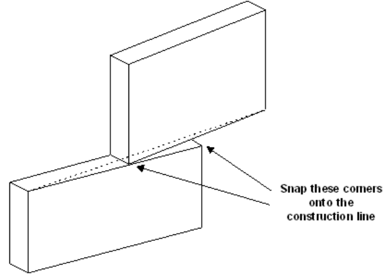

Eine Alternative ist ein Verbindungsblock wie oben beschrieben. Einfacher ist es jedoch, Konstruktionslinien zu erstellen, die den Problembereich überspannen, und die Eckpunkte des oberen und unteren Blocks an diese Linien zu fangen. Dies muss sowohl für die Rück- als auch für die Vorderseite der Abbaukammerblöcke erfolgen.

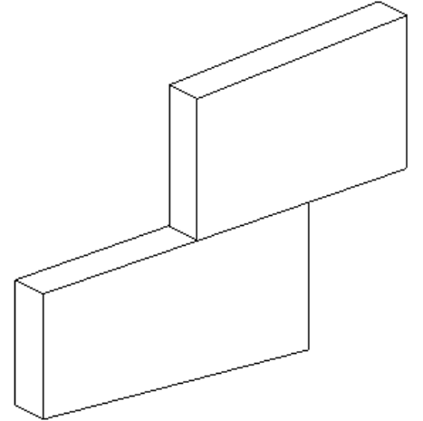

Der Nachteil dieser Methode ist, dass sie die Form der Abbaukammerblöcke verändert, möglicherweise auf unerwünschte Weise.

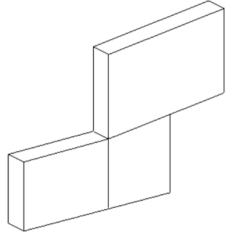

Die beste Alternative ist wahrscheinlich, einen oder beide Abbaukammerblöcke zu unterteilen. Dies ist die wirksamste Technik, um Lücken zu beseitigen und nicht passende Blöcke zu verbinden.

#### Versetzte Abbaukammerblöcke verbinden

Häufig passt die Form eines Abbaukammerblocks nicht zum benachbarten Block.

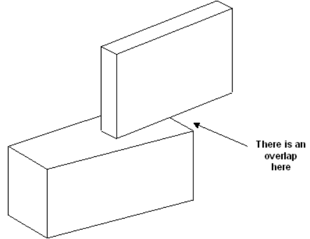

Diese Situation lässt sich mit den integrierten booleschen Schnittfunktionen von Map3D leicht bewältigen. Das Programm erzeugt den Schnitt zwischen beiden Blöcken in Phase 2 der Analyse automatisch.

Diese Routinen funktionieren am besten, wenn alle Punkte der Unterseite des oberen Blocks und alle Punkte der Oberseite des unteren Blocks auf derselben Höhe liegen. Dies erreichen Sie mit

#### CAD > Edit > Move Vertices to Z

Die Routinen funktionieren selbst dann, wenn die Unterseite des oberen Blocks und die Oberseite des unteren Blocks nicht eben sind und auf unterschiedlichen Höhen liegen, solange sie sich tatsächlich schneiden. In diesem Fall kann der resultierende Schnitt jedoch viele komplexe Elemente enthalten. Diese Formen funktionieren zwar, können die Analyse aber verlangsamen, da sie zahlreich sind und oft fein diskretisiert werden müssen.

#### Strecke an einen Abbaukammerblock anschließen

Häufig soll eine Strecke mit einem Abbaukammerblock verschnitten werden.

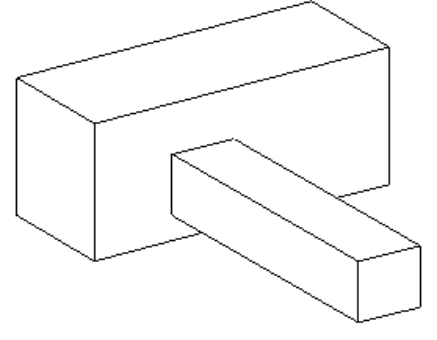

Wie oben lässt sich diese Situation mit den integrierten booleschen Schnittfunktionen von Map3D leicht bewältigen. Das Programm erzeugt den Schnitt zwischen Strecke und Abbaukammerblock in Phase 2 der Analyse automatisch.

Diese Routinen funktionieren am besten, wenn die sich schneidenden Flächen eben und parallel sind. Sie funktionieren selbst dann, wenn die Flächen nicht eben und nicht parallel sind, solange sie sich tatsächlich schneiden. In diesem Fall kann der resultierende Schnitt jedoch viele komplexe Elemente enthalten. Diese Formen funktionieren zwar, können die Analyse aber erheblich verlangsamen, da sie zahlreich sind und oft fein diskretisiert werden müssen.
