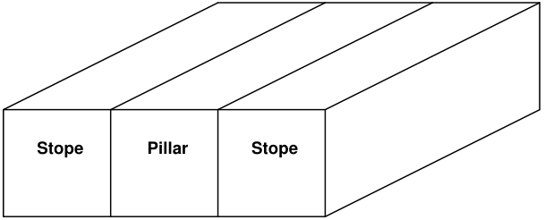
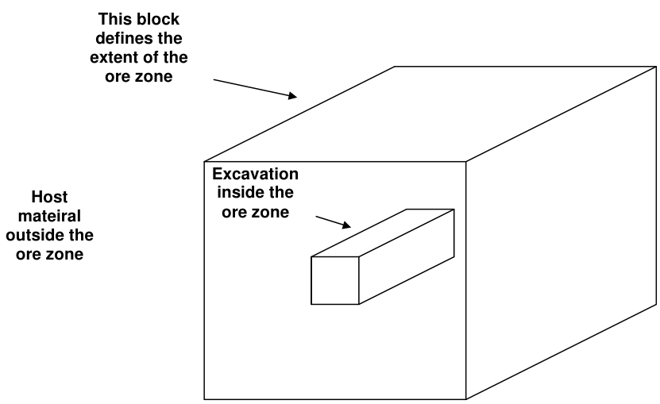
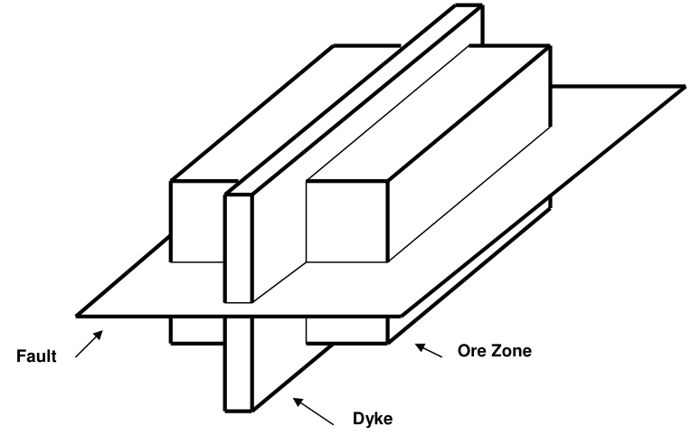

Modelle mit mehreren Materialien werden nach ähnlichen Prinzipien erstellt wie normale Hohlraummodelle. Anstatt das Innere eines Blocks als ausgebrochen zu definieren (d. h. Materialcode Null), geben Sie einfach die Nummer des Materials an, das sich im Block befindet.

Standardmäßig hat das Wirtsgestein die Materialnummer 1. Jeder Bereich mit abweichenden Eigenschaften (Anfangsspannung, elastisches Verhalten oder Festigkeit) muss genauso definiert werden wie ein Hohlraum, also mit Randelementen fiktiver Kräfte. Statt diesen Blöcken den Materialcode Null (für spannungsfreie Oberflächen) oder einen negativen Materialcode (für einen vorgegebenen Spannungszustand) zuzuweisen, erhalten sie einfach einen positiven Materialcode, der die Eigenschaften der jeweiligen Blockgruppe kennzeichnet.

Wie bereits beschrieben, werden komplexe Hohlraumformen erstellt, indem mehrere Blöcke mit derselben Blocknummer zur gewünschten Form kombiniert werden. Auf genau dieselbe Weise werden getrennte Bereiche mit jeweils eigenen Materialeigenschaften gebildet, indem die gewünschte Form aus vielen Blöcken mit derselben Blocknummer aufgebaut wird.

Wichtig ist dabei, möglichst wenige Blocknummern zu verwenden, da alle Flächen zwischen Blockgruppen mit unterschiedlichen Blocknummern in der Datenbank erhalten bleiben.

Es gibt zwei Methoden, Bereiche zu definieren, denen die Materialnummer 2 oder höher (also eine andere Materialnummer als die des Wirtsgesteins) zugewiesen werden soll.

Bei der ersten Methode werden Bereiche mit anderen Materialnummern aus Blöcken aufgebaut, die genauso aussehen wie Hohlräume.

Diese Technik eignet sich zur Definition von Details wie Zonen mit niedrigem Modul am Rand von Hohlräumen. Sie ist auch die beste Methode zur Definition isolierter Strukturen wie steifer Gänge oder durch Sprengung geschädigter Pfeiler.

Die zweite Methode ist ein globalerer Ansatz, bei dem ein ganzes Hohlraumsystem (oder ein Teil davon) von einer Gruppe von Blöcken umhüllt wird, die beispielsweise die Erzzone definieren. Hüllen dürfen ineinander geschachtelt werden (wie Zwiebelschalen) und sich überlappen. Strecken dürfen beispielsweise aus der Erzzone in das Wirtsgestein hineinragen. Map3D erzeugt die erforderlichen Schnitte.

Beide Methoden können gleichzeitig verwendet werden. Blöcke, die nach der zweiten Methode einen globalen Bereich definieren, dürfen andere, nach der ersten Methode definierte Hohlräume vollständig oder nur teilweise umhüllen.

Bei der Definition mehrerer Materialzonen ist nur eine Regel strikt einzuhalten: die Konvention, dass höhere Materialnummern Vorrang vor niedrigeren haben. Diese Konvention beseitigt Mehrdeutigkeiten beim Schnitt zweier Strukturen, etwa einer Störung mit einem Gang. Schneiden sich eine Störung und ein Gang, ist nicht klar, ob die Störung durch den Gang hindurchläuft oder umgekehrt. Ein weiteres Beispiel ist ein Gang, der eine Erzzone schneidet. Soll der Gang als durchgehend gelten und das Erz durchschneiden, oder soll das Erz als durchgehend gelten und den Gang abschneiden?

In all diesen Fällen ist die Struktur mit der höheren Materialnummer durchgehend. Hätte die Störung die Materialnummer 4, der Gang die Nummer 3 und das Erz die Nummer 2, wäre die Störung überall durchgehend. Da sie die höchste Materialnummer hat, verliefe sie ununterbrochen durch Erz und Gang, natürlich aber nicht durch Hohlräume. Da das Erz die niedrigste Materialnummer hat, würde es den Gang nicht durchschneiden; vielmehr würde der Gang das Erz durchschneiden.

Mit folgenden Ausblendfunktionen können Sie klären, welches Material andere Materialien durchschneidet:

#### View > Hide > Solids

#### View > Hide > Unused

Die integrierte Logik unterstützt den gleichzeitigen Schnitt von bis zu fünf Strukturen (d. h. von Blöcken mit fünf verschiedenen Blocknummern). Beliebig viele Blöcke können sich schneiden, an derselben Stelle jedoch höchstens fünf. So lassen sich beispielsweise mehrschichtige Erzzonen mit Hohlräumen auf beiden Seiten des Kontakts und einer entlang des Kontakts verlaufenden Störung abbilden. Map3D erkennt automatisch Blöcke, die teilweise oder vollständig in anderen Blöcken liegen, sowie Blöcke, die an andere Blöcke angrenzen. Damit kann in jeder Analyse eine praktisch unbegrenzte Anzahl von Bereichen mit unterschiedlichen Materialtypen berücksichtigt werden.

Bei der Anzeige der Hohlraumgeometrie im Grafikmodus können Sie den Mauszeiger über einen Block bewegen. Beim Drücken einer Maustaste werden Blocknummer und Blockname angezeigt, außerdem der diesem Block zugewiesene Materialcode und der Materialcode des Bereichs, der an diese Blockoberfläche angrenzt oder sie umhüllt. Bei Blockoberflächen, die an das Wirtsgestein angrenzen, ist der „angrenzende Materialcode“ beispielsweise eins (Material eins steht für das Wirtsgebirge). Grenzt die Blockoberfläche an einen Hohlraum mit Materialcode 2, ist der „angrenzende Materialcode“ 2.

Während der Analyse werden Ergebnisse auf Feldpunktrastern berechnet. Map3D erkennt automatisch, ob Rasterpunkte innerhalb von Hohlräumen oder in Bereichen mit anderen Materialeigenschaften liegen. Bei der Anzeige von Konturergebnissen können Sie den Mauszeiger über den gewünschten Feldpunkt bewegen. Beim Drücken einer Maustaste werden der Materialcode des Bereichs, in dem dieser Feldpunkt liegt, sowie Koordinaten, Verschiebungen und Spannungszustand angezeigt. Beachten Sie, dass Festigkeitsfaktoren mit den für diesen Bereich festgelegten Materialeigenschaften berechnet werden. So lässt sich eine Festigkeit bewerten, die sich von Bereich zu Bereich unterscheiden kann.
