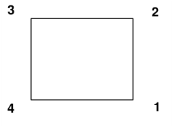
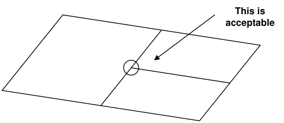
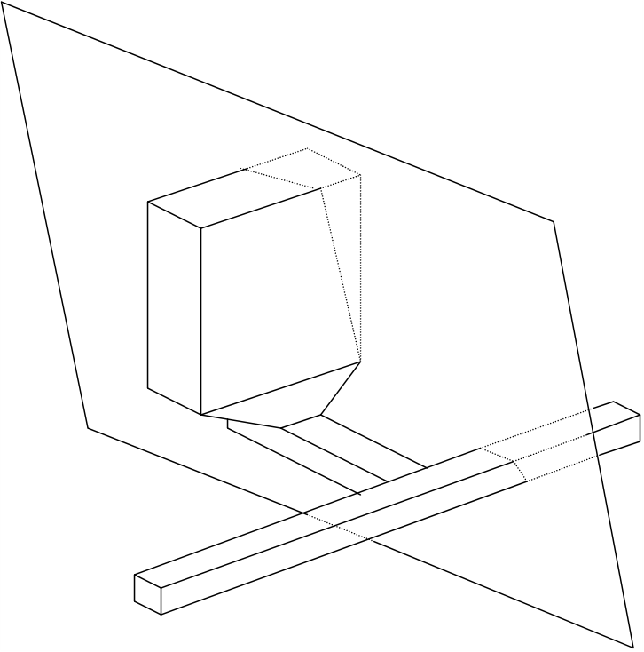
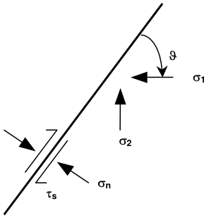

Modelle können aus einzelnen Flächenstücken aufgebaut werden. Diese werden durch drei- oder vierseitige Polygone definiert, die nicht eben sein müssen. Die Eckpunkte können im oder gegen den Uhrzeigersinn eingegeben werden. Jeder Eckpunkt kann wiederholt werden, um dreiseitige Formen und Keile zu definieren.

#### CAD > Build > DD Loop

Diese Formen können mit den in Map3D integrierten CAD-Funktionen erstellt oder aus anderen CAD-Paketen in einem der folgenden Formate importiert werden:

- AutoCAD-DXF-Format. Ein verbreitetes Zeichnungsaustauschformat mit der Endung „.DXF“.

- Das Punktdateiformat ist eine universelle ASCII-Datendatei mit der Endung „.PNT“.

Anders als bei anderen Analyseprogrammen (isoparametrische Randelementmethoden sowie Finite-Elemente- oder Finite-Differenzen-Methoden) müssen diese Platten keine gemeinsamen Eckpunkte haben. Sie können Elemente mit Unterteilungen in der Mitte ihrer Kanten definieren, sofern keine Lücken entstehen.

Störungsflächen und tafelförmiger Abbau werden nach denselben Prinzipien erstellt wie normale Hohlraummodelle. Diese Strukturen werden einfach zusammen mit anderen Hohlräumen und mehreren Materialzonen festgelegt und können gleichzeitig mit allen anderen Map3D-Funktionen verwendet werden.

Störungsflächen und tafelförmige Abbauzonen werden mit Verschiebungsdiskontinuitäts-Elementen definiert. Diese können nur als Plattendefinitionen angegeben werden. Die vier Eckpunkte der Platte legen die Grenzen der Verschiebungsdiskontinuität fest. Verschiebungsdiskontinuitäten können Hohlräume an jeder beliebigen Stelle schneiden, da Map3D die Kantenschnitte intern erzeugt.

Wie im vorigen Abschnitt ist bei der Definition von Störungsflächen nur eine Regel strikt einzuhalten: die Konvention, dass höhere Materialnummern Vorrang vor niedrigeren haben. Schneiden sich zwei Strukturen, etwa eine Störung und ein Gang, setzt sich die Struktur mit der höheren Materialnummer durch die andere fort.

Bei nichtlinearer Modellierung (ob Störungsgleiten oder allgemeines Fließen in Map3D Non-Linear) ist zu beachten, dass die Fernfeldspannung die Festigkeit nicht überschreiten darf. Überschreiten die Fernfeldspannungen die Gebirgsfestigkeit, ist das Gebirge selbst instabil. Dies mag bei manchen Kriechproblemen zulässig sein, ist aber im Allgemeinen nicht akzeptabel, und stationäre Lösungen (d. h. ohne Kriechen) sind nicht möglich.

Diese Einschränkung wirkt sich bei der Simulation von Störungen stärker aus. Jede Störung kann sich mit dem Fernfeldspannungszustand im oder sehr nahe am statischen Gleichgewicht befinden (d. h. Spannungen gleich der Festigkeit). Bei schwachen Störungen unter hohen Spannungsverhältnissen müssen die Hauptspannungen nahezu senkrecht oder parallel zur Störungsfläche ausgerichtet sein. Andernfalls ist die Störung instabil und gleitet selbst ohne Abbau. Dieser Zustand ist im Allgemeinen nicht akzeptabel, da stationäre Lösungen (d. h. ohne Kriechen) nicht möglich sind.

Ist s1 unter dem Winkel J zur Störungsfläche ausgerichtet, ergeben sich die auf die Störung wirkende Schub- und Normalspannung zu

ts = ( s1 - s2 ) sin(J) cos(J)

sn = s1 sin² (J) +  s2 cos² (J)

Durch Einsetzen in die Scherfestigkeitsbeziehung

|ts| = Cohesion + sn tan(j)

ergibt sich, dass der Spannungszustand folgende Bedingung erfüllen muss

|( s1 - s2 ) sin(J) cos(J)| = Cohesion + [ s1 sin² (J) +  s2 cos² (J) ] tan(j)

Zum Beispiel muss mit

s1 = 32 MPa s2 = 16 MPa Cohesion = 0 j = 10°

J kleiner als 11° oder zwischen 69° und 90° sein.

Mit

s1 = 60 MPa s2 = 16 MPa Cohesion = 0 j = 30°

muss J kleiner als 15° oder zwischen 45° und 90° sein.
