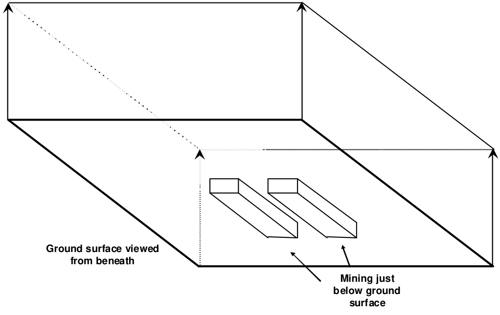

Die Geländeoberfläche lässt sich am besten mit einer großen FF-Zone definieren, deren Unterseite die Geländeoberfläche bildet. Wenn Sie diesen Elementen den Materialcode Null zuweisen, stellt Map3D sicher, dass entlang dieser Flächen keine Normal- und Schubspannungen auftreten. Auf diese Weise wird eine freie Oberfläche simuliert.

Die Geländeoberfläche muss nur definiert werden, wenn die Abbauhohlräume relativ oberflächennah liegen (d. h. wenn die Abbautiefe weniger als etwa das Doppelte der seitlichen Ausdehnung des Abbaus beträgt). In diesen Fällen sollte sich die freie Oberfläche in alle Richtungen mindestens über das Doppelte der seitlichen Ausdehnung des Abbaus erstrecken.

Führen Sie Feldpunktraster nur dann in die Nähe der freien Oberfläche oder durch sie hindurch, wenn es unbedingt erforderlich ist, da die freie Oberfläche sonst in eine große Anzahl von Randelementen diskretisiert wird.
