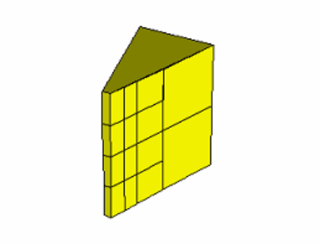
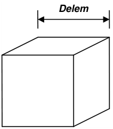
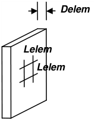
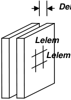
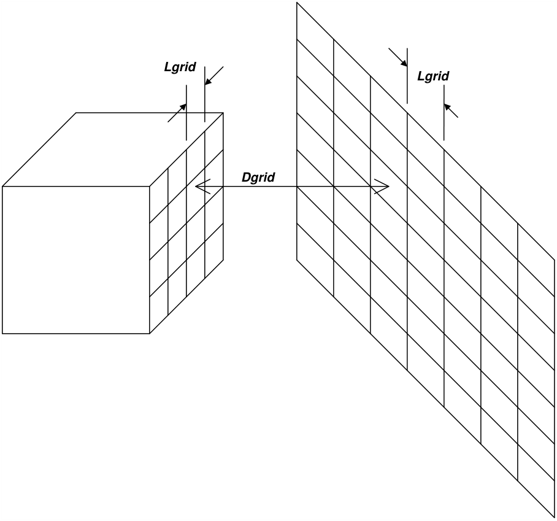
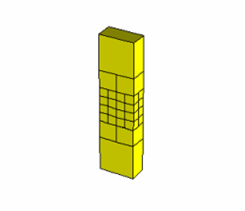
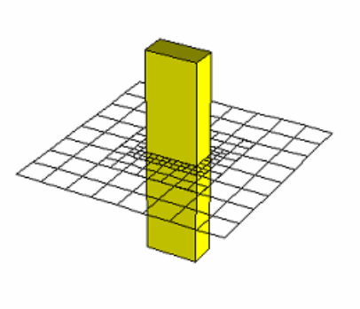
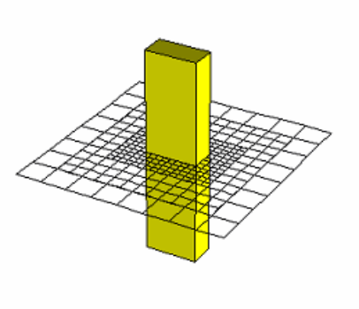
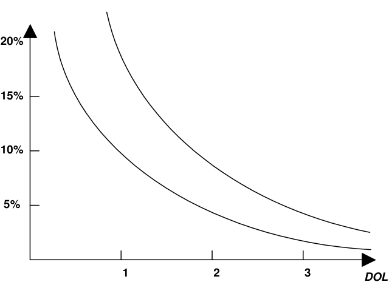
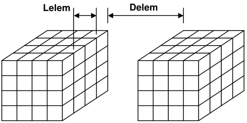

Map3D verwendet mehrere unterschiedliche, aber sich ergänzende Strategien, um die Analyse sehr großer Probleme zu ermöglichen. Die Diskretisierung wird so gesteuert, dass Randelemente nur dort eingesetzt werden, wo sie benötigt werden. Anschließend werden verschiedene Formen der Zusammenfassung (Lumping) genutzt, um Rechenzeit und Speicherbedarf zu verringern. Zusammen ermöglichen diese Funktionen Map3D die Bearbeitung sehr großer Probleme (mehr als 2.000.000 Elemente) auf PCs.

Ohne Zusammenfassung würde ein Problem mit 64000 Elementen 147 GB Festplattenspeicher belegen. Mit Zusammenfassung lässt sich dies auf weniger als 1 GB reduzieren. Die Rechenzeit verringert sich etwa im gleichen Verhältnis. So können Sie die bestehende Abbaugeometrie detailliert abbilden und bei Bedarf neuen Abbau hinzufügen. Der Aufwand für die Einrichtung und Durchführung von Analysen sinkt dadurch erheblich, und bei Bedarf kann das gesamte Bergwerk betrachtet werden.

Alle Diskretisierungs- und Zusammenfassungsparameter werden als Verhältnis von Abstand zu Länge ausgedrückt. In allen Fällen wird der Abstand zwischen zwei interessierenden Punkten gemessen (z. B. von einem Element zu einem anderen oder von einem Element zum nächstgelegenen Rasterpunkt). Die Länge in diesem Verhältnis ist die Elementgröße oder der Rasterabstand an einem der interessierenden Punkte.

Empfohlene Werte für die Diskretisierungs- und Zusammenfassungsparameter:

- _AL_ sollte auf das Doppelte der kleinsten Pfeiler- oder Abbaukammerbreite gesetzt werden. Verwenden Sie dieselben Einheiten wie für die Koordinaten (z. B. Meter oder Fuß).

- _AG_ sollte auf die kleinste interessierende Abmessung gesetzt werden. Verwenden Sie dieselben Einheiten wie für die Koordinaten (z. B. Meter oder Fuß).

- _DON_ =0.5, _DOL_ = _DOC_ =1, _DOE_ = _DOG_ =2 für 10-20 % Fehler

- _DON_ =0.5, _DOL_ = _DOC_ =2, _DOE_ = _DOG_ =4 für 5-10 % Fehler

- _DON_ =1.0, _DOL_ = _DOC_ =4, _DOE_ = _DOG_ =8 für &lt; 5 % Fehler

Diese Parameter werden im Dialog CAD > Properties > Control Parameters eingestellt.

Die Verwendung dieser Parameter zur Steuerung von Diskretisierung und Zusammenfassung wird im Folgenden ausführlich beschrieben.

**_DON_ und** **_AL_ – Matrixkonditionierung**

Bei der Diskretisierung werden alle Modelloberflächen (Oberflächen von FF-Blöcken und DD-Ebenen) in Randelemente mit der Seitenlänge

_Lelem_ = _Delem_ / _DON_

unterteilt, wobei _Delem_ der von Map3D ermittelte kleinste Abstand zwischen benachbarten Modelloberflächen ist. Da der Abstand _Delem_ an manchen Stellen null sein kann, muss eine minimale Elementseitenlänge _AL_ angegeben werden.

_AL_ sollte auf das Doppelte der kleinsten Pfeiler- oder Abbaukammerbreite gesetzt werden. Verwenden Sie dieselben Einheiten wie für die Koordinaten (z. B. Meter oder Fuß).

Ein Wert von 0,5 für _DON_ ist im Allgemeinen für alle Probleme ausreichend, außer bei sehr schmalen Hohlräumen oder Pfeilern. In diesem Fall wird ein Wert von 1,0 für _DON_ empfohlen.

Höhere Werte für _DON_ erzeugen zwar mehr Randelemente und damit längere Rechenzeiten, sind aber bei sehr schmalen Hohlräumen oder Pfeilern notwendig, um ein gut konditioniertes, lösbares Problem zu erhalten.

_DON_ steuert, wie Blockoberflächen in Randelemente diskretisiert werden. Zusammen mit _AL_ stellt dieser Parameter sicher, dass die Randelementanalyse eine gut konditionierte, lösbare Koeffizientenmatrix erzeugt.

Die Matrixkonditionierung hängt direkt von der Größe von _DON_ ab. Mit größeren Werten für _DON_ (nahe eins) lässt sich eine gut konditionierte, leicht lösbare Matrix sicherstellen.

_DON_ = 0.5

#### _DON_ = 1.0

Diese Parameter steuern, wie fein Flächen diskretisiert werden, die nahe aneinander vorbeiführen. Vergleicht man beispielsweise die Fälle mit _DON_ = 0,5 und 1,0, so zeigt sich, dass größere Werte für _DON_ an der Stelle der Abbaukammer kleinere Randelemente erzeugen.

Aus Sicht der Analyse gibt es drei grundlegende Problemtypen. Am einfachsten zu lösen sind Probleme mit massigen dreidimensionalen Formen, deren Flächen weit voneinander entfernt liegen.

Bei diesem Problemtyp wird immer eine gut konditionierte Koeffizientenmatrix erzeugt, und der Einfluss von _DON_ und _AL_ ist unerheblich.

Der nächstschwierigere Problemtyp ist einer, bei dem schmale Abbaukammern definiert sind. In diesem Fall entspricht der Abstand _Delem_ (der kleinste Abstand von einem Element zum anderen) einfach der Abbaukammerbreite. Da sich die Elementseitenlänge _Lelem_ aus dem Verhältnis _DON_ als

#### _Lelem_ = _Delem_ / _DON_

berechnen lässt, wobei _Lelem_ nicht kleiner als _AL_ sein darf, erzeugen kleine Werte für _DON_ nur in der Nähe schmaler Abbaukammern kleine Elemente. Mit zunehmender Entfernung von diesen Bereichen nimmt die Elementgröße sehr schnell zu. Werden Elemente fiktiver Kräfte zur Erstellung eines solchen tafelförmigen Hohlraums verwendet, kann eine schlecht konditionierte Matrix entstehen, sofern nicht ein Wert von etwa einhalb für _DON_ verwendet wird. Dies muss natürlich mit einem ausreichend kleinen Wert für _AL_ einhergehen, damit kleine Elemente erzeugt werden können.

_AL_ sollte normalerweise auf die Breite des schmalsten Pfeilers oder der schmalsten Abbaukammer bzw. auf den kleinsten Abstand zwischen Hangendem und Liegendem gesetzt werden. So kann die Diskretisierungsroutine so kleine Elemente verwenden, wie für eine ordnungsgemäße Matrixkonditionierung erforderlich.

Am schwierigsten zu lösen sind Probleme, bei denen schmale Pfeiler definiert oder eng beieinanderliegende Klüfte verwendet werden. Wie oben ist _Delem_ die Abbaukammer- oder Pfeilerbreite. Auch hier lässt sich die Elementseitenlänge aus dem Verhältnis _DON_ berechnen. Bei diesem Problemtyp, bei dem Hohlräume sehr nahe beieinanderliegen und schmale Pfeiler bilden, entsteht jedoch eine schlecht konditionierte, unlösbare Matrix, sofern nicht ein Wert von etwa eins für _DON_ verwendet wird. Dies muss natürlich mit einem ausreichend kleinen Wert für _AL_ einhergehen, damit kleine Elemente erzeugt werden können.

Der empfohlene Wert für _DON_ beträgt 0,5 bei Problemen mit schmalen Abbaukammern und 1 bei Problemen mit schmalen Pfeilern.

_AL_ sollte normalerweise auf die Breite des schmalsten Pfeilers oder auf den kleinsten Abstand zwischen Hangendem und Liegendem gesetzt werden. So kann die Diskretisierungsroutine so kleine Elemente verwenden, wie für eine ordnungsgemäße Matrixkonditionierung erforderlich.

Zusammengefasst: _AL_ sollte auf die Breite des schmalsten Pfeilers oder auf den kleinsten Abstand zwischen Hangendem und Liegendem gesetzt werden. Werden zu viele Elemente erzeugt, können größere Werte erforderlich sein. _DON_ sollte bei normalen Problemen auf 0,5 und bei Problemen mit schmalen Pfeilern auf 1,0 gesetzt werden.

Bei der Diskretisierung versucht Map3D, das angegebene Verhältnis _DON_ für alle Elemente einzuhalten. Jede Block- oder Plattenkante kann dabei in höchstens 256 Randelemente unterteilt werden. Wird diese Anzahl erreicht, ohne dass das angegebene Verhältnis _DON_ eingehalten wird, gibt Map3D eine Warnung aus, die den Benutzer auffordert, den Block oder die Platte in kleinere Teile zu unterteilen.

Nach Abschluss der Diskretisierung kann der Abstand _Delem_ dargestellt werden mit

Plot > Miscellaneous > Delem Distance to nearest element on surfaces

Das Verhältnis _Delem/Lelem_ kann dargestellt werden mit

Plot > Miscellaneous > Delem/Lelem _DON_ ratio on surfaces

Stellen mit kleinem _DON_ (unter 0,5) können dazu führen, dass der Lösungsprozess nicht konvergiert.

Beachten Sie, dass dieses Verhalten bei Bedarf für jedes Element einzeln übersteuert werden kann, indem die maximale Breite jedes Elements angegeben wird

#### CAD > Edit > Entity Properties > Maximum Width

#### _DOL_ und _AG_ – Lösungsgenauigkeit

Bei der Diskretisierung werden Blöcke und DD-Ebenen in Randelemente mit der Seitenlänge _Lgrid_ unterteilt. Die Elementgröße ergibt sich aus dem kleinsten Abstand _Dgrid_ zur nächstgelegenen Feldpunkt-Rasterebene gemäß der Beziehung

_Lgrid_ = _Dgrid_ / _DOL_

Da der Abstand _Dgrid_ an manchen Stellen null sein kann, muss außerdem eine minimale Elementseitenlänge _AG_ angegeben werden.

Dieselbe Beziehung wird auch verwendet, um Rasterebenen in Punkte zu unterteilen, an denen Feldspannungen, -dehnungen und -verschiebungen berechnet werden. Der minimale Rasterabstand beträgt die Hälfte von _AG_.

Der Parameter _AG_ sollte auf die kleinste interessierende Abmessung gesetzt werden. Für hinreichend genaue Ergebnisse sollte _AG_ etwa ein Viertel der Abbaukammer- oder Pfeilerbreite betragen. Möchte der Benutzer beispielsweise die Spannungsverteilung über einen 2 m breiten Pfeiler sehen, liefert ein Wert von 0,5 für _AG_ genügend Feldpunkte für eine genaue Konturdarstellung.

Verwenden Sie dieselben Einheiten wie für die Koordinaten (z. B. Meter oder Fuß).

Ein Wert von 1,0 für _DOL_ wird für alle Probleme empfohlen, außer wenn eine höhere Genauigkeit erforderlich ist. Bei einem Wert von 1,0 ist mit einem Fehler von 10-20 % zu rechnen. Ein Wert von 2,0 sollte einen Fehler von 5-10 % ergeben, ein Wert von 4,0 einen Fehler von unter 2 %.

Höhere Werte für _DOL_ erzeugen zwar mehr Elemente, sind aber für eine höhere Genauigkeit notwendig.

_DOL_ steuert, wie Raster und Blockoberflächen unterteilt werden. Zusammen mit _AG_ legt dieser Parameter fest, wie detailliert und genau die Ergebnisse sein sollen.

_AG_ sollte die interessierende Größenordnung widerspiegeln. Werden beispielsweise Details der Spannungsverteilung nur auf einen Meter genau in der Nähe der Hohlraumoberflächen benötigt, sollte _AG_ auf einen Meter gesetzt werden.

Der Feldpunktabstand und die Elementseitenlänge _Lgrid_ werden aus dem angegebenen Verhältnis _DOL_ bestimmt. _Dgrid_ ist der kleinste Abstand eines gegebenen Elements zum nächstgelegenen Raster. Da sich _Lgrid_ aus dem Verhältnis _DOL_ als

_Lgrid_ = _Dgrid_ / _DOL_

berechnen lässt, wobei _Lgrid_ nicht kleiner als _AG_ sein darf, erzeugen kleine Werte für _DOL_ nur dort kleine Elemente und Rasterabstände, wo Raster nahe an Abbaukammern vorbeiführen. Mit zunehmender Entfernung von diesen Bereichen nimmt die Elementgröße sehr schnell zu.

_DOL_ = 1

_DOL_ = 2

_DOL_ = 1

#### _DOL_ = 2

Kleine Werte für _DOL_ (eins oder weniger) erzeugen nur dort kleine Feldpunktabstände und kleine Elemente, wo das Raster den Block schneidet oder sehr nahe an ihm vorbeiführt. Mit zunehmender Entfernung von diesen Bereichen nehmen Feldpunktabstand und Elementseitenlänge sehr schnell zu. Größere Werte für _DOL_ (zwei oder mehr) vergrößern den Bereich, in dem Feldpunktabstand und Elementseitenlänge klein bleiben.

#### Fehler

Die Ergebnisgenauigkeit hängt direkt von der Größe von _DOL_ ab. Die Fehler sind bei _DOL_ nahe eins auf etwa 10-20 % und bei _DOL_ nahe zwei auf 5-10 % begrenzt. Diese Werte sind nur Näherungen. Bei Problemen, die hohe Genauigkeit erfordern, wird daher empfohlen, Werte für _DOL_ nahe vier zu verwenden. Bei Problemen, bei denen eine geringe Genauigkeit ausreicht, genügt _DOL_ nahe eins. Es wird nicht empfohlen, _DOL_ kleiner als eins zu wählen.

Beachten Sie, dass große Werte für _DOL_ und kleine Werte für _AG_ zu mehr Elementen und längeren Rechenzeiten, aber auch zu höherer Genauigkeit führen.

Zusammengefasst: _AG_ sollte auf die gewünschte Auflösung (einen Bruchteil der Abbaukammerbreite) gesetzt werden. _DOL_ sollte für grobe Ergebnisse auf 1, für detaillierte Ergebnisse auf 2 und bei sehr hohen Genauigkeitsanforderungen auf 4 gesetzt werden.

Bei der Diskretisierung versucht Map3D, das angegebene Verhältnis _DOL_ für alle Elemente und Raster einzuhalten. Jede Block- oder Plattenkante kann dabei in höchstens 256 Randelemente unterteilt werden. Auch jede Rasterkante kann in höchstens 256 Feldpunkte unterteilt werden. Wird diese Anzahl erreicht, ohne dass das angegebene Verhältnis _DOL_ eingehalten wird, gibt Map3D eine Warnung aus, die den Benutzer auffordert, Block, Platte oder Raster in kleinere Teile zu unterteilen.

Nach Abschluss der Diskretisierung kann der Abstand _Dgrid_ auf Modelloberflächen dargestellt werden mit

Plot > Miscellaneous > Dgird Distance to nearest grid on surfaces

oder auf Rastern mit

Plot > Miscellaneous > Dgrid Distance to nearest element on grids

Das Verhältnis _Dgrid_ / _Lgrid_ kann auf Modelloberflächen dargestellt werden mit

Plot > Miscellaneous > Dgrid/Lgrid _DOL_ ratio on surfaces

oder auf Rastern mit

Plot > Miscellaneous > Dgrid/Lgrid _DOL_ ratio on grids

Beachten Sie, dass dieses Verhalten bei Bedarf für jedes Raster einzeln übersteuert werden kann, indem die maximale Breite jedes Rasters angegeben wird

CAD > Edit > Entity Properties > Maximum Width

#### _DOR_ – Seitenverhältnis der Elemente

_DOR_ steuert das maximale Seitenverhältnis der Elemente. Überschreitet das Verhältnis der Seitenlängen eines Elements den Wert _DOR_, wird das Element unterteilt. Der empfohlene Wert für _DOR_ ist 5. Treten sprunghafte Ergebnisse auf, sollte _DOR_ auf 2 verringert werden. Beachten Sie, dass kleinere Werte für _DOR_ zu mehr Elementen und längeren Rechenzeiten, aber auch zu höherer Genauigkeit führen.

Bei der Diskretisierung versucht Map3D, das angegebene Verhältnis _DOR_ für alle Elemente einzuhalten. Jede Block- oder Plattenkante kann dabei in höchstens 256 Randelemente unterteilt werden. Wird diese Anzahl erreicht, ohne dass das angegebene Verhältnis _DOR_ eingehalten wird, gibt Map3D eine Warnung aus, die den Benutzer auffordert, den Block oder die Platte in kleinere Teile zu unterteilen.

#### _DOC_ – Matrixzusammenfassung

Beim Aufstellen der Matrix wird der Abstand _Delem_ zwischen Gruppen von Blöcken und DD-Ebenen geprüft, um festzustellen, ob diese für Berechnung und Speicherung zusammengefasst werden können. Der Grad der Zusammenfassung hängt davon ab, wie viele Elemente in eine Zone mit der Seitenlänge _Lelem_ passen, die sich aus folgender Beziehung ergibt

#### _Lelem_ = _Delem_ / _DOC_

Ein Wert von 1,0 für _DOC_ wird für alle Probleme empfohlen, außer wenn eine höhere Genauigkeit erforderlich ist. Bei einem Wert von 1,0 ist mit einem Fehler von 10-20 % zu rechnen. Ein Wert von 2,0 sollte einen Fehler von 5-10 % ergeben, ein Wert von 4,0 einen Fehler von unter 5 %.

Höhere Werte für _DOC_ führen zwar zu größeren Problemen, sind aber für eine höhere Genauigkeit notwendig.

_DOC_ steuert, wie Elemente beim Aufstellen der Matrix zusammengefasst werden. Elemente mit der kombinierten Seitenlänge _Lelem_ werden zusammengefasst, wenn der Abstand _Delem_ zum betroffenen Element das geforderte Verhältnis _DOC_ überschreitet. Sind die Abstände zwischen den Abbaukammern groß, können viele Elemente zusammengefasst werden.

Kleine Werte für _DOC_ (eins oder weniger) ergeben eine maximale Zusammenfassung, allerdings verschlechtert sich die Genauigkeit der Spannungen nahe den Hohlraumoberflächen, und die Matrixkonditionierung nimmt ab. Größere Werte für _DOC_ (zwei oder mehr) ergeben weniger Zusammenfassung, erhalten aber die Genauigkeit und eine gute Matrixkonditionierung.

_DOC_ sollte für grobe Ergebnisse auf 1, für detaillierte Ergebnisse auf 2 und bei sehr hohen Genauigkeitsanforderungen auf 4 gesetzt werden. Beachten Sie, dass große Werte für _DOC_ zu einer größeren Matrix und längeren Rechenzeiten, aber auch zu höherer Genauigkeit führen.

#### _DOE_ – Elementzusammenfassung

Bei der Berechnung der Feldpunkte (d. h. beim Aufbau der Raster) wird der Abstand _Dgrid_ zwischen diesen Punkten und Gruppen von Blöcken und DD-Ebenen geprüft, um festzustellen, ob diese Gruppen für die Berechnung zusammengefasst werden können. Der Grad der Zusammenfassung hängt davon ab, wie viele Elemente in eine Zone mit der Seitenlänge _Lgrid_ passen, die sich aus folgender Beziehung ergibt

#### _Lgrid_ = _Dgrid_ / _DOE_

Ein Wert von 2,0 für _DOE_ wird für alle Probleme empfohlen, außer wenn eine höhere Genauigkeit erforderlich ist. Bei einem Wert von 2,0 ist mit einem Fehler von 10-20 % zu rechnen. Ein Wert von 4,0 sollte einen Fehler von 5-10 % ergeben, ein Wert von 8,0 einen Fehler von unter 5 %.

Höhere Werte für _DOE_ führen zwar zu längeren Rechenzeiten, sind aber für eine höhere Genauigkeit notwendig.

_DOE_ steuert, wie Elemente bei der Berechnung der Feldpunkte zusammengefasst werden. Elemente mit der kombinierten Seitenlänge _Lgrid_ werden zusammengefasst, wenn der Abstand _Dgrid_ zum Feldpunkt das geforderte Verhältnis _DOE_ überschreitet. Kleine Werte für _DOE_ (zwei oder weniger) ergeben eine maximale Zusammenfassung, allerdings verschlechtert sich die Genauigkeit der Spannungsverteilungen nahe den Hohlraumoberflächen, und diese werden sprunghaft. Größere Werte für _DOE_ (vier oder mehr) ergeben weniger Zusammenfassung, gewährleisten aber Genauigkeit und glatte Spannungsverteilungen.

_DOE_ sollte für grobe Ergebnisse auf 2, für detaillierte Ergebnisse auf 4 und bei sehr hohen Genauigkeitsanforderungen auf 8 gesetzt werden. Beachten Sie, dass große Werte für _DOE_ zu einer größeren Matrix und längeren Rechenzeiten, aber auch zu höherer Genauigkeit führen.

#### _DOG_ – Rasterzusammenfassung

Bei der Berechnung der Feldpunkte (d. h. beim Aufbau der Raster) wird der Abstand _Dgrid_ zwischen diesen Punkten und Gruppen von Blöcken und DD-Ebenen geprüft, um festzustellen, ob diese Feldpunkte für die Berechnung zusammengefasst werden können. Der Grad der Zusammenfassung hängt davon ab, wie viele Feldpunkte in eine Zone mit der Seitenlänge _Lgrid_ passen, die sich aus folgender Beziehung ergibt

_Lgrid_ = _Dgrid_ / _DOG_

Ein Wert von 2,0 für _DOG_ wird für alle Probleme empfohlen, außer wenn eine höhere Genauigkeit erforderlich ist. Bei einem Wert von 2,0 ist mit einem Fehler von 10-20 % zu rechnen. Ein Wert von 4,0 sollte einen Fehler von 5-10 % ergeben, ein Wert von 8,0 einen Fehler von unter 5 %.

Höhere Werte für _DOG_ führen zwar zu längeren Rechenzeiten, sind aber für eine höhere Genauigkeit notwendig.

_DOG_ steuert, wie Feldpunkte bei ihrer Berechnung zusammengefasst werden. Feldpunkte mit dem kombinierten Abstand _Lgrid_ werden zusammengefasst, wenn der Abstand _DOG_ zum einwirkenden Element das geforderte Verhältnis _DOG_ überschreitet. Kleine Werte für _DOG_ (zwei oder weniger) ergeben eine maximale Zusammenfassung, allerdings verschlechtert sich die Genauigkeit der Spannungsverteilungen nahe den Hohlraumoberflächen, und diese werden sprunghaft. Größere Werte für _DOG_ (vier oder mehr) ergeben weniger Zusammenfassung, gewährleisten aber Genauigkeit und glatte Spannungsverteilungen.

_DOG_ sollte für grobe Ergebnisse auf 2, für detaillierte Ergebnisse auf 4 und bei sehr hohen Genauigkeitsanforderungen auf 8 gesetzt werden. Beachten Sie, dass große Werte für _DOG_ zu einer größeren Matrix und längeren Rechenzeiten, aber auch zu höherer Genauigkeit führen.
