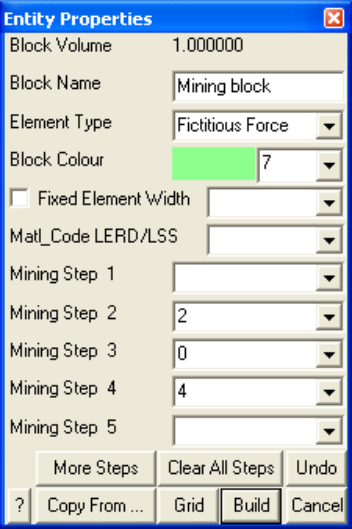

Die Abfolge der Abbauschritte wird einfach festgelegt, indem im gewünschten Abbauschritt die passenden Materialcodes zugewiesen werden. Der Materialcode gibt die Nummer des Materials an, das sich im Block befindet. Standardmäßig hat das Wirtsgestein die Materialnummer 1. Jedem Bereich, dessen Eigenschaften (Anfangsspannung, elastisches Verhalten oder Festigkeit) vom Wirtsgestein abweichen, wird einfach ein positiver Materialcode zugewiesen, der die Eigenschaften der jeweiligen Blockgruppe kennzeichnet.

Der Materialcode 0 legt fest, dass das Element spannungsfreie Oberflächen hat. Dies ist die Voreinstellung und wird normalerweise für Hohlraumoberflächen, die Geländeoberfläche und Tagebauböschungen verwendet.

Der Materialcode -M (z. B. -2) legt fest, dass die Oberflächenspannungen des Elements dem Spannungszustand von Material Nummer M entsprechen. Dies ist nützlich zur Modellierung von Hohlräumen unter Innendruck oder von Spannungen, die sich mit der Tiefe ändern (z. B. Versatz).

Der Materialcode +M (z. B. 2) legt fest, dass sich der umschlossene Bereich mit den Eigenschaften von Material Nummer M verhält. Mit diesem Code werden Bereiche festgelegt, deren Eigenschaften vom Wirtsgestein abweichen (z. B. Erz, Gang, Versatz usw.).

Materialcodes werden bei der Modellerstellung zugewiesen mit

CAD > Build > Block CAD > Build > DD Loop CAD > Build > FF Loop

Materialcodes können jederzeit zugewiesen werden mit

CAD > Edit > Entity Properties

Folgende Abfrage wird angezeigt

In diesem Beispiel wird der ausgewählte Block in Schritt 1 nicht verwendet. In Abbauschritt 2 erhält er die Eigenschaften von Material Nummer 2. In Abbauschritt 3 wird der Block ausgebrochen. In Abbauschritt 4 schließlich wird der Block mit Material Nummer 4 versetzt.

Dieses Verfahren kann mit Elementen fiktiver Kräfte verwendet werden, um dreidimensionale Zonen mit unterschiedlichen Spannungen und Materialeigenschaften zu definieren (z. B. steife Gänge, weiche Erzzonen oder nachgiebige Zonen). Mit Verschiebungsdiskontinuitäts-Elementen lassen sich ebene Zonen mit unterschiedlichen Spannungen und Materialeigenschaften definieren (z. B. mit Störungsletten gefüllte Störungen oder nachgiebige Pfeiler im tafelförmigen Abbau).

Für jeden Abbauschritt kann ein anderer Materialcode festgelegt werden. Wird kein Materialcode zugewiesen (das Feld bleibt leer), bleibt der Block inaktiv.

Wichtig ist die Konvention, dass höhere Materialnummern (Materialcodes) Vorrang vor niedrigeren haben. Diese Konvention beseitigt Mehrdeutigkeiten beim Schnitt mehrerer Strukturen, etwa einer Störung mit einem Gang oder von Versatz, der in einen Teil einer Abbaukammer eingebracht wird. Um Probleme zu vermeiden, empfiehlt es sich, für den Versatz die höchsten Materialnummern zu verwenden.

Bei der Simulation steifer Ausbausysteme wie Bögen, Stahlbögen, Stempel, dicke Auskleidungen, Holzpfeiler, fester Versatz usw. muss die Gebirgsbewegung bis zum Zeitpunkt des Ausbaueinbaus modelliert werden. Anschließend werden die Ausbauelemente entweder spannungs- und dehnungsfrei oder mit einer vorgegebenen Vorspannung eingesetzt. Dazu müssen Sie zunächst das gewünschte Ausbauelement (einen 3D-FF-Block oder eine DD-Ebene) bis zum gewünschten vorgespannten Zustand ausbrechen (Materialcode Null für spannungsfreie Zustände oder eine negative Materialnummer für einen vorgegebenen Spannungszustand). In einem späteren Abbauschritt setzen Sie dann das Ausbaumaterial ein (mit einer positiven Materialnummer). Ist die Option Analysis > Options > Zero Strain Support Placement aktiviert, führt Map3D die erforderlichen Berechnungen durch, um die Ausbauelemente im aktuellen Abbauschritt spannungs- und dehnungsfrei oder mit vorgegebener Vorspannung einzusetzen. Der Ausbruch bis zu einem spannungsfreien oder vorgegebenen Spannungszustand mit anschließendem Einsetzen eines anderen Materials signalisiert Map3D, die erforderlichen Berechnungen durchzuführen.

Dieses Verfahren ist besonders nützlich für die Simulation tragender Ausbauelemente und ermöglicht deren Einbau, die Änderung ihrer Eigenschaften und bei Bedarf ihren späteren Rückbau. Die Option ist für 3D-FF-Blöcke und/oder DD-Ebenen verfügbar.

Ohne diese Option werden alle Materialien im Verformungszustand vor dem Abbau eingesetzt. Das kann insbesondere in steifen Ausbauelementen zu fälschlich hohen Spannungen führen.

Die erzielte Abbaufolge lässt sich im Grafikmodus von Map3D einfach durch Umschalten zwischen den Abbauschritten anzeigen mit

File > Mining Step
