Um die Modellerstellung anhand digitalisierter Grubenrisse zu zeigen, erstellen wir eine einfache Geometrie für einen VRM-Großraumabbau.

Konstruktionslinien dienen dazu, die genaue Lage untertägiger Objekte wie Hohlräume, Kontakte, Strukturen usw. festzulegen. Ein Map3D-Modell wird normalerweise auf Grundlage dieser Konstruktionsliniendaten erstellt.

Die Grubenrisse wurden zuvor mit Map3D

#### CAD > Digitizer Setup

oder einem anderen CAD-Programm digitalisiert. Diese Risse können in einem der folgenden Formate gespeichert werden:

Das Punktdateiformat ist eine universelle ASCII-Datendatei mit der Endung „.PNT“. Dieses Format eignet sich zum Austausch roher Konstruktionsliniendaten mit anderer CAD-Software.

Das AutoCAD-DXF-Format ist ein verbreitetes Zeichnungsaustauschformat mit der Endung „.DXF“. Dieses Format eignet sich zum Austausch von Konstruktionsliniendaten mit anderer CAD-Software.

Wir wollen von vorn beginnen und wählen daher

#### File > New (Model)

Bevor Sie beginnen: Wenn Sie den Mauszeiger über eine Schaltfläche bewegen, erscheint ein Tooltip mit ihrer Funktion. Außerdem erhalten Sie durch Rechtsklick auf ein Element ausführliche Hilfe zu dieser Funktion.

#### Digitalisierte Grubenrisse importieren

Zuerst müssen wir eine Datei mit den digitalisierten Grubenrissen öffnen. Dies geschieht mit

#### File > Open (Construction Lines)

In diesem Fall wurden die Konstruktionslinien im DXF-Format gespeichert. Ändern Sie daher „Files of Type“ in *.dxf

Die Datei „BULK.dxf“ ist in der Map3D-Installation enthalten und sollte zum Import verfügbar sein.

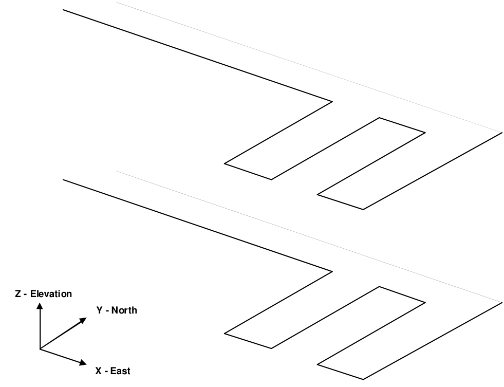

Die Zugangsstrecken sind etwa 5 m breit und 5 m hoch, der Sohlenabstand beträgt 25 m.

#### Ansicht neu ausrichten

Während der Blockerstellung oder zu jedem anderen Zeitpunkt können Sie die Geometrie verschieben, drehen oder zoomen, um die Darstellung zu erleichtern. Dafür gibt es mehrere Möglichkeiten (siehe Modell drehen und Modell verschieben). Am einfachsten drehen Sie, indem Sie die linke Maustaste gedrückt halten und den Cursor über den Bildschirm ziehen. Verschoben wird mit gedrückter rechter Maustaste. Zum Vergrößern oder Verkleinern halten Sie beide Maustasten gedrückt.

Richten Sie die Ansicht so aus, dass die Konstruktionslinien gut sichtbar sind.

#### Zugangsstrecken im Liegenden und Querschläge erstellen

Für die Erstellung dieser Objekte gibt es zahlreiche Methoden. In diesem Tutorial werden einige davon gezeigt.

#### Blöcke einzeln erstellen

Die einfachste (wenn auch zeitaufwendigste) Methode besteht darin, nacheinander eine Reihe von Blöcken mit 8 Eckpunkten zu erstellen.

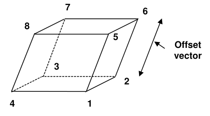

Verwenden Sie für den ersten Block CAD > Build > FFLoop. Diese Funktion lässt sich wie folgt in der CAD-Symbolleiste auswählen (falls die CAD-Symbolleiste nicht sichtbar ist, aktivieren Sie sie mit Tools > CAD Toolbar):

Wählen Sie CAD > Build in der CAD-Symbolleiste

Das Untermenü der Erstellfunktionen wird angezeigt

Wählen Sie nun

#### CAD > Build > FFLoop

Da wir an Konstruktionslinien fangen möchten, müssen wir den Fangmodus einstellen. Dies geschieht mit CAD > Snap > Nearest Edge. Diese Funktion lässt sich in der Symbolleiste Build Entity auswählen

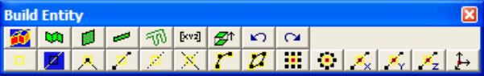

Um das Fangen an der nächsten Kante zu aktivieren, wählen Sie

#### CAD > Snap > Nearest Edge

(nur erforderlich, wenn die entsprechende Schaltfläche nicht bereits hervorgehoben ist).

In diesem Modus wird am Schnittpunkt des Fadenkreuzes ein Auswahlfeld angezeigt.

**Der nächstgelegene Punkt auf dieser Kante wird ausgewählt**

Die Koordinaten der aktuellen Cursorposition werden in der Statusleiste angezeigt. Liegt das Auswahlfeld über einem Eckpunkt einer Konstruktionslinie, wird dieser Eckpunkt ausgewählt; andernfalls der nächstgelegene Punkt auf der Kante der Konstruktionslinie unter dem Auswahlfeld. In beiden Fällen sind alle 3 Koordinatenwerte (x, y und z) eindeutig festgelegt.

Die FFLoop-Routine fordert Sie in der Statusleiste auf, den ersten Eckpunkt des Blocks einzugeben

Input: Select Point 1

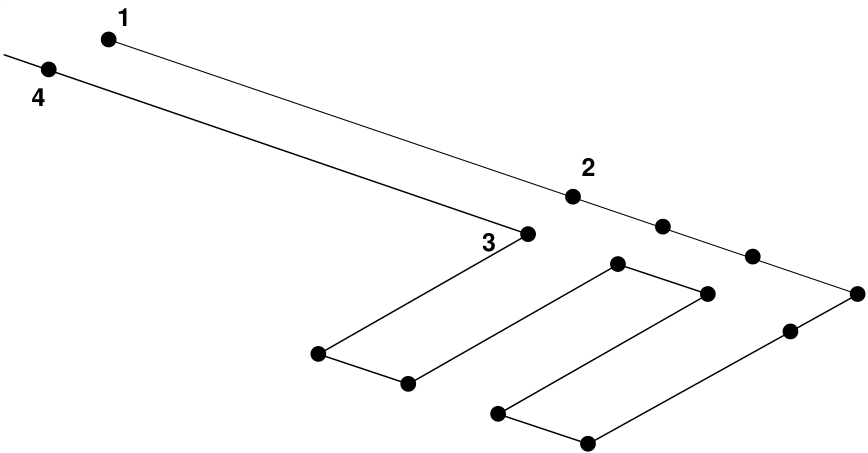

Bewegen Sie den Cursor, bis Sie Punkt 1 gefunden haben. Wählen Sie ihn mit einem Klick der linken Maustaste aus.

Nun werden Sie zur Eingabe des nächsten Eckpunkts aufgefordert

#### Input: Select Point 2

Beim Bewegen des Cursors sehen Sie unten links nicht nur die aktuelle Cursorposition, sondern auch den Versatz des aktuellen Punkts zum zuletzt gewählten Punkt (d. h. den Versatzvektor von Punkt 1 zu Punkt 2). Wählen Sie Punkt 2. Wiederholen Sie die Auswahl für die Punkte 3 und 4.

Wenn Sie eine falsche Position gewählt haben, machen Sie die Auswahl einfach mit der Rückgängig-Schaltfläche

CAD > Build > Undo Point rückgängig und versuchen Sie es erneut.

Wählen Sie zum Schluss erneut den ersten Punkt (d. h. Punkt 1).

Sobald der erste Punkt erneut gewählt wurde, ist die Grundfläche des Blocks vollständig. Es erscheint die Meldung

Loop complete: Start next loop.

Um den Block fertigzustellen, erzeugen wir die verbleibenden 4 Punkte aus den ersten 4 Eckpunkten durch Addition eines Versatzes. Wählen Sie dazu die Versatzfunktion in der Symbolleiste Build Entity

#### CAD > Build > Extrude/Offset Remaining

Sie werden wie folgt zur Eingabe des Versatzvektors aufgefordert

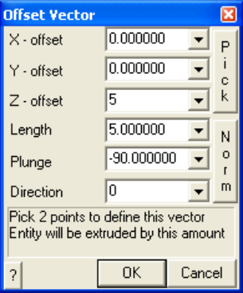

Geben Sie den Versatz ein:

X-offset > 0 Y-offset > 0 Z-offset > 5

Die Punkte 5, 6, 7 und 8 werden aus den Punkten 1, 2, 3 und 4 erzeugt, indem die Versatzwerte zu ihren Koordinaten addiert werden.

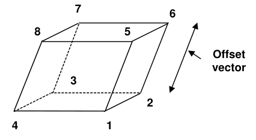

Nach Fertigstellung des Blocks werden Sie automatisch zur Eingabe der Blockeigenschaften aufgefordert (CAD > Build > FFLoop)

Geben Sie Folgendes ein:

Block Name: Intersection Element Type: Fictitious Force Block Colour: 1

Dieser Kreuzungsblock soll in Abbauschritt 1 ausgebrochen werden. Dies wird durch Mining Step 1: 0 angegeben

Damit sind wir fertig und können den Block mit der

Schaltfläche erstellen.

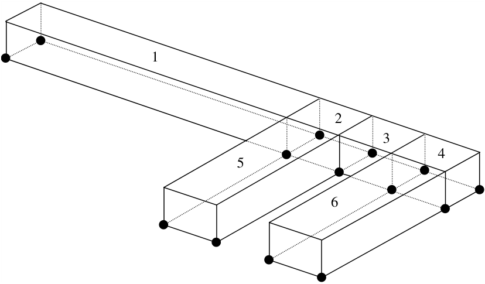

Durch Wiederholen dieses FFLoop-Verfahrens lässt sich die gesamte Sohle als Folge von Blöcken erstellen.

#### Komplexe Blöcke erstellen

Erstellen wir nun Blöcke mit komplexerer Form.

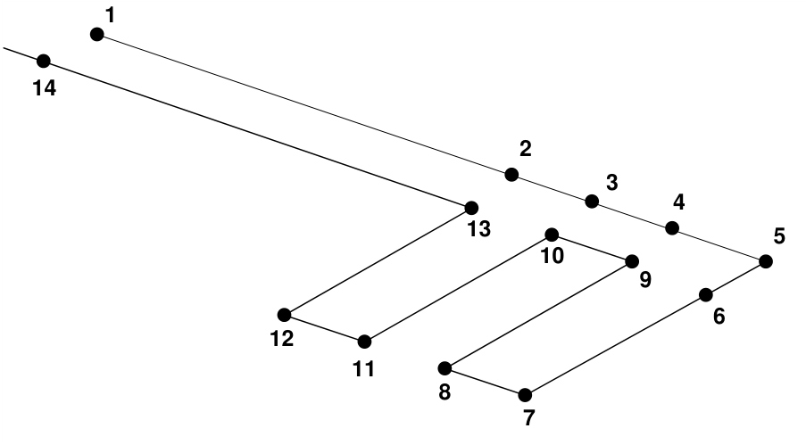

Dazu verwenden wir dasselbe FFLoop-Verfahren wie oben, wählen aber alle 14 Punkte des Grundrisses. Nachdem Punkt 14 gewählt wurde, müssen Sie erneut Punkt 1 wählen, um die Grundfläche des Blocks zu schließen. Es erscheint die Meldung

#### Loop complete: Start next loop.

Um den Block fertigzustellen, wählen Sie wie zuvor die Versatzfunktion in der Symbolleiste Build Entity.

#### CAD > Build > Extrude/Offset Remaining

Dieses Verfahren erzeugt einen großen, durchgehenden Block, der den gesamten Grundriss abdeckt. Alternativ könnten Sie einen Block mit der Punktfolge 1-2-3-4-5-6-9-10-13-14-1 für die Hangendstrecke und anschließend 13-10-11-12 sowie 9-6-7-8 für die Querschläge als separate Blöcke erstellen. Dieses Vorgehen wäre sinnvoll, wenn die Querschläge in einem anderen Abbauschritt aufgefahren werden sollen als die Hangendstrecke.

Erstellen Sie nun die Zugangsstrecken der unteren Sohle nach demselben Verfahren.

#### VRM-Abbaufelder erstellen

Nun können die VRM-Abbaufelder erstellt werden. Dazu werden FFLoop-Blöcke mit 8 Eckpunkten verwendet.

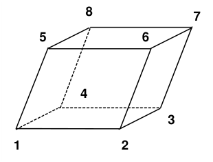

Wählen Sie zum Beginnen

#### CAD > Build > FFLoop

Da wir an Eckpunkten bereits erstellter Blöcke fangen möchten, müssen wir den Fangmodus auf CAD > Snap > Nearest Corner setzen. Diese Funktion lässt sich in der Symbolleiste Build Entity auswählen

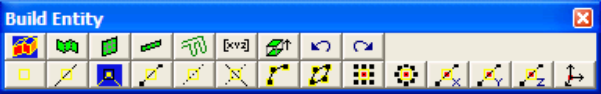

Um das Fangen am nächsten Eckpunkt zu aktivieren, wählen Sie

#### CAD > Snap > Nearest Corner

(nur erforderlich, wenn die entsprechende Schaltfläche nicht bereits hervorgehoben ist).

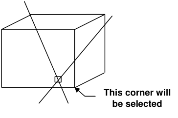

Im Eckpunkt-Fangmodus wird am Schnittpunkt des Fadenkreuzes ein Auswahlfeld angezeigt. Der nächstgelegene Eckpunkt des Objekts oder der Konstruktionslinie unter dem Auswahlfeld wird ausgewählt (gefangen), sodass alle 3 Koordinatenwerte (x, y und z) eindeutig festgelegt sind.

Wir könnten hier auch den Kanten-Fangmodus verwenden

#### CAD > Snap > Nearest Edge

da die Eckpunkte der Blöcke ohnehin ausgewählt würden (sofern der Eckpunkt im Auswahlfeld liegt). Mit dem Eckpunkt-Fangmodus können wir jedoch ungenauer zielen, da nur Eckpunkte ausgewählt werden.

Wählen Sie die ersten 4 Punkte wie unten gezeigt. Denken Sie daran, erneut Punkt 1 zu wählen, um die untere Schleife zu schließen.

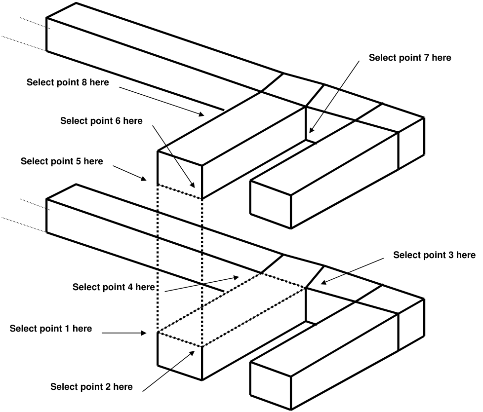

Um die Punkte 5 bis 8 auszuwählen, müssen wir das Modell so drehen, dass wir von unten nach oben blicken. Halten Sie dazu einfach die linke Maustaste gedrückt und ziehen Sie den Cursor auf dem Bildschirm nach oben.

Wählen Sie die Punkte 5 bis 8 wie unten gezeigt. Denken Sie daran, erneut Punkt 5 zu wählen, um die obere Schleife zu schließen.

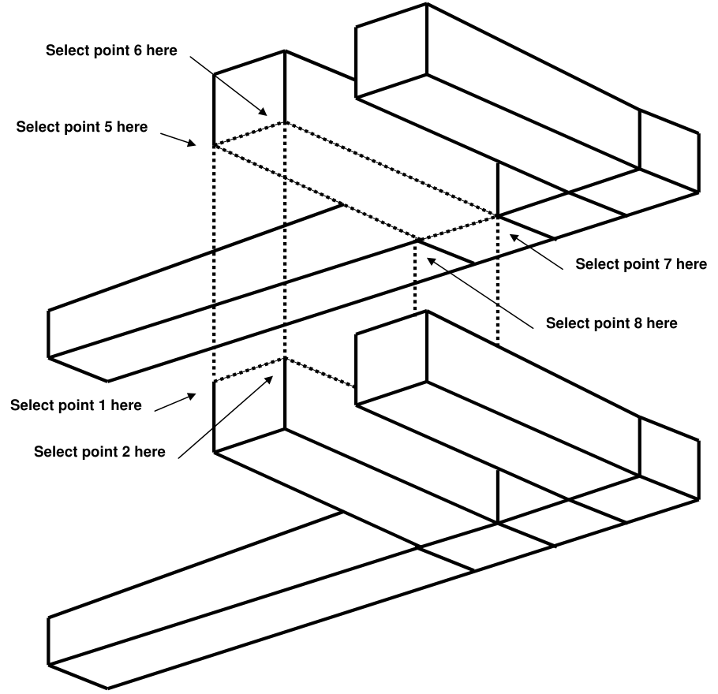

Wie zuvor erscheint die Meldung

Loop complete: Start next loop.

Um den Block fertigzustellen, wählen Sie die Erstellen-Schaltfläche in der Symbolleiste Build Entity

Nach Fertigstellung des Blocks werden Sie automatisch zur Eingabe der Blockeigenschaften aufgefordert (CAD > Build > FFLoop)

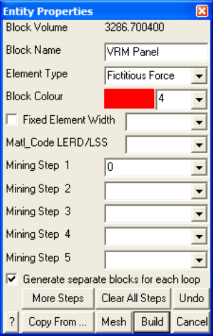

Geben Sie Folgendes ein:

Block Name: VRM Panel Element Type: Fictitious Force Block Colour: 4

Dieser Block bleibt in Schritt 1 unverritzt und wird in Schritt 2 ausgebrochen. Dies wird folgendermaßen angegeben

Mining Step 1: (Feld leer lassen) Mining Step 2: 0

Damit sind wir fertig und können den Block erstellen. Das benachbarte Abbaufeld wird nach demselben Verfahren erstellt, wodurch sich die endgültige Geometrie ergibt.

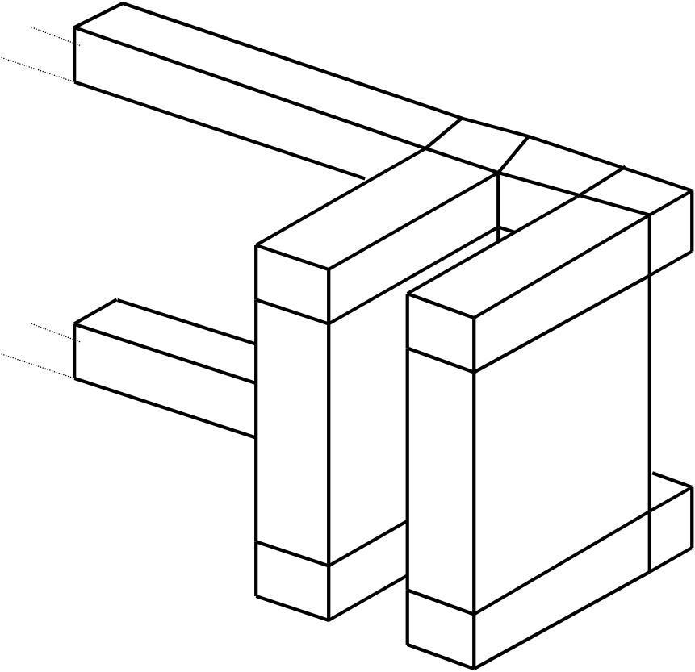

#### Geometrie speichern

Wir haben nun die Zugangsstrecken im Liegenden und zwei VRM-Abbaufelder erstellt. Bevor wir fortfahren, sollten wir das bisherige Modell speichern. Dazu wählen wir

File > Save Model As

Speichern wir es unter dem Namen „VRM.INP“

#### Rasterebenen erstellen

Nun müssen wir entscheiden, wo Ergebnisse berechnet werden sollen. In diesem Beispiel interessiert uns die Spannung im Pfeiler zwischen den beiden VRM-Abbaufeldern. Wir definieren daher eine horizontale Rasterebene, die den Pfeiler auf halber Höhe schneidet.

Wir verwenden die Fangraster-Funktion. Sie kann jetzt oder nach dem Start der Funktion zur Erstellung der Rasterebene eingerichtet werden. Um sie jetzt einzurichten, wählen Sie die entsprechende Schaltfläche in der CAD-Symbolleiste

Da wir freihändig zeichnen, müssen wir das Fangraster einrichten. Dies geschieht mit CAD > Snap > Rectangular Grid Snap. Diese Funktion lässt sich in der Symbolleiste Snap auswählen

Um das Fangraster zu aktivieren, wählen Sie

#### CAD > Snap > Rectangular Grid Snap

(nur erforderlich, wenn die entsprechende Schaltfläche nicht bereits hervorgehoben ist).

Die Koordinaten der aktuellen Cursorposition werden in der Statusleiste angezeigt. Sie werden feststellen, dass sich beim Bewegen des Cursors die x- und y-Werte ändern, nicht aber der z-Wert. Um den aktuellen z-Wert festzulegen, klicken Sie auf CAD > Snap > Cursor/Grid Setup. Folgender Dialog wird angezeigt:

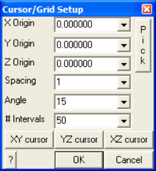

Wählen wir diese Position grafisch mit der Funktion Pick.

Da die Fangbasis auf halber Höhe der VRM-Abbaufelder liegen soll, stellen Sie den Fangmodus auf Linienmittelpunkt um

#### CAD > Snap > Midpoint of Line

Stellen Sie vor dem Fortfahren sicher, dass der richtige Fangmodus eingestellt ist: Entweder ist der Menüpunkt CAD > Snap > Midpoint of Line markiert oder die Mittelpunkt-Fangschaltfläche ist hervorgehoben

Wählen Sie den Ursprung der Fangbasis (Cursor/Snap Base Origin) auf der vertikalen Kante des VRM-Abbaufelds.

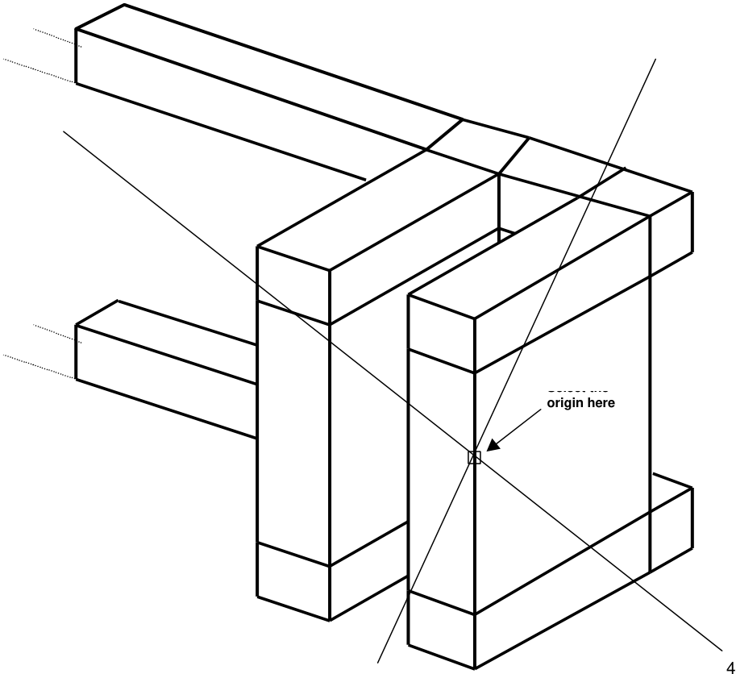

Der Punkt auf halber Höhe dieser Kante wird ausgewählt. Der z-Wert sollte lauten

Z Origin: 1012.5

Außerdem sollten wir

Snap Spacing: 10

einstellen, um die Punktauswahl zu erleichtern.

Bewegt sich das Fadenkreuz nicht in der x-y-Ebene, wählen Sie die

Schaltfläche.

Bevor wir mit der Erstellung der Rasterebene beginnen, sollten wir die Geometrie in eine Grundrissansicht drehen. Dies geschieht mit

#### View > View XY Plane

Erstellen wir nun die Rasterebene.

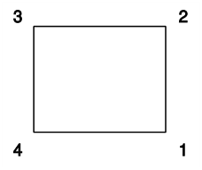

Sie wird als Ebene mit 4 Eckpunkten erstellt. Wählen Sie dazu die Menüfunktion zur Rastererstellung

#### CAD > Build > Grid Plane

Diese Funktion lässt sich auch wie folgt in der CAD-Symbolleiste auswählen:

Wählen Sie CAD > Build in der CAD-Symbolleiste

Das Untermenü der Erstellfunktionen wird angezeigt

Wählen Sie nun

#### CAD > Build > Grid Plane

Da wir freihändig zeichnen, müssen wir sicherstellen, dass CAD > Snap > Rectangular Grid Snap aktiviert ist. Diese Funktion lässt sich in der Symbolleiste Build Entity auswählen

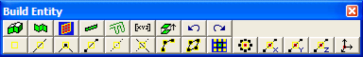

Um das Fangraster zu aktivieren, wählen Sie

#### CAD > Snap > Rectangular Grid Snap

(nur erforderlich, wenn die entsprechende Schaltfläche nicht bereits hervorgehoben ist).

Die Routine zur Erstellung der Rasterebene fordert Sie auf, den ersten Eckpunkt der Ebene einzugeben

Input: Select Point 1

Wählen Sie die vier Eckpunkte der Ebene.

**3**

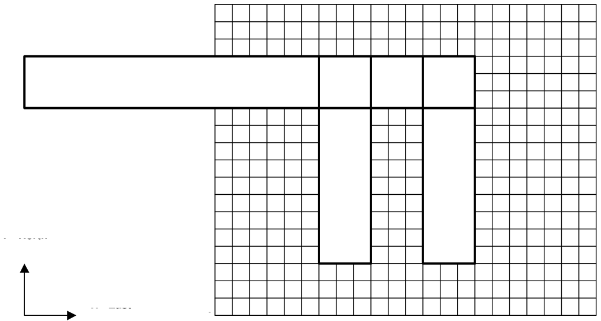

Nach Auswahl des 4. Punkts werden Sie automatisch aufgefordert, die Eigenschaften der Rasterebene anzugeben (

#### CAD > Build > Grid Plane).

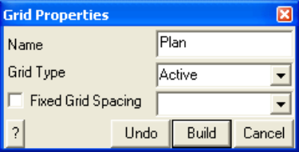

Geben Sie einen aussagekräftigen Namen (Name) für die Rasterebene ein, stellen Sie sicher, dass Grid Type auf Active steht, und lassen Sie das Kontrollkästchen Fixed Grid Spacing deaktiviert.

#### Materialeigenschaften des Wirtsgesteins festlegen

Nun müssen wir die Eigenschaften des Wirtsgesteins festlegen. Diese werden mit der Funktion für Materialeigenschaften eingegeben

#### CAD > Properties > Material Properties

Dieser Menüpunkt öffnet ein Untermenü zur Bearbeitung der Materialeigenschaften. Beachten Sie, dass Material Nummer 1 definitionsgemäß das Wirtsgestein ist. Andere Materialnummern dienen zur Definition alternativer Materialzonen wie Erz, Störungsletten, Versatz usw. Zuerst werden Sie aufgefordert, die zu bearbeitende Materialnummer einzugeben. Definieren wir zunächst die Eigenschaften des Wirtsgesteins

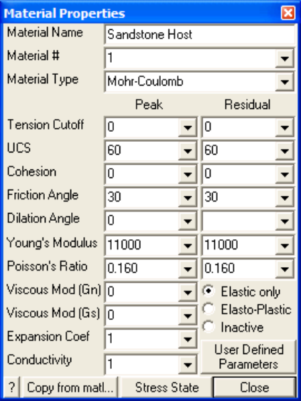

Geben Sie Folgendes ein:

Material Name: Sandstone Host Material # : 1 Young's (deformation) Modulus: 60000 MPa Poisson's Ratio: 0.25

Die viskosen Moduln können auf null gesetzt werden, da sie nur zur Simulation von Kriechverhalten in der nichtlinearen Analyse dienen.

Wir möchten hier das Mohr-Coulomb-Kriterium verwenden. Setzen Sie dazu

Material Type: Mohr-Coulomb UCS: 60 MPa

Der Kohäsionsparameter wird in diesem Fall nicht verwendet und kann daher auf null gesetzt werden.

Friction Angle: 30°

Der Dilatanzwinkel wird in diesem Fall nicht verwendet und kann daher auf null gesetzt werden.

Nun kann der Primärspannungszustand festgelegt werden

CAD > Properties > Material Properties > Stress State

Der passende Fernfeldspannungszustand für dieses Modell ist

sa constant:  30 MPa sb constant:  20 MPa sc constant:  20 MPa

Die Änderung der Spannungen mit der Tiefe setzen wir auf

Dsa variation:  -0.027 MPa/m Dsb variation:  -0.013 MPa/m Dsc variation:  -0.013 MPa/m

Außerdem sollten die Spannungsorientierungen (Streichen und Fallen) auf null gesetzt werden, wodurch sa und sb horizontal und sc vertikal festgelegt werden.

Das Bezugsniveau (Datum) kann auf 1000 Meter gesetzt werden, um die Änderung mit der Tiefe festzulegen als

s + Ds ( _z_ - _Datum_ )

So definiert beträgt die Spannung sa in der Tiefe z = 1000 m genau 30 MPa und nimmt um 0,027 MPa je Meter Tiefe zu.

#### Steuerparameter festlegen

Nun müssen wir die Parameter für Modelldiskretisierung und Lösung festlegen. Diese werden mit der Funktion für Steuerparameter eingegeben

#### CAD > Properties > Control Parameters

Dieser Menüpunkt öffnet einen Dialog mit den Steuerparametern

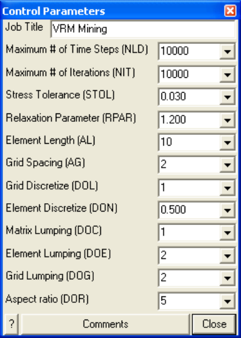

Geben Sie Folgendes ein:

Job Title: VRM Mining

Alle Parameter können auf ihren Standardwerten bleiben, außer Spannungstoleranz, Elementlänge und Rasterabstand.

Stress Tolerance: 0.03 MPa

sollte auf etwa 0,1 % des Fernfeldspannungszustands gesetzt werden. Dadurch werden die Oberflächenspannungen bei der Lösung mit einer numerischen Genauigkeit von 0,03 MPa berechnet.

#### Element Length: 10

sollte auf das Doppelte der Streckenhöhe oder der Pfeilerbreite gesetzt werden. Dieser Parameter steuert die minimale Randelementgröße an Stellen mit schmalen Flözen oder Pfeilern. Dadurch wird ein gut konditioniertes, leicht lösbares Problem formuliert.

#### Grid Spacing: 2

sollte auf etwa die Hälfte der Pfeilerbreite gesetzt werden. Dieser Parameter steuert die minimale Randelementgröße und den minimalen Abstand auf der Rasterebene an Stellen, an denen diese nahe am Modell vorbeiführt oder es schneidet. Genaue Ergebnisse lassen sich bis auf die Hälfte dieses Abstands an die Modelloberflächen heran erzielen. Außerdem stellt dieser Parameter sicher, dass im Pfeiler genügend Spannungspunkte für glatte Konturen berechnet werden.

Sie können einen größeren Rasterabstand wählen. Das verkleinert das Problem und verkürzt die Rechenzeit. Bei größeren Randelementen sind die Ergebnisse jedoch weniger genau, besonders nahe den Modelloberflächen, und bei größerem Rasterabstand lassen sich keine glatten Konturen erzeugen.

Empfohlene Werte für die Diskretisierungs- und Zusammenfassungsparameter:

_DON_ =0.5, _DOL_ = _DOC_ =1, _DOE_ = _DOG_ =2 für 10-20 % Fehler

_DON_ =0.5, _DOL_ = _DOC_ =2, _DOE_ = _DOG_ =4 für 5-10 % Fehler _DON_ =1.0, _DOL_ =DOC=4, _DOE_ = _DOG_ =8 für &lt; 5 % Fehler

Die Einstellungen für grobe Ergebnisse werden für alle Probleme empfohlen, außer wenn eine höhere Genauigkeit erforderlich ist. Bei dieser Einstellung ist bei den Spannungsprognosen mit numerischen Fehlern von 10-20 % zu rechnen. Die Einstellungen für detaillierte Ergebnisse ergeben 5-10 % numerischen Fehler, die Einstellungen für hohe Genauigkeit unter 5 %. Sie können genauere Einstellungen wählen, dadurch wird das Problem jedoch größer und die Rechenzeit länger.

#### Map3D-Analyse ausführen

Damit ist die Modellerstellung abgeschlossen, und wir können eine Analyse starten. Mit Map3D Fault-Slip erhalten Sie eine elastische Lösung dieses Problems. Mit Map3D NonLinear wird eine vollständige nichtlineare Analyse durchgeführt.

Die Analyse wird über das Hauptmenü gestartet.

Die vollständige Analyse führen Sie aus, indem Sie

#### BEM Analysis

wählen. Hier gehen wir schrittweise vor. Wählen Sie zunächst

#### Discretization

Wenn Sie das Modell seit dem letzten Speichern geändert haben, werden Sie aufgefordert, die Änderungen zu speichern.

Sind Verschneidung und Diskretisierung abgeschlossen, wählen Sie

#### Analysis > Graphics

Wählen Sie im Grafikmodus die Option für die diskretisierte Ansicht

#### View > Render > Discretize

So sehen Sie, wie die Blockoberflächen in Randelemente diskretisiert wurden. Damit die einzelnen Elemente sichtbar sind, müssen Umrisse aktiviert sein

#### View > Render > Block Outlines

Um zu sehen, wie das Raster diskretisiert wurde (falls die Kontur-Symbolleiste nicht sichtbar ist, aktivieren Sie sie mit Tools > CAD Toolbar), wählen Sie

#### Plot > Grid Selection > Grid #1

in der Kontur-Symbolleiste

Die Diskretisierung kann beliebig oft mit unterschiedlichen Werten für Rasterabstand sowie Diskretisierungs- und Zusammenfassungsparameter wiederholt werden, bis die gewünschte Dichte von Randelementen und Rasterpunkten erreicht ist.

Wenn Sie zufrieden sind, fahren Sie mit der BEM-Analyse (Aufstellen und Lösen der Matrix) fort, indem Sie

#### Analysis

im Hauptmenü und anschließend

#### BEM Analysis

wählen. Wenn die Analyse abgeschlossen ist, wählen Sie

#### Analysis > Graphics

Im Grafikmodus können Sie jeden gewünschten Parameter als Kontur darstellen. Um beispielsweise die Konturen der größten Hauptspannung anzuzeigen, wählen Sie

#### Plot > Stress > S1 Major Principal Stress

Dadurch wird eine Konturdarstellung auf der Rasterebene erzeugt.

Die Interpretation der Ergebnisse wird hier nicht behandelt.
