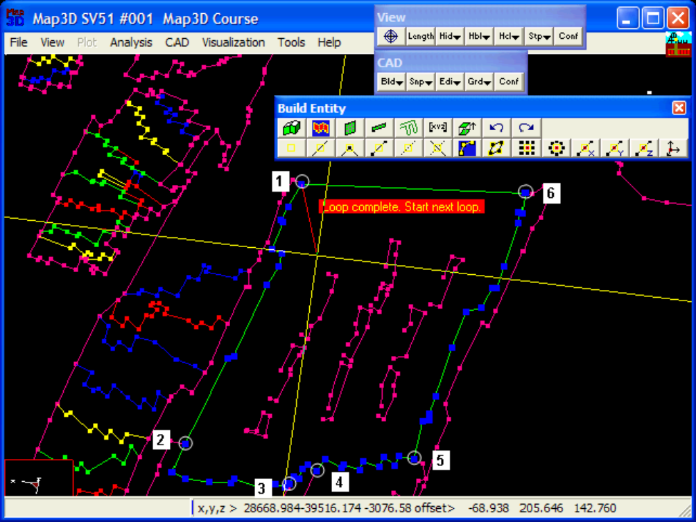
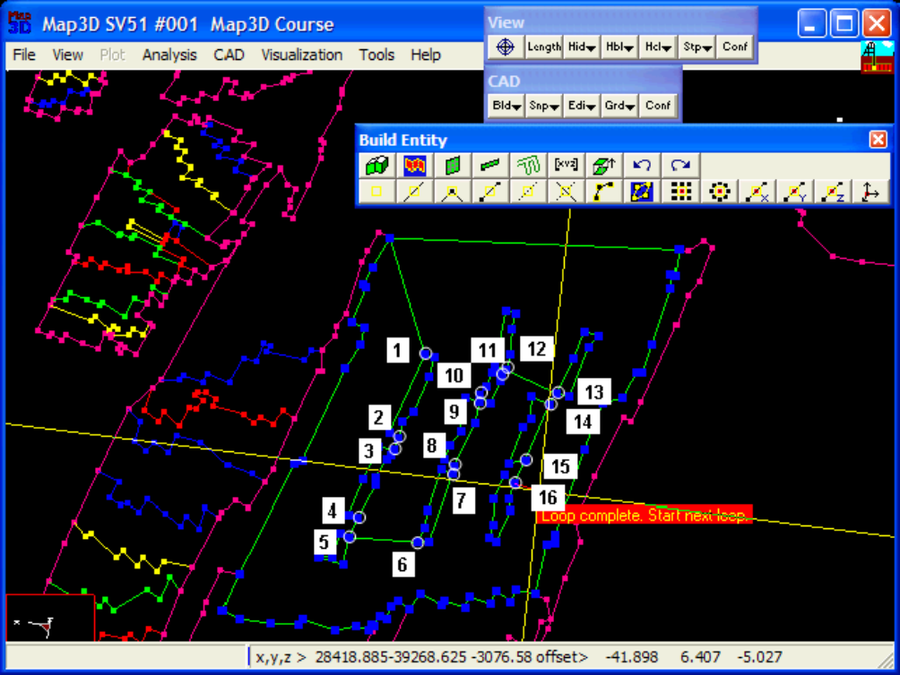
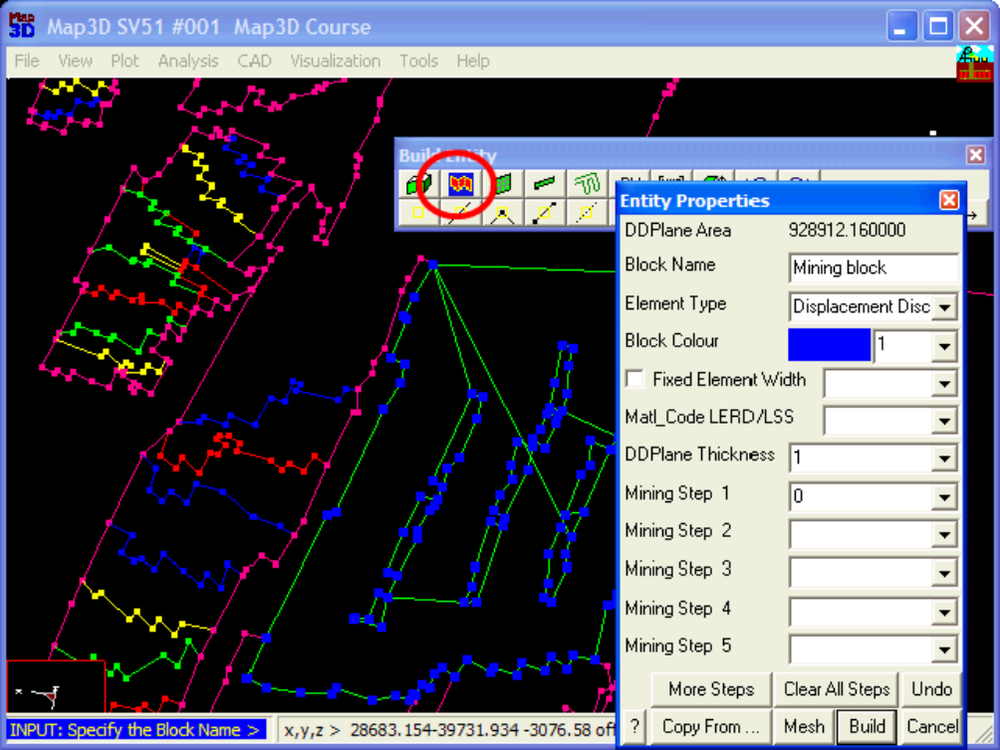
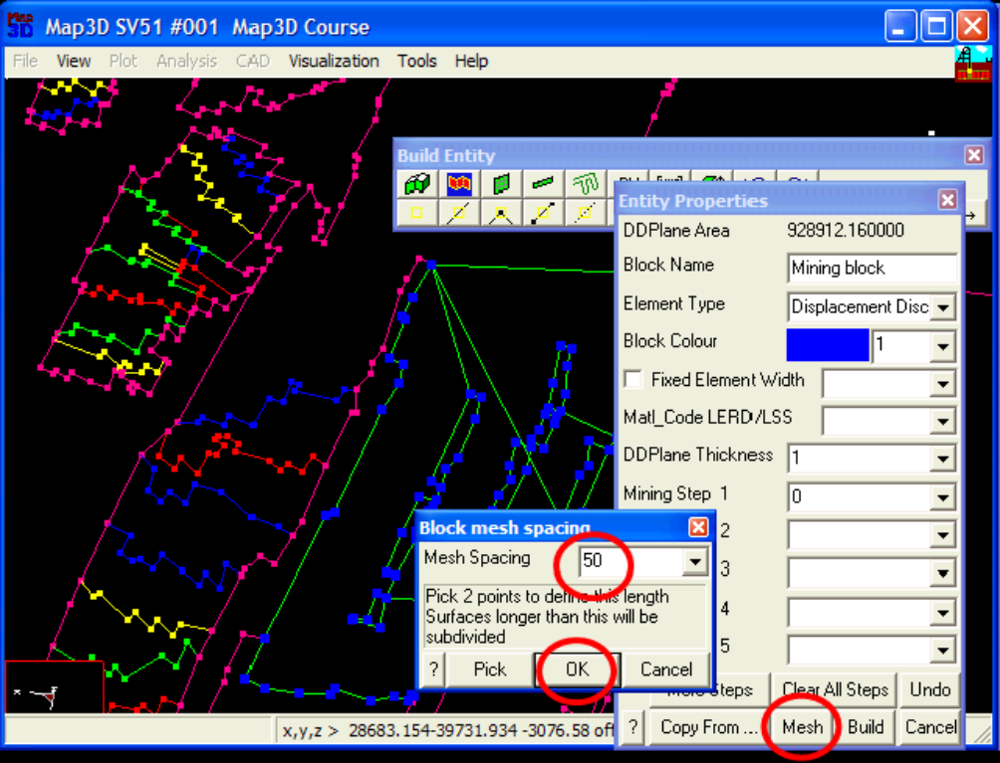
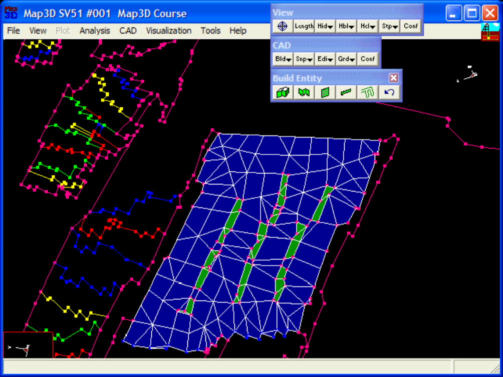

**Schritt 1: Digitalisierte Grubenrisse importieren.**

- Die Risse für dieses Beispiel befinden sich in der Datei „t.pnt“.

- Sie werden mit dem Befehl File > Open Construction Lines importiert.

**Schritt 2: DDLoop-Routine starten und Fangmodus Cline einstellen.**

- DDLoop wird über (CAD > Build > DDLoop) gestartet.

- Der Fangmodus Cline wird über (CAD > Snap > Trace Cline) eingestellt.

**Schritt 3: Äußere Schleife erstellen.**

- Die äußere Schleife wird erstellt, indem die Endpunkte der gewünschten Konstruktionsliniensegmente ausgewählt werden.

- Hier wählen wir die Punkte 1-2-3-4-5-6-1

- Punkt 1 wird am Ende dieser Folge gewählt, um die Schleife zu schließen. Damit ist die äußere Schleife fertig.

**Schritt 4: Fangmodus CLoop einstellen und innere Schleifen erstellen.**

- Der Fangmodus CLoop wird über (CAD > Snap > Trace CLoop) eingestellt.

- Die inneren Schleifen werden durch Auswahl der Ein- und Austrittspunkte jeder Schleife definiert.

- Die 1. Schleife wird durch die Punkte 1 und 2 definiert.

- Die 2. Schleife wird durch die Punkte 3 und 4 definiert.

- Die 3. Schleife wird durch Punkt 5 definiert.

- Die 4. Schleife wird durch die Punkte 6 und 7 definiert.

- Die 5. Schleife wird durch die Punkte 8 und 9 definiert.

- Die 6. Schleife wird durch die Punkte 10 und 11 definiert.

- Die 7. Schleife wird durch Punkt 12 definiert.

- Die 8. Schleife wird durch Punkt 13 definiert.

- Die 9. Schleife wird durch die Punkte 14 und 15 definiert.

- Die 10. Schleife wird durch Punkt 16 definiert.

**Schritt 5: Ende der Konstruktion signalisieren.**

- Nachdem alle Schleifen definiert sind, wählen wir erneut (CAD > Build > DDLoop), um das Ende der Konstruktion zu signalisieren.

- Dies kann auch durch erneutes Auswählen des letzten Punkts (d. h. Punkt 16) signalisiert werden.

**Schritt 6: DDLoops erstellen.**

- Wir könnten die DDLoops zwar mit der Funktion erstellen, hier verwenden wir jedoch die Funktion.

- Diese zweite Funktion erzeugt besser geformte Elemente.

- Sie werden nach dem gewünschten Netzabstand gefragt.

- Stellen Sie diesen auf 50 Meter ein.

#### Schritt 7: Konstruktion abgeschlossen.

- Damit ist die Konstruktion des tafelförmigen Abbaus einschließlich der Pfeiler abgeschlossen.

- Wahrscheinlich möchten Sie die Objekteigenschaften der Pfeiler bearbeiten, um ihnen passende Eigenschaften und eine Abbaureihenfolge zuzuweisen.

