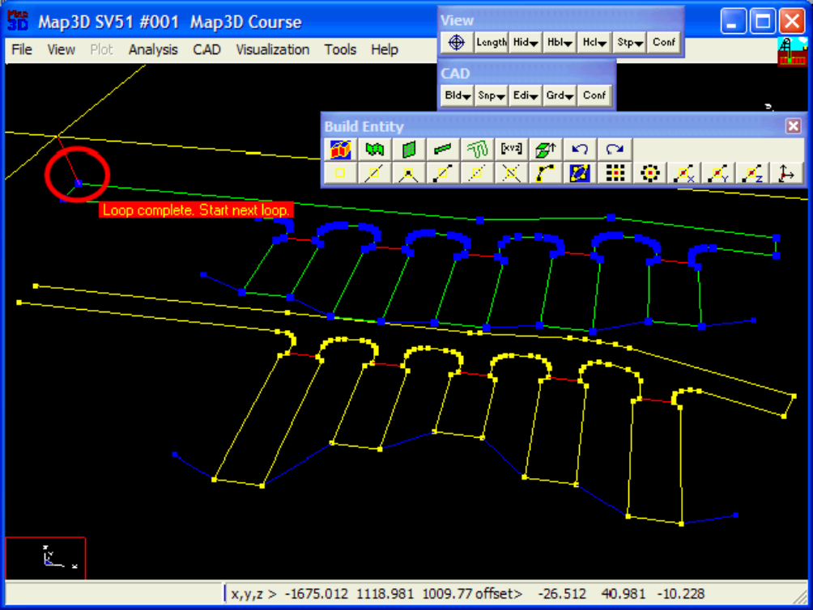
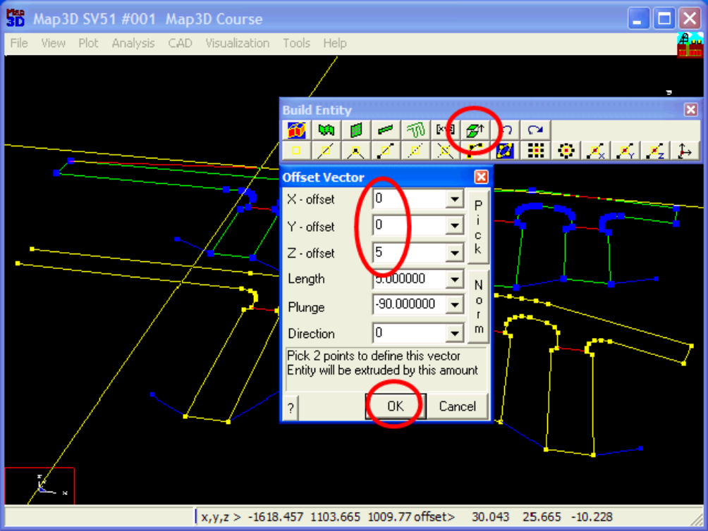
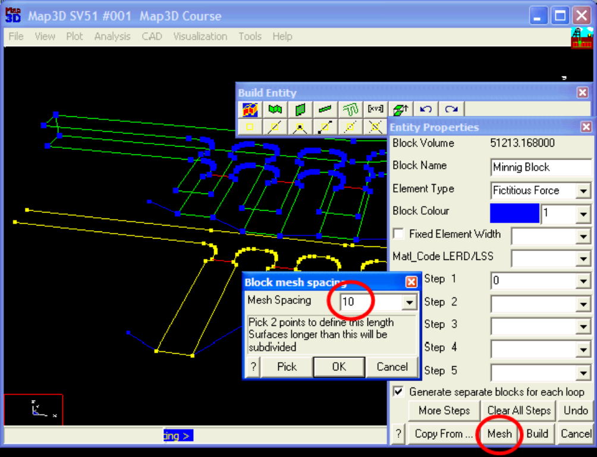
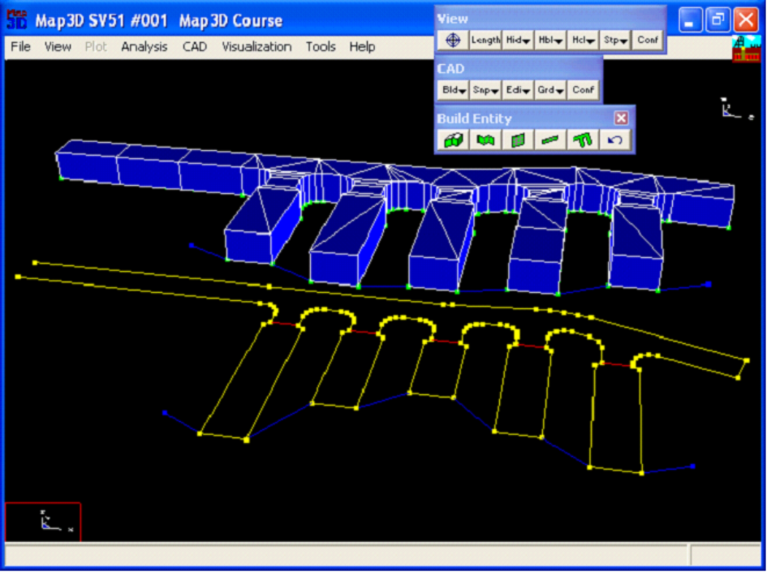

#### Schritt 1: Digitalisierte Grubenrisse importieren.

- Die Risse für dieses Beispiel befinden sich in der Datei „bulk.dxf“.

- Sie werden mit dem Befehl File > Open Construction Lines importiert.

#### Schritt 2: FFLoop-Routine starten und Fangmodus CLoop einstellen.

- FFLoop wird über (CAD > Build > FFLoop) gestartet.

- Der Fangmodus CLoop wird über (CAD > Snap > Trace CLoop) eingestellt.

**Schritt 3: FFLoop erstellen.**

- Der FFLoop wird durch Auswahl eines Punkts auf der gewünschten Konstruktionslinie erstellt.

**Schritt 4: Grundriss zu einer 3D-Strecke extrudieren.**

- Zu diesem Zeitpunkt haben wir den Grundriss der Strecke erstellt.

- Dieser kann nun über (CAD > Build > Offset/Extrude) zu einer 3D-Form extrudiert werden.

- Setzen Sie den Versatzvektor auf (0 0 5).

**Schritt 5: Strecke erstellen.**

- Der FFLoop kann nun mit der Funktion erstellt werden.

- Geben Sie 10 als Netzabstand (Mesh Spacing) an und klicken Sie auf OK.

**Schritt 6: Konstruktion abgeschlossen.**

- Damit ist die Konstruktion der Strecke abgeschlossen.

