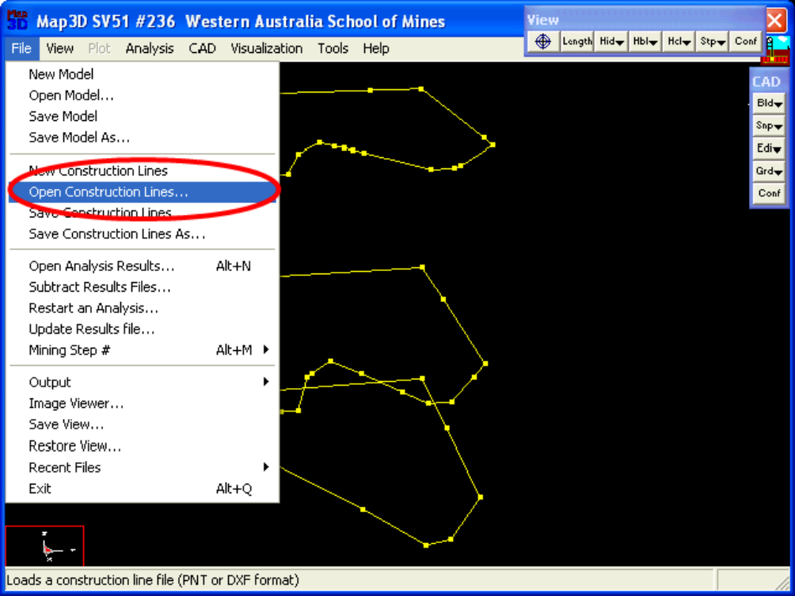
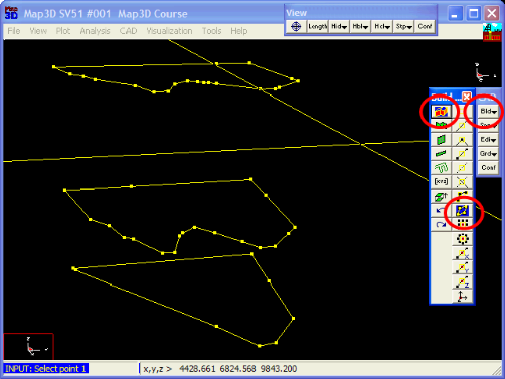
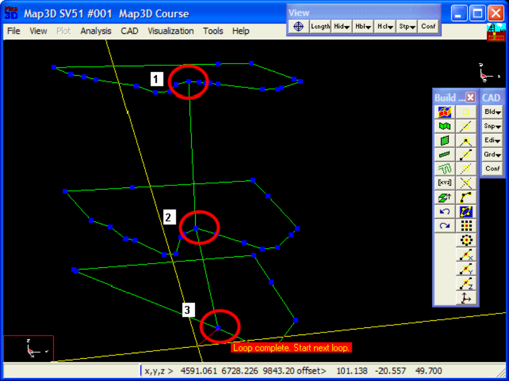
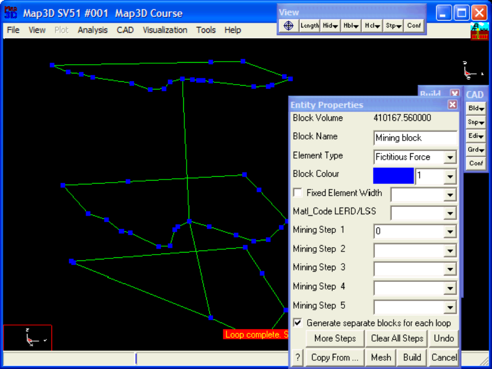
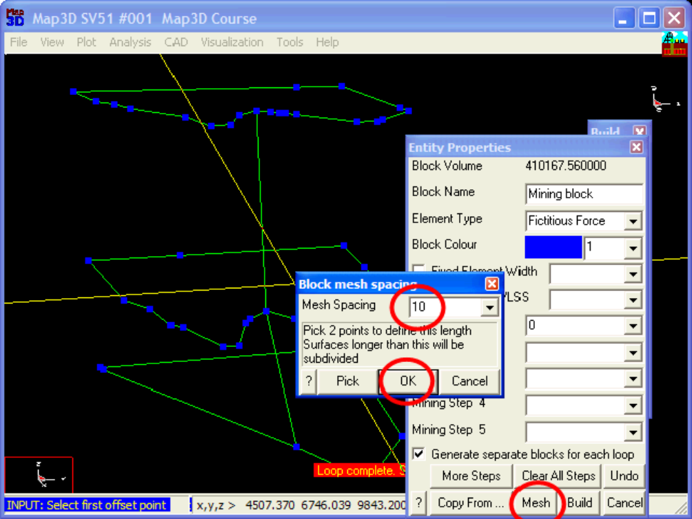
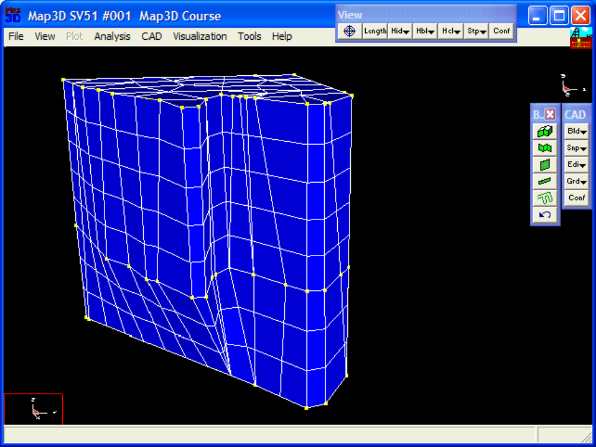

#### Schritt 1: Digitalisierte Grubenrisse importieren.

- Die Risse für dieses Beispiel befinden sich in der Datei „bulk.dxf“.

- Sie werden mit dem Befehl File > Open Construction Lines importiert.

**Schritt 2: FFLoop-Routine starten und Fangmodus CLoop einstellen.**

- FFLoop wird über (CAD > Build > FFLoop) gestartet.

- Der Fangmodus CLoop wird über (CAD > Snap > Trace CLoop) eingestellt.

#### Schritt 3: FFLoop erstellen.

- Der FFLoop wird durch Auswahl je eines Punkts auf jeder Konstruktionslinie erstellt.

- Beachten Sie, dass entlang langer Seiten automatisch Punkte im Abstand von 10 m erzeugt werden

- Wählen Sie am besten Punkte an scharfen Ecken oder Knicken, da die Linie zwischen den Schleifen den Konstruktionsprozess steuert.

#### Schritt 4: Ende der Konstruktion signalisieren.

- Nachdem alle Schleifen definiert sind, wählen wir erneut (CAD > Build > FFLoop), um das Ende der Konstruktion zu signalisieren.

- Dies kann auch durch erneutes Auswählen des letzten Punkts (d. h. Punkt 3) signalisiert werden.

**Schritt 5: Abbaukammer erstellen.**

- Der FFLoop kann nun mit der Funktion erstellt werden.

- Geben Sie 10 als Netzabstand (Mesh Spacing) an und wählen Sie OK.

**Schritt 6: Konstruktion abgeschlossen.**

- Damit ist die Konstruktion der Abbaukammer abgeschlossen.

