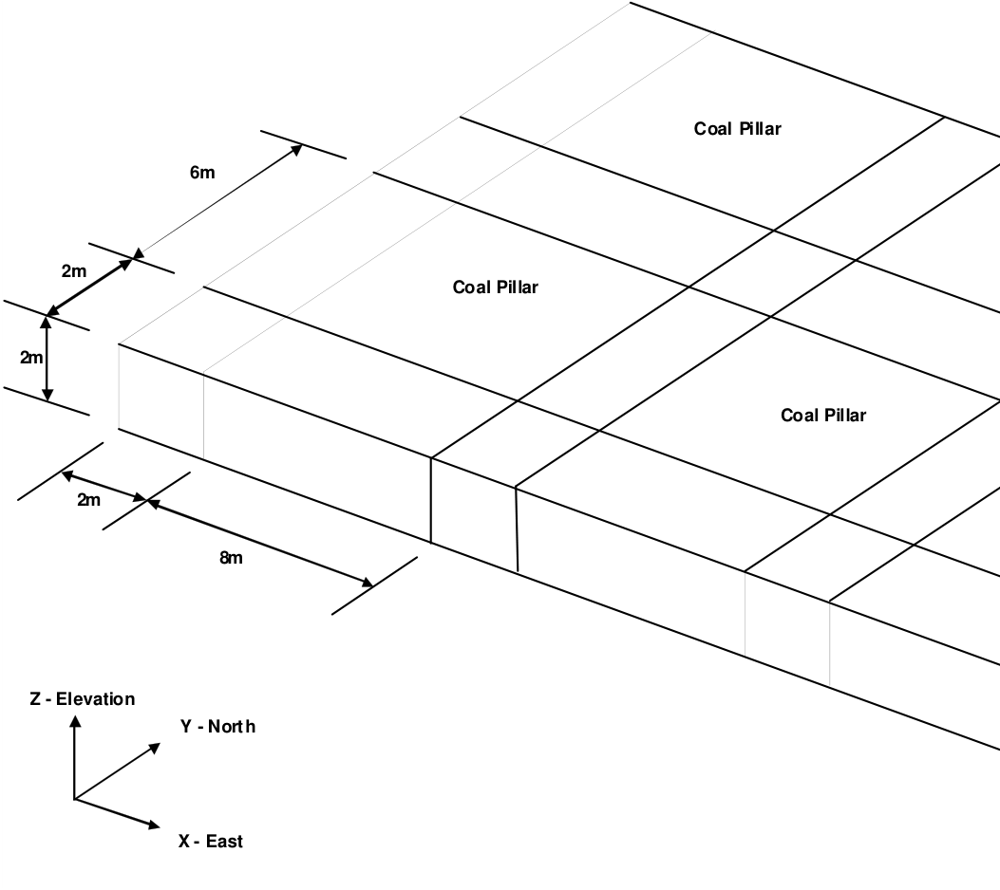

Um die Freihandtechnik zu zeigen, erstellen wir zunächst eine einfache Geometrie für einen Kammerpfeilerbau im Kohlebergbau. Die Strecken sind 2 m breit und 2 m hoch, die Kohlepfeiler messen 6 m nach Osten und 4 m nach Westen.

Wir wollen von vorn beginnen und wählen daher

File > New Model

Bevor Sie beginnen: Wenn Sie den Mauszeiger über eine Schaltfläche bewegen, erscheint ein Tooltip mit ihrer Funktion. Außerdem erhalten Sie durch Rechtsklick auf ein Element ausführliche Hilfe zu dieser Funktion.

#### Kreuzung erstellen

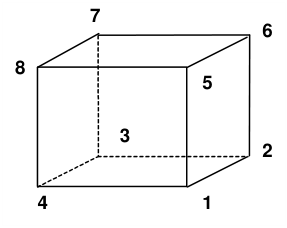

Erstellen wir zuerst eine Kreuzung. Sie wird aus Blöcken mit 8 Eckpunkten aufgebaut. Verwenden Sie für den ersten Block CAD > Build > FFLoop. Diese Funktion lässt sich wie folgt in der CAD-Symbolleiste auswählen (falls die CAD-Symbolleiste nicht sichtbar ist, aktivieren Sie sie mit Tools > CAD Toolbar):

#### Wählen Sie CAD > Build in der CAD-Symbolleiste

Das Untermenü der Erstellfunktionen wird angezeigt

Wählen Sie nun

#### CAD > Build > FFLoop

Da wir freihändig zeichnen, müssen wir das Fangraster einrichten. Dies geschieht mit CAD > Snap > Rectangular Grid Snap. Diese Funktion lässt sich in der Symbolleiste Build Entity auswählen

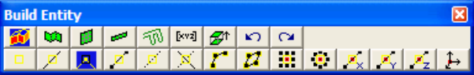

Um das Fangraster zu aktivieren, wählen Sie

#### CAD > Snap > Rectangular Grid Snap

(nur erforderlich, wenn die entsprechende Schaltfläche nicht bereits hervorgehoben ist).

Die Koordinaten der aktuellen Cursorposition werden in der Statusleiste angezeigt. Sie werden feststellen, dass sich beim Bewegen des Cursors die x- und y-Werte ändern, nicht aber der z-Wert. Um den aktuellen z-Wert festzulegen, klicken Sie auf CAD > Snap > Cursor/Grid Setup. Folgender Dialog wird angezeigt:

Legen Sie Ursprung und Fangabstand wie folgt fest:

X-Origin > 0 Y-Origin > 0 Z-Origin > 0 Snap spacing > 1

Bewegt sich das Fadenkreuz nicht in der x-y-Ebene, wählen Sie die

Schaltfläche.

Damit wird der Fangmodus auf Raster gesetzt. In diesem Modus wird am Schnittpunkt des Fadenkreuzes kein Auswahlfeld angezeigt, und die Cursorbewegung ist auf den festgelegten Rasterabstand beschränkt. Beim Bewegen springt der Cursor jeweils um den Rasterabstand (hier 1 Meter) weiter.

Die FFLoop-Routine fordert Sie in der Statusleiste auf, den ersten Eckpunkt des Blocks einzugeben

Input: Select Point 1

Bewegen Sie den Cursor, bis Sie den ersten Punkt gefunden haben

x,y,z >  0  0  0

Wählen Sie ihn mit einem Klick der linken Maustaste aus.

Nun werden Sie zur Eingabe des nächsten Eckpunkts aufgefordert

Input: Select Point 2

Beim Bewegen des Cursors sehen Sie unten links nicht nur die aktuelle Cursorposition, sondern auch den Versatz des aktuellen Punkts zum zuletzt gewählten Punkt (d. h. den Versatzvektor von Punkt 1 zu Punkt 2). Wählen Sie Punkt 2 bei

x,y,z >  2  0  0

Wiederholen Sie die Auswahl für Punkt 3

x,y,z >  2  2  0

und Punkt 4

x,y,z >  0  2  0

Wenn Sie eine falsche Position gewählt haben, machen Sie die Auswahl einfach mit der Rückgängig-Schaltfläche rückgängig

#### CAD > Build > Undo Point und versuchen Sie es erneut.

Wählen Sie zum Schluss erneut den ersten Punkt

x,y,z >  0  0  0

Sobald der erste Punkt erneut gewählt wurde, ist die Grundfläche des Blocks vollständig. Es erscheint die Meldung

Loop complete: Start next loop.

Um den Block fertigzustellen, können Sie entweder die Höhe ändern und die übrigen 4 Punkte (d. h. die Punkte 5, 6, 7 und 8) wählen oder sie aus den ersten 4 Eckpunkten durch Addition eines Versatzes erzeugen. Für das zweite Verfahren wählen Sie die Versatzfunktion in der Symbolleiste Build Entity

#### CAD > Build > Extrude/Offset Remaining

Sie werden wie folgt zur Eingabe des Versatzvektors aufgefordert

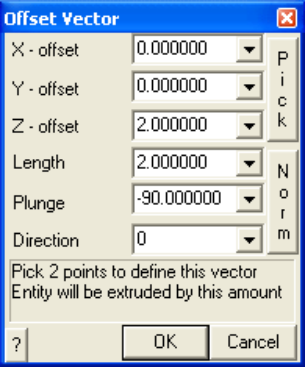

Geben Sie den Versatz ein:

X-offset > 0 Y-offset > 0 Z-offset > 2

Die Punkte 5, 6, 7 und 8 werden aus den Punkten 1, 2, 3 und 4 erzeugt, indem die Versatzwerte zu ihren Koordinaten addiert werden.

Nach Fertigstellung des Blocks werden Sie automatisch zur Eingabe der Blockeigenschaften aufgefordert (CAD > Build > FFLoop)

Geben Sie Folgendes ein:

Block Name: Intersection Element Type: Fictitious Force Block Colour: 1

Dieser Kreuzungsblock soll in Abbauschritt 1 ausgebrochen werden. Dies wird angegeben durch

Mining Step 1: 0

Damit sind wir fertig und können den Block mit der

Schaltfläche erstellen.

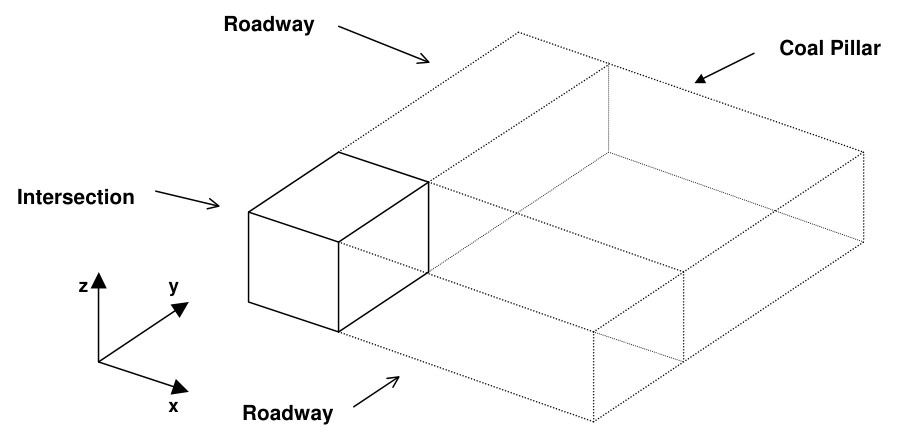

#### Ansicht neu ausrichten

Während der Blockerstellung oder zu jedem anderen Zeitpunkt können Sie die Geometrie verschieben, drehen oder zoomen, um die Darstellung zu erleichtern. Dafür gibt es mehrere Möglichkeiten (siehe Modell drehen und Modell verschieben).

#### Strecke 1 erstellen

Weitere Blöcke lassen sich erstellen, indem Sie erneut die FFLoop-Funktion wählen

#### CAD > Build > FFLoop

Erstellen wir den nächsten Block neben dem ersten. Wählen Sie Punkt 1 bei

x,y,z >  2  0  0

Wir möchten Punkt 2 bei

x,y,z >  8  0  0

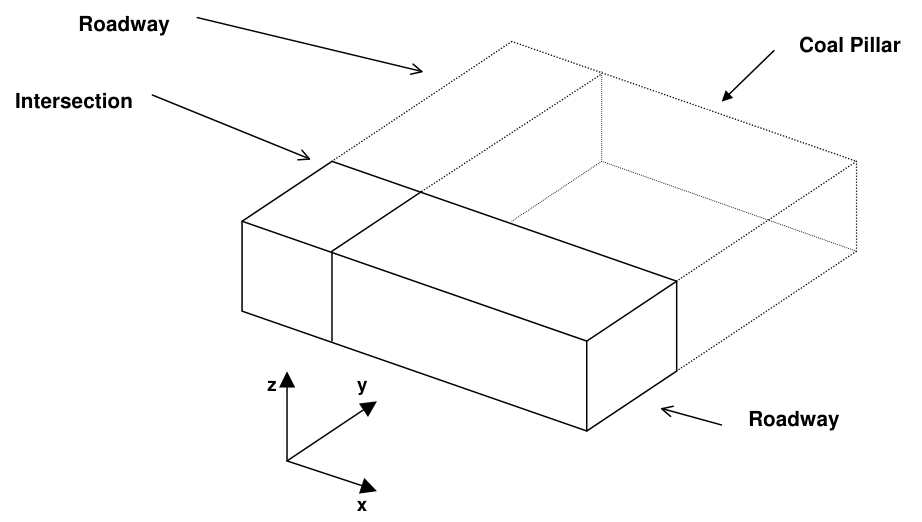

wählen, diese Position liegt jedoch außerhalb des Bildschirmbereichs. Zoomen Sie dazu einfach heraus (Modell verschieben).

Nun lässt sich Punkt 2 problemlos wählen.

Wählen Sie Punkt 3 bei

x,y,z >  8  2  0

Wählen Sie Punkt 4 bei

x,y,z >  2  2  0

Wählen Sie zum Schluss erneut den ersten Punkt

x,y,z >  2  0  0

Sobald der erste Punkt erneut gewählt wurde, ist die Grundfläche des Blocks vollständig. Wie zuvor erscheint die Meldung

Loop complete: Start next loop.

Versetzen Sie nun die übrigen Punkte dieses Blocks mit der Versatzfunktion

#### CAD > Build > Extrude/Offset Remaining

Sie werden wie folgt zur Eingabe des Versatzvektors aufgefordert

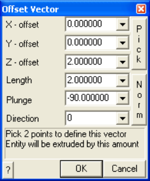

Geben Sie den Versatz ein:

X-offset > 0 Y-offset > 0 Z-offset > 2

Nach Fertigstellung des Blocks werden Sie automatisch zur Eingabe der Objekteigenschaften aufgefordert (CAD > Build > FFLoop)

Geben Sie Folgendes ein:

Block Name: Roadway

Element Type: Fictitious Force Block Colour: 1

Dieser Streckenblock soll in Abbauschritt 1 ausgebrochen werden. Dies wird durch Mining Step 1: 0 angegeben

Damit sind wir fertig und können den Block mit der Schaltfläche erstellen.

#### Strecke 2 erstellen

Erstellen wir einen dritten Block

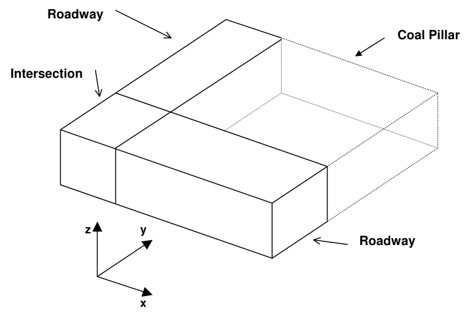

indem wir Punkt 1 bei

x,y,z >  2  2  0

wählen. Wählen Sie Punkt 2 bei

x,y,z >  2  6  0

Wählen Sie Punkt 3 bei

x,y,z >  0  6  0

Wählen Sie Punkt 4 bei

x,y,z >  0  2  0

Wählen Sie erneut den ersten Punkt, um die Grundfläche zu schließen

x,y,z >  2  0  0

und versetzen Sie dann die übrigen Punkte wie zuvor

CAD > Build > Extrude/Offset Remaining

Damit ist die Strecke fertig.

#### Kohlepfeiler erstellen

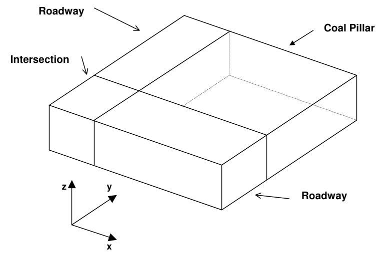

Sie haben nun eine Kreuzung und zwei Strecken erstellt. Erstellen wir jetzt einen Kohlepfeiler.

#### CAD > Build > FFLoop

indem wir Punkt 1 bei

x,y,z >  2  2  0

wählen. Wählen Sie Punkt 2 bei

x,y,z >  8  2  0

Wählen Sie Punkt 3 bei

x,y,z >  8  6  0

Wählen Sie Punkt 4 bei

x,y,z >  2  6  0

Wählen Sie erneut den ersten Punkt, um die Grundfläche zu schließen

x,y,z >  2  2  0

und versetzen Sie dann die übrigen Punkte wie zuvor

CAD > Build > Extrude/Offset Remaining

Damit ist der Kohlepfeiler fertig.

Nach Fertigstellung des Blocks werden Sie automatisch zur Eingabe der Blockeigenschaften aufgefordert (CAD > Build > FFLoop). Wir müssen angeben, dass dieser Block ein Kohlepfeiler und kein Hohlraum (Voreinstellung) ist. Folgender Dialog wird angezeigt:

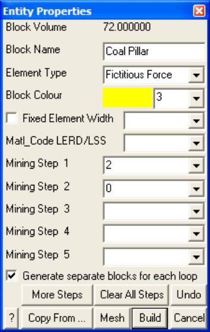

Geben Sie Folgendes ein:

Block Name: Coal Pillar Element Type: Fictitious Force Block Colour: 3

Wir müssen angeben, dass dieser Block die Materialeigenschaften von Kohle hat. Dazu wird in Abbauschritt 1 Material Nummer 2 für Kohle definiert. Dies wird angegeben durch

Mining Step 1: 2

Derselbe Pfeiler könnte in Schritt 2 durch folgenden Materialcode abgebaut werden

Mining Step 2: 0

Damit sind wir fertig und können den Block erstellen.

#### Geometrie speichern

Wir haben nun eine kleine Ecke der gewünschten Abbaugeometrie erstellt. Bevor wir fortfahren, sollten wir das bisherige Modell speichern. Dazu wählen wir

#### File > Save Model As

Speichern wir es unter dem Namen „COAL.INP“

#### Geometrie erweitern

Das erstellte Modell stellt nur einen kleinen Teil des endgültigen Modells dar. Dieses Muster lässt sich leicht durch mehrfaches Kopieren wiederholen. Dazu wählen wir die Kopierfunktion

CAD > Edit > Copy Entities

Diese Funktion lässt sich auch wie folgt in der CAD-Symbolleiste auswählen:

Wählen Sie CAD > Edit in der CAD-Symbolleiste

Das Untermenü der Bearbeitungsfunktionen wird angezeigt

Um die Kopierfunktion zu aktivieren, wählen Sie

#### CAD > Edit > Copy Entities

Nun werden Sie aufgefordert, eine Liste der zu kopierenden Objekte zu erstellen

Halten Sie die Umschalttaste gedrückt und ziehen Sie ein Auswahlfenster auf (alternativ können Sie die Kreuzungsfenster-Funktion wählen).

**Zweite Ecke des Fensters**

Alle Objekte innerhalb des Auswahlfensters (d. h. Kreuzung, Strecken und Kohlepfeiler) sollten hervorgehoben sein.

Nun können Sie die ausgewählten Objekte mit der Kopieren-Schaltfläche kopieren

Sie werden wie folgt zur Eingabe des Kopierversatzvektors aufgefordert:

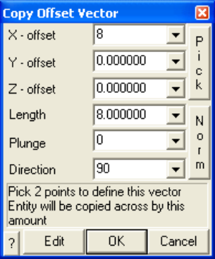

Es gibt viele Möglichkeiten, den Kopierversatz festzulegen. Sie können den gewünschten Versatz als (8  0 0) eingeben.

Er lässt sich auch grafisch festlegen, indem Sie zwei Punkte wählen, die den Vektor definieren. Stellen Sie zunächst den Fangmodus ein auf

#### CAD > Snap > Rectangular Grid Snap

(nur erforderlich, wenn die entsprechende Schaltfläche nicht bereits hervorgehoben ist).

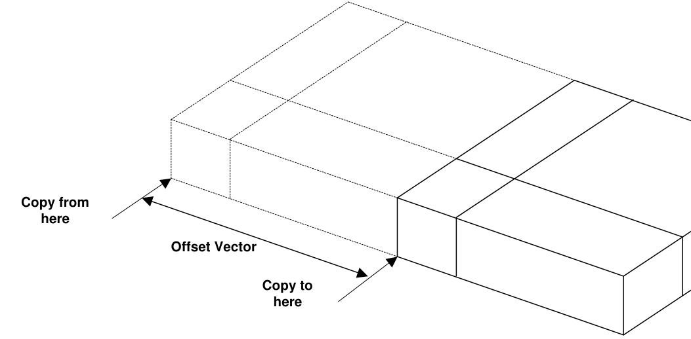

Sie werden (oben auf dem Bildschirm) aufgefordert, das erste Ende des Versatzvektors zu wählen

INPUT: Select first offset point

Wählen Sie diesen Punkt bei

x,y,z >  0  0  0

Anschließend werden Sie aufgefordert, das andere Ende des Versatzvektors zu wählen

INPUT: Select second offset point

Wählen Sie diesen Punkt bei

x,y,z >  8  0  0

Der Versatz (8  0  0) wird nun im Dialogfeld angezeigt.

Klicken Sie auf OK. Die ausgewählten Objekte werden kopiert, indem der Versatzvektor zu allen Koordinaten addiert wird.

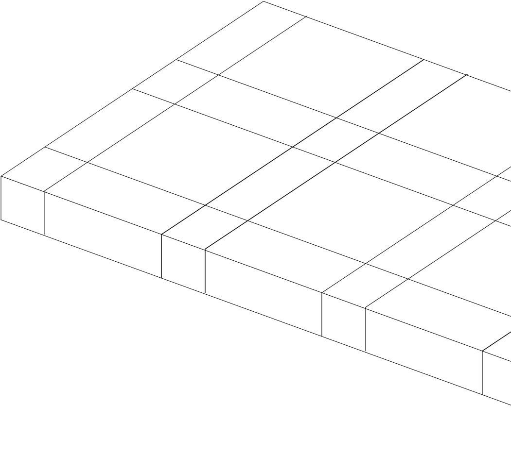

Um den Kopiervorgang zu wiederholen, erstellen Sie die Auswahl neu oder stellen die vorherige Auswahl wieder her und kopieren die ausgewählten Objekte erneut mit der Kopierfunktion

#### CAD > Edit > Copy Entities

Bei Bedarf kann dieses Kopierverfahren beliebig oft wiederholt werden, um das Abbaumuster in x- und y-Richtung zu vervielfältigen.

Damit kann die Geometrie als fertig gelten. Nun müssen wir die Lage der Rasterebenen festlegen, auf denen Ergebnisse berechnet werden, und die Materialeigenschaften angeben.

#### Rasterebenen erstellen

**3 2 4 1**

Nun müssen wir entscheiden, wo Ergebnisse berechnet werden sollen. In diesem Beispiel interessiert uns die Spannung in den Kohlepfeilern. Wir definieren daher eine Schnitt-Rasterebene durch die Mitte eines der Pfeiler. Sie wird als Ebene mit 4 Eckpunkten erstellt. Wählen Sie dazu die Menüfunktion zur Rastererstellung

#### CAD > Build > Grid Plane

Diese Funktion lässt sich auch wie folgt in der CAD-Symbolleiste auswählen:

Wählen Sie CAD > Build in der CAD-Symbolleiste

Das Untermenü der Erstellfunktionen wird angezeigt

Wählen Sie nun

#### CAD > Build > Grid Plane

Da wir freihändig zeichnen, müssen wir das Fangraster einrichten. Dies geschieht mit CAD > Snap > Rectangular Grid Snap. Diese Funktion lässt sich in der Symbolleiste Build Entity auswählen

Um das Fangraster zu aktivieren, wählen Sie

#### CAD > Snap > Rectangular Grid Snap

(nur erforderlich, wenn die entsprechende Schaltfläche nicht bereits hervorgehoben ist).

Die Koordinaten der aktuellen Cursorposition werden in der Statusleiste angezeigt. Um den aktuellen z-Wert festzulegen, klicken Sie auf CAD > Snap > Cursor/Grid Setup. Folgender Dialog wird angezeigt:

Legen Sie Ursprung und Fangabstand wie folgt fest:

X-Origin > 0 Y-Origin > 0 Z-Origin > -2 Snap spacing > 1

Bewegt sich das Fadenkreuz nicht in der x-y-Ebene, wählen Sie die

Schaltfläche.

Die Routine zur Erstellung der Rasterebene fordert Sie auf, den ersten Eckpunkt der Ebene einzugeben

INPUT: Select point 1

Bewegen Sie den Cursor, bis Sie den gewünschten Punkt gefunden haben

x,y,z >  9  4  -2

Wählen Sie ihn mit einem Klick der linken Maustaste aus.

Nun werden Sie zur Eingabe des nächsten Eckpunkts aufgefordert

INPUT: Select point 2

Wählen Sie Punkt 2 bei

x,y,z >  17  4  -2

Wenn Sie eine falsche Position gewählt haben, machen Sie die Auswahl einfach rückgängig

CAD > Build > Undo Point

und versuchen Sie es erneut.

Sobald Punkt 2 gewählt wurde, ist eine Kante der Ebene vollständig. Um die Ebene fertigzustellen, können Sie entweder die Höhe ändern und die übrigen 2 Punkte (d. h. die Punkte 3 und 4) wählen oder sie aus den ersten 2 Eckpunkten durch Addition eines Versatzes erzeugen. Für das zweite Verfahren wählen Sie die Versatzfunktion in der Symbolleiste Build Entity

CAD > Build > Offset Remaining

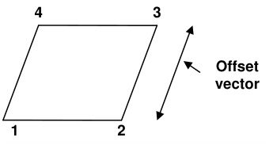

Sie werden wie folgt zur Eingabe des Versatzvektors aufgefordert

Geben Sie den Versatz ein:

X-offset > 0 Y-offset > 0 Z-offset > 6

Die Punkte 3 und 4 werden aus den Punkten 2 und 1 erzeugt, indem die Versatzwerte zu ihren Koordinaten addiert werden.

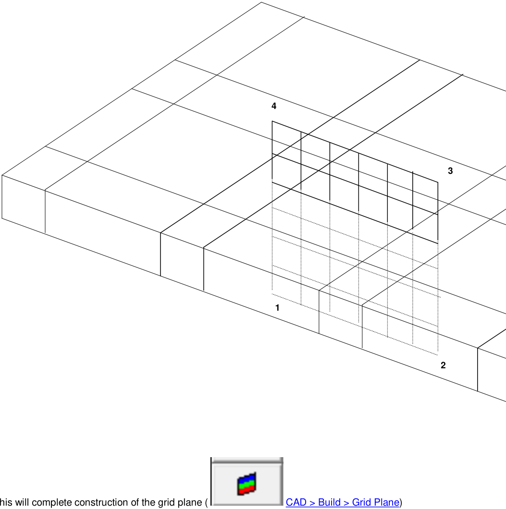

Damit ist die Rasterebene fertig (

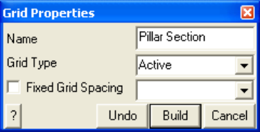

Geben Sie einen aussagekräftigen Namen für die Rasterebene ein und lassen Sie das Kontrollkästchen Fixed Grid Spacing deaktiviert.

#### Materialeigenschaften des Sandstein-Wirtsgesteins festlegen

Nun müssen wir die Eigenschaften des Wirtsgesteins festlegen. Diese werden mit der Funktion für Materialeigenschaften eingegeben

#### CAD > Properties > Material Properties.

Dieser Menüpunkt öffnet ein Untermenü zur Bearbeitung der Materialeigenschaften. Beachten Sie, dass Material Nummer 1 definitionsgemäß das Wirtsgestein ist. Andere Materialnummern dienen zur Definition alternativer Materialzonen wie Kohle, Störungsletten, Versatz usw. Zuerst werden Sie aufgefordert, die zu bearbeitende Materialnummer einzugeben. Definieren wir zunächst die Eigenschaften des Wirtsgesteins

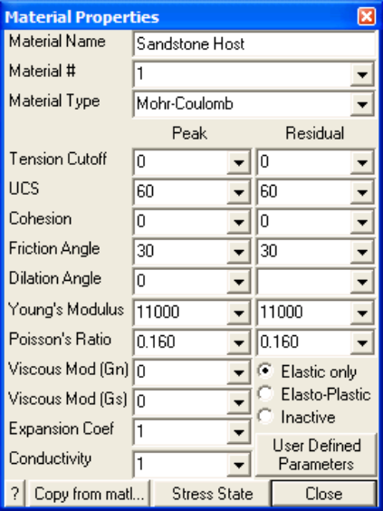

Geben Sie Folgendes ein:

Material Name: Sandstone Host Material # : 1 Young's (deformation) Modulus: 11000 MPa Poisson's Ratio: 0.16

Die viskosen Moduln können auf null gesetzt werden, da sie nur zur Simulation von Kriechverhalten in der nichtlinearen Analyse dienen.

Wir möchten hier das Mohr-Coulomb-Kriterium verwenden. Setzen Sie dazu

Material Type: Mohr-Coulomb UCS: 60 MPa

Der Kohäsionsparameter wird in diesem Fall nicht verwendet und kann daher auf null gesetzt werden.

Friction Angle: 30°

Der Dilatanzwinkel wird in diesem Fall nicht verwendet und kann daher auf null gesetzt werden.

Nun kann der Primärspannungszustand festgelegt werden

CAD > Properties > Material Properties > Stress State

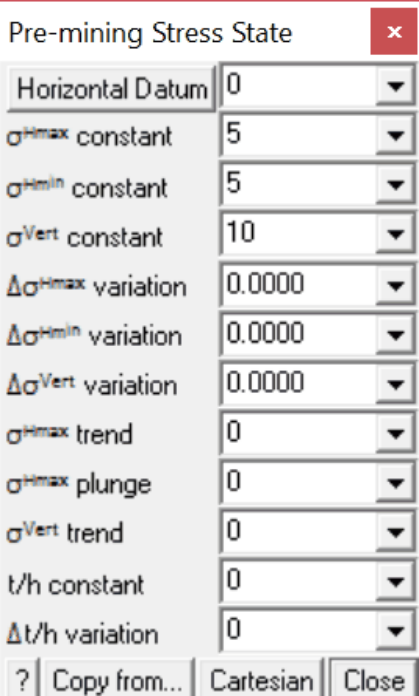

Der passende Fernfeldspannungszustand für dieses Modell ist

sHmax constant:  5 MPa sHmin constant:  5 MPa sVert constant: 10 MPa

Die Änderung der Spannungen mit der Tiefe setzen wir auf null

DsHmax variation:  0 MPa/m DsHmin variation:  0 MPa/m DsVert variation:  0 MPa/m

Außerdem sollten die Spannungsorientierungen (Streichen und Fallen) auf null gesetzt werden, wodurch sa und sb horizontal und sc vertikal festgelegt werden.

Das Bezugsniveau (Datum) kann ebenfalls auf null gesetzt werden, da es nur zur Festlegung der Änderung mit der Tiefe dient.

#### Materialeigenschaften des Kohleflözes festlegen

Nun müssen wir die Eigenschaften des Kohleflözes festlegen. Diese werden mit der Funktion für Materialeigenschaften eingegeben

#### CAD > Properties > Material Properties

Dieser Menüpunkt öffnet ein Untermenü zur Bearbeitung der Materialeigenschaften. Bei der Erstellung des Kohlepfeilers hatten wir festgelegt, dass für diesen Block Material Nummer 2 verwendet wird.

Setzen wir Material # auf 2.

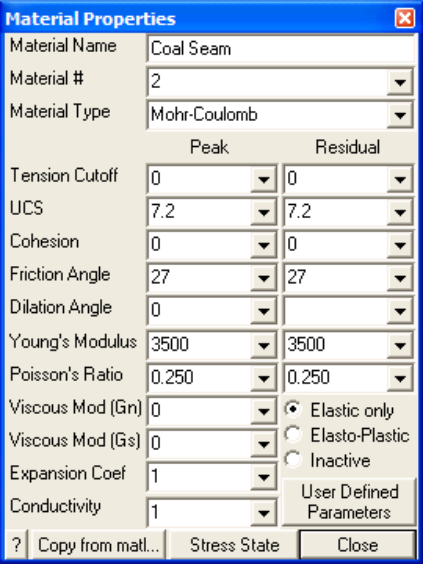

Geben Sie Folgendes ein:

Material Name: Coal Seam Young's  (deformation) Modulus: 3500 MPa Poisson's Ratio: 0.25

Die viskosen Moduln können auf null gesetzt werden, da sie nur zur Simulation von Kriechverhalten in der nichtlinearen Analyse dienen.

Wir möchten hier das Mohr-Coulomb-Kriterium verwenden. Setzen Sie dazu

Material Type: Mohr-Coulomb UCS: 7.2 MPa

Der Kohäsionsparameter wird in diesem Fall nicht verwendet und kann daher auf null gesetzt werden.

Friction Angle: 27°

Der Dilatanzwinkel wird in diesem Fall nicht verwendet und kann daher auf null gesetzt werden.

Nun kann der Primärspannungszustand festgelegt werden

#### CAD > Properties > Material Properties > Stress State

Die Anfangsspannung in der Kohle soll derjenigen im Sandstein-Wirtsgestein entsprechen. Kopieren wir sie daher mit Copy von Material 1.

#### Steuerparameter festlegen

Nun müssen wir die Parameter für Modelldiskretisierung und Lösung festlegen. Diese werden mit der Funktion für Steuerparameter eingegeben

#### CAD > Properties > Control Parameters

Dieser Menüpunkt öffnet einen Dialog mit den Steuerparametern

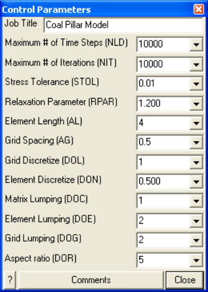

Geben Sie Folgendes ein:

Job Title: Coal Pillar Model

Alle Parameter können auf ihren Standardwerten bleiben, außer Spannungstoleranz, Elementlänge und Rasterabstand.

Stress Tolerance: 0.01 MPa

sollte auf etwa 0,1 % des Fernfeldspannungszustands gesetzt werden. Dadurch werden die Oberflächenspannungen bei der Lösung mit einer numerischen Genauigkeit von 0,01 MPa berechnet.

Element Length: 4

sollte auf das Doppelte der Flözmächtigkeit gesetzt werden. Dieser Parameter steuert die minimale Randelementgröße an Stellen mit schmalen Flözen oder Pfeilern. Dadurch wird ein gut konditioniertes, leicht lösbares Problem formuliert.

Grid Spacing: 0.5

sollte auf etwa ein Viertel der Flözmächtigkeit gesetzt werden. Dieser Parameter steuert die minimale Randelementgröße und den minimalen Abstand auf der Rasterebene an Stellen, an denen diese nahe am Modell vorbeiführt oder es schneidet. Genaue Ergebnisse lassen sich bis auf die Hälfte dieses Abstands an die Modelloberflächen heran erzielen. Außerdem stellt dieser Parameter sicher, dass im Pfeiler genügend Spannungspunkte für glatte Konturen berechnet werden.

Sie können einen größeren Rasterabstand wählen. Das verkleinert das Problem und verkürzt die Rechenzeit. Bei größeren Randelementen sind die Ergebnisse jedoch weniger genau, besonders nahe den Modelloberflächen, und bei größerem Rasterabstand lassen sich keine glatten Konturen erzeugen.

Empfohlene Werte für die Diskretisierungs- und Zusammenfassungsparameter:

_DON_ =0.5, _DOL_ = _DOC_ =1, _DOE_ = _DOG_ =2 für 10-20 % Fehler _DON_ =0.5, _DOL_ = _DOC_ =2, _DOE_ = _DOG_ =4 für 5-10 % Fehler _DON_ =1.0, _DOL_ =DOC=4, _DOE_ = _DOG_ =8 für &lt; 5 % Fehler

Die Einstellungen für grobe Ergebnisse werden für alle Probleme empfohlen, außer wenn eine höhere Genauigkeit erforderlich ist. Bei dieser Einstellung ist bei den Spannungsprognosen mit numerischen Fehlern von 10-20 % zu rechnen. Die Einstellungen für detaillierte Ergebnisse ergeben 5-10 % numerischen Fehler, die Einstellungen für hohe Genauigkeit unter 5 %. Sie können genauere Einstellungen wählen, dadurch wird das Problem jedoch größer und die Rechenzeit länger.

#### Map3D-Analyse ausführen

Damit ist die Modellerstellung abgeschlossen, und wir können eine Analyse starten. Mit Map3D Fault-Slip erhalten Sie eine elastische Lösung dieses Problems. Mit Map3D NonLinear wird eine vollständige nichtlineare Analyse durchgeführt.

Die Analyse wird über das Hauptmenü gestartet.

Die vollständige Analyse führen Sie aus, indem Sie

#### BEM Analysis

wählen. Hier gehen wir schrittweise vor. Wählen Sie zunächst

#### Discretization

Wenn Sie das Modell seit dem letzten Speichern geändert haben, werden Sie aufgefordert, die Änderungen zu speichern.

Sind Verschneidung und Diskretisierung abgeschlossen, wählen Sie

#### Analysis > Graphics

Wählen Sie im Grafikmodus die Option für die diskretisierte Ansicht

#### View > Render > Discretize

So sehen Sie, wie die Blockoberflächen in Randelemente diskretisiert wurden. Damit die einzelnen Elemente sichtbar sind, müssen Umrisse aktiviert sein

#### View > Render > Block Outlines

Um zu sehen, wie das Raster diskretisiert wurde (falls die Kontur-Symbolleiste nicht sichtbar ist, aktivieren Sie sie mit Tools > CAD Toolbar), wählen Sie

#### Plot > Grid Selection > Grid #1

in der Kontur-Symbolleiste

Die Diskretisierung kann beliebig oft mit unterschiedlichen Werten für Rasterabstand sowie Diskretisierungs- und Zusammenfassungsparameter wiederholt werden, bis die gewünschte Dichte von Randelementen und Rasterpunkten erreicht ist.

Wenn Sie zufrieden sind, fahren Sie mit der BEM-Analyse (Aufstellen und Lösen der Matrix) fort, indem Sie

#### Analysis

im Hauptmenü und anschließend

#### BEM Analysis

wählen. Wenn die Analyse abgeschlossen ist, wählen Sie

#### Analysis > Graphics

Im Grafikmodus können Sie jeden gewünschten Parameter als Kontur darstellen. Um beispielsweise die Konturen der größten Hauptspannung anzuzeigen, wählen Sie

Plot > Stress > S1 Major Principal Stress

Dadurch wird eine Konturdarstellung auf der Rasterebene erzeugt.

Die Interpretation der Ergebnisse wird hier nicht behandelt.
