Dieses Beispiel zeigt die Modellerstellung für einen mehrstufigen tafelförmigen Abbau.

Konstruktionslinien dienen dazu, die genaue Lage untertägiger Objekte wie Hohlräume, Kontakte, Strukturen usw. festzulegen. Ein Map3D-Modell wird normalerweise auf Grundlage dieser Konstruktionsliniendaten erstellt.

Die Grubenrisse wurden zuvor mit Map3D

#### CAD > Digitizer Setup

oder einem anderen CAD-Programm digitalisiert. Diese Risse können in einem der folgenden Formate gespeichert werden:

Das Punktdateiformat ist eine universelle ASCII-Datendatei mit der Endung „.PNT“. Dieses Format eignet sich zum Austausch roher Konstruktionsliniendaten mit anderer CAD-Software.

Das AutoCAD-DXF-Format ist ein verbreitetes Zeichnungsaustauschformat mit der Endung „.DXF“. Dieses Format eignet sich zum Austausch von Konstruktionsliniendaten mit anderer CAD-Software.

Wir wollen von vorn beginnen und wählen daher

#### File > New Model

Bevor Sie beginnen: Wenn Sie den Mauszeiger über eine Schaltfläche bewegen, erscheint ein Tooltip mit ihrer Funktion. Außerdem erhalten Sie durch Rechtsklick auf ein Element ausführliche Hilfe zu dieser Funktion.

#### Digitalisierte Grubenrisse importieren

Zuerst müssen wir eine Datei mit den digitalisierten Grubenrissen öffnen. Dies geschieht mit

#### File > Open Construction Lines

In diesem Fall wurden die Konstruktionslinien im PNT-Format gespeichert. Die Datei „TAB.pnt“ ist in der Map3D-Installation enthalten und sollte zum Import verfügbar sein.

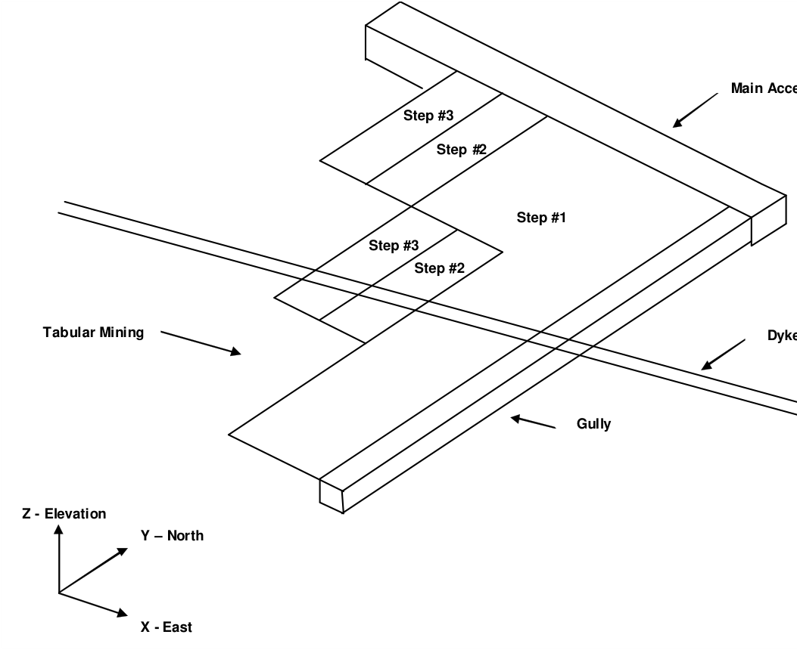

#### Ansicht neu ausrichten

Während der Blockerstellung oder zu jedem anderen Zeitpunkt können Sie die Geometrie verschieben, drehen oder zoomen, um die Darstellung zu erleichtern. Dafür gibt es mehrere Möglichkeiten (siehe Modell drehen und Modell verschieben). Am einfachsten drehen Sie, indem Sie die linke Maustaste gedrückt halten und den Cursor über den Bildschirm ziehen. Verschoben wird mit gedrückter rechter Maustaste. Zum Vergrößern oder Verkleinern halten Sie beide Maustasten gedrückt.

Richten Sie die Ansicht so aus, dass die Konstruktionslinien gut sichtbar sind.

#### Abbauschritt 1 erstellen

Erstellen wir nun den tafelförmigen Abbauschritt 1. Er wird mit Verschiebungsdiskontinuitäts-Elementen erstellt, die durch den Umriss der Abbauzone definiert sind.

Verwenden Sie für den ersten Block CAD > Build > DDLoop. Diese Funktion lässt sich wie folgt in der CAD-Symbolleiste auswählen (falls die CAD-Symbolleiste nicht sichtbar ist, aktivieren Sie sie mit Tools > CAD Toolbar):

Wählen Sie CAD > Build in der CAD-Symbolleiste

Das Untermenü der Erstellfunktionen wird angezeigt

Wählen Sie nun

#### CAD > Build > DDLoop

Da wir an Konstruktionslinien fangen möchten, müssen wir den Fangmodus einstellen. Dies geschieht mit CAD > Snap > Nearest Edge. Diese Funktion lässt sich in der Symbolleiste Build Entity auswählen

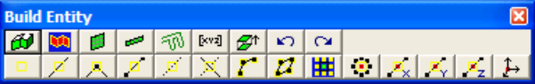

Um das Fangen an der nächsten Kante zu aktivieren, wählen Sie

#### CAD > Snap > Nearest Edge

(nur erforderlich, wenn die entsprechende Schaltfläche nicht bereits hervorgehoben ist).

In diesem Modus wird am Schnittpunkt des Fadenkreuzes ein Auswahlfeld angezeigt. Die Koordinaten der aktuellen Cursorposition werden in der Statusleiste angezeigt. Liegt das Auswahlfeld über einem Eckpunkt einer Konstruktionslinie, wird dieser Eckpunkt ausgewählt; andernfalls der nächstgelegene Punkt auf der Kante der Konstruktionslinie unter dem Auswahlfeld. In beiden Fällen sind alle 3 Koordinatenwerte (x, y und z) eindeutig festgelegt.

Die DDLoop-Routine fordert Sie in der Statusleiste auf, den ersten Eckpunkt des Blocks einzugeben

Input: Select Point 1

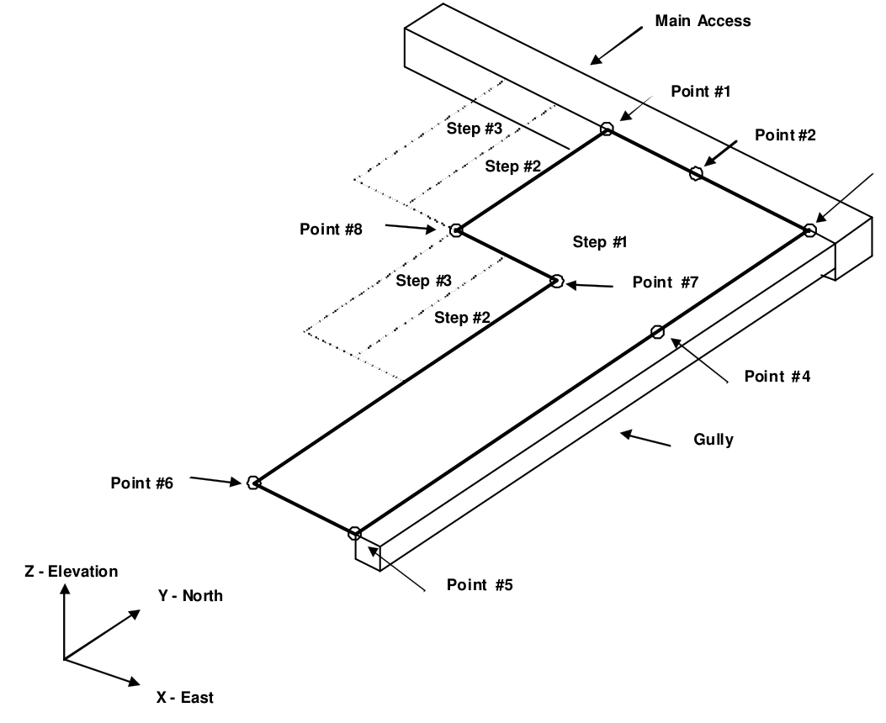

Wählen Sie die Punkte 1 bis 8 wie gezeigt.

Beachten Sie, dass wir hier für alle Punkte außer 2 und 4 auch den Eckpunkt-Fangmodus verwenden könnten

#### CAD > Snap > Nearest Corner

Wenn Sie eine falsche Position gewählt haben, machen Sie die Auswahl einfach rückgängig

#### CAD > Build > Undo Point

und versuchen Sie es erneut.

Die Punkte 2 und 4 sind optional und wurden nur gewählt, um ein saubereres Modell zu erhalten.

Nach Auswahl von Punkt 8 ist der Grundriss vollständig. Um den DDLoop fertigzustellen, wählen Sie erneut Punkt 1 oder klicken Sie auf die Schaltfläche.

Sie werden automatisch zur Eingabe der Blockeigenschaften aufgefordert (CAD > Build > DDLoop)

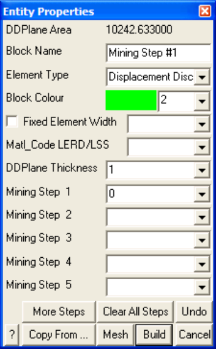

Geben Sie Folgendes ein:

Block Name: Mining Step #1 Element Type: Displacement Discontinuity Block Colour: 2 DDPlane Thickness: 1

DDPlane Thickness sollte auf die Abbaumächtigkeit gesetzt werden.

Dieser tafelförmige Abbau soll in Abbauschritt 1 ausgebrochen werden. Dies wird angegeben durch

Mining Step 1: 0

Damit sind wir fertig und können den Block mit der Schaltfläche erstellen.

#### Abbauschritt 2 erstellen

Erstellen wir nun den tafelförmigen Abbauschritt 2. Auch er wird mit Verschiebungsdiskontinuitäts-Elementen erstellt, die durch den Umriss der Abbauzone definiert sind. Wählen Sie zum Beginnen

CAD > Build > DDLoop

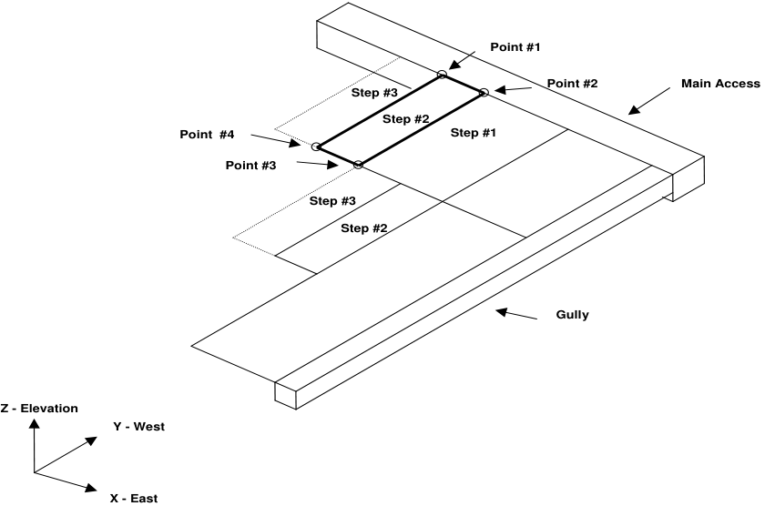

Wählen Sie die 4 Punkte wie gezeigt.

Nach Auswahl von Punkt 4 ist der Grundriss vollständig. Um den DDLoop fertigzustellen, wählen Sie erneut Punkt 1 oder klicken Sie auf die Schaltfläche.

Sie werden automatisch zur Eingabe der Blockeigenschaften aufgefordert (

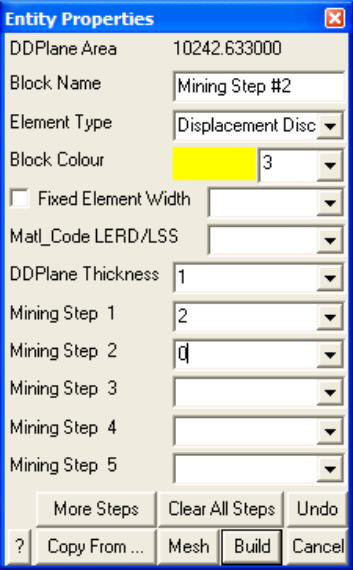

Geben Sie Folgendes ein:

Block Name: Mining Step #2 Element Type: Displacement Discontinuity Block Colour: 3 DDPlane Thickness: 1

DDPlane Thickness sollte auf die Abbaumächtigkeit gesetzt werden.

Diesem tafelförmigen Abbau sollen in Abbauschritt 1 die Eigenschaften des Erzes (Material Nr. 2) zugewiesen werden; in Abbauschritt 2 wird er ausgebrochen. Dies wird angegeben durch

Mining Step 1: 2 Mining Step 2: 0

Damit sind wir fertig und können den Block mit der Schaltfläche erstellen.

Erstellen Sie nun den anderen Teil von Schritt 2 nach demselben Verfahren.

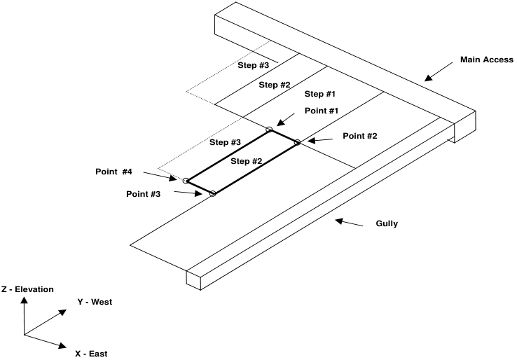

#### Abbauschritt 3 erstellen

Dieser Abbau wird genauso erstellt wie der Abbau in Schritt 2, jedoch werden ihm in den Abbauschritten 1 und 2 die Eigenschaften des Erzes (Material Nr. 2) zugewiesen; in Abbauschritt 3 wird er ausgebrochen.

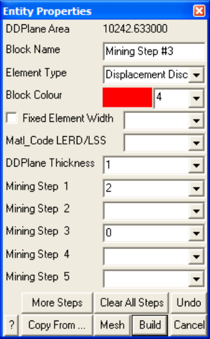

#### Ergebnisse erhalten

Obwohl wir die Abbaugeometrie definiert haben, müssen wir noch angeben, wo Spannungsprognosen berechnet werden sollen. Standardmäßig erhalten wir sie auf allen nicht abgebauten DD-Ebenen. Wenn wir auch Spannungen außerhalb des Flözes oder vor der Abbaufront benötigen, müssen wir dort DD-Ebenen oder Rasterebenen anordnen. Rasterebenen sind die wesentlich wirtschaftlichere Alternative (hinsichtlich der Rechenzeit).

In diesem Fall möchten wir Ergebnisse nur auf DD-Ebenen erhalten. Die Diskretisierung dieser Ebenen soll mit dem Parameter Fixed Element Width auf eine geeignete Elementgröße festgelegt werden. Verwenden Sie dazu CAD > Edit > Properties > Entity Properties. Diese Funktion lässt sich wie folgt in der CAD-Symbolleiste auswählen (falls die CAD-Symbolleiste nicht sichtbar ist, aktivieren Sie sie mit Tools > CAD Toolbar):

Wählen Sie CAD > Edit in der CAD-Symbolleiste

Das Untermenü der Bearbeitungsfunktionen wird angezeigt

Wählen Sie nun

CAD > Edit > Entity Properties

Dadurch wird die Symbolleiste zum Bearbeiten von Objekten geöffnet

Beim Start dieser Routine werden Sie zunächst aufgefordert, eine Liste der zu bearbeitenden Objekte zu erstellen. Halten Sie die Umschalttaste gedrückt und wählen Sie alle DD-Ebenen aus, die die Abbauschritte darstellen.

Wenn Sie den gesamten Abbau ausgewählt haben, wählen Sie erneut

#### CAD > Edit > Entity Properties

oder doppelklicken Sie auf ein Objekt, um den Dialog Entity Properties zu öffnen.

Zeigt ein Feld im Dialog „Variable“ an, haben einige der ausgewählten Blöcke unterschiedliche Werte für dieses Feld. Wenn Sie diese Werte unverändert lassen möchten (also für jeden Block unterschiedlich), lassen Sie das Feld auf „Variable“. Wenn Sie den Wert für alle ausgewählten Blöcke ändern möchten, geben Sie den gewünschten Wert ein.

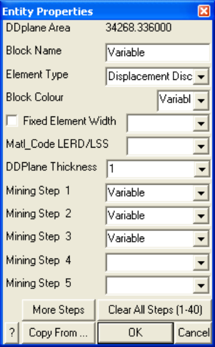

In diesem Fall möchten wir nur folgendes Feld ändern

Fixed Element Width:  20

Setzen Sie den Wert auf 20 und wählen Sie OK.

Dadurch unterteilt Map3D die Abbauzone bei der Diskretisierung in gleichmäßige Elemente mit 20 Metern Breite. Dieser Parameter kann später verkleinert werden, wenn eine feinere Diskretisierung gewünscht ist.

#### Geometrie speichern

Für dieses Beispiel nehmen wir an, dass die bisher definierte Geometrie zufriedenstellend ist. Da sowohl die endgültige Geometrie als auch die Abbaufolge nun vollständig sind, sollten wir das Modell speichern. Dazu wählen wir

#### File > Save Model As

Speichern wir es unter dem Namen „TAB.INP“

#### Gang erstellen

Als zusätzliche Erschwernis erstellen wir nun den Gang. Verwenden Sie dazu CAD > Build > FFLoop. Diese Funktion lässt sich wie folgt in der CAD-Symbolleiste auswählen (falls die CAD-Symbolleiste nicht sichtbar ist, aktivieren Sie sie mit Tools > CAD Toolbar):

Wählen Sie CAD > Build in der CAD-Symbolleiste

Das Untermenü der Erstellfunktionen wird angezeigt

Wählen Sie nun

#### CAD > Build > FFLoop

Da wir an Eckpunkten der Konstruktionslinien fangen möchten, müssen wir den Fangmodus einstellen. Dies geschieht mit CAD > Snap > Nearest Corner. Diese Funktion lässt sich in der Symbolleiste Build Entity auswählen

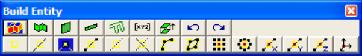

Um das Fangen am nächsten Eckpunkt zu aktivieren, wählen Sie

#### CAD > Snap > Nearest Corner

(nur erforderlich, wenn die Schaltfläche Nearest Corner Snap nicht bereits hervorgehoben ist).

Wir könnten hier auch den Kanten-Fangmodus verwenden

#### CAD > Snap > Nearest Edge

da die Eckpunkte der Konstruktionslinien ohnehin ausgewählt würden (sofern der Eckpunkt im Auswahlfeld liegt). Mit dem Eckpunkt-Fangmodus können wir jedoch ungenauer zielen, da nur Eckpunkte ausgewählt werden.

Wählen Sie alle vier Punkte wie in der Abbildung gezeigt.

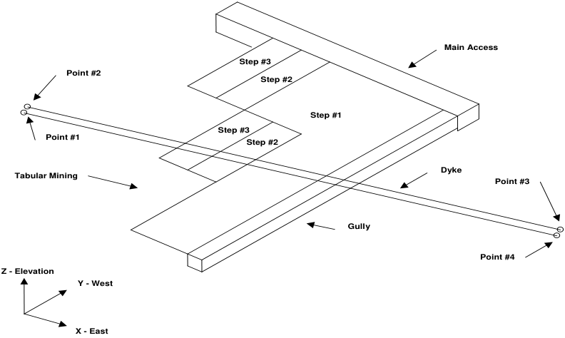

Wenn Sie eine falsche Position gewählt haben, machen Sie die Auswahl einfach mit der Rückgängig-Schaltfläche rückgängig

#### CAD > Build > Undo Point und versuchen Sie es erneut.

Wählen Sie zum Schluss erneut den ersten Punkt (d. h. Punkt 1).

Sobald der erste Punkt erneut gewählt wurde, ist die Grundfläche des Blocks vollständig. Es erscheint die Meldung

#### Loop complete: Start next loop.

Um den Block fertigzustellen, erzeugen wir die verbleibenden 4 Punkte aus den ersten 4 Eckpunkten durch Addition eines Versatzes. Wählen Sie dazu die Versatzfunktion in der Symbolleiste Build Entity

#### CAD > Build > Extrude/Offset Remaining

Sie werden wie folgt zur Eingabe des Versatzvektors aufgefordert

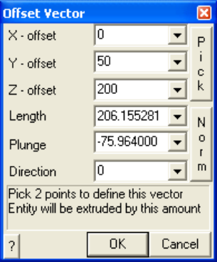

Geben Sie den Versatz ein:

X-offset > 0 Y-offset > 50 Z-offset > 200

Die Punkte 5, 6, 7 und 8 werden aus den Punkten 1, 2, 3 und 4 erzeugt, indem die Versatzwerte zu ihren Koordinaten addiert werden.

Nach Fertigstellung des Blocks werden Sie automatisch zur Eingabe der Blockeigenschaften aufgefordert (CAD > Build > FFLoop)

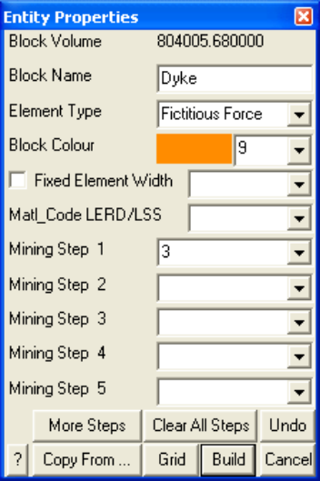

Geben Sie Folgendes ein:

Block Name: Dyke Element Type: Fictitious Force Block Colour: 9

Deaktivieren Sie Fixed Element Width, um diese Funktion auszuschalten

Diesem Gang soll in Abbauschritt 1 Material Nr. 3 zugewiesen werden. Dies wird angegeben durch

Mining Step 1: 3

Damit sind wir fertig und können den Block mit der

Schaltfläche erstellen.

Der Gang muss auch unterhalb des Abbaus fortgesetzt werden. Dazu können wir diesen Block unter den Abbau kopieren. Wählen Sie

CAD > Edit in der CAD-Symbolleiste

Dadurch wird die Bearbeitungs-Symbolleiste geöffnet

Um Objekte zu kopieren, wählen Sie

CAD > Edit > Copy Entities

Dadurch wird die Symbolleiste zum Kopieren von Objekten geöffnet

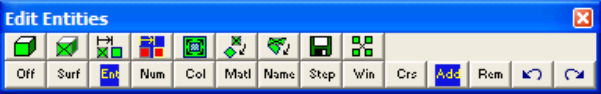

Beim Start dieser Routine werden Sie zunächst aufgefordert, eine Liste der zu bearbeitenden Objekte zu erstellen. Klicken Sie auf den Gang. Dadurch wird der Dialog für den Kopierversatzvektor geöffnet

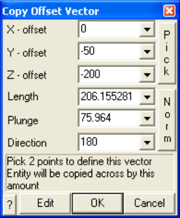

Wählen wir diese Position grafisch mit der Funktion Pick.

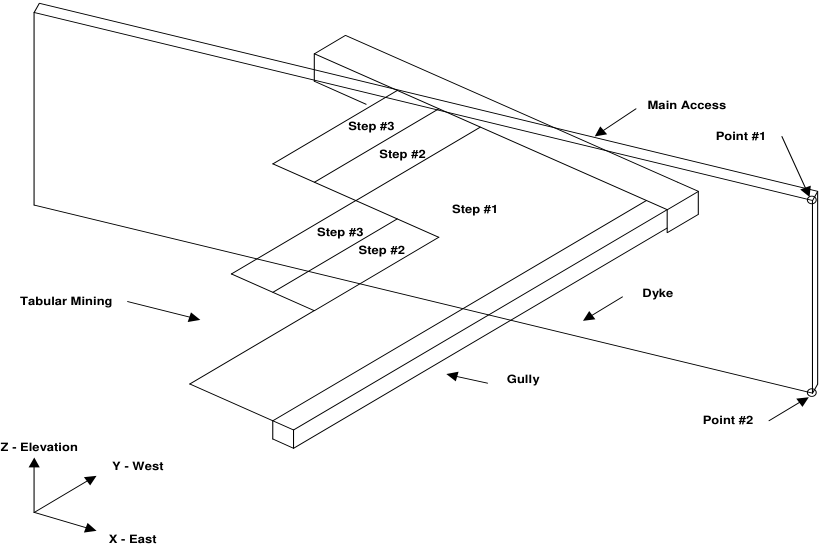

Dadurch wird der Versatzvektor festgelegt

X - offset: 0

Y - offset: -50

Z - offset: -200

Wählen Sie nun OK. Der Gang wird unter den Abbau kopiert.

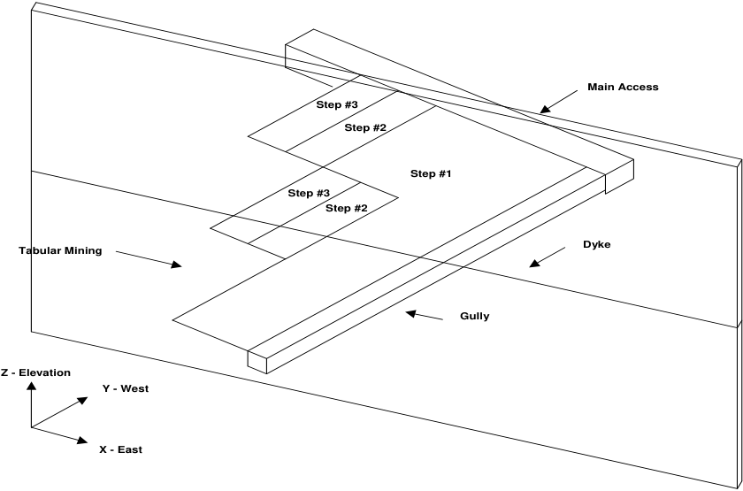

Damit ist die Modellerstellung abgeschlossen.

#### Materialeigenschaften des Wirtsgesteins festlegen

Nun müssen wir die Eigenschaften des Wirtsgesteins festlegen. Diese werden mit der Funktion für Materialeigenschaften eingegeben

#### CAD > Properties > Material Properties

Dieser Menüpunkt öffnet ein Untermenü zur Bearbeitung der Materialeigenschaften. Beachten Sie, dass Material Nummer 1 definitionsgemäß das Wirtsgestein ist. Andere Materialnummern dienen zur Definition alternativer Materialzonen wie Erz, Störungsletten, Versatz usw. Zuerst werden Sie aufgefordert, die zu bearbeitende Materialnummer einzugeben. Definieren wir zunächst die Eigenschaften des Wirtsgesteins

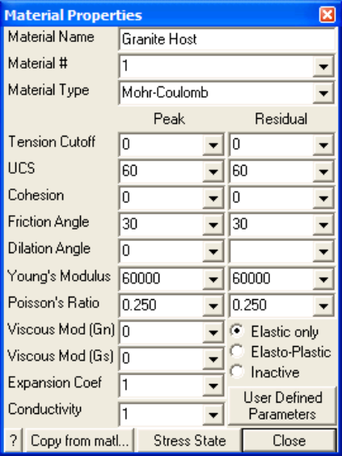

Geben Sie Folgendes ein:

Material Name: Granite Host Material #: 1 Young's (deformation) Modulus: 60000 MPa Poisson's Ratio: 0.25

Die viskosen Moduln können auf null gesetzt werden, da sie nur zur Simulation von Kriechverhalten in der nichtlinearen Analyse dienen.

Wir möchten hier das Mohr-Coulomb-Kriterium verwenden. Setzen Sie dazu

Material Type: Mohr-Coulomb UCS: 60 MPa

Der Kohäsionsparameter wird in diesem Fall nicht verwendet und kann daher auf null gesetzt werden.

Friction angle: 30°

Der Dilatanzwinkel wird in diesem Fall nicht verwendet und kann daher auf null gesetzt werden.

Wählen Sie Stress State, um den Dialog für den Spannungszustand zu öffnen

Der passende Fernfeldspannungszustand für dieses Modell ist

sa constant:  30 MPa sb constant:  20 MPa sc constant:  20 MPa

Die Änderung der Spannungen mit der Tiefe setzen wir auf

Dsa variation:  -0.027 MPa/m Dsb variation:  -0.013 MPa/m Dsc variation:  -0.013 MPa/m

Außerdem sollten die Spannungsorientierungen (Streichen und Fallen) auf null gesetzt werden, wodurch sa und sb horizontal und sc vertikal festgelegt werden.

Das Bezugsniveau (Datum) kann auf 1000 Meter gesetzt werden, um die Änderung mit der Tiefe festzulegen als

s + Ds ( _z_ - _Datum_ )

So definiert beträgt die Spannung sa in der Tiefe z = 1000 m genau 30 MPa und nimmt um 0,027 MPa je Meter Tiefe zu.

#### Materialeigenschaften des Erzes festlegen

Nun müssen wir die Eigenschaften des Erzes festlegen. Diese werden mit der Funktion für Materialeigenschaften eingegeben

#### CAD > Properties > Material Properties

Dieser Menüpunkt öffnet ein Untermenü zur Bearbeitung der Materialeigenschaften. Beachten Sie, dass Material Nummer 1 definitionsgemäß das Wirtsgestein ist. Andere Materialnummern dienen zur Definition alternativer Materialzonen wie Erz, Störungsletten, Versatz usw. Zuerst werden Sie aufgefordert, die zu bearbeitende Materialnummer einzugeben.

Setzen wir Material # auf 2.

Alle Parameter können nach Wunsch gesetzt werden. Seien Sie hier besonders sorgfältig, da dieses Material in DD-Ebenen eingesetzt wird. Diese Strukturen können sich nichtlinear verhalten und unter Druck und Scherung fließen (siehe Abschnitt zu Mohr-Coulomb in DD-Ebenen).

Wählen Sie Stress State, um den Dialog für den Spannungszustand zu öffnen

Die Anfangsspannung im Erz soll derjenigen im Wirtsgestein entsprechen. Kopieren wir sie daher mit Copy von Material 1.

#### Materialeigenschaften des Gangs festlegen

Nun müssen wir die Eigenschaften des Gangs festlegen. Diese werden mit der Funktion für Materialeigenschaften eingegeben

#### CAD > Properties > Material Properties

Dieser Menüpunkt öffnet ein Untermenü zur Bearbeitung der Materialeigenschaften. Beachten Sie, dass Material Nummer 1 definitionsgemäß das Wirtsgestein ist. Andere Materialnummern dienen zur Definition alternativer Materialzonen wie Erz, Störungsletten, Versatz usw. Zuerst werden Sie aufgefordert, die zu bearbeitende Materialnummer einzugeben.

Setzen wir Material # auf 3.

Alle Parameter können nach Wunsch gesetzt werden. Bei Verwendung von Map3D Non-Linear sollten Sie hier besonders sorgfältig sein, da sich diese Struktur nichtlinear verhalten und unter Druck und Scherung fließen kann (siehe Abschnitt zu Mohr-Coulomb in 3D-FF-Blöcken).

Wählen Sie unbedingt Stress State, um den Dialog für den Spannungszustand zu öffnen, und setzen Sie den Spannungszustand im Gang auf denselben Wert wie im Wirtsgestein (Copy von Material 1).

#### Steuerparameter festlegen

Nun müssen wir die Parameter für Modelldiskretisierung und Lösung festlegen. Diese werden mit der Funktion für Steuerparameter eingegeben

#### CAD > Properties > Control Parameters

Dieser Menüpunkt öffnet einen Dialog mit den Steuerparametern

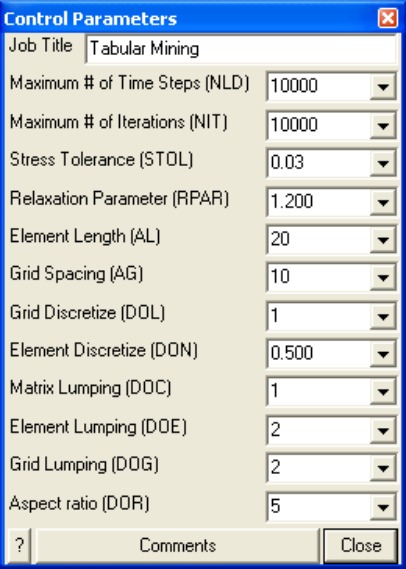

Geben Sie Folgendes ein:

Job Title: Tabular Mining

Alle Parameter können auf ihren Standardwerten bleiben, außer Spannungstoleranz, Elementlänge und Rasterabstand.

Stress Tolerance: 0.03 MPa

sollte auf etwa 0,1 % des Fernfeldspannungszustands gesetzt werden. Dadurch werden die Oberflächenspannungen bei der Lösung mit einer numerischen Genauigkeit von 0,03 MPa berechnet.

Element Length: 20

sollte auf das Doppelte der Gangmächtigkeit gesetzt werden (der Gang ist 10 Meter mächtig), da dies die schmalste Struktur in diesem Modell ist. Dieser Parameter steuert die minimale Randelementgröße an Stellen mit schmalen Flözen oder Pfeilern. Dadurch wird ein gut konditioniertes, leicht lösbares Problem formuliert.

Der Rasterabstand (Grid Spacing) wird nicht verwendet, da keine Feldpunktraster definiert wurden.

Empfohlene Werte für die Diskretisierungs- und Zusammenfassungsparameter:

_DON_ =0.5, _DOL_ = _DOC_ =1, _DOE_ = _DOG_ =2 für 10-20 % Fehler _DON_ =0.5, _DOL_ = _DOC_ =2, _DOE_ = _DOG_ =4 für 5-10 % Fehler _DON_ =1.0, _DOL_ =DOC=4, _DOE_ = _DOG_ =8 für &lt; 5 % Fehler

Die Einstellungen für grobe Ergebnisse werden für alle Probleme empfohlen, außer wenn eine höhere Genauigkeit erforderlich ist. Bei dieser Einstellung ist bei den Spannungsprognosen mit numerischen Fehlern von 10-20 % zu rechnen. Die Einstellungen für detaillierte Ergebnisse ergeben 5-10 % numerischen Fehler, die Einstellungen für hohe Genauigkeit unter 5 %. Sie können genauere Einstellungen wählen, dadurch wird das Problem jedoch größer und die Rechenzeit länger.

#### Map3D-Analyse ausführen

Damit ist die Modellerstellung abgeschlossen, und wir können eine Analyse starten. Mit Map3D Fault-Slip erhalten Sie eine elastische Lösung dieses Problems. Mit Map3D NonLinear wird eine vollständige nichtlineare Analyse durchgeführt.

Die Analyse wird über das Hauptmenü gestartet.

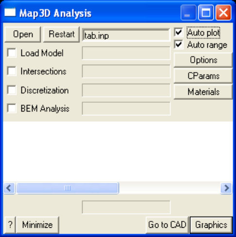

Die vollständige Analyse führen Sie aus, indem Sie

#### BEM Analysis

wählen. Hier gehen wir schrittweise vor. Wählen Sie zunächst

#### Discretization

Wenn Sie das Modell seit dem letzten Speichern geändert haben, werden Sie aufgefordert, die Änderungen zu speichern.

Sind Verschneidung und Diskretisierung abgeschlossen, wählen Sie

#### Analysis > Graphics

Wählen Sie im Grafikmodus die Option für die diskretisierte Ansicht

#### View > Render > Discretize

So sehen Sie, wie die Blockoberflächen in Randelemente diskretisiert wurden. Damit die einzelnen Elemente sichtbar sind, müssen Umrisse aktiviert sein

#### View > Render > Block Outlines

Um zu sehen, wie das Raster diskretisiert wurde, wählen Sie

#### Plot > Grid Selection > Grid #1

Ist alles zufriedenstellend, fahren Sie mit der BEM-Analyse (Aufstellen und Lösen der Matrix) fort, indem Sie

#### Analysis

im Hauptmenü und anschließend

#### BEM Analysis

wählen. Wenn die Analyse abgeschlossen ist, wählen Sie

#### Analysis > Graphics

Im Grafikmodus können Sie jeden gewünschten Parameter als Kontur darstellen. Um beispielsweise die Normalverschiebung (Konvergenz) im tafelförmigen Abbau anzuzeigen, wählen Sie

#### Plot > Surface Components > Dn Normal Displacement (Closure)

Dadurch wird eine Konturdarstellung auf den DD-Ebenen erzeugt.

#### Hauptzugang erstellen

Er wird erstellt, indem mit DDLoop ein Grundriss gezeichnet und dieser anschließend zu einem 3D-Block extrudiert wird.

Dazu müssen wir zur CAD-Phase der Map3D-Analyse zurückkehren, indem wir

#### Analysis > Go to CAD

im Analysedialog wählen. Wählen Sie dann

#### Analysis > Graphics

Wählen Sie zunächst die Menüfunktion zur DDLoop-Erstellung

#### CAD > Build > DD Loop

Stellen Sie den Fangmodus auf nächste Kante (oder nächster Eckpunkt)

#### CAD > Snap > Nearest Edge

(nur erforderlich, wenn die Kanten-Fangschaltfläche nicht bereits hervorgehoben ist).

Die DDLoop-Routine fordert Sie in der Statusleiste auf, den ersten Eckpunkt des Blocks einzugeben

Input: Select Point 1

Wählen Sie die ersten beiden Punkte wie in der Abbildung gezeigt.

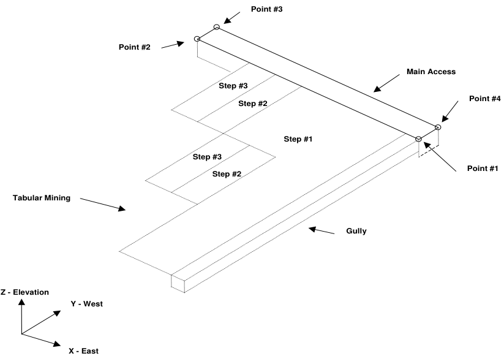

Die Punkte 3 und 4 werden durch Versatz von der Linie zwischen den Punkten 1 und 2 erzeugt. Wählen Sie dazu

#### CAD > Build > Offset Remaining

in der Erstellen-Symbolleiste.

Sie werden zur Eingabe des Versatzvektors aufgefordert.

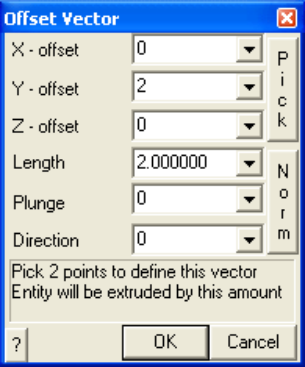

Geben Sie den Versatz ein

X - offset: 0

Y - offset: 2

#### Z - offset: 0

Dadurch werden die Punkte 3 und 4 erzeugt und der DDLoop wird fertiggestellt.

Sie werden automatisch zur Eingabe der Blockeigenschaften aufgefordert

Geben Sie Folgendes ein:

#### Block Name: Main Access

#### Element Type: Fictitious Force

Daraufhin werden Sie aufgefordert, den Versatzvektor für die Extrusion des Blocks einzugeben.

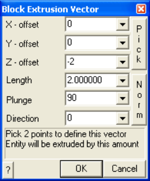

Geben Sie den Versatz ein:

X - offset: 0 Y - offset: 0 Z - offset: -2

Block Colour: 1 Fixed Element Width:   (deaktiviert lassen)

Dieser Zugang soll in Abbauschritt 1 aufgefahren werden. Dies wird angegeben durch

Mining Step 1: 0

Damit sind wir fertig und können den Block erstellen.

#### Gully erstellen

Erstellen Sie nun den Gully nach demselben Verfahren wie oben beschrieben.

Wählen Sie die ersten beiden Punkte wie in der Abbildung gezeigt.

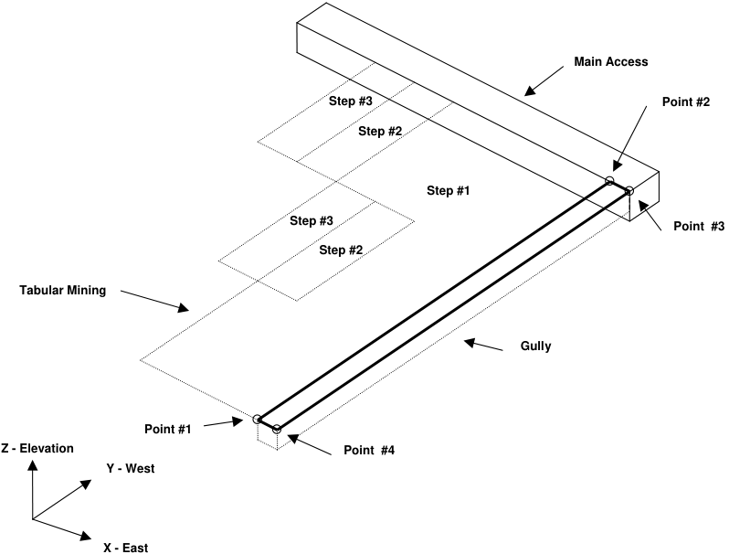

Die Punkte 3 und 4 werden durch Versatz von der Linie zwischen den Punkten 1 und 2 erzeugt. Wählen Sie dazu

CAD > Build > Offset Remaining

in der Erstellen-Symbolleiste.

Sie werden zur Eingabe des Versatzvektors aufgefordert.

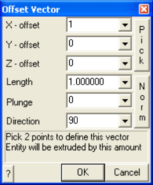

Geben Sie den Versatz ein:

- X - offset: 1

- Y - offset: 0

- Z - offset: 0

Dadurch werden die Punkte 3 und 4 erzeugt und der DDLoop wird fertiggestellt.

Sie werden automatisch zur Eingabe der Blockeigenschaften aufgefordert

#### Geben Sie Folgendes ein:

#### Block Name: Gully

#### Element Type: Fictitious Force

Daraufhin werden Sie aufgefordert, den Versatzvektor für die Extrusion des Blocks einzugeben.

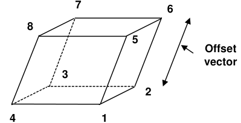

Geben Sie den Versatz ein:

X - offset: 0 Y - offset: 0 Z - offset: -1

Block Colour: 1

Fixed Element Width:   (deaktiviert lassen)

Dieser Zugang soll in Abbauschritt 1 aufgefahren werden. Dies wird angegeben durch

Mining Step 1: 0

Damit sind wir fertig und können den Block erstellen.

#### Diskussion

Bevor wir mit der Analyse fortfahren, müssen wir den Steuerparameter Element Length ( _AL_ ) anpassen, damit die neuen Modellbestandteile richtig berücksichtigt werden

#### CAD > Properties > Control Parameters

AL sollte auf das Doppelte der Gully-Mächtigkeit gesetzt werden (der Gully ist 1 Meter mächtig), da dies die schmalste Struktur in diesem Modell ist.

Wenn wir das Modell jetzt diskretisieren

#### Analysis > Discretization

zeigt eine genaue Betrachtung, dass für die Diskretisierung der Bereiche neben dem Gully und dem Hauptzugang sehr viele Randelemente verwendet werden. Diese Strukturen werden die Rechenzeit offensichtlich stark erhöhen. Tragen sie nicht wesentlich zum Ergebnis bei, lässt sich erheblicher Rechenaufwand einsparen, indem man sie aus der Analyse entfernt, also inaktiv setzt.

Wählen Sie dazu

#### Analysis > Go to CAD

im Analysedialog. Wählen Sie dann

Analysis > Graphics

Wählen Sie nun

in der CAD-Symbolleiste

Dadurch wird die Bearbeitungs-Symbolleiste geöffnet

Um Objekte zu bearbeiten, wählen Sie

CAD > Edit > Entity Properties

Dadurch wird die Symbolleiste zum Bearbeiten von Objekten geöffnet

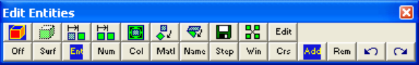

Beim Start dieser Routine werden Sie zunächst aufgefordert, eine Liste der zu bearbeitenden Objekte zu erstellen. Halten Sie die Umschalttaste gedrückt und wählen Sie den Gully und den Hauptzugang aus. Wählen Sie weder den tafelförmigen Abbau noch den Gang aus.

Wenn Sie diese Strukturen ausgewählt haben, wählen Sie erneut

CAD > Edit > Entity Properties

oder doppelklicken Sie auf den Gully oder den Hauptzugang, um den Dialog Entity Properties zu öffnen.

Zeigt ein Feld im Dialog „Variable“ an, haben einige der ausgewählten Blöcke unterschiedliche Werte für dieses Feld. Wenn Sie diese Werte unverändert lassen möchten (also für jeden Block unterschiedlich), lassen Sie das Feld auf „Variable“. Wenn Sie den Wert für alle ausgewählten Blöcke ändern möchten, geben Sie den gewünschten Wert ein.

In diesem Fall möchten wir nur den Parameter Element Type ändern. Setzen Sie ihn auf Inactive Fictitious Force

Element Type: Inactive Fictitious Force

und wählen Sie dann OK.

Nun können Sie die BEM-Analyse erneut starten, indem Sie Folgendes wählen

BEM Analysis

