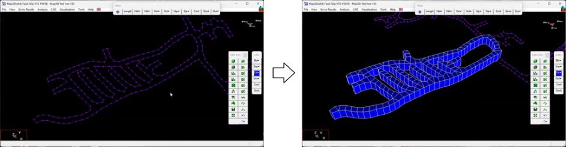

Dieses Beispiel zeigt, wie Sie mit der Map3D-Funktion DDLoop ein komplexes Streckenlayout erstellen. Das Layout enthält komplizierte innere Pfeilerformen.

Die in diesem Video verwendeten Konstruktionslinien sind in der Demoversion von Map3D enthalten und/oder können unter z305_floor_plan-a.dxf heruntergeladen werden

**Videodemonstration der DDLoop-Modellerstellung mit inneren Schleifen**
