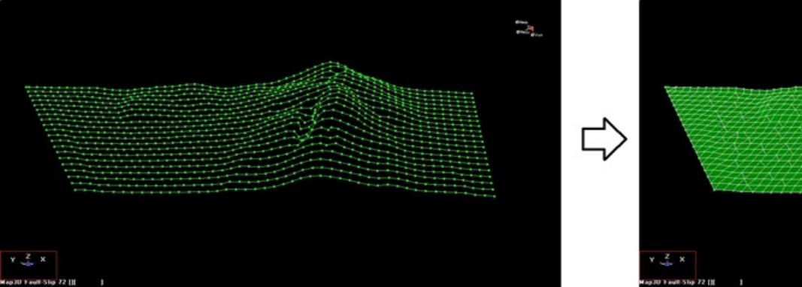

Dieses Beispiel zeigt die DDLoop-Modellerstellung in Map3D mit der Option „Snap > Window“.

Das Layout enthält mehrere subparallele Konstruktionslinien.

Die in diesem Video verwendeten Konstruktionslinien sind in der Demoversion von Map3D enthalten und/oder können unter lines3a.dxf heruntergeladen werden

**Videodemonstration der DDLoop-Modellerstellung mit der Option Window (lines3a.dxf)**
