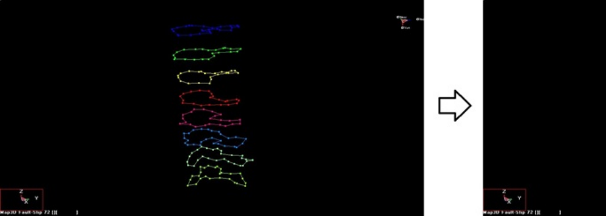

Dieses Beispiel zeigt, wie Sie die Map3D-Funktion FFLoop mit der neuen Option „Snap > Window“ verwenden.

Das Layout enthält mehrere Schleifen aus Konstruktionslinien.

Dieses Video zeigt die FFLoop-Konstruktion aus einer Reihe von Konstruktionslinienschleifen. Die in diesem Video verwendeten Konstruktionslinien sind in der Demoversion von Map3D enthalten und/oder können unter 7a.pnt heruntergeladen werden

**Videodemonstration der FFLoop-Modellerstellung mit der neuen Option „Win > Snap“**
