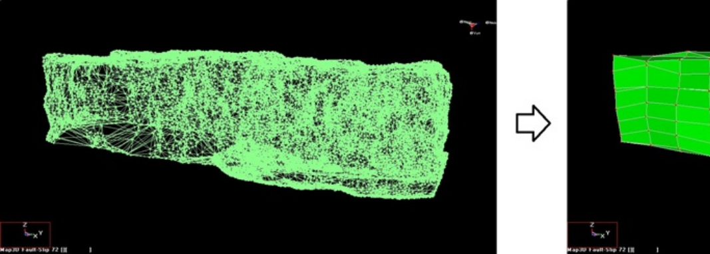

Dieses Beispiel zeigt die Modellvereinfachung durch Schneiden in Map3D. Das Layout enthält eine übermäßig komplexe Hohlraumform.

Dieses Video zeigt die Vereinfachung einer komplexen Geometrie durch „Slicing“ (Schneiden), „Smoothing“ (Glätten) und anschließende „FFLoop“-Konstruktion.

Die in diesem Video verwendeten Konstruktionslinien sind in der Demoversion von Map3D enthalten und/oder können unter Skivpall.dxf heruntergeladen werden

**Videodemonstration der Modellvereinfachung durch Schneiden (Skivpall.dxf)**
