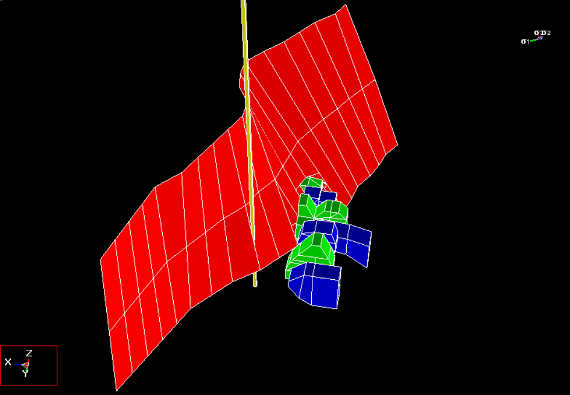

In diesem Beispiel werden mehrere alternative Methoden zur Modellierung des Versagens durch Störungsgleiten untersucht, um das pseudostatische Gleitverhalten zu bewerten. Die Ergebnisse der numerischen Modellierung werden zum Vergleich dieser Ansätze herangezogen, um zu zeigen, dass die Ergebnisse gültig und zuverlässig sind.

Beispiel für Störungsgleiten

