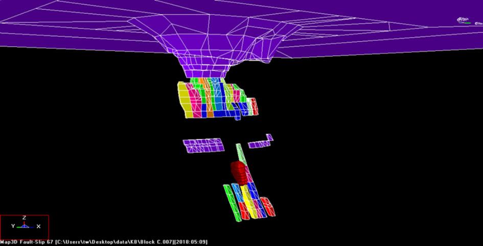

In diesem Beispiel wird Mehrausbruch aus einer früheren Abbauphase genutzt, um ein Modell zu kalibrieren und das zu erwartende Verhalten beim Abbau einer nachfolgenden, tieferen Sohle vorherzusagen.

#### Beispiel KB

