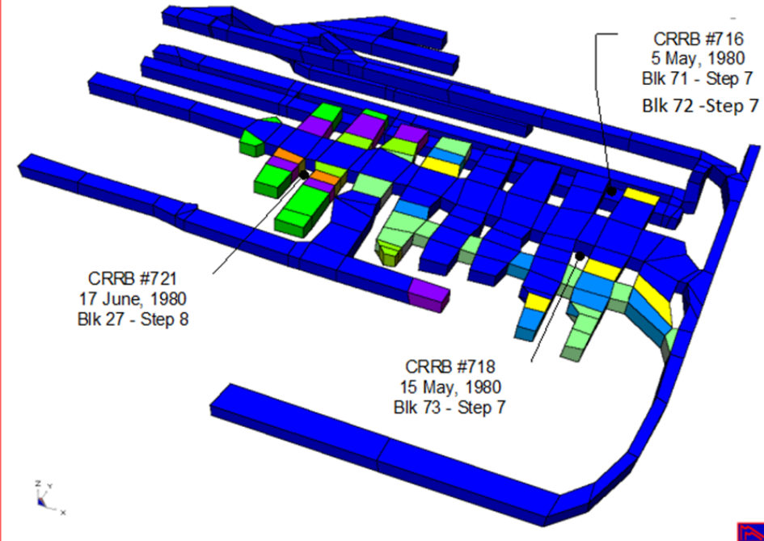

In diesem Beispiel traten während der Auffahrung der Teilsohlen (Silling out) auf 3 verschiedenen Sohlen mehrere Pfeilerbrüche auf. Diese werden genutzt, um ein Modell zu kalibrieren und das zu erwartende Verhalten beim späteren Abbau eines Kronenpfeilers vorherzusagen.

#### Beispiel CR

