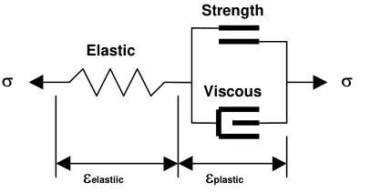

Realiza el análisis de fluencia elastoviscoplástica.

Esta función se usa solo en análisis no lineales (bloques FF 3D en Map3D Non-Linear y planos DD en Map3D Fault-Slip). El modelo de fluencia se puede usar simplemente como una técnica para amortiguar las deformaciones no lineales o, si se activa esta opción de fluencia, para simular la fluencia dependiente del tiempo en tiempo real.

En cada paso de fluencia, el estado de esfuerzo en todos los elementos en fluencia (elementos donde el esfuerzo supera la resistencia) se calcula como la resistencia más la resistencia a la fluencia. Esto limita el tamaño del incremento de fluencia plástica Deplastic en cada elemento en fluencia

s = _Strength_ + _C_ Deplastic /D _t_

_C_ = _G_ D _t_

donde la resistencia a la fluencia se determina como el coeficiente de fluencia _C_ multiplicado por la tasa de deformación plástica Deplastic /D _t_ . Tenga en cuenta que el usuario debe seleccionar tanto el coeficiente de fluencia _C_ como el tamaño del paso de tiempo D _t_ , y luego especificar el cociente de ambos como el módulo viscoso _G_ . La contribución al esfuerzo s que hace el incremento de fluencia es el esfuerzo en exceso, dado por

Ds  = _C_ Deplastic /D _t_

El esfuerzo en exceso máximo de todos los elementos en fluencia se indica mediante Plot > Surface Components > Ferr

Si se activa esta opción de fluencia, Map3D ejecutará solo un incremento de fluencia por cada paso de minado. Por lo tanto, el tiempo transcurrido se puede determinar como el producto del número del paso de tiempo actual _is_ (Analysis Dialogue) por el tamaño del paso de tiempo D _t_ definido por el usuario.

Tiempo total transcurrido = _is_ D _t_

Es posible que desee repetir varios pasos de minado sin agregar nuevo minado, simplemente para permitir que el modelo fluya durante un número controlado de pasos.

Si no se activa esta opción de fluencia, Map3D ejecutará tantos incrementos de fluencia como sea necesario para reducir _fer_ por debajo de la tolerancia de esfuerzo _STOL_ , antes de pasar al siguiente paso de minado.

En cualquier caso, la deformación plástica acumulada eplastic se determina como la suma de los incrementos de fluencia plástica Deplastic de todos los pasos de fluencia.

Temas relacionados:

Plot > Surface Components > DTs Excess Shear Stress

Plot > Surface Components > DEs Incremental Shear Strain

Plot > Surface Components > Ts Shear Stress

Plot > Surface Components > Es Shear Strain

Esta función debe estar marcada antes de realizar el análisis BEM de Map3D

Analysis > BEM Analysis
