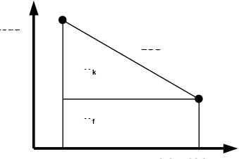
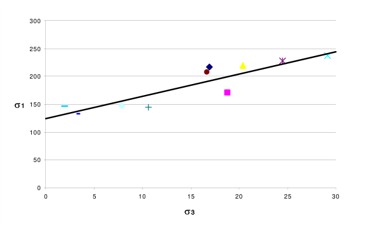
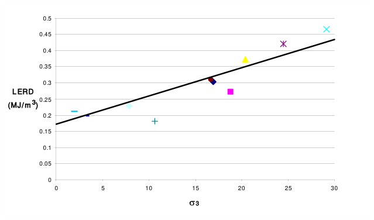
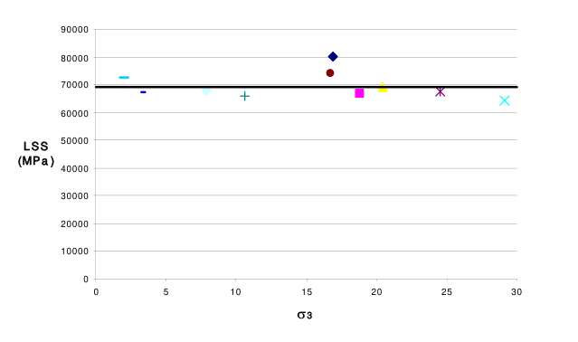

Calcula la tasa de liberación de energía y la rigidez del sistema de carga, durante el análisis BEM de Map3D.

Esta rutina permite calcular la tasa de liberación de energía ( _ERR_ ) en cualquier ubicación deseada y ofrece una amplia flexibilidad para controlar cómo se realiza el cálculo. Existe un método alternativo

en el que _ERR_ se calcula solo por delante de un frente de excavación Plot > Surface Components > ERR

Cuando seleccionas LERD/LSS, se te solicita un nombre de archivo de datos donde se escribirán los resultados de los cálculos LERD/LSS. La extensión predeterminada de este archivo es ".ERR".

Los resultados se escriben en este archivo con el siguiente formato:

Si el bloque de prueba se construye como un bloque 3D (con elementos FF)

**Block# Volume Area   Wk  Wf  Ev  LSS   x y z** s **1  t1  p1** s **2  t2  p2** s **3  t3  p3**

donde s **i  ti  pi** representan un componente de esfuerzo principal, su rumbo y su inclinación.

Si el bloque de prueba se construye como una característica plana (con elementos DD)

**Block# Volume Area   Wk  Wf  Ev  LSS   x y z** t **s  ts  ps** s **n  tn  pn**

donde t **s  ts  ps** representan el esfuerzo cortante máximo en el plano, su rumbo y su inclinación, y s **n  tn  pn** representan el esfuerzo normal, su rumbo y su inclinación.

En ambos casos, **x y z** son las coordenadas del centro del bloque de prueba donde se calculan los esfuerzos.

**Wk  Wf** y **LSS** se definen más abajo.

**Ev** es el cambio de volumen que ocurre durante el cálculo LERD/ERR.

Además, también se calcula la liberación total de energía asociada con las nuevas excavaciones realizadas durante la etapa de explotación actual. Ten en cuenta que no es necesario especificar bloques de prueba para que se realice este cálculo. Los resultados se informan de la siguiente manera:

#### Stp# Volume Area Wk Wf Ev LSS

Un indicador útil de la naturaleza de la respuesta esperada durante la fluencia es la rigidez del sistema de carga ( _LSS_ ) y la densidad local de liberación de energía ( _LERD_ ). En distintas ubicaciones de un modelo se puede

esperar que estos indicadores cambien debido a efectos geométricos. En las ubicaciones donde la _LSS_ es más rígida que la respuesta posterior al pico de la roca en fluencia, se puede esperar una falla controlada que avanza en secuencia con la explotación. Sin embargo, en las ubicaciones donde la _LSS_ es más blanda que la respuesta posterior al pico de la roca en fluencia, se pueden esperar fallas no controladas. Se puede esperar que la cantidad de energía excedente disponible se correlacione con la magnitud del evento.

Para determinar la _LSS_ o la _LERD_ en un modelo numérico, es necesario flexionar el modelo y observar la respuesta del sistema de carga. Esto se hace especificando el código de material para el cálculo LERD/LSS mediante

#### CAD > Edit > Entity Properties > Matl Code LERD/LSS

Este código de material especial se usa para alterar temporalmente las propiedades del material o las condiciones de borde en el área de prueba, de modo que el modelo se deforme de alguna manera.

Como se espera que la _LSS_ cambie de una ubicación a otra, es necesario hacer esto en todas las ubicaciones de interés. Al monitorear con cuidado la respuesta del sistema de carga durante esta deformación, se pueden calcular la _LSS_ y las diversas cantidades de energía transferida.

Considera el ejemplo simple de un plano de falla que atraviesa una zona de explotación, y plantea la pregunta "¿Cómo respondería esta falla si cediera?". Se podría simplemente sustituir un ángulo de fricción menor y observar cómo se deforma el macizo rocoso. Llamemos "Etapa I" al modelo con la falla en su ángulo de fricción normal y "Etapa II" al mismo modelo con la falla en un ángulo de fricción reducido. En algún punto del plano de falla se puede esperar el siguiente tipo de respuesta.

La _LSS_ es simplemente la pendiente de la curva de respuesta carga-deformación. La cantidad máxima de energía que se puede liberar como energía cinética es el área del triángulo superior etiquetado como Wk (se debe esperar que esto se correlacione con la magnitud del evento observado). La cantidad mínima de energía que se puede disipar en la deformación por fricción de la falla es el área del rectángulo inferior etiquetado como Wf (se debe esperar que esto se correlacione con la cantidad de daño observado en la fuente del evento). Este cálculo debe realizarse en todas las ubicaciones del plano de falla para obtener la energía total transferida como resultado de la reducción del ángulo de fricción. Ten en cuenta que, según cómo se configuren las propiedades del material, podría haber deformaciones normales (dilatación que ocurre con la respuesta al corte) que deben incluirse en los cálculos de energía.

Los mismos cálculos se pueden hacer para un pilar entre dos galerías. En este caso, llamemos "Etapa I" al modelo con el pilar intacto. Para flexionar el modelo, podríamos sustituir un material diferente en el pilar y llamar a esto "Etapa II". Entonces se pueden repetir todos los cálculos e interpretaciones anteriores para Wk y Wf. Ten en cuenta que, al igual que antes, los cálculos de energía incluyen contribuciones de los componentes normal y de corte.

Como Map3D calcula los esfuerzos que actúan sobre los elementos de borde, la transferencia total de energía se puede calcular como la integral de los esfuerzos a través de sus deformaciones sobre todos los elementos. En el ejemplo anterior del pilar, si realmente excavamos el pilar para obtener la etapa II y luego dividimos Wk entre el volumen del pilar, obtenemos la densidad local de liberación de energía ( _LERD_ ). Se ha comprobado que esta se correlaciona muy bien con los episodios de falla violenta. (Ten en cuenta que, en el caso de la explotación tabular, si divides Wk entre el área (en el plano de explotación), obtienes la tasa clásica de liberación de energía, _ERR_ ).

Para reforzar este concepto, consideremos un ejemplo real. Considera varios estallidos de pilares ocurridos a lo largo de varios años de explotación. Para cada falla, se ejecutó un modelo numérico para determinar el estado de esfuerzos en el momento y el lugar de la falla. Si graficamos todas estas predicciones de esfuerzo en un conjunto de ejes s **1** frente a s **3**, obtenemos lo siguiente:

Esta figura ilustra que existe una fuerte correlación entre el estado de esfuerzos en el momento de cada estallido y un criterio de resistencia lineal. El coeficiente de correlación de estos datos es 0.90. Dicho de otro modo, el error medio en la predicción de s **1** es de aproximadamente 17 MPa. Esto da un coeficiente de variación de solo 9%.

La _LERD_ en el momento del estallido en cada ubicación también muestra una fuerte correlación entre el estado de esfuerzos en el momento de cada estallido y un criterio lineal. El coeficiente de correlación de estos datos es 0.88.

Dicho de otro modo, el error medio en la predicción de la _LERD_ es de aproximadamente 0.045 MPa/mª. Esto da un coeficiente de variación de solo 14%.

Aunque los componentes Wk y Wf se calculan fácilmente de esta manera, la definición de la _LSS_ no es tan directa. Sin embargo, se puede determinar una _LSS_ representativa de la siguiente manera:

Identifica un área representativa para la cual se determinará la _LSS_. Esto se hace construyendo un bloque de prueba que debe abarcar la zona de fluencia prevista.

Construyes el bloque de prueba como cualquier otra característica, pero lo identificas como un "bloque de prueba" especificando el código de material deseado para el cálculo LERD/LSS mediante

#### CAD > Edit > Entity Properties > Matl Code LERD/LSS

El código de material para las etapas de explotación debe establecerse según cómo quieras que se trate esta zona durante la secuencia de explotación. Estos bloques se pueden usar como zonas de material alterno y excavarse si se desea.

Suponiendo que este bloque de prueba está lleno de un material ficticio cuya rigidez posterior al pico coincide exactamente con la respuesta del sistema de carga, y que el comportamiento del bloque de prueba se puede describir mediante

s **1 =** **_LSS_** e **1** s **2 =** **_LSS_** e **2** s **3 =** **_LSS_** e **3**

La densidad de energía se puede calcular como

**½ (** s **1** e **1 +** s **2** e **2 +** s **3** e **3 )**

La densidad media de energía se puede estimar como

**( Wk + Wf ) /** **_Volume_**

Por lo tanto, la rigidez del sistema de carga se puede determinar a partir de

**_LSS_ = ½ (** s **1² +** s **2² +** s **3² )** **_Volume_ / ( Wk + Wf )**

Si hacemos este cálculo con los datos presentados arriba, obtenemos el siguiente gráfico.

La _LSS_ en el momento del estallido en cada ubicación muestra un valor fuertemente independiente del esfuerzo. El error medio en la predicción de la _LSS_ es de aproximadamente 4730 MPa. Esto da un coeficiente de variación de solo 7%.

Este cálculo de la _LSS_ solo es representativo si los esfuerzos se distribuyen de manera uniforme en todo el bloque de prueba. En los casos en que esto no se cumple, se encuentra una correlación deficiente con la _LSS_.

#### Notas

Esta función debe estar activada antes de realizar el análisis de discretización

Analysis > Discretization
