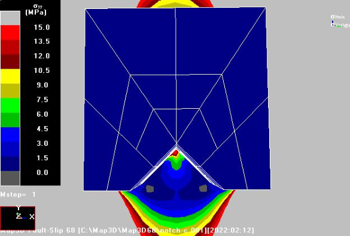

Usa elementos de borde de orden superior, durante el análisis BEM de Map3D.

El método de elementos de borde utiliza una aproximación numérica de cómo se distribuye la intensidad de los componentes superficiales del esfuerzo o de la discontinuidad de desplazamiento sobre los bordes. La suposición más simple es que estos componentes superficiales se distribuyen de manera uniforme sobre cada elemento de borde. La experiencia con Map3D ha demostrado que esta aproximación produce resultados precisos para todos los problemas, salvo una clase limitada en la que intervienen efectos de flexión significativos. Incluso en este último tipo de problema, se siguen obteniendo resultados precisos en todas las ubicaciones, excepto cerca de las superficies de borde.

Para obtener resultados precisos cerca de los bordes en problemas con efectos de flexión significativos, es necesario implementar elementos de borde de orden superior. Los efectos de flexión suelen ser importantes en problemas con luces grandes y formas irregulares. Esto es particularmente importante cerca de los quiebres del borde que pueden surgir por las intersecciones entre distintas características.

Cuando no está activada ni **linear** ni **quad**, la intensidad de los componentes superficiales del esfuerzo o de la discontinuidad de desplazamiento se distribuye como valores **constantes**.

Cuando está activada la opción **linear**, la intensidad de los componentes superficiales del esfuerzo o de la discontinuidad de desplazamiento se distribuye sobre los elementos de borde mediante una distribución polinómica de orden lineal. Para triángulos se usa la siguiente distribución

_a + b x + c y_

Para cuadriláteros se usa la siguiente distribución

_a + b x + c y + d xy_

Cuando está activada la opción **quad**, la intensidad de los componentes superficiales del esfuerzo o de la discontinuidad de desplazamiento se distribuye sobre los elementos de borde mediante una distribución polinómica de orden cuadrático. Para triángulos se usa la siguiente distribución

_a + b x + c y + d x_ ² _+ e xy + f y_ ²

Para cuadriláteros se usa la siguiente distribución

_a + b x + c y + d x_ ² _+ e xy + f y_ ² _+ g x_ ²y _+ h x_ ² _y_ ² _+ i y_ ²x

Notas:

Esta función debe estar activada antes de realizar el análisis BEM de Map3D

#### Analysis > BEM Analysis

Esta opción aumentará el tamaño del problema y, por tanto, el tiempo de análisis, ya que los elementos de orden superior requieren más nodos de interpolación en las superficies de borde.

Si no tienes certeza de la sensibilidad de tu modelo a esta aproximación, se sugiere ejecutar algún subconjunto del modelo real con y sin elementos lineales para compararlos.

En el siguiente ejemplo se ilustra una excavación con una muesca. Se grafican los contornos del esfuerzo vertical para los tres casos: ni **linear** ni **quad**, luego **linear** y luego **quad**. Observa la concentración anómala de esfuerzo en la punta de la muesca con la distribución constante. Este efecto se elimina con la distribución **linear** y se reduce aún más con la distribución **quad**.

#### Distribución linear

Distribución **quad**

